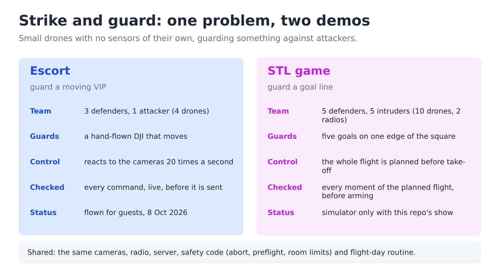

# Strike and Guard

Small drones defending something against attackers, in two demos.



The drones are **Crazyflies**: palm-sized, about 30 g each, with no sensors to see one
another. Motion-capture cameras on the walls track every drone. One laptop decides where
each drone goes, and the safety rules are enforced there, before any command is sent.

| Demo | The problem | Read |
|---|---|---|
| **Escort** | Three defenders hold a ring around a VIP (a hand-flown DJI) and turn it so one is always between the VIP and an attacker. Reacts live. Flown for guests on 8 October 2026. | [run](docs/escort/run.md) · [how it works](docs/escort/how-it-works.md) · [presenting](docs/escort/presenting.md) |
| **STL game** | Five defenders stop five intruders from reaching a goal line. The whole flight is planned and checked before take-off. Simulator-tested with this repo's show. | [run](docs/stl/run.md) · [how it works](docs/stl/how-it-works.md) |

It runs on ROS 2 with [Crazyswarm2](https://github.com/IMRCLab/crazyswarm2) and OptiTrack
motion capture.

## What you need

| | Simulator | Escort | STL game |
|---|---|---|---|
| Ubuntu 22.04 + ROS 2 Humble (24.04 + Jazzy also works) | yes | yes | yes |
| Crazyflie 2.1 with mocap markers | | 4 | 10 |
| Crazyradio USB dongle (PA or 2.0) | | 1 | 2 |
| OptiTrack cameras + a Windows PC running Motive | | yes | yes |
| A DJI (or any tracked object) as the VIP, with a pilot | | optional | |
| Color LED deck on each Crazyflie (shows the lights) | | optional | optional |

## Start here

1. **Install** everything once: [docs/01-setup.md](docs/01-setup.md).
2. **Learn the flight-day routine** both demos share: [docs/02-flight-day.md](docs/02-flight-day.md).
3. **Pick a demo** from the table above. Run it in the simulator first.

Something not working? See [docs/troubleshooting.md](docs/troubleshooting.md).
Want the full detail? [docs/details/](docs/details/README.md).

## Safety first

- **Know where E-STOP is before anything arms.** E-STOP cuts all motors at once and
  the drones drop. You can trigger it with the `e` key in the preflight window, the
  E-STOP button in the web console, or this command:
  `ros2 service call /all/emergency std_srvs/srv/Empty '{}'`.
- **Ctrl-C lands the drones.** Both shows catch it and land every drone under control.
- **Nobody walks into the flight area while drones are up.**
- **Never skip the checks.** Both shows refuse to fly a plan that fails them, and each
  refusal so far has prevented a real problem.

## What is in this repo

```
docs/                    the guides above, plus docs/details/ for the deep dives
  diagrams/              every diagram, as an editable PowerPoint file + PNGs
scripts/                 setup, build, radio scan, drone placement helpers
console/                 optional web GUI (start it with ./console/run.sh)
src/crazyswarm2/
  crazyflie_shows/       the demos: escort*.py and plan_escort.py, stl_*.py and plan_stl.py,
                         plus the shared safety code (abort, preflight, safety)
  crazyflie/config/      crazyflies.yaml (the drones), arena.yaml (the room)
src/motion_capture_tracking/, src/natnet_ros2/   camera drivers
```

The show package also contains code for two older choreographed shows (carousel and
constellation). The escort shares some helpers with them, so that code is still here.
This repo documents only the two demos.

## Credits

Built on [Crazyswarm2](https://github.com/IMRCLab/crazyswarm2) (IMRCLab),
[motion_capture_tracking](https://github.com/IMRCLab/motion_capture_tracking) (IMRCLab)
and [natnet_ros2](https://github.com/L2S-lab/natnet_ros2) (L2S-lab). All three are
included in `src/` with local fixes. The one thing the first build downloads is
OptiTrack's NatNet SDK, so build once on a network with internet.
The STL game's algorithm is a colleague's, used with permission; its original script is
kept unchanged in `crazyflie_examples`. The escort, the safety layer and the tools are
this project's own. Who owns which layer, measured file by file:
[docs/details/provenance.md](docs/details/provenance.md).
