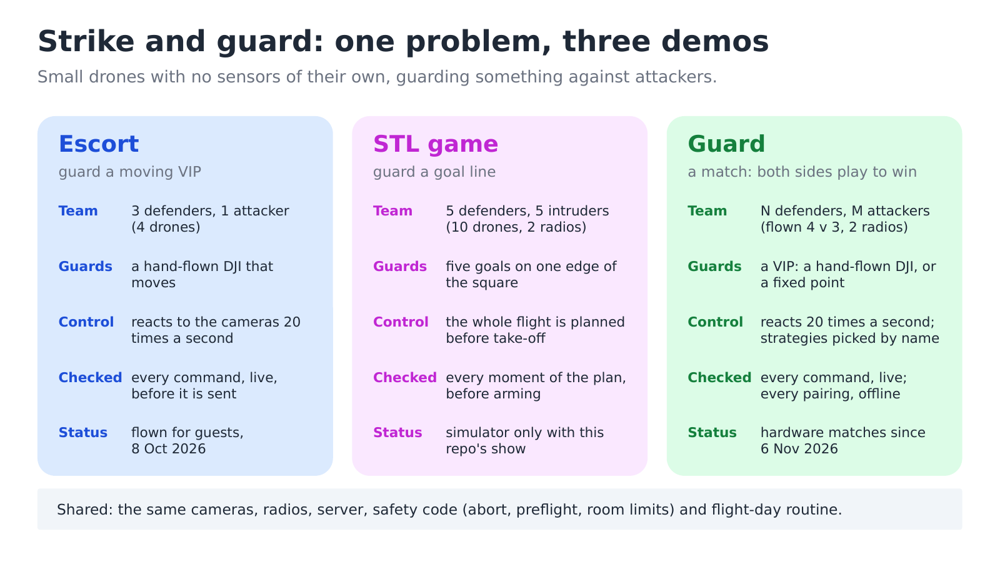

# Strike and Guard

Small drones defending something against attackers, in three demos.



The drones are **Crazyflies**: palm-sized, about 30 g, with no sensors to see one
another. Motion-capture cameras track every drone, and one laptop decides where each goes,
enforcing every safety rule before a command is sent. It runs on ROS 2 with
[Crazyswarm2](https://github.com/IMRCLab/crazyswarm2) and OptiTrack.

| Demo | Read |
|---|---|
| **Escort** | [run](docs/escort/run.md) · [how it works](docs/escort/how-it-works.md) · [presenting](docs/escort/presenting.md) |
| **STL game** | [run](docs/stl/run.md) · [how it works](docs/stl/how-it-works.md) |
| **Guard** | [run](docs/guard/run.md) · [how it works](docs/guard/how-it-works.md) · [presenting](docs/guard/presenting.md) |
| **Serpent** (a one-minute choreographed show, not a defence demo) | [run](docs/serpent/run.md) |

## What you need

| | Simulator | Escort | STL game | Guard | Serpent |
|---|---|---|---|---|---|
| Ubuntu 22.04 + ROS 2 Humble (24.04 + Jazzy also works) | yes | yes | yes | yes | yes |
| Crazyflie 2.1 with mocap markers | | 4 | 10 | 7 | 5 |
| Crazyradio USB dongle (PA or 2.0) | | 1 | 2 | 2 | 1 |
| OptiTrack cameras + a Windows PC running Motive | | yes | yes | yes | yes |
| A DJI (or any tracked object) as the VIP, with a pilot | | optional | | optional (or a fixed point) | |
| Color LED deck on each Crazyflie (shows the lights) | | optional | optional | optional | optional |

## Start here

1. **Install** everything once: [docs/01-setup.md](docs/01-setup.md).
2. **Learn the flight-day routine** every demo shares: [docs/02-flight-day.md](docs/02-flight-day.md).
3. **Pick a demo** from the table above. Run it in the simulator first.

Something not working? See [docs/troubleshooting.md](docs/troubleshooting.md).
Everything else: [the docs map](docs/README.md).

## Safety first

- **Know where E-STOP is before anything arms.** E-STOP cuts all motors at once and
  the drones drop. You can trigger it with the `e` key in the preflight window, the
  E-STOP button in the web console, or this command:
  `ros2 service call /all/emergency std_srvs/srv/Empty '{}'`.
- **Ctrl-C lands the drones.** Every show catches it and lands every drone under control.
- **Nobody walks into the flight area while drones are up.**
- **Never skip the checks.** Every show refuses a plan that fails them; each refusal so
  far prevented a real problem.

## What is in this repo

```
docs/                    one folder per demo (guides + details/), rig/ for the shared parts
  diagrams/              every diagram, as an editable PowerPoint file + PNGs
scripts/                 setup, build, radio scan, drone placement helpers
console/                 optional web GUI (start it with ./console/run.sh)
src/crazyswarm2/
  crazyflie_shows/       the demos: escort*.py and plan_escort.py, stl_*.py and plan_stl.py,
                         guard_show.py, plan_guard.py and the guard/ package, serpent*.py,
                         plus the shared safety code (abort, preflight, safety), the console
                         windows (missions/) and an RViz config (data/guard.rviz)
  crazyflie/config/      crazyflies.yaml (the drones), arena.yaml (the room)
src/motion_capture_tracking/, src/natnet_ros2/   camera drivers
```

The show package also holds two older, undocumented choreographed shows (carousel and
constellation); the demos share helpers with them, so their code stays.

## Credits

Built on [Crazyswarm2](https://github.com/IMRCLab/crazyswarm2) (IMRCLab),
[motion_capture_tracking](https://github.com/IMRCLab/motion_capture_tracking) (IMRCLab)
and [natnet_ros2](https://github.com/L2S-lab/natnet_ros2) (L2S-lab). All three are
included in `src/` with local fixes; the first build downloads OptiTrack's NatNet SDK,
so it needs internet once. The STL game's algorithm is a colleague's, used with
permission (the original is unchanged in `crazyflie_examples`); the guard's safety solver
is AirStack's, copied verbatim. Who owns which layer, file by file:
[docs/rig/provenance.md](docs/rig/provenance.md).
