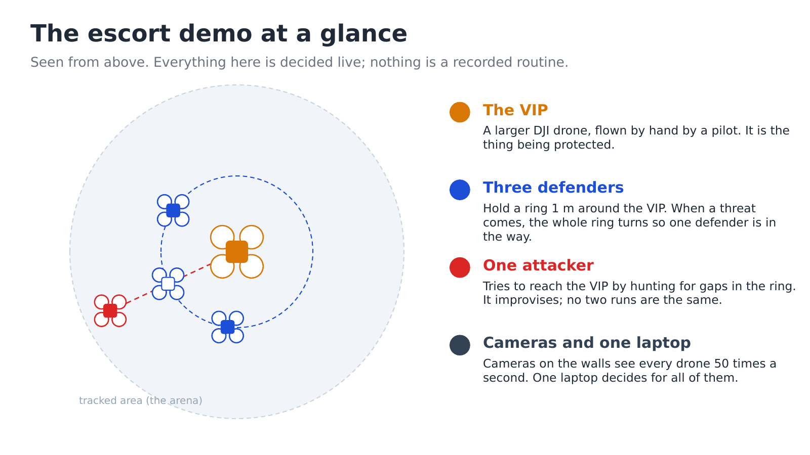

# Escort Demo

Three small drones guard a larger one from an attacker.



Three **Crazyflie** drones hold a ring around a **VIP**, a DJI flown by hand. A
fourth Crazyflie, the **attacker**, tries to reach it. The ring turns on its own so
that one defender is always between the attacker and the VIP.

The drones cannot see each other. Motion-capture cameras on the walls track every
drone, and one laptop decides where each one goes, 20 times a second. Nothing is
pre-recorded: the attacker improvises, and the pilot moves the VIP wherever they like.

The demo was flown for guests on 8 October 2026. It runs on ROS 2 with
[Crazyswarm2](https://github.com/IMRCLab/crazyswarm2) and OptiTrack motion capture.

## What you need

| | For the simulator | For real flights |
|---|---|---|
| Ubuntu 22.04 + ROS 2 Humble (24.04 + Jazzy also works) | yes | yes |
| 4 × Crazyflie 2.1 with mocap markers | | yes |
| Crazyradio USB dongle (PA or 2.0) | | yes |
| OptiTrack cameras + a Windows PC running Motive | | yes |
| A DJI (or any tracked object) as the VIP, with a pilot | | optional; a fixed point works too |
| Color LED deck on each Crazyflie | | optional; it shows the lights |

## Start here

1. **Install** everything once: [docs/01-setup.md](docs/01-setup.md).
2. **Try it in the simulator** (no drones, no cameras):
   [docs/02-run-the-demo.md, part 1](docs/02-run-the-demo.md#part-1-the-simulator).
3. **Fly it** for real: [docs/02-run-the-demo.md, part 2](docs/02-run-the-demo.md#part-2-real-drones).
4. **Understand it**, in plain language: [docs/03-how-it-works.md](docs/03-how-it-works.md).
5. **Show it to guests**, with a script and answers: [docs/04-presenting.md](docs/04-presenting.md).

Something not working? See [docs/05-troubleshooting.md](docs/05-troubleshooting.md).
Want the full detail? [docs/details/](docs/details/README.md).

## Safety first

- **Know where E-STOP is before anything arms.** E-STOP cuts all motors at once and
  the drones drop. You can trigger it with the `e` key in the preflight window, the
  E-STOP button in the web console, or this command:
  `ros2 service call /all/emergency std_srvs/srv/Empty '{}'`.
- **Ctrl-C lands the drones.** The show catches it and lands every drone under control.
- **Nobody walks into the flight area while drones are up.**
- **Never skip the checks.** The show refuses to fly a plan that does not fit the room,
  and each refusal has prevented a real problem.

## What is in this repo

```
docs/                    the guides above, plus docs/details/ for the deep dives
  diagrams/              every diagram, as an editable PowerPoint file + PNGs
scripts/                 setup, build, radio scan, drone placement helpers
console/                 optional web GUI (start it with ./console/run.sh)
src/crazyswarm2/
  crazyflie_shows/       THE ESCORT: escort.py (the brain), escort_show.py (flies it),
                         plan_escort.py (checks it before flight)
  crazyflie/config/      crazyflies.yaml (the drones), arena.yaml (the room)
src/motion_capture_tracking/, src/natnet_ros2/   camera drivers
```

The show package also contains code for two older choreographed shows (carousel and
constellation). The escort shares some helpers with them, so that code is still here.
This repo documents only the escort.

## Credits

Built on [Crazyswarm2](https://github.com/IMRCLab/crazyswarm2) (IMRCLab),
[motion_capture_tracking](https://github.com/IMRCLab/motion_capture_tracking) (IMRCLab)
and [natnet_ros2](https://github.com/L2S-lab/natnet_ros2) (L2S-lab). All three are
included in `src/` with local fixes, so a clone builds without fetching any other
repository.
The escort behaviour, the safety layer and the tools around them are this project's
own. Who owns which layer, measured file by file:
[docs/details/provenance.md](docs/details/provenance.md).
