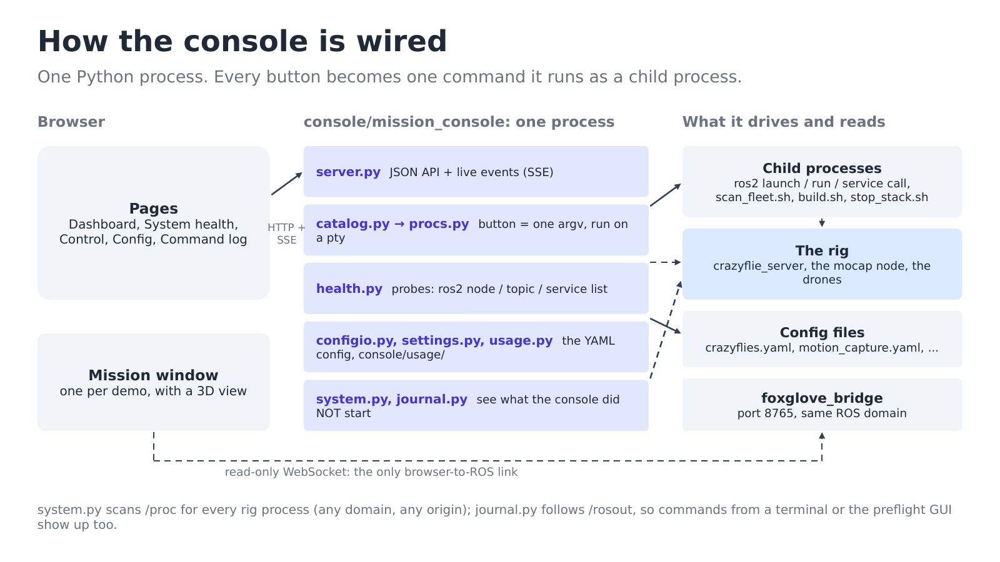

# Mission console

A browser GUI for this rig: launch, preflight checks, flight commands, the YAML config,
and a health diagram that says **where** the stack is broken. Every button runs the
`ros2` or shell command you would type, and shows it. This file is for developers. What
each button does and the command it runs is in the operator's page,
[docs/rig/console.md](../docs/rig/console.md); each demo's window and its YAML spec are in
[docs/rig/mission-window.md](../docs/rig/mission-window.md).

```bash
./console/run.sh                 # opens http://localhost:8077
./console/run.sh --port 9000
./console/run.sh --no-browser
./console/run.sh --host 0.0.0.0  # reachable from the lab network: read "Access"
```

`run.sh` gives the console's children the environment a terminal on this rig would have,
so every command it shows can be pasted into a terminal. In order, it: strips conda/venv
from `PATH` and `PYTHONPATH`; sources `/opt/ros/$ROS_DISTRO/setup.bash` under `set +u`
(that file reads the unbound `AMENT_TRACE_SETUP_FILES`); sources `install/setup.bash`,
so the vendored `motion_capture_tracking` wins over the apt one; then
`exec /usr/bin/python3 -m mission_console`. A step that fails warns instead of aborting,
and System health then shows the gap. The console uses the `ROS_DOMAIN_ID` it inherited
(shown in the nav bar); if that differs from the stack's, it sees an empty graph.

## A module, not a fork

- Everything lives in `console/`. Nothing in `src/` imports it, it is not a colcon
  package, and `launch.py`, `CMakeLists.txt` and `setup.sh` do not know it exists. Only
  prose points here. So `rm -rf console/` removes it and the workspace keeps working.
  **Keep it that way.**
- Plain Python 3 (stdlib HTTP server) plus PyYAML, which is already a dependency. No
  rebuild, nothing to install.
- **The `ros2` CLI, never in-process rclpy.** A fresh rclpy process on this rig can stall
  forever in DDS discovery (the same reason `scripts/led.sh` uses the CLI), while the
  CLI daemon keeps the graph warm. And a CLI command is one the operator can copy. The
  one exception is the mission window's 3D view: the browser reads foxglove_bridge
  (:8765) directly, read-only, because a 50 Hz pose stream is not a command.
- **Not a safety layer.** It will run a show that should not fly. The refusals live in
  the shows (`crazyflie_shows/preflight.py`), the planners and
  `scripts/sync_initial_positions.py`.



## One source of truth

The console shows the machine, not just itself (2026-10-09):

- **Settings** (`settings.py`, `console/usage/settings.json`). Every dropdown and field is
  ONE stored value, keyed by what it is: `rviz`, `backend`, `drone` are each one setting
  whichever card shows them; others are `<action>.<param>` or `mission.<id>.<option>`.
  The backend merges the store under each request, so a pin or the palette uses the same
  values, and every open page updates live. No per-widget browser storage.
- **Process census** (`system.py`). Every sweep reads `/proc` for the launch, server,
  mocap node, bridge, RViz, preflight GUI and any show or example script, with each one's
  `ROS_DOMAIN_ID` (from `/proc/<pid>/environ`) and whether this console started it. The
  radio and UDP 1511 belong to the machine, so "is the radio free" and "may I launch"
  count a server or mocap node **on any domain**. The ROS probes still see only the
  console's own domain.
- **Fleet-command journal** (`journal.py`). The server logs every command it acts on to
  `/rosout`; the console follows it with
  `ros2 topic echo /rosout --csv --qos-durability transient_local`. An e-stop from
  anywhere raises the e-stop banner. Own domain only.

## Health sweeps

Two cadences (`server.py`: `LIVE_PERIOD` 3 s, `HEALTH_PERIOD` 30 s). The live sweep
re-reads what moves: the ROS graph, `/poses`, and each drone's battery, link and
supervisor state. The full sweep, also run at startup, after any action or config write
and on *Re-check*, adds the workspace, interpreter, config, fleet sanity, USB radio and
the Motive discovery ping. The live sweep costs ~0.14 s, a full one ~1.7 s, mostly the
NatNet ping. Each probe records the command it ran. `SIGNATURES` in `health.py` matches
every output line of every child against known errors and attaches a hit to its box. What
each box catches: [console.md, the health diagram](../docs/rig/console.md#the-health-diagram).

**Build status** (`builds.py`, file checks only, no imports). Every `crazyflie_py`
package under `src/` is compared with `install/`: never built, a `setup.cfg` script with
no shim, a new module with no installed symlink, or a package built after the console
started (not on its `AMENT_PREFIX_PATH`). `--symlink-install` makes edits live and hides
exactly these. A new module blocks only the scripts that import it (their same-package
import closure, read with `ast`). It feeds the *Show packages built* box, the *not built*
badge on mission chips and the mission window's Build button.

**Flight scripts are discovered, never listed.** `catalog.discover_scripts()` scans
`install/*/share/*/package.xml` for packages that depend on `crazyflie_py` and lists
their executables, with each module docstring (read with `ast`, never imported: importing
a flight script can have side effects) as its description. Do not add per-script cards;
add a docstring, or a `SCRIPT_NOTES` entry where a safety detail matters. `SCRIPT_NOTES`
carries no geometry figures: a show's reach depends on its marks, so point at the
planner's output.

## Behaviours that must not regress

- **E-STOP** goes to `/api/estop`, never through the confirm modal or a tab switch. It
  runs `ros2 service call /all/emergency std_srvs/srv/Empty {}` and answers within
  `ESTOP_CONFIRM_S` (3 s): confirmed, or NOT CONFIRMED with the reason, because
  `ros2 service call` has no timeout and prints nothing against an unreachable server. At
  `ESTOP_ABANDON_S` (15 s) the call is killed, so it cannot e-stop a server launched
  later. No keyboard shortcut. In the simulator `crazyflie_sim` only logs
  `emergency not yet implemented`; the journal spots that line and the banner says so.
- **Restart after updating the console.** The page is re-read from disk on every load;
  the Python backend is not, so a reloaded page can call a route the running process
  lacks (HTTP 404 `{"error": "not found"}`). That once made the web e-stop not fire.
  Guards: `/api/bootstrap` carries `code_changed` and the page shows a restart banner; a
  route-miss 404 reads as "outdated console" (an unknown process id 404s as
  `no such process` instead); the e-stop falls back to `/api/run`, which every version
  has.
- **YAML writes are text-surgical** (`configio.YamlText`). Only the touched lines change,
  never a `yaml.dump()` round-trip, which would delete these files' comments. Every write:
  parse check, diff, timestamped backup into `console/backups/` (git-ignored), write.
  Never add a second copy of `crazyflies.yaml`.
- **Stop ladder** (`procs.py`). Stop sends SIGINT to the process group, then SIGTERM, then
  SIGKILL: 6 / 4 / 2 s, or 15 / 4 / 2 s for a flight script (`is_flight`), because
  `abort.py` restores the default handlers once its landing starts and a SIGTERM then
  kills the landing. `interrupt` mode is one SIGINT and nothing after (the mission
  window's Abort & land).

## Usage log and flight logs

**Usage** (`usage.py`). Every run (and where it was started from), stop, e-stop, config
write, scan, tab, palette use and mission open/start is appended to
`console/usage/usage.jsonl`; pins go to `console/usage/dashboard.json` (both
git-ignored). Stdin is recorded only as its shape (`enter`, `q`, `text`): a sudo password
can go through that box. Teleop keys are not recorded one by one. Read it before
rearranging the Dashboard. `MISSION_CONSOLE_USAGE_DIR` redirects it: set it for a test
console.

**Flight logs** (`flightlog.py`). Every process `procs.is_flight` says commands drones
gets a folder under `~/.ros/flight_logs/`: the output (wall-clock stamped), `meta.json`
(argv, git commit, domain, exit), copies of `crazyflies.yaml` and `arena.yaml`, a
`ros2 bag record` (mcap), and afterwards `flight_report`. The recorder and report run as
ordinary processes in the live console; the show gets `$FLIGHT_LOG_DIR`.
`FLIGHT_LOG_ROOT` moves the folders, `MISSION_CONSOLE_FLIGHT_LOG=0` turns recording off.
Contents: [docs/rig/flight-logs.md](../docs/rig/flight-logs.md).

## Access

It binds `127.0.0.1`. With `--host 0.0.0.0` there is **no authentication**: anyone who
can reach the port can arm and fly the drones. Use an SSH tunnel instead:

```bash
ssh -L 8077:localhost:8077 <rig-host>
```

Ctrl-C on the console sends SIGINT to everything long-running it started; a second
signal exits at once.

## Extending it

- **A command:** one `action(...)` in `catalog.py`, with a `why` (when to use it) and a
  `teaches` (how to read the command). `build(values)` returns the argv, which is both
  what is shown and what runs. Add its row to
  [console.md](../docs/rig/console.md#gui-action--terminal-command) in the same commit.
- **A health check:** a node id/label/column/row in `Health.run()` (`health.py`), an edge
  to its dependency, and a probe that sets `status`, `summary`, `detail`, `fix` and
  appends the command it ran to `commands`. A gotcha added to
  `docs/rig/known-issues.md` is only half done without one.
- **An error signature:** one tuple in `SIGNATURES` (regex, node id, level, title,
  explanation, fix).
- **A flight script:** nothing. Build the package; it appears on the next page load.
- **A mission window:** **do not touch the console.** Write `missions/<name>.yaml` in the
  show's package ([mission-window.md](../docs/rig/mission-window.md)); a widget the stock
  set lacks goes in a `view:` module beside the spec. Change the console only for
  something every mission needs: a stock widget in `static/mission/app.mjs` (register it
  in `STOCK` and add it to `missions.WIDGETS`), a marker type in `scene.mjs`, a spec field
  in `missions.normalise()`.

## HTTP API (`server.py`)

| Route | What |
|---|---|
| `GET\|POST /api/settings` | the single settings store; POST `{values: {key: value\|null}}`, broadcast as an SSE `settings` event |
| `GET /api/system` | the process census |
| `POST /api/signal {pid, mode: int\|kill}` | only for a pid the census lists as an OUTSIDE rig process |
| `GET /api/journal` | fleet commands; SSE `fleet` events carry each entry |
| `POST /api/estop`, `/api/run`, `/api/stop`, `/api/input` | e-stop, run an action, stop (`mode: stop \| kill \| interrupt`), write stdin |
| `POST /api/scan_fleet` | the radio scan behind System health's button |
| `GET /api/missions`, `GET /api/mission?id=` | mission cards; one spec and its processes |
| `POST /api/mission/preview`, `/api/mission/start` | `{id, role: main\|<helper>, values, sim}` gives an argv / starts a process |
| `GET /api/arena` | `arena.yaml` plus the parking marks |
| `GET /mission-assets/<pkg>/<name>/<file>` | a custom view module, path-checked |
| `GET\|POST /api/usage`, `/api/prefs` | the usage log and pins |

Health facts include `system`, `server_any`, `mocap_any`, `stack_any` (machine-wide)
beside the per-domain `server_running` / `mocap_running`. Mission-window processes use
the same process manager, so they show in the Dashboard and the Command log.

## Layout

```
console/
  run.sh                     entry point (sources ROS + overlay, de-condas, serves)
  stop_stack.sh              stops a stack: SIGINT -> SIGTERM -> SIGKILL, then checks UDP 1511 is free
  backups/                   timestamped copies of every config file it writes
  mission_console/
    __main__.py              CLI, http server lifecycle, signal handling
    server.py                JSON API + SSE event stream
    catalog.py               the command catalog (every button)
    health.py                the health graph probes and error signatures
    configio.py              YAML read, validation, comment-preserving writes
    procs.py                 process manager (pty, process groups, ring buffers,
                             partial-prompt events, the SIGINT-only interrupt)
    missions.py              mission-spec discovery, validation and argv
    builds.py                is every show in src/ built? (file checks only)
    settings.py              the ONE store for every dropdown/field (console/usage/settings.json)
    system.py                census of rig processes on the machine: any domain, any origin
    journal.py               fleet-command journal from /rosout (ros2 topic echo --csv)
    usage.py                 the usage log and dashboard prefs
    flightlog.py             every flight recorded: output, bag, meta, report
    static/                  index.html, app.js, style.css
      mission/               the mission window: index.html app.mjs ros.mjs scene.mjs plan2d.mjs mission.css
      vendor/                Preact+htm, three.js (vendored: the rig network is offline)
  tests/                     python3 -m unittest discover -s tests
  usage/                     usage.jsonl, dashboard.json, settings.json (git-ignored)
```

Tests (stdlib `unittest`, no ROS; the spec checks read the installed packages, so source
the workspace first):

```bash
cd console && python3 -m unittest discover -s tests -v
```

URL flags: `?live=0` opens the page without the event stream (a static snapshot; a
headless-browser capture needs it, or it waits forever on the stream). `?node=<id>` opens
with that health box selected. For UI scale, use the browser's zoom.

---

Full earlier text: `git show 678bac1:console/README.md`
