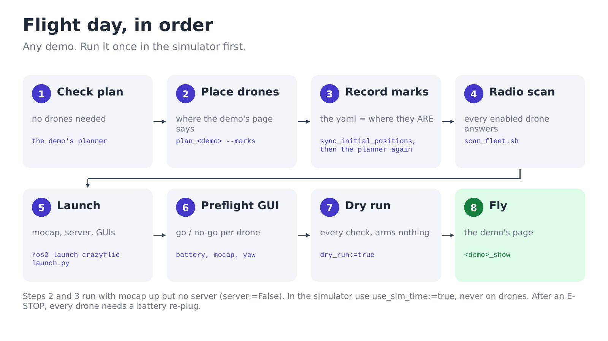

# 2. Flight day: the steps every demo shares

Every demo ([escort](escort/run.md), [STL](stl/run.md), [guard](guard/run.md),
[serpent](serpent/run.md)) is flown the same way. This page is the shared part; each
demo's page adds its own checks and fly command. Open every terminal as in
[setup step 5](01-setup.md#step-5-open-a-terminal-the-right-way).



## The simulator

Run every demo in the simulator before flying it. It runs the same show script on
simulated drones:

```bash
ros2 launch crazyflie launch.py backend:=sim
```

RViz shows the drones on the floor; the small preflight window can be ignored here. Run the
demo's show in a second terminal.

- Every show needs `use_sim_time:=true` in the simulator, and must **never** get it on real
  drones.
- **Restart the launch between runs.** The simulator cannot start a second run on the same
  drones.
- No lights and no camera data: the simulator checks the logic, not the tracking.
- It runs at real speed, and flies better than real drones: it lacks their lag behind
  commands (see the guard's
  [how-it-works](guard/how-it-works.md#why-the-drones-run-late-and-what-to-do-about-it)).

## Choose the fleet

`src/crazyswarm2/crazyflie/config/crazyflies.yaml` lists every drone. Only those with
`enabled: true` connect, and **every enabled drone must be switched on and in the room**.

| Demo | Drones | Radios |
|---|---|---|
| Escort | 4 (3 defenders + 1 attacker) | one Crazyradio |
| STL | 10 (5 defenders + 5 intruders) | two: the intruders use the second |
| Guard | 7 (4 defenders + 3 attackers) | two: the attackers use the second |

Print what is enabled now, with each drone's radio address: `./scripts/scan_fleet.sh --list`.

## Once, before the first flight

In Motive: one rigid body per drone, named exactly as in `crazyflies.yaml`, created with
the drone's nose along the room's **+X** axis
([rig/mocap.md](rig/mocap.md#2-defining-rigid-bodies)); streaming set to **Multicast** at
**50 Hz**.

## 1. Place the drones and record where they are

Each demo's page says where its drones stand. Start the cameras **without** the drone
server, so nothing can arm, put the drones down, and record their real positions:

```bash
ros2 launch crazyflie launch.py server:=False                 # terminal 1
python3 scripts/sync_initial_positions.py --dry-run           # terminal 2: preview
python3 scripts/sync_initial_positions.py                     # write
```

Then re-run the demo's planner (it must pass) and stop terminal 1 (Ctrl-C).

## 2. Radio scan

```bash
./scripts/scan_fleet.sh          # every enabled drone must say GO
```

Never skip it: if one enabled drone does not answer, the server hangs forever at start,
with no error message.

## 3. Launch

```bash
ros2 launch crazyflie launch.py
```

This starts the camera receiver, the drone server, RViz and the preflight window. Near the
top it prints `mocap: NatNet multicast joined on <ip>`: that must be this laptop's address
on the Motive network. If the laptop is also on Wi-Fi, this line is how you catch the
camera data going to the wrong network ([troubleshooting.md](troubleshooting.md)).

## 4. Preflight go / no-go

In the preflight window, check every drone (← / → switches drone) against
[its go / no-go table](rig/preflight-gui.md#reading-the-gui): battery green, `mocap [Hz]`
flat at about 50, yaw error (`err.yaw`, dashed) within ±5°. A yaw error means the Motive
rigid body was created with the drone pointing the wrong way: recreate it.

## 5. Dry run, then fly

Every show takes `-p dry_run:=true`: it runs every check and prints the plan, but arms
nothing. Then fly with the command on the demo's page.

## Stopping

| Situation | Do this |
|---|---|
| Waiting at a prompt (escort) | type `q`, press Enter: normal landing |
| Any time | **Ctrl-C**: every drone lands under control |
| A drone is misbehaving | **E-STOP** (`e` in the preflight window): motors off, drones drop |

After an E-STOP, unplug and re-plug **every** drone's battery. Until then the drones
refuse to arm, with no error message.

## After the flight

Every flight started from the console is recorded: what the show printed, the drones'
commands against where mocap saw them, battery and radio, and a report. For a flight
started from a terminal, put `./scripts/record_flight.sh` in front of the command. The
folder (under `~/.ros/flight_logs/`) is printed at the start and the end; open
`report.txt` in it. What it all means: [rig/flight-logs.md](rig/flight-logs.md).

## The web console (optional)

Prefer buttons? Run `./console/run.sh`, open http://localhost:8077, and pick the demo under
**Missions**. Each demo's window has a 3D view, its settings and **Abort & land** (the same
as Ctrl-C), and every button shows the command it runs:
[rig/console.md](rig/console.md), [rig/mission-window.md](rig/mission-window.md).
