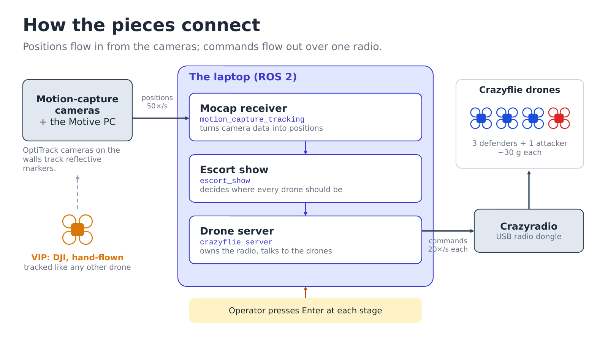
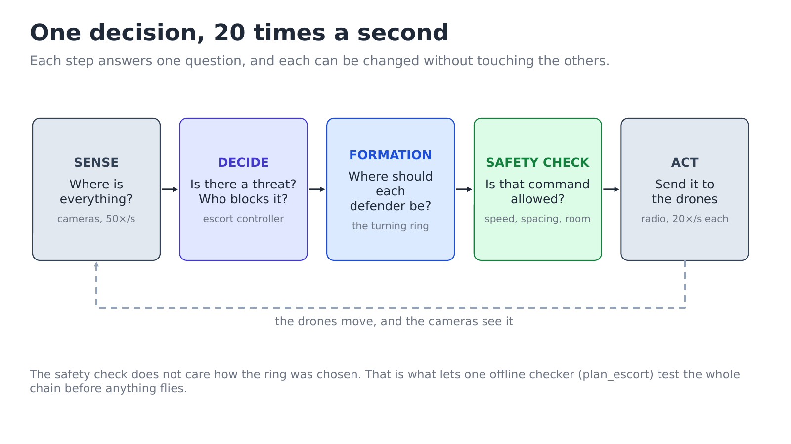
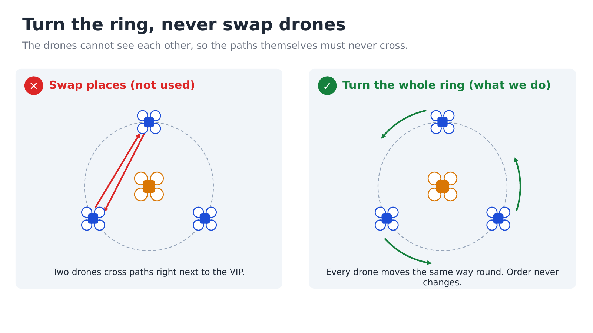
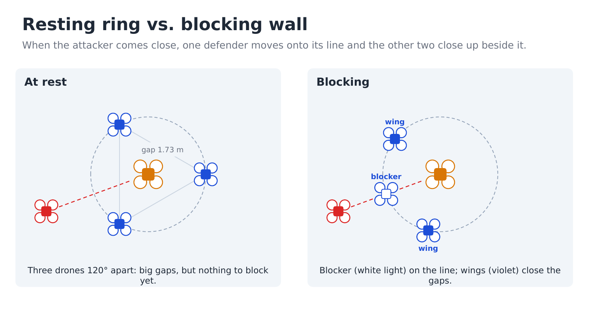
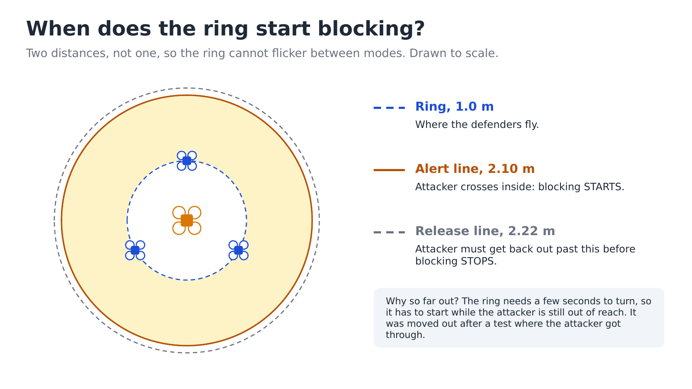
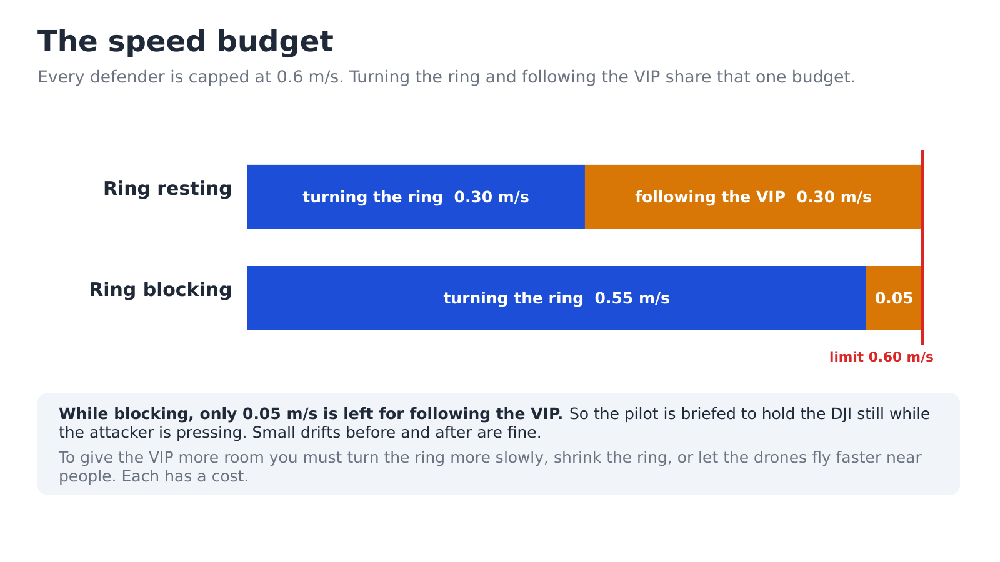
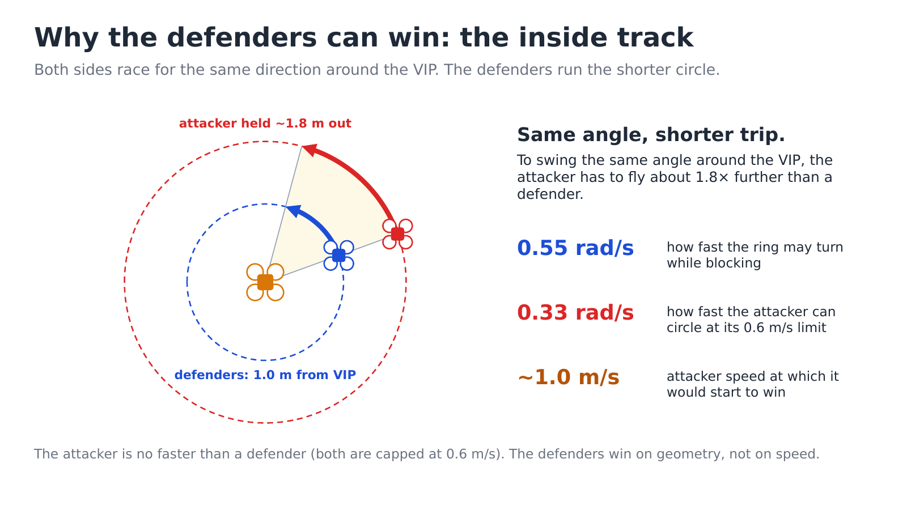
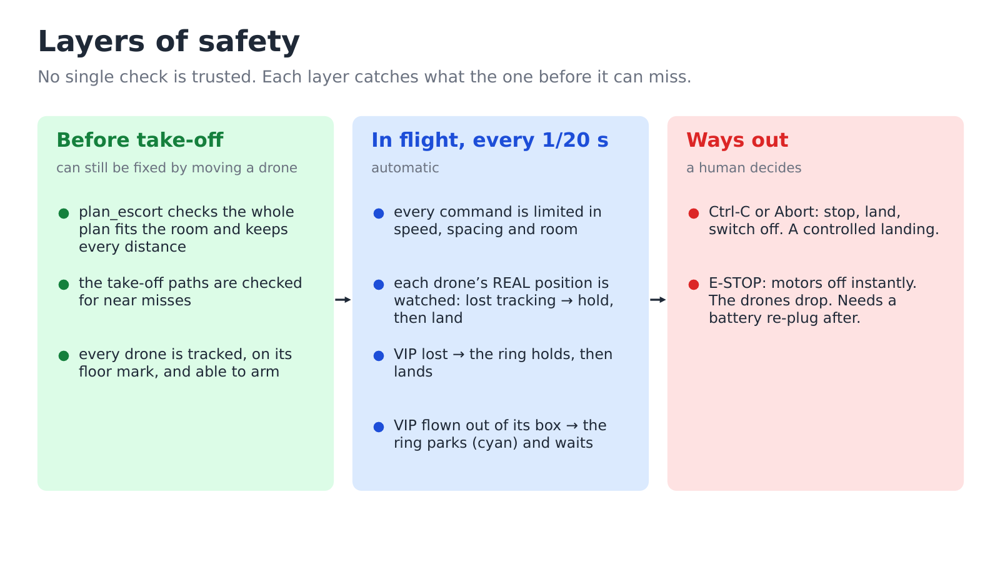
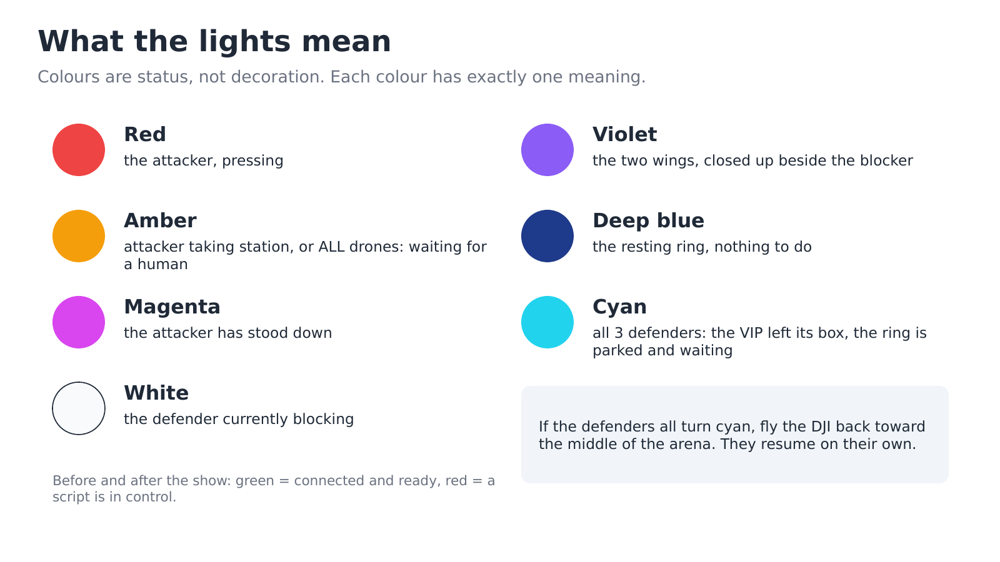

# 3. How it works

This page uses no maths. The maths, and the reason behind every design choice, are in
[details/theory.md](details/theory.md).

## The pieces

- **Cameras** around the room see reflective markers on every drone and on the DJI,
  and report all positions 50 times a second.
- **The laptop** runs three programs. The *mocap receiver* turns camera data into
  positions. The *escort show* decides where every drone should be. The *drone server*
  sends that to the drones over one USB radio.
- **The drones** have no sensors to see each other. Each one only flies to the point it
  is told, using the camera positions to know where it is.

Because nothing on a drone can see or avoid anything, **every safety rule is enforced
on the laptop, before a command is sent.**

## One decision, 20 times a second

Each step answers one question. Because the steps are separate, the safety check works
the same whatever the formation decided. The same split lets one program,
`plan_escort`, test the whole chain on a laptop before anything flies.

## The ring turns; the drones never swap

The obvious way to get a defender in front of the attacker is to send the best-placed
drone there. But then two drones cross paths, right next to the VIP, with nothing to
stop them colliding.

Instead the three defenders keep their order around the VIP for the whole show, and the
**whole ring turns** as one. Because they all move the same way round, their paths can
never cross. Whichever defender is already nearest the attacker becomes the blocker, so
the ring never has to turn more than 60°.

## Blocking

At rest the defenders sit 120° apart, with 1.73 m gaps between them. When the attacker
comes close, the blocker moves onto the line between attacker and VIP, and the other two
(the *wings*) close up beside it to form a wall. The change is blended over a few
seconds, never switched instantly, so no drone is ever asked to jump.

## When blocking starts and stops

Blocking starts when the attacker comes within 2.10 m of the VIP. It only stops once the
attacker is back beyond 2.22 m. With a single line, an attacker hovering on it would
flip the ring between modes many times a second.

When blocking stops, the ring stays where it is. It does not turn back to a "home"
position: doing that made it swing back and forth with the attacker.

## The speed budget

A defender's speed is shared between two jobs: going round the ring, and following the
VIP. While blocking, turning the ring takes almost all of it. **That is why the pilot
holds the DJI still while the attacker is pressing.**

## Why the defenders can win

The attacker is no faster than a defender. The defenders win because they are on the
inside track: to get round the VIP by the same angle, the attacker has to fly almost
twice as far. It would need about 1.0 m/s to win; it flies at 0.6 m/s.

## The attacker

The attacker is not scripted. It looks for the widest gap in the ring and goes for it,
and it backs away from any defender that gets close. When it fails to get closer for a
while, it gives up on its own. Run the demo ten times and you get ten different attacks.

The attacker also obeys the safety rules: it keeps away from the VIP and the defenders,
and its speed is capped like theirs. The defenders hold their line, and the attacker is
the one that gives way. Details: [details/theory.md, part 8](details/theory.md#8-the-adversary-a-deliberately-beatable-opponent).

## Layers of safety

No single check is trusted. Some highlights:

- **Before arming**, the show refuses to fly if the plan does not fit the measured room,
  if two drones would pass too close while forming the ring, or if a drone is not on its
  mark.
- **In flight**, the show watches where each drone really is, not just where it was told
  to go. A drone that stops following its command is the earliest warning sign there is.
- **If the cameras lose the VIP**, the ring holds still; after 2 seconds, everything lands.
- **If the pilot flies the DJI out of its box**, the ring parks and turns cyan until it
  comes back.

## What the lights mean

The lights tell the operator, from across the room, that the drones and the script agree
on what is happening.

## Where to go next

| You want | Read |
|---|---|
| The maths and the design reasons | [details/theory.md](details/theory.md) |
| What was tried, what broke, what is still open | [details/design-notes.md](details/design-notes.md) |
| Every setting and number | [details/operator-reference.md](details/operator-reference.md) |
