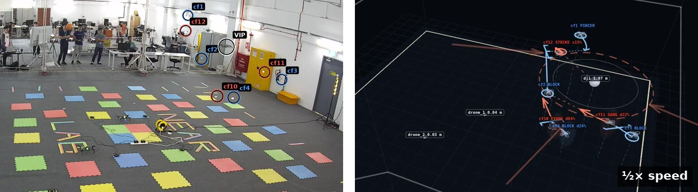

# Watching a hardware flight again

The flight log ([flight-logs.md](flight-logs.md)) gives numbers. This page covers two tools
that turn a guard_show flight back into pictures. Both live in `scripts/footage/`:

- `replay_flight.py`: rebuilds the console's 3D view of the match from the flight-log
  folder.
- `camera_overlay.py`: takes the hall camera's footage of the same flight and circles
  every drone in its team colour. The positions come from mocap.



*24 Nov 2026, shell v coordinated under pressure: the moment before cf4 takes down cf10.*

Both need the workspace sourced (`source install/setup.bash`), because they read the bag
with rclpy. Neither touches a running stack.

## The console view: `replay_flight.py`

```bash
scripts/footage/replay_flight.py ~/.ros/flight_logs/<stamp>_guard_show /tmp/replay_bag
```

**What it does.**
- **Inputs:** the flight bag has `/poses` but not `/guard/markers`, which is left out on
  purpose at about 1.5 MB/s.
- **The re-run:** the script re-runs the same `Match` with the seed, rules and strategies
  from `meta.json`. It feeds the match the measured positions from `guard_trace.csv` and the
  VIP's logged `/poses`.
- **Locked setpoints:** each tick's setpoints are locked to the logged ones, so the picture
  cannot drift.
- **Output:** a bag with `/poses` and `/guard/markers`. The markers are drawn by
  `guard/viz.py`, exactly as guard_show draws them.

**Checks it prints.**
- **The trace clock:** fitted to `/poses`. It is a fraction of a centimetre off on 24 Nov.
- **Intents:** how many of the logged intents the re-run agrees with. On 24 Nov that was
  2790 of 2821.
- **Events:** the re-run's events, to compare line by line with `output.log`. On 24 Nov all
  three downs matched, at the same times.

**Limits.**
- It needs `vip_mode:=mocap`, because the VIP must be on `/poses`.
- Before START there is no plan to show: the gates and form-up draw the drones with the
  HOLDING and FORM-UP titles only.

**Filming it.** Use the recording rig from [guard-footage.md](guard-footage.md):
`rig.sh up`, then `ros2 bag play <bag> --rate 0.5` while ffmpeg grabs the 3D scene, then
speed the capture back up 2x (as `film.sh` does). Two differences from the simulator
clips:
- **Camera position:** `film.sh` calls `camera.sh`, which places the camera for the
  simulator's marks. For a hardware flight, set the view with `cdp_drag.py` (orbit, wheel
  zoom, `BTN=right` pan) before playing.
- **Chrome on Wayland:** on a Wayland desktop, Chrome opens on the real screen, not on
  Xvfb (its log says `--ozone-platform=wayland`). Start it with
  `env -u WAYLAND_DISPLAY XDG_SESSION_TYPE=x11 scripts/footage/rig.sh chrome`.

## The hall camera: `camera_overlay.py`

```bash
F=~/.ros/flight_logs/<stamp>_guard_show
V=D04_<YYYYmmddHHMMSS>.mp4                     # the Camera 01 export
scripts/footage/camera_overlay.py sync   $F $V        # writes D04_<...>.sync.json (about 2 min)
scripts/footage/camera_overlay.py render $F $V match.mp4            # 16:9, 6 s before START .. 30 s after
scripts/footage/camera_overlay.py render $F $V wide.mp4 --pip       # 2.59:1, left side clear for an inset
```

### The camera model: `scripts/footage/camera01.json`

**The model.** A 3×4 projection plus two radial distortion terms. It maps a mocap position
(m) to a pixel of the 3840×2160 picture.

**How it was fitted** (25 Nov), in two steps:
1. **A starting model** from 16 hand-picked points:
   - the seven Crazyflies on their charging pads;
   - the same seven hovering at 1 m;
   - the two parked Starlings.
2. **The refinement** from about 350 LED detections over the whole 24 Nov flight.

**Accuracy:** median error 2.6 px, 90th percentile 7.7 px, in 4K pixels. At slide size
that is about 1 px.

**When it holds:**
- **The camera:** only while Camera 01 is not moved or re-zoomed. If the circles drift,
  run `calibrate $F $V --out cam.json`. It refits from that flight's LEDs, starting from the
  current model, then run `sync` again with `--camera cam.json`.
- **The volume:** it is fitted where the drones flew, about x −3…3.4 m and y −4.8…2.1 m.
  Further out it extrapolates. Floor strips drawn near the far wall came out crossing each
  other, which no real lens does.

### The clock: `sync`

**The offset.** A camera export starts at the time in its name, to the second. The camera's
clock also differs from the laptop's: on 24 Nov it ran 0.48 s ahead. Measured that way,
video t=0 was 14:47:38.68 on the log clock.

**How it is measured.**
- **Sampling:** every 0.5 s of the flight, `sync` finds the bright, saturated blobs in the
  frame. These are the drones' LEDs; the ceiling lights are bright but white, so saturation
  drops them.
- **Scoring:** for each offset on a grid, it measures each airborne drone's predicted pixel
  against its nearest blob, and keeps the offset with the smallest median distance.
- **Result:** on 24 Nov it found the offset to within 0.01 s of the hand fit.

### The picture: `render`

**The framing** is one fixed crop around everything in play for the whole clip, never into
the camera's clock in the top rows. A panning crop was tried and dropped: it changes every
pixel of every frame, which made GIFs balloon past 40 MB and was harder to watch.

**What it draws.**
- **Circles:** sized to the drone's distance.
- **Colours:** blue for Guard, red for Strike, white for the VIP.
- **Downed drones:** grey with "out" from the moment `output.log` says DOWNED.
- **Landing:** drones are dropped from the picture once they land.

**Seeking.** The export is HEVC with an open GOP. A plain input seek decodes broken grey
frames until the next keyframe, so `render` seeks 3 s early and decodes the rest.

## Putting both side by side

One video, so the two halves cannot drift apart. Here `dash.mp4` is the filmed console
view for the same window, and the takedowns play at half speed:

```bash
ffmpeg -i match.mp4 -i dash.mp4 -filter_complex "[0]scale=640:360[f];[1]scale=640:360[d];\
[f]pad=663:360:0:0:white[fp];[fp][d]hstack,split=3[s1][s2][s3];\
[s1]trim=0:17,setpts=PTS-STARTPTS[a];[s2]trim=17:23.5,setpts=2*(PTS-STARTPTS)[b];\
[s3]trim=23.5:36,setpts=PTS-STARTPTS[c];[a][b][c]concat=n=3:v=1:a=0" side_by_side.mp4
```

**For slides, embed the MP4, not a GIF.**
- **DeckCraft's limit:** DeckCraft keeps only 64 MB of decoded frames per GIF (its
  `GIF_BUDGET`). It silently drops the rest, so a long GIF loops after about 5 s.
- **Video in DeckCraft:** an MP4 with PowerPoint's "start automatically" timing plays in
  Slide Show in both PowerPoint and DeckCraft. DeckCraft ignores the loop flag on import, so
  turn on Loop in its Playback tab.
