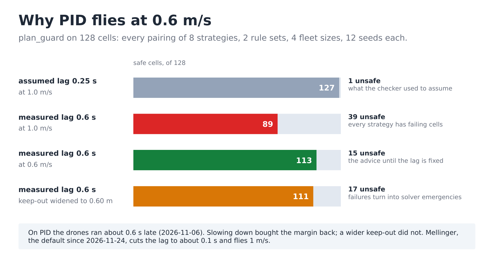

# Guard: design notes

The dated log: what was decided, measured and learned, oldest first. The current design
is in [guard-theory.md](guard-theory.md) (why) and [guard-modules.md](guard-modules.md)
(the code); the beginner guide is [../guard/run.md](../guard/run.md). Numbers are as
measured on the day: run `plan_guard` for current ones.

Built 2026-11-03 for the big arena, as the successor experiment to the escort (which
stays the demo flown for guests). It has flown on hardware since early November 2026.

## First decisions (2026-11-03 to 11-17)

- **The rules became meters (11-03), and changed nothing they were not meant to.**
  Before the refactor, 32 matches with tagging and 16 without were recorded per seed;
  afterwards `tag` and `timer` gave the same winner, match time, strikes, downs and
  closest pair on all 48.
- **The team boundary is enforced (11-03).** Before, an opponent's velocity was its
  command, and both teams shared one random stream. The spy, vandal and dice tests in
  `test_guard.py` pin the fix.
- **A held drone still dodges.** The first gate only re-sent the last setpoint, so a DJI
  climbing past the drones would have had nothing getting out of its way
  (`test_a_held_drone_still_dodges_the_dji`).
- **Two lessons from building `coordinated`.** Gating the attempt on a provably open
  lane meant it never went at all, so robustness now chooses the line instead
  ([theory §6.3](guard-theory.md#63-robustness-chooses-the-line-it-does-not-gate-the-attempt)).
  Fleeing on the first approach of a defender made striking impossible.
- **"Not following" is judged against the last 1.0 s of setpoints (11-17).** Against the
  current setpoint, the ~0.6 s lag read as 0.6 m off at 1 m/s and aborted the 17-11
  matches seconds after START: 11 false aborts in 7 of the 14 hardware traces, none with
  the window, and a worst windowed error of 0.59 m for a single tick.

### The first rules matrix (2026-11-03)

`plan_guard --matrix --rules all`, 4 v 3, 12 seeds, relaxed 0.45 m keep-out. Each entry is defence wins out of 12, with the number of
defenders downed across all 12 matches in brackets:

| Rule set | `shell` v `coordinated` | `shell` v `direct` | `ring` v `coordinated` | `ring` v `direct` |
|---|---|---|---|---|
| `tag` | 12 | 0 | 4 | 5 |
| `zone` | 11 | 0 | 6 | 5 |
| `pressure` | 8 (13 down) | 3 (10 down) | 0 (23 down) | 0 (12 down) |
| `zone_pressure` | 1 | 3 | 0 | 0 |
| `timer` | 0 | 0 | 0 | 0 |

- Every cell was safe. The closest aircraft pair was 0.40 m against the 0.35 m floor.
- **`pressure` is the most two-sided:**
  - defenders are downed as well as attackers;
  - `ring`, which never gangs up, loses every match: the rule rewards coordination,
    which was the point;
  - its strike radius defaults to 1.6 m, not 2.4 m. A lone defender cannot down a
    lone attacker, so the strike zone has to be smaller. At 2.0 m `shell` won 4 and
    0 of 8.
- **`timer` cannot be held** at any strike radius from 1.6 to 2.4 m. Nothing downs
  an attacker, and with the relaxed 0.45 m keep-out one defender's wall is too thin.
  Pure denial needs a wider keep-out (`-p d_cc:=0.9`).
- **`zone_pressure` favours the attack.** Neither default strategy has home-ground
  tactics yet: the defence could hold a tighter perimeter, and the attack could lure
  defenders out. That is the next strategy work, not a rule fix.
- **No strategy dominates.** `shell` beats the planner under `tag` and `zone` but
  loses to the rush; `ring` the reverse; under `pressure` coordination decides.

**Earlier, with the 0.90 m keep-out and the first fixed referee:**
- A defender on the line between the VIP and an attacker was a wall: the CBF let
  nothing through, and attackers stopped at the defender's distance + `d_cc`. A strike
  radius of 1.6–2.2 m never scored against `shell`.
- At 2.4 m, `shell` against `coordinated` went from 11 of 12 to 0 of 12 between a
  1.10 s and a 1.15 s tag time. One simultaneous exchange tends to settle a match.

Run `plan_guard --matrix --rules all` for the current numbers. Do not copy them
from here.

## Making the match readable (2026-11-05)

The show had been flown several times on hardware (4 v 3, cf1-cf4 against
cf10-cf12). Three problems came out of those flights. First, the strategies'
intent was only partly visible. Second, most matches ended on a near-miss
landing before a winner was obvious. Third, who won lived in the console.

**Intent, not clutter.** Strategies now say what each drone means to do
(`Intent`: kind, goal, target) and what the team's play is (`plan`). The viz
draws these as an operations map. The engine hands them to the picture only,
never to the opponent. Recording them does not change play: `plan_guard` gives
the same result, match time and closest pair as before the change, on 12 seeds
of the defaults and on 8 seeds of `pressure` with a drifting VIP.

What was removed:
- the body sphere on each drone (it sat on top of the real drone);
- the always-on keep-out ellipsoids, now shown only while the CBF is changing that
  drone's command;
- the translucent strike and keep-out spheres round the VIP, now two circles.

**Near misses: graded, glitch-filtered, explained.** The old watch landed
everything when two measured drones were inside 0.7 of the floor ellipsoid on
a single frame. Two things made that end matches it did not need to end:
- One frame is enough for a mocap glitch to count. A swapped or ghost rigid
  body puts a drone on top of another for a frame or two.
- Landing does not separate a close pair. Holding does: the CBF already keeps the
  *setpoints* `d_cc` apart, so held aircraft settle back apart.

So now (guard/watch.py):
- A pose that jumps further than a Crazyflie can fly is a glitch. The drone flies
  on its setpoint for that tick, and the glitch is counted.
- A soft near miss on two ticks in a row pauses the match.
- Inside 0.55 of the floor (0.19 m across, 0.34 m vertically), or a pause that
  does not clear in 3 s, everything lands.
- `near_miss_pause:=false` restores the old rule.

**Why the near misses happened is not known yet.** No output from those flights
was kept. The stand-in aircraft in `plan_guard` (first-order lag, 0.25 s) never
comes inside the floor, so the cause is something it does not model: real
tracking, mocap glitches, or both. Every near miss now prints the setpoint gap
and each drone's tracking error at that tick. Each run writes a trace to
its flight folder (`guard_trace.csv`, next to the bag the console records: [flight-logs.md](flight-logs.md)). The next hardware session should answer it.

**The finale (guard/finale.py)** makes the result visible on the drones:
- losers dark, low, home, landed;
- winners green, in an honour guard (defence) or a capture ring (attack);
- the attacker that struck stays up for the capture.

It flies through `Match.steer`, so the CBF is under it, and `plan_guard` checks it
on every seed. Measured on 8 seeds each, all reached the end of the finale:
4 v 3 under `tag`, `timer` and `pressure`; 2 v 1; 5 v 5 `zone_pressure`; tau 0.4.

The first version landed the losers at their marks wherever the VIP was. With a
drifting VIP that was unsafe: down to 0.50 of the VIP keep-out at 0.5 m/s. A drone
being landed is a fixed obstacle that cannot dodge, and nothing stops a hand-flown
DJI. Losers now land only `land_clear` (0.8 m) beyond the keep-out. The capture
ring is at 1.8 ± 0.12 m.

**A moving DJI: what `plan_guard --vip-move` says** (8 seeds, VIP on a 0.6 m
circle; the worst figure is the closest any aircraft came, as a fraction of the
VIP keep-out):

| Rules | Drift | Worst | Verdict |
|---|---|---|---|
| `tag` | 0.1 to 0.5 m/s | 0.98 to 0.94 | SAFE |
| `timer`, finale on | 0.3 m/s | 0.95 | SAFE |
| `timer`, finale on | 0.5 m/s | 0.88 (1 seed) | FAILED: the winning striker rallying from the keep-out's edge, aircraft lag |
| `pressure` | 0.1 m/s | 0.98 | SAFE |
| `pressure` | 0.2 to 0.5 m/s | 0.85 to 0.66 | FAILED |

The `pressure` failures **predate this change**. They are downed *defenders*
being landed straight down near the VIP while it drifts onto them. This is the same
mechanism the finale fix removes. Widening `d_vip` does not help (tried 1.35).

The fix is to have a downed drone move clear of the VIP through the CBF before it
is landed. That changes the match: the drone stays an obstacle for longer, and the
balance shifts. It is not done yet. Until it is, fly the DJI under `tag` (only
attackers are downed, out where defenders meet them), and keep the DJI slow
(≤ 0.3 m/s) during the match and the finale.

**LEDs.** The cues are now:
- out of play: dark (amber read as red across the room);
- scoring: white (a defender tagging, an attacker in the strike zone);
- decoy: magenta;
- finale: winners green.

Each cue is sent only on a change, at most every 0.25 s per drone. None of it has
been seen on hardware yet. Magenta against red is the one most likely to be hard to
tell apart.

## The first hardware matches (2026-11-06)

Seven Crazyflies (cf1-cf4 defend, cf10-cf12 attack), the DJI as the VIP (rigid body
`dji`), `pressure` rules, paced from the console. Every run has a flight folder
([flight-logs.md](flight-logs.md)); that is where all the numbers below come from.

| Run | Ended | Why |
|---|---|---|
| 14:53 | abort at the START gate | `CONTAINMENT cf1: no mocap for 1.1 s`, and the console never showed the START card |
| 15:09 | abort in the match | `cf10: 0.64 m from where it was commanded for 0.9 s` |
| 15:13 | **attack won** | cf10 downed cf4 and cf3, then struck; capture finale |
| 15:19 | operator landed | batteries 3.72-3.87 V at the start |
| 15:27 | **defence won** | three downs in 12.4 s; honour-guard finale |

Four causes were found and three fixed.

**1. Every drone trails its setpoint by ~0.56 s (fixed 2026-11-23 by flying Mellinger;
see the last section).**
Every drone, every run, followed its commanded path to within 3-5 cm, but 0.54-0.60 s
late. So at 1 m/s it sat 0.5-0.7 m behind its setpoint. The firmware's PID position
controller (`stabilizer.controller` 1, which the server sets) overwrites the
setpoint velocity in `modeAbs` (`position_controller_pid.c`, the `runPid` branch), so
`cmd_full_state`'s velocity feed-forward is thrown away and the drone moves only in
proportion to its position error.

Consequences:
- The CBF's `TRACKING_MARGIN` (0.10 m) and `plan_guard`'s default stand-in lag
  (0.25 s) are both optimistic for hardware.
- The 15:09 abort was this lag.
- Both completed runs had a closest pair at the 0.35 m floor, with the setpoints
  further apart.
- The simulator never showed it: `server.yaml` runs the SIL drones on Mellinger.

`plan_guard --tau 0.6` is the honest check:
- At 1 m/s, 89 of 128 pairing/rule/fleet cells are safe.
- At 0.6 m/s, 113 of 128 are.
- Widening `d_cc` to 0.60 m moved the problem into solver emergencies (111 of 128).

The fix to try was `-p controller:=mellinger` (full-state tracking); until then the
advice was 0.6 m/s. It was flown on 2026-11-23, with a lag of 0.08-0.14 s: see the last
section.

**2. `/poses` went stale inside the show (fixed).**
- `crazyflie_py` subscribes every drone's `/cfN/pose` (10 Hz) and `/cfN/status` on the
  show's node: about 127 messages/s with 7 drones.
- The show ran one `spin_once` per tick, and a paced gate sits 50 ms in `select()`
  between ticks.
- Reproduced off the drones at the same rates: `/poses` was 0.3-0.4 s old on average
  and up to 0.9 s.
- A real 0.34 s mocap stall on top of that crossed the 1.0 s watchdog: the 14:53 abort.
- `drain()` now runs up to `drain_count()` callbacks per tick (14 with 7 drones);
  `/poses` is then 0-5 ms old.
- The escort had the same pattern and now uses the same helper.

**3. The console lost a gate (fixed).** Answering a gate cleared "whatever gate is open"
after the POST returned. When the show printed the next gate in the same millisecond
(PILOT -> START), that was the new one. The window now clears only the gate it
answered.

**4. The console's 3D view lagged (fixed).**
- Drawing every 20 Hz marker message, it fell 0.7 s/s behind: 3.3 s late by the end of
  the 15:27 match.
- Then it replayed 4 s of match in 2. That was the "accelerated" attacker rush on the
  screen recording; mocap shows the drones flew normally.
- Now the show publishes at 10 Hz and the window draws only the newest snapshot per
  frame.

Also seen: the whole `/poses` stream froze for 0.2-0.55 s every 10-40 s, and the server
saw it too. It is under the 1.0 s watchdog, and the cause is not known yet (network, or
laptop load).

## More strategies (2026-11-06)

`zone` and `hunter` (defence), `flood` and `wolfpack` (attack); what each does is in
[guard-modules.md](guard-modules.md). They were designed to be different ideas, not
parameter variants, and checked offline on every pairing with all eight strategies.

**Safety** (`plan_guard`, 12 seeds per cell; `tag` and `pressure`; 4 v 3, 2 v 1, 5 v 5
and the real roster: 128 cells):

| Stand-in lag | Speed | Safe cells | Failures |
|---|---|---|---|
| 0.25 s | 1.0 m/s | 127/128 | shell v coordinated, `pressure`, roster: 2 seeds of solver emergency (existing strategies only) |
| 0.6 s | 1.0 m/s | 89/128 | every strategy, old and new (hunter and flood 14 cells each, shell and coordinated 10) |
| 0.6 s | 0.6 m/s | 113/128 | hunter 8 (all `pressure`, 0.85-1.00 of the floor), flood 3, shell/ring 6 |

The 0.6 s failures are cause 1 above, not the strategies. `hunter` is the most sensitive
to it: its flanking pair closes on one attacker from both sides.

**Balance** (defence wins of 12, 4 v 3, stand-in lag 0.25 s; † = mostly ran the
clock out):

| Rules | Defence | v coordinated | v direct | v flood | v wolfpack |
|---|---|---|---|---|---|
| `tag` | shell | 12 | 0 | 12 | 0 |
| `tag` | ring | 4 | 5 | 0 | 0 |
| `tag` | zone | **6** | 0 | 12 | 0 |
| `tag` | hunter | 12 | 12 | 12 | 12 |
| `pressure` | shell | **8** | 3 | 2 | **6** |
| `pressure` | ring | 0 | 0 | 0 | 0 |
| `pressure` | zone | 0 | 0 | 2 | 0 |
| `pressure` | hunter | 0 | 12† | 1 | 2 |

Even pairings for a demo:
- zone v coordinated under `tag`: 6/12, and 9/12 from the real roster.
- shell v wolfpack under `pressure`: 6/12, and 8/12 from the roster.
- shell v coordinated under `pressure`: 8/12, but 0/12 from the roster.

Lopsided pairings:
- `hunter` wins every `tag` match.
- `zone` loses to overloads under `pressure`.
- `hunter` v `direct` under `pressure` is a clock-out standoff.

**Simulator** (the SIL simulator, 4 v 3 on the real roster, a fresh launch each, all
completed with no CBF emergency, backstop or near miss): zone v coordinated (`tag`,
attack won), shell v wolfpack (`pressure`, defence 3 downs), hunter v flood (`pressure`,
defence), hunter v wolfpack (`pressure`, attack struck at 6.9 s), zone v flood (`tag`,
defence).

## The simulator is fast enough to use now (2026-11-06)

The SIL simulator ran at 0.06x real time with 7 drones, so a 4 v 3 match with finale
took about 5 minutes. It is one Python thread, and the time went on per-call overhead,
not physics. Each step still runs, at the same 0.5 ms:
- the rigid-body step is in plain floats instead of numpy/rowan on 3-vectors;
- roll/pitch/yaw are in closed form;
- the setpoint is converted to a State only when the `none` backend or the `pdf`
  visualization reads it;
- `/clock` is published at 500 Hz and the RViz TF at 100 Hz;
- ten physics steps run per timer callback.

Each replacement was checked against the original to 1e-13 or better.

The result is 0.76x even under load, and it is now paced to exactly 1.00x at half a core
(`sim.realtime`, default true; `false` runs it flat out, about 18 s of wall time per
match with finale).

**Proven in the simulator** (which has no mocap, so poses come from setpoints):
- the full flight path;
- a paced run with every gate answered through stdin, as the console does;
- one SIGINT mid-match landing all seven drones (exit 130);
- downs landing drones one at a time.

**Not exercised until hardware:**
- **Every check that reads real `/poses`:** the per-drone containment watchdog, the
  near-miss check on measured aircraft, the placement check, and opponents'
  velocities estimated from real mocap. The escort's first flight was the first test
  of its equivalents too.
- **Close flying.** The STL game is designed to 0.20 m, but `stl_show` has no
  hardware flight recorded in this repo.
- **Streaming load.** Seven drones on `cmd_full_state` at 20 Hz: the escort streamed
  four, and the STL game uses the high-level commander. Expect two Crazyradios
  (roster URIs `radio://0/…`, `radio://1/…`).
- **The DJI gates.** They need a mocap VIP.
- **LED cues.** They are off in the simulator.

**A ladder for the first session.** Run `plan_guard` with the same choices before
each step, and a dry run (`-p dry_run:=true`) before the first:

| Step | Teams | Settings |
|---|---|---|
| 1 | 1 v 1 | point VIP, `rules:=tag`, `v_max_defense`/`v_max_attack` 0.5, `min_separation` 0.6, `d_cc` 0.7, paced |
| 2 | 2 v 1 | the same; then `rules:=pressure`, so a defender can be downed |
| 3 | 4 v 3 | 0.8 m/s; then narrow the separation in steps, watching the closest pair the show prints at the end |
| 4 | with the DJI | `vip_mode:=mocap`, paced, all gates |

Before going faster than 1 m/s, build the acceleration-level CBF (HOCBF).

## Landing out of the way, and what the planner flies (2026-11-19)

**The planner's aircraft.** `plan_guard` now flies each drone through a pure delay
(`--delay`, 0.4 s) and then a first-order lag (`--tau`, 0.2 s), the best fit to the
11-06/11-17 match traces (both flight days measured ~0.6 s in total). Until 11-19 it
was a 0.25 s lag alone. The split matters. A delay that every commanded drone shares
is harmless: the aircraft replay a safe setpoint pattern late, still apart. The lag
rounds corners, so two drones swinging past each other come out a little closer than
their setpoints were. And a body that does NOT share the delay (the DJI, a drone
being landed) can be run into for the length of it. On this plant the old behaviour
fails far more than the old stand-in said (shell v coordinated, `pressure`, 1 m/s,
with the finale: 10 of 12 seeds).

**Landing out of the way.** A downed or struck drone used to be landed on the spot,
at once. It stopped dead while its neighbours' aircraft carried on into it, and a
hand-flown DJI could drift over it while it came down and could not dodge (flagged
11-05). Now it EXITS first: out of play at once (dark, ignored by the strategies and
the referee), but still commanded through the safety layer. It brakes at `a_max`; if
it is inside `exit_land_clear` (0.8 m) beyond the VIP keep-out it flies out past that
at `exit_speed` (0.5 m/s); it is landed once it has exited for `exit_min_s` (1.0 s,
time for the aircraft to catch up with a braked setpoint) and is clear, or after
`exit_max_s` (6 s) whatever. `exit_min_s:=0.0` is the old immediate landing.
`guard_show` lands it from `Match.pop_landing()`; the containment watchdog covers it
while it exits.

Matrix, 1 m/s, 17-11 marks, form-up, 12 seeds, 80 cells (4 x 4 strategies x 5 rule
sets) per row, the new plant; "unsafe" = a cell with any safety failure:

| VIP | exit off: unsafe, closest pair | exit on: unsafe, closest pair |
|---|---|---|
| default mark | 14/80, 0.08 m | 1/80, 0.34 m |
| the DJI's 17-11 hover (-0.20, -2.07, 1.10) | 10/80, 0.09 m | 1/80, 0.37 m |
| default, drifting 0.2 m/s | 23/80, 0.20 m | 5/80, 0.25 m |

Defence wins were unchanged (214 v 215, 231 v 224, 213 v 212 of 960): the fix does
not change the game. Simulator: one paced 7-drone match at 1 m/s, the downed drones
landed 1.0-1.3 s after their down events, 0 CBF emergencies, 0 near misses.

**Tried and dropped** (on the same plant): commanding each drone ahead along its
velocity (cancels the lag only when the lead matches tau exactly, and the traces
cannot pin tau down; at 0.1 or 0.3 s it was worse than none); padding the keep-out
by relative speed, on every pair or only against the VIP and landing drones (a
keep-out that grows suddenly can swallow a drone: up to 194 solver emergencies and
worse VIP passes); a 1.5 s brake-and-hold before the finale (no measurable effect
once the planner reinstated the winning striker the way `guard_show` does, at its
setpoint, not where its aircraft was).

**Left open:** with a drifting DJI, 5/80 cells still fail, mostly an active drone
running into one being landed, or the DJI coming to ~1 m of a landing drone. The
real cure for both is less lag: Mellinger (flown 2026-11-23, next section) or an
acceleration-level CBF.

## The form-up (2026-11-17 to 11-23)

Until 11-17 a match started over the floor marks, so where the pilot parked the DJI
decided the geometry, and often the game. The form-up (`guard/formation.py`, guard-modules.md
7b) moves the start into the air, round the VIP's live position. It went through three
versions, each one driven by a flight:

- **11-17: built once, at the gate.** The slots were laid out round where the DJI was
  when the gate passed. The pilot then moved the DJI 1.4 m (17-11 18:00/18:02). The ring
  stayed put, cf4's slot ended 1.2 m from the DJI, inside its keep-out, and the show
  logged "not all in position after 25 s".
- **11-19: `Follow`.** The slots became offsets from the VIP, translated with its live
  position every tick and rebuilt only when the room no longer fits them. The form-up
  waits for the DJI to be above `vip_airborne_z`, and follows it through the START gate.
  The aborts 1.5-5 s after START in the same flights were the containment check, not a
  collision risk: at 1 m/s and 0.6 s of lag a drone sits 0.6 m behind its *current*
  setpoint. `track_lag_s` (1.0 s) measures against the nearest setpoint of the last
  second instead. Replayed over all 14 hardware traces, that turned 11 false aborts into 0.
- **11-23: attackers hold.** The pilot moves the DJI *away* from the attackers to open
  distance before START. With the arc, the attackers came along. Over 12 rebuilds as the
  DJI moved, cf10 swung 5.7 m right round to the far side. Now they hold where they hover
  (`attackers` = `hold`, the default; `follow` keeps the arc), and only the defenders
  follow the DJI, so the gap opens. The start-reach rule then says whether the start is
  *fair*, not whether a formation exists. The pilot fixes an unfair start by moving the
  DJI on, and the show says when it is fair. In every hold match on 11-23, the show
  printed `NOT A FAIR START yet` and then `fair start` before START.

In `plan_guard`, hold looked unsafe on the PID plant (delay 0.4 + tau 0.6). On a
Mellinger plant (delay 0.1, tau 0.1), every case was 0/12 unsafe, with the closest pair
at 0.42 m or more.

## Mellinger, attackers that hold, contested strikes (2026-11-23)

Four defenders (cf1-cf4) against three attackers (cf10-cf12), the DJI as the VIP,
`pressure` rules, 1 m/s for both teams, paced from the console. Every run has a flight
folder ([flight-logs.md](flight-logs.md)), and the numbers below come from their reports.

| Run | Controller | Set-up | Ended |
|---|---|---|---|
| 13:38 | PID | | refused: `no /poses entry for 'operator'` (VIP name left at the console default) |
| 13:39 | PID | shell v coordinated, form-up `follow` | **attack won** at 8.5 s: two defenders downed, then cf12 struck |
| 13:57 | Mellinger | shell v coordinated, `hold` | **attack won** at 14.5 s: two attackers downed, then cf10 struck |
| 14:08 | Mellinger | hunter v coordinated | operator stopped it at the DJI gate |
| 14:13 | Mellinger | shell v wolfpack, `hold` | **attack won** at 8.8 s: one attacker downed, then cf10 struck |
| 14:41 | Mellinger | | refused: the drones were too close to the VIP |
| 14:41 | Mellinger | shell v coordinated, `hold` | **defence won** at 17.0 s: three downs |
| 15:22 | Mellinger | `strike_block` 0.8 | stopped while `Crazyswarm()` waited for the server |
| 16:38 | Mellinger | `strike_block` 0.8 | abort: `VIP pose lost for 2.0 s` |
| 16:42, 16:45 | Mellinger | `strike_block` 0.8 | operator stopped both at the DJI gate |
| 16:49 | Mellinger | shell v coordinated, `hold`, `strike_block` 0.8 | **defence won** at 15.3 s: three downs |

**1. Mellinger removes most of the lag.** PID at 13:39: 0.54-0.58 s of lag, as on 11-06.
Mellinger in every completed match: 0.08-0.14 s, a tracking error p95 of 0.13-0.21 m at
1 m/s, and the closest pair 0.36-0.40 m against the 0.35 m floor. There were no near
misses. The safety layer had one emergency, an unconverged solve at 14:41, and the
backstop never fired. Since 2026-11-24 `controller` defaults to `mellinger` (on
hardware; the simulator already runs it), and the advice is Mellinger at 1 m/s.
`plan_guard`'s default plant stays the PID fit (delay 0.4 + tau 0.2), which is the more
cautious verdict. Use `--delay 0.1 --tau 0.1` for the Mellinger plant.

**2. The strike that prompted contested strikes.** At 13:57, cf10 struck 1.40 m from the
DJI with cf4 shadowing it about 0.45 m away for the whole second. Under the rules as they
were, the block counted for nothing. `strike_block` (every rule set, guard-modules.md
section 4) makes a defender that close contest the strike. Measured in `plan_guard`
(Mellinger plant, hold layout with the DJI moved 1 m, finale on, 12 seeds × 64 cells):

- 0 unsafe cells, with the closest pair at 0.42 m.
- `pressure` with 0.8 m: shell v flood went from 3 to 11 defence wins of 12, shell v
  wolfpack from 5 to 8, and hunter v flood and v wolfpack to 12. But shell v coordinated
  went only from 1 to 2. Coordinated wins by *downing* every defender (the
  local-majority problem), so the strike rule hardly matters to it. The next lever is a
  teammate-support radius, which is not built.
- `tag` with 0.8 m is one-sided for the defence (shell 11-12 of 12 against most attacks).

On hardware the match was more even than these numbers (two attackers downed before the
13:57 strike). The one completed `strike_block` match, at 16:49, went to the defence.

**3. Two report quirks, not faults.**
- cf10's supervisor flagged `crashed, tumbled` at its 13:57 touchdown, an ordinary
  landing in mocap. The same flags appeared on cf4 and cf2 on 11-17. Separately, its
  `land()` line was missing from rosout, so the report's SERVER COMMANDS list can be
  incomplete.
- The VIP-lost abort at 16:38 was the DJI's rigid body dropping out of `/poses` for 2 s,
  and the watchdog did what it is for.
