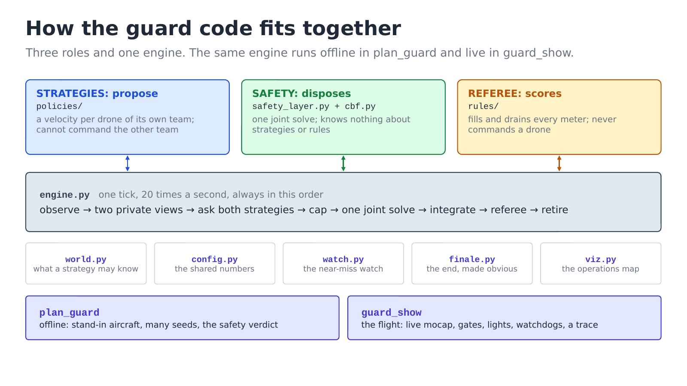

# Guard: the modules

How the guard show is put together: what each module does, what it may and may not
do, and how one tick flows through them. Why it is built this way:
[guard-theory.md](guard-theory.md). What was measured: [guard-design-notes.md](guard-design-notes.md).
To run it: [../guard/run.md](../guard/run.md).

All the code is under `src/crazyswarm2/crazyflie_shows/crazyflie_shows/`.

## One tick

Every 50 ms (20 Hz), in this order:

1. **Observe.** The engine takes every drone's position from mocap, or from its
   setpoint in the simulator, and estimates its velocity from those positions.
2. **Two private views.** It builds a separate copy of the world for each team. Your
   own drones carry what you commanded; the other team's carry only what a camera
   could see.
3. **Ask both strategies.** Each returns a velocity request for its own active
   drones. Neither sees the other's requests.
4. **Cap the requests** at the team's speed and the acceleration limit.
5. **One joint safety solve.** The safety layer makes the smallest change to *all*
   requests together so that no pair gets too close, nobody enters the VIP's
   keep-out, and everyone stays inside the room and the height band.
6. **Integrate into setpoints.** These go out over the radio, or to the simulated
   drones in `plan_guard`.
7. **Referee.** It fills and drains every drone's meters from the *aircraft*
   positions, using the rule set in play, and declares downs, strikes and the result.
8. **Retire.** A downed or striking drone, of either team, first *exits*: it brakes
   and, if it is near the VIP, moves clear of it, still through the safety layer. Then
   it is handed to the landing commander and is a descending obstacle until it is down.

## 1. `guard/world.py`: what a strategy may know

- **`Agent`:** name, team, observed position, velocity, status and outcome.
  - Velocity, for your own team, is what you commanded. For an opponent, it is
    estimated from its observed positions, never its command.
  - Status is active or retiring. Outcome is downed or struck. A retiring drone first
    *exits* under the engine's command (`Match.exiting`; brake, then clear of the VIP)
    and is handed to the caller to land by `Match.pop_landing()`; see
    guard-design-notes.md, "Landing out of the way".
- **`View`:** the time, the VIP's position and velocity, every agent, the arena, the
  config (limits and safety), the rule set in play, everybody's meters, and the public
  events so far.
- **`Arena`:** clearance to the edge, which way is inward, and room above and below.

Nothing in a View is live: every one is a copy made for one team for one tick.

## 2. `guard/policies/`: the strategies

Each team's brain, swappable by name.

- **Contract:**
  - `act(view)` returns a velocity per active drone of your own team.
  - `reset(view, rng)` is called once, with your team's own random stream.
  - `DEFAULTS` lists your tunables. Passing a misspelled one is an error, not a
    silent default.
  - `labels` holds a word per drone, shown in logs and RViz.
  - `intents` (optional) holds an `Intent(kind, goal, target)` per drone: what move
    it is making, where it is heading and which opponent it is about. `plan`
    (optional) holds the team's play (`phase`, `lanes`, `decoy`). Both are for the
    picture and the LEDs only. The engine passes them to the viz in the `Tick`,
    never to the other strategy. `DEFENSE_KINDS` / `ATTACK_KINDS` in
    `policies/__init__.py` list the kinds the viz has symbols for.
- **Plugging in:** decorate the class with `@register`, then choose it by name
  (`-p defense:=...`, `-p attack:=...`). To use a strategy without editing the
  package, put it in any importable module and pass `-p policy_module:=...` (show)
  or `--policy-module` (planner). The template is in `policies/__init__.py`.
- **What a strategy cannot do:**
  - command the other team;
  - exceed its speed or acceleration limits;
  - get past the safety layer.

  A buggy strategy costs matches, not drones.
- **`common.py`** holds shared helpers: a braking-law `seek`, a smooth minimum,
  assignment, and room and band projections.

Built in:

| Name | Team | What it does |
|---|---|---|
| `shell` | defence (default) | Urgency-weighted 3D intercepts; every spare defender a pincer. Posts round the VIP, alternating above and below, only while no attacker is in play |
| `zone` | defence | Each defender owns a sector of the VIP's sky that turns toward the attack (idle posts alternate above and below); engages only inside it, at the attacker's height, and helps a neighbour only where the rules say a 2 v 1 downs the attacker |
| `hunter` | defence | A pair flanks one attacker out at range (only a target the rules say two hunters down, from spots where neither is outnumbered); the rest guard close. Everyone guards under `timer` |
| `ring` | defence (baseline) | The escort's idea: a flat ring that turns to face the nearest threat |
| `coordinated` | attack (default) | A team play (stage, commit together or behind a decoy, regroup), with each attacker planning 3D options scored by STL-style robustness, plus feints and evasion |
| `flood` | attack | Spread to evenly spaced bearings, then all charge at once with a sideways weave; regroup from the gaps when all stall |
| `wolfpack` | attack | The whole pack closes on the loneliest defender (never where a wolf is outnumbered); strikes from spread lanes once the defence is halved, after `hunt_timeout_s` (12 s), or when nobody is worth hunting; straight to the strike where defenders cannot be downed |
| `direct` | attack (baseline) | Straight at the VIP, all at once |

Every built-in sets `labels`, `intents` and (where it has a team phase) `plan`.
Tests: `test/test_guard_strategies.py` (registration, an intent per active drone,
only its own team commanded, deterministic per seed, a short safe match each).

## 3. `guard/safety_layer.py` + `cbf.py`: what the drones are allowed to do

- **`cbf.py`** is AirStack's CBF solver, copied byte for byte. A test checks its hash
  against upstream. It is never edited here: change it in AirStack and re-copy. It
  is the bridge for flying Crazyflies under AirStack later.
- **`safety_layer.py`** builds the constraints the solver enforces:
  - **every pair of aircraft:** an ellipsoidal keep-out, taller than it is wide,
    because a drone in another's downwash loses thrust;
  - **the VIP and drones being landed:** fixed obstacles, so only the active
    Crazyflies dodge;
  - **the room:** one constraint per nearby wall edge, plus the floor and the
    ceiling.
- **The backstop:** a clamp after integration catches a solve that failed, and
  counts every firing. It has never fired, in simulation or in any hardware match
  through 2026-11-23.

It knows nothing about strategies or rules, and nothing above it can turn it off.

## 4. `guard/rules/`: the rules and the referee

Rule sets plug in by name like strategies (`-p rules:=...`, `--rules`), and
`plan_guard --list` names them.

The model (meters, the five built-in sets, `pressure`'s counting) is
[guard-theory.md §7](guard-theory.md#7-rules-as-rates). In code, a rule set is a `Rules`
subclass with:
- `down_rates`, `strike_rates`: how fast each meter fills, per second, vectorised so a
  planner can call them on whole rollouts;
- `drain`: how fast a meter empties when nothing fills it (`inf` = reset);
- `result`: the attack wins on `strikes_to_win` strikes or with no defender left; the
  defence with no attacker left or when `duration` runs out;
- `problems()`: refuses numbers only contact could meet (a reach inside the keep-out, a
  strike radius inside the VIP's);
- `DOWNABLE` (which teams can be downed) and `DEFAULTS` (its tunables).

**Contested strikes (`strike_block`, every rule set, default 0 = off).** With
`strike_block` > 0, a defender within that distance of an attacker contests its
strike (the rate is 0; with the usual instant drain the meter resets).
`strike_rates(att_p, vip_p, def_p)` takes the active defenders, either (M, 3) for every
case or (K, M, 3) per case for a planner's predictions. Leaving `def_p` out gives the
uncontested rate. The referee passes the active defenders. `coordinated` scores a
strike spot by how far the nearest *predicted* defender stays outside the block over
the dwell, so it looks for an uncontested spot. `problems()` refuses a block inside
`d_cc`, which no defender could ever get close enough to contest. Set it with
`guard_show -p strike_block:=0.8`, `plan_guard --rparam strike_block=0.8`, or the
console's number field.

The referee and the strategies share one rule object: the referee integrates it on
the aircraft, the strategies call it on predictions.

To write one: subclass `Rules`, set `name`, `DEFAULTS` and `DOWNABLE`, implement
`down_rates` (and `drain` if it is not a plain reset), and decorate it with `@register`.
The built-in sets are in `rules/standard.py`.

## 5. `guard/engine.py`: one tick

Runs the eight steps above, in that fixed order, and keeps the safety statistics:
corrections, emergencies, unconverged solves and backstop firings. It also enforces
the boundary between the teams: private copies, opponents observed not asked, and
separate random streams. It is pure Python, and identical offline and on drones.

## 6. `guard/config.py`: the shared contract

Everything both strategies are held to, under every rule set:
- the room and the height band;
- speed and acceleration limits;
- the separation floor and the safety layer's keep-outs;
- the watchdogs.

The rule numbers live with each rule set, not here.

`problems()` refuses an inconsistent set: for example a keep-out under the hard
floor, a separation floor under 0.20 m (nothing here has flight evidence for closer),
or near-miss ratios out of order. Field names match the escort's config, so the
containment check and the room helpers are shared, not copied.

## 7. `guard/viz.py`: the picture, as an operations map

The same markers go to RViz and to the console's 3D view. Its module docstring
has the full symbol table. In short:
- **Who is who:** a team-coloured halo and a label per drone. The drone itself is
  the real one (TF / `/poses`); only `plan_guard --rviz`, which has no real
  drones, adds a body sphere (`GuardViz(bodies=True)`).
- **What each drone means to do:** its `Intent` as a symbol: a block's screen
  bar, a pincer's hook, a staging circle, a strike arrow, and so on. A dotted
  line runs to the opponent it is about.
- **The attack's plan:** its lanes as axes of advance, and the phase on the
  scoreboard (`attack COMMITTED behind decoy cf11`).
- **The safety layer at work:** a drone's keep-out shows only on the ticks the
  CBF changed its command (`Match.corrected`).
- **Events and result:** a ring bursts where a drone is downed, and at the VIP
  on a strike. The VIP turns green or red under a banner.

Markers that were drawn last tick and not this one are deleted at once, so a
changed intent never lingers. `guard_show` publishes at about 10 Hz (events between
two publishes are carried to the next), and the console's 3D view draws only the
newest snapshot per browser frame (`latestOnly` in the mission window): at 20 Hz with
every message drawn, it fell 3.3 s behind a match (2026-11-06). Publishing is best
effort: a failed marker costs a picture, never a flight.

## 7a. `guard/finale.py`: the end, made obvious

After the result, the same for every strategy and rule set:
1. **Rally.** The winners take a formation round the VIP. The losers sink to
   `floor + loser_dz`, fly home to their marks and are landed there.
2. **Emote.**
   - Defence wins: an honour guard turning with a Mexican wave.
   - Attack wins: a capture ring squeezing in and out. The attacker whose strike
     won is reinstated (`Match.reinstate`) instead of landed.
3. **Home.** The winners fly to their marks at start height and hold. A mark
   with a downed drone on it is moved aside.

Every move is `Match.steer`: requests to goals, through the same safety
layer, with no strategy, referee or match clock. Losers are handed to the
landing commander with `Match.retire`. The formation is VIP-relative, so a
moving DJI drags it along.

Lights, per drone: `win` (green), `team` (its colour), `off`. `check()`
refuses a ring inside the VIP keep-out + 0.2 m, or a speed that is not positive; the
speed is also capped at the slower team's.
`plan_guard` flies the finale on its stand-in aircraft and checks it like the
match (`--no-finale` to skip; `--matrix` never flies it).

## 7b. `guard/formation.py`: the form-up before START

Before START (after the DJI gate, once the DJI is above `vip_airborne_z`, 0.3 m), every
drone flies through `Match.steer` to a formation round the VIP's *live* position. The
match is then built from where the drones are at START, not from the floor marks.

- **`formation(cfg, rules, vip, pos, D, A, check, params)`** returns `(goals, turn_deg,
  why)`:
  - defenders go to a ring at `r_def` (1.8 m), one of them facing the attack side,
    which is the bearing from the VIP to the attackers' centroid;
  - slots are assigned by least travel;
  - if the layout straight on does not fit the room, it is turned by up to ±90°.

  `check(goals, reach)` is `plan_guard.mark_problems`, so a formation is held to
  the same rules as a start from the floor marks.
- **Attackers, `attackers` = `hold` (the default since 2026-11-23) or `follow`.**
  - `hold`: each attacker's slot is where it hovered when the form-up began, at
    start height, and stays fixed through every rebuild.
  - `follow`: the 11-17 layout. Attackers go to an arc at up to `r_att` (4.4 m) on
    their side, `spacing` apart, and the arc moves with the VIP.

  `params_of()` refuses any other value.
- **`Follow`** keeps the formation as offsets from the VIP and translates it rigidly
  every tick. With `hold`, only the defenders' slots move. It rebuilds round the live
  VIP only when the translated slots fail the checks (for example, when they hit a
  wall), and holds the last good goals if nothing fits. `rebuilds` counts the
  rebuilds.
- **A fair start.** The start-reach rule (`plan_guard.mark_problems`): under rules
  that can down someone, no attacker may start within `reach` + 0.5 m of a defender. With `follow`, the arc is laid out to pass it. With `hold`, the
  rule cannot decide whether a formation exists, because the attackers do not move.
  It decides whether the start is *fair* instead.
  - `Follow.unfair(vip)` lists the start-reach problems alone.
  - `guard_show` prints `NOT A FAIR START yet: ...` and `fair start` as that changes.
  - `plan_guard` prints the same problems as `!!!` warnings (move the VIP with
    `--vip`), not as refusals.
- **Parameters:**
  - `r_def`, `r_att`, `spacing`, `room_margin`;
  - `speed` (0.4 m/s, slow because the drones lag their setpoints);
  - `reached` (0.15 m) and `timeout_s` (25 s, after which the drones hold where they
    are).

  Set them with `guard_show -p form_up_params:=key=value,...` or `plan_guard --uparam
  key=value`, and the attackers' mode with `-p form_up_attackers:=hold|follow` or
  `--uparam attackers=follow`. To switch the form-up off, use `form_up:=false` or
  `--no-form-up`.

Tests: `test/test_guard_formup.py`.

## 7c. `guard/watch.py`: the near-miss watch

It runs on the *measured* aircraft every tick in `guard_show`, gates included. The
thresholds and why they are where they are: [guard-theory.md §5.2](guard-theory.md#52-defence-in-depth-on-the-aircraft-themselves).
The parameters:
- `mocap_jump_m`: a glitch, not a near miss; the drone flies on its setpoint for two
  ticks;
- `near_miss_ratio` for `near_miss_ticks` ticks: pause; `near_miss_clear_ratio`: resume;
- `near_miss_land_ratio`, or a pause longer than `near_miss_pause_s`: land everything;
- `near_miss_pause:=false`: the old rule, where a soft near miss lands everything.

Each near miss is printed with its evidence: the measured gap, the setpoint gap
at the same tick, and each drone's tracking error. These separate "the plan put
them there" from "the aircraft lagged the plan".

## 8. The programs

- **`plan_guard`** (offline, no drones): whole matches against simulated drones
  over many seeds, and a **safety verdict** that is the gate before flying. It also
  has:
  - `--matrix`: every defence against every attack; with `--rules all`, under every
    rule set;
  - `--rviz`: live replay in RViz. With `--matrix --rules all` it rotates through
    every pairing and rule set, and shows each drone's meters (`d40%` down,
    `s40%` strike);
  - `--marks`: where to stand the drones;
  - `--list`: the strategies;
  - the form-up (7b above) before every match, the same as the show. Use
    `--no-form-up` to start from the floor marks, and `--uparam` to change it;
  - its stand-in aircraft: a pure delay (`--delay`, 0.4 s) and then a first-order
    lag (`--tau`, 0.2 s), fitted to the PID traces. For the Mellinger plant, use
    `--delay 0.1 --tau 0.1`.
- **`guard_show`** (the flight): preflight, arming, takeoff, the lift to start
  height, then the engine on live mocap at 20 Hz. It lands drones as they are tagged
  or strike, and an abort lands everything. Its watchdogs cover:
  - **VIP pose lost:** hold, then land;
  - **each drone:** stale mocap, outside the room, or not following its setpoint
    (the escort's check, shared);
  - **near miss:** two *measured* aircraft too close: a pause, or a landing if
    much closer (7c above).

  Before START it runs the form-up (7b above). The rules options are
  `strike_block` (contested strikes, section 4) and `rules_params`. A
  `rules_params` entry for `strike_block` wins over the separate parameter.

  It also drives the LEDs:
  - role lights mid-match: white while scoring, magenta for the decoy, dark when
    out of play; `role_lights:=false` turns them off;
  - the finale's lights.

  Each change is sent once, at most every 0.25 s per drone.

  `controller` = `mellinger` (the default since 2026-11-24) sets
  `stabilizer.controller` 2 on the flying drones before arming and back to 1 (PID)
  after, landing or abort (`set_controller`, in a `finally`). On 2026-11-23 it cut
  the lag to 0.08-0.14 s from PID's ~0.56 s (guard-design-notes.md). With
  `use_sim_time` nothing is switched: the simulator runs Mellinger from `server.yaml`,
  and restoring PID after would leave it on PID. `controller:=pid` leaves the server's
  setting alone.

  **Gates** (`paced:=true`): it waits for Enter, or the console's Continue, to arm and
  take off; for the pilot to take the DJI off (`vip_mode:=mocap`); to START; and at the
  end for the pilot to land the DJI (otherwise to land the drones). The DJI goes up
  into drones that already dodge it, and comes down before them. While a gate waits, or
  the match pauses (a lost VIP pose, a drone on hold), `Match.hold()` keeps every drone
  in place *through the safety layer*, with every watchdog running and the match clock
  stopped. The console's window is `missions/guard.yaml`.

  Every tick drains the node's ready callbacks (`drain`, shared with the escort in
  `escort_show.py`), so `/poses` is never queued behind the drones' own pose and status
  topics. `trace:=true` (the default) writes every tick's measured and commanded position, phase and intent
  per drone to `guard_trace.csv` in the flight's folder
  ([flight-logs.md](flight-logs.md)).
