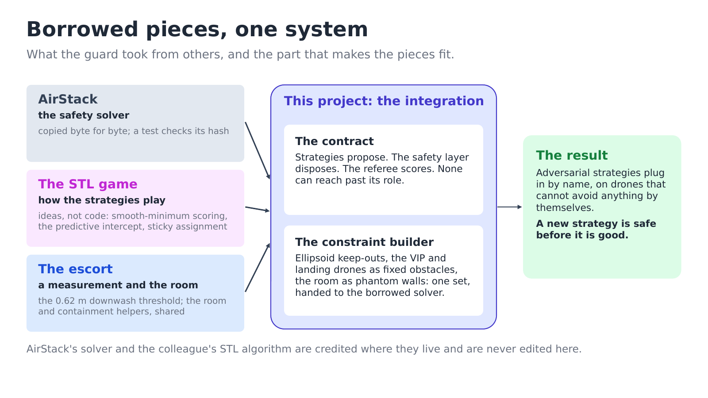
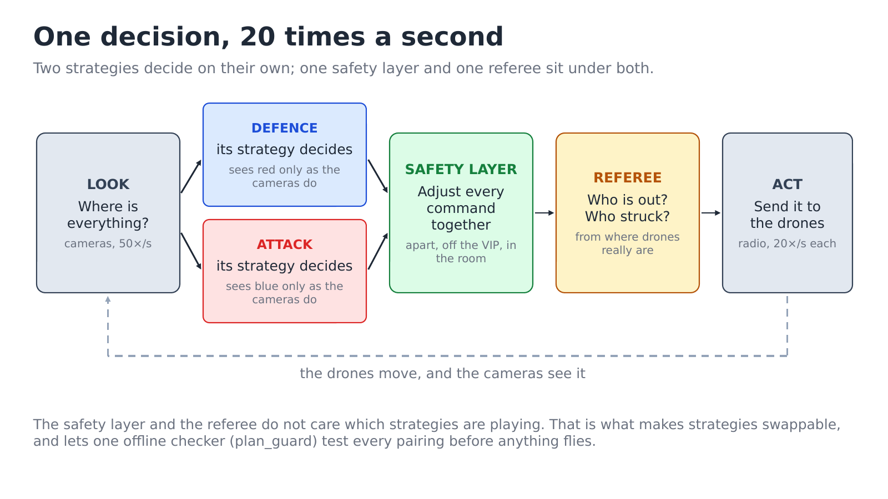
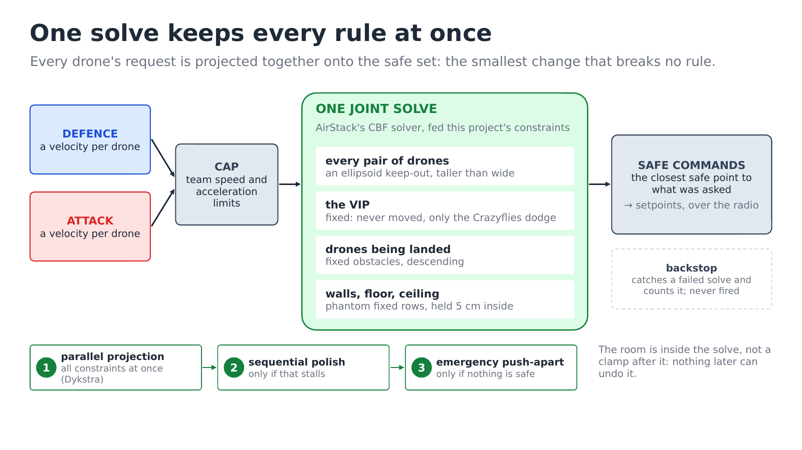
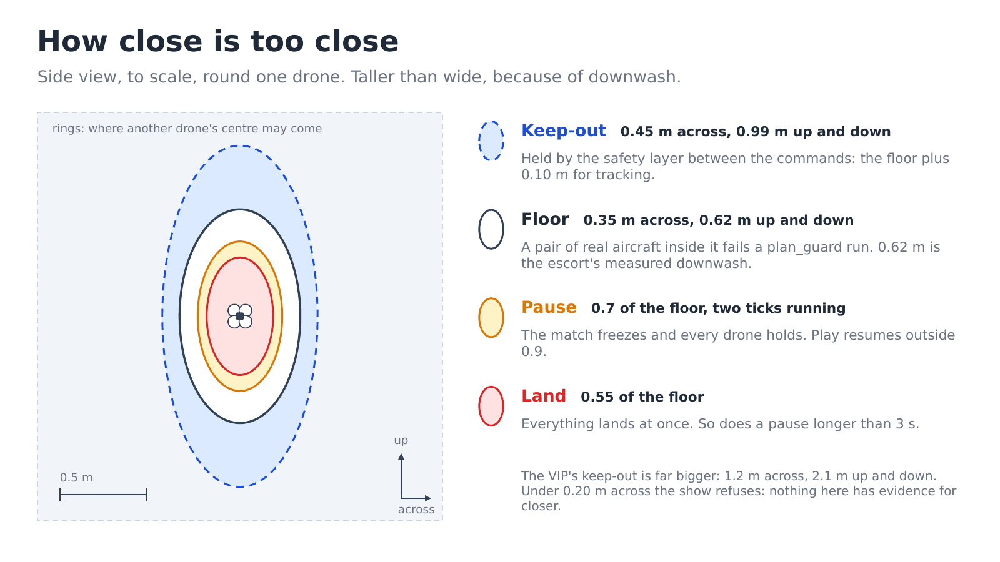
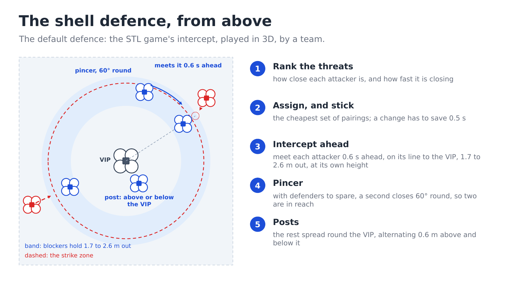
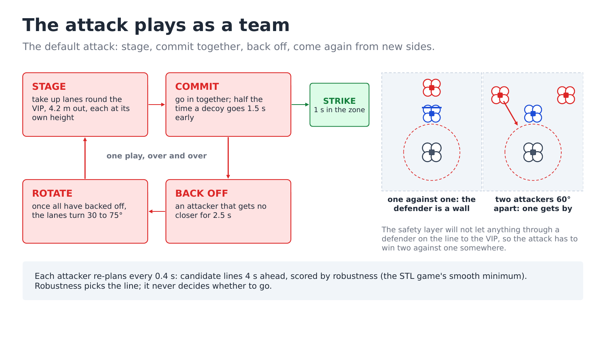
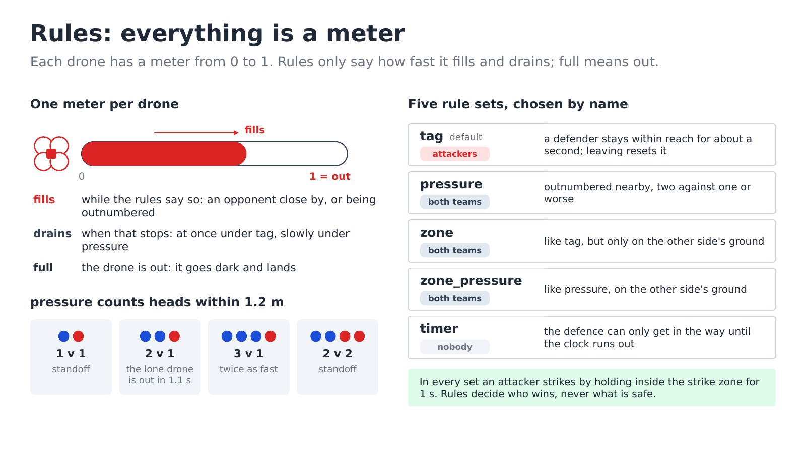
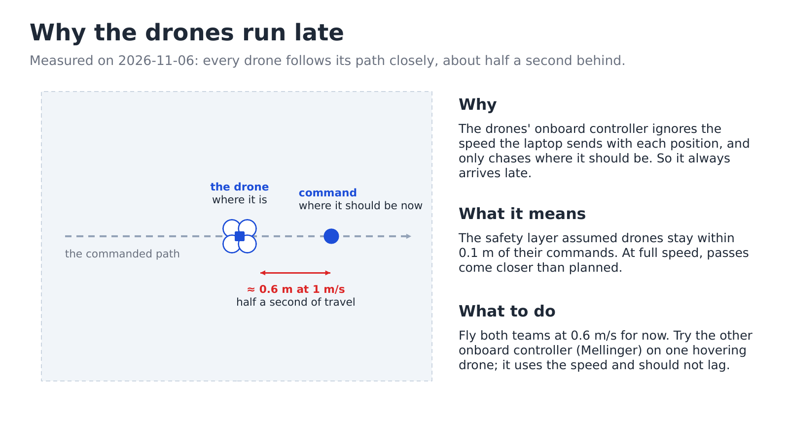
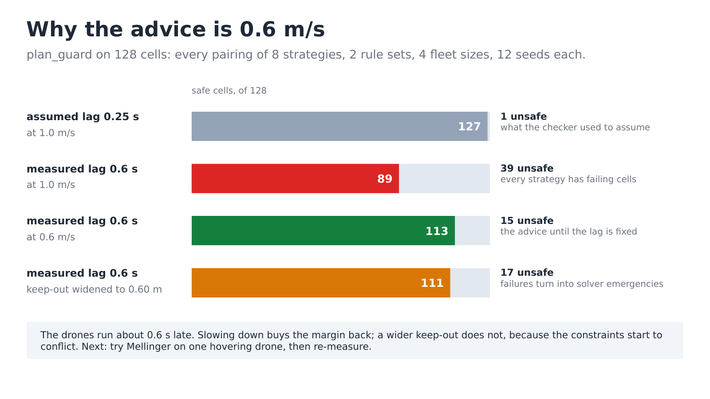

# Guard: theory and design

The ideas behind each algorithm, and why each design decision was taken. The plain-language
version is [../guard/how-it-works.md](../guard/how-it-works.md); this page adds the maths.
What was measured is in [guard-design-notes.md](guard-design-notes.md); the modules are
described in [guard-modules.md](guard-modules.md).

One warning about what this page contains. The guard borrows its machinery on purpose: the
safety solver is AirStack's, copied byte for byte; the way the strategies play comes from
the STL game, a colleague's algorithm, turned from one game into the other; the vertical
separation number is the escort's measured downwash threshold. What is genuinely this
project's is the integration — a contract between the strategies, the safety layer and the
referee that makes it safe to plug in adversarial strategies by name, on a system where a
wrong command is a collision. The borrowed pieces are §3 (AirStack's solver) and §6 (the
STL game's playing theory); the contract (§2) and the constraint set built for the borrowed
solver (§4) are what this project adds.

---

## Notation

Every symbol used in the equations below, in one place. The central equations each have
their own "where" legend directly under them. Values are the shipped `GuardConfig` defaults
(`guard/config.py`) and the shipped rule sets (`guard/rules/standard.py`), unless stated.

| Symbol | Meaning | Value in the demo |
|---|---|---|
| $p_i,\ v_i$ | position and commanded velocity of drone $i$ | measured; computed |
| $v^{\text{nom}}_i$ | the velocity drone $i$'s strategy asked for | computed |
| $\Delta t$ | control period | 0.05 s (20 Hz) |
| $v_{\max}$ | per-team speed cap, applied to each request before the safety layer | 1.0 m/s both teams |
| $v^{\text{saf}}_{\max}$ | hard cap the safety layer may use while dodging | 1.2 m/s |
| $a_{\max}$ | acceleration limit on each strategy's request | 2.0 m/s² |
| $h_{ij}$ | pairwise barrier between drones $i$ and $j$ (safe when $\ge 0$) | computed |
| $r$ | per-drone safety radius in AirStack's spherical form | solver input |
| $\alpha$ | CBF class-K gain: how fast a gap may close, per metre of gap | 2.5 /s |
| $\alpha_{\text{wall}}$ | gain for the walls, floor and ceiling | 2.0 /s |
| $a,\ c$ | half-axes of a keep-out ellipsoid: across, and up/down | see §4.1 |
| $W^2$ | $\mathrm{diag}(1/a^2,\,1/a^2,\,1/c^2)$, the ellipsoid's shape matrix | computed |
| $d_{\text{cc}}$ | Crazyflie–Crazyflie keep-out across | 0.45 m |
| $z_{\text{cc}}$ | vertical ratio of the Crazyflie keep-out ($d_{\text{cc}} \cdot z_{\text{cc}}$ tall) | 2.2 |
| $d_{\text{vip}},\ z_{\text{vip}}$ | Crazyflie–VIP keep-out across, and its vertical ratio | 1.2 m, 1.75 |
| $\eta$ | hard separation floor across (`min_separation`) | 0.35 m |
| $\eta_z$ | hard separation floor vertically (`min_separation_z`) | 0.62 m |
| $\mathrm{TM}$ | tracking margin: how far an aircraft may trail its setpoint | 0.10 m |
| $\tau$ | first-order tracking lag of an aircraft behind its setpoint | 0.25 s assumed; 0.54–0.60 s measured |
| $n$ | inward unit normal of a wall | geometric |
| $T$ | down time: seconds of filling that downs a drone | 1.1 s |
| $\rho$ | reach: distance within which an opponent counts against a drone | 1.15 m `tag`, 1.2 m `pressure` |
| $\delta$ | drain rate of a meter nothing is filling | ∞ (`tag`), 0.5 /s (`pressure`) |
| $k$ | sharpness of the smooth minimum | 8.0 |
| $\mathrm{clip}(x, lo, hi)$ | limit $x$ to the range $[lo, hi]$ | |
| $\lVert\cdot\rVert$ | length of a vector | |

---

## 1. The game as a control problem

N defenders protect a VIP — a hand-flown DJI, or a fixed point in the air — against M
attackers trying to reach it. As a control problem this is pursuit and evasion under hard
safety constraints: a target-guarding game (Isaacs), replanned 20 times a second, with every
decision in one place. Three facts constrain everything:

* **Nothing can sense anything.** Positions come only from motion capture, so the system is
  **centralised**: one program knows every position and decides for every drone.
* **Nothing can avoid anything.** The Crazyflies have no onboard collision avoidance, so
  **every safety property has to be enforced in the commands** before they leave the ground.
* **Nothing above the safety layer can be trusted.** This is the one the escort did not
  have. The strategies are *adversarial by design*: each is written to beat the other, and
  new ones plug in by name from outside the package (`-p policy_module:=...`). A safety
  argument that assumed cooperative or correct strategies would not survive the first
  plugged-in experiment.

The speeds are the first step up from the escort, which flew at 0.6 m/s: both teams cap at
$v_{\max}$ = 1.0 m/s, the safety layer may use $v^{\text{saf}}_{\max}$ = 1.2 m/s while
dodging, and each request is limited to $a_{\max}$ = 2.0 m/s² of acceleration (`config.py`).
The design answer to the third fact is not a better strategy. It is a contract that makes
the strategies irrelevant to safety (§2), and a filter strong enough to absorb whatever they
ask for (§3–§5).

---

## 2. The stack and the contract

### 2.1 The parties

| Party | What it does | File |
|---|---|---|
| Strategies | propose: a velocity request per active drone of their own team | `guard/policies/` |
| Safety layer | dispose: one joint projection of all requests onto the safe set | `guard/safety_layer.py` + `cbf.py` |
| Referee | score: fills and drains every drone's meters from the measured positions | `guard/rules/` |

The engine (`guard/engine.py`) runs them in one fixed order each tick: observe, ask both
strategies, cap each request at its team's speed and acceleration, **project every request
at once onto the safe set**, integrate into setpoints, then let the referee judge the
*aircraft* positions. Retiring drones (downed or struck) become obstacles for everyone else
until they are down.

### 2.2 The five clauses of the contract

1. **Strategies propose; they never dispose.** A strategy returns a velocity request, capped
   by the engine before the layer sees it
   (`test_a_strategy_cannot_steer_the_other_team` pins this).
2. **The safety layer has the last word, by construction.** Nothing after the projection may
   undo it, except one backstop clamp that exists for a solver that failed, never fired, and
   is counted if it does (`engine.py` step 4; `safety_layer.backstop`); `plan_guard` treats
   a firing as a safety failure.
3. **Opponents are observed, never asked.** Each team gets a private copy of the world, built
   fresh every tick. An opponent's velocity is *estimated* from its observed positions; its
   commands and its strategy's decisions never appear. Each team has its own random stream.
   `test_guard.py` checks this with a spy, a vandal and a dice test.
4. **Rules never touch safety.** The referee scores; it never commands. Each rule set's
   `problems()` refuses numbers that could only be met by contact: a reach inside the
   keep-out, or a strike radius inside the VIP's.
5. **The numbers are one shared file.** `GuardConfig` holds everything every strategy is
   held to under every rule set. Its field names match the escort's `EscortConfig` on
   purpose, so the two shows share one definition of "inside the room" and one containment
   rule (`config.py` docstring).

**Why this makes pluggable strategies safe.** Safety is not a property of the strategies.
It is a property of the layer underneath them, which none of them can switch off, with
numbers none of them can weaken. A strategy can be naive or buggy and still not crash
anything — a buggy strategy costs matches, not drones. That turns the strategy table from a
risk into an experiment: a new adversarial strategy is safe *before it is good*, and the
offline verifier only ever has to test one layer, against every strategy at once, because
all of them go through the same projection.

---

## 3. The safety filter: AirStack's solver, verbatim

`crazyflie_shows/cbf.py` is AirStack's `svg_ground_control/cbf_filter.py`, copied **byte
for byte** between BEGIN/END markers (snapshot 91376aa, castacks yikuan/SVG_ground_control
@ cf719f0, 2026-10-07, sha256
`7f5d8c5a58398a9702e79ab905e8ef371304277136700658b5234fb5a9078db9`). `test/test_cbf.py`
runs AirStack's own tests plus one that re-hashes the block against that upstream hash; the
file is never edited here — change it upstream and re-copy. Two reasons for the strictness:
the same solver runs AirStack's swarm commander, so it is the bridge to flying Crazyflies
under AirStack later; and AirStack validated it in MuJoCo against the Starling 2 Max
airframe, a validation that travels with the file. This project adds its own checks (§9).

What the solver solves is a **control barrier function** safety filter (Ames et al. 2019 —
named in escort-theory §5.4 as future work; the escort's own filter is a heuristic
projection, and the guard starts where that page left off).

### 3.1 The barrier and the constraint

For drones $i$, $j$ with positions $p_i, p_j$ and a shared safety radius $r$, the pairwise
barrier is

$$
h_{ij} = \lVert p_i - p_j\rVert^2 - (2r)^2
\qquad (\ge 0 \text{ means safe})
$$

| Where | |
|---|---|
| $2r$ | the distance two drones must keep: each has radius $r$; $h_{ij} = 0$ is that surface |

Requiring the barrier to stay non-negative through the class-K condition
$\dot h + \alpha h \ge 0$ gives a constraint that is **linear in the velocities**:

$$
2\,(p_i - p_j)\cdot(v_i - v_j) + \alpha\, h_{ij} \;\ge\; 0
$$

| Where | |
|---|---|
| $(p_i - p_j)\cdot(v_i - v_j)$ | how fast the gap is closing, along the line between them |
| $\alpha h_{ij}$ | the slack: the gap may close at rate $\alpha$ per metre of gap that remains |

Together with the per-drone cap $\lVert v_i \rVert \le v_{\max}$, the safe-velocity set is
an intersection of convex sets, and the solver returns its closest point to the strategies'
requests:

$$
\min_{v}\ \sum_k \lVert v_k - v^{\text{nom}}_k\rVert^2
\quad\text{subject to every pair half-space and every cap;}
\quad v^{\text{nom}}_k = \text{drone } k\text{'s request}
$$

### 3.2 Solving it: Dykstra, two phases, and a fallback

The projection is Dykstra's alternating projection, in **parallel product-space form**:
every constraint is projected simultaneously in vectorised numpy, and the per-drone results
are averaged each sweep, weighted by how many constraint sets each drone participates in
(its pair count, plus one for the speed-cap set). Three more pieces, from the docstring:

* **Active-pair pruning.** A pair too far apart to possibly activate this step —
  $\alpha h \ge \lVert\text{grad}\rVert \cdot 2 v_{\max}$, the most the constraint's
  left-hand side could be moved — is pruned up front. Cost scales with the number of
  *active* conflicts, not all $N^2$ pairs.
* **A Gauss-Seidel polish**, warm-started from the parallel phase, runs only if that phase
  stalls: sequential propagation converges in few sweeps where consensus averaging stalls
  (many constraints sharing drones).
* **An emergency push-apart** engages when the problem is infeasible (drones already inside
  each other's safety spheres, or a negative barrier with no gradient to push along). It
  overwrites violated pairs with an away-from-each-other velocity, capped at $v_{\max}$ — a
  best-effort safety action, not an optimal one.

The solver is written against a generic `PairwiseConstraints` bundle — each row is
$\text{gradient}\cdot(x_i - x_j) + \text{bias} \ge 0$ over per-drone decision vectors $x$,
plus a per-drone norm cap — and the docstring names that bundle as the extension point: a
different constraint builder plugs into the same solver. That is exactly the seam this
project builds on.

### 3.3 Fixed rows

Rows can be marked **fixed**: their command is taken as ground truth, never projected,
capped or averaged, and each pair constraint involving one puts its **full** correction on
the movable drone. AirStack introduced this for an RC-flown intruder; the guard leans on it
hard (§4.2) — the VIP and every retiring drone are fixed rows, so the Crazyflies absorb all
of the evasion.

---

## 4. The constraint builder: the integration this project adds

The solver is AirStack's. The constraint set handed to it is this project's
(`guard/safety_layer.py`), built in the solver's own `PairwiseConstraints` shape — the
extension point its docstring names. This is the theory that is genuinely new here: not a
new algorithm, but the fitting together of a borrowed solver with this show's bodies, room
and referee.

### 4.1 Aircraft pairs: an ellipsoidal barrier

AirStack's barrier is spherical. Drones in a downwash are not: a drone under another's
rotors loses thrust, so the hazard is taller than it is wide. The keep-out is therefore an
ellipsoid, and the barrier on it is

$$
h_{ij} = \frac{d_x^2 + d_y^2}{a^2} + \frac{d_z^2}{c^2} - 1
\qquad (d = p_i - p_j,\ \ge 0 \text{ means safe})
$$

| Where | |
|---|---|
| $a$, $c$ | horizontal and vertical half-axes ($c > a$: taller than wide); the surface is $h = 0$, normalised unlike AirStack's $-(2r)^2$ |

Differentiating along commanded velocities ($W^2$ is constant, so $\dot h$ picks up exactly
the relative velocity) and requiring $\dot h + \alpha h \ge 0$:

$$
2\,W^2 (p_i - p_j)\cdot(v_i - v_j) + \alpha\, h_{ij} \;\ge\; 0,
\qquad W^2 = \mathrm{diag}\!\big(1/a^2,\ 1/a^2,\ 1/c^2\big)
$$

| Where | |
|---|---|
| $W^2$ | the ellipsoid's shape matrix: it weighs the vertical by $1/c^2$, so a vertical gap counts for more |

This is exactly the form AirStack's builder produces for a sphere, $W = I/r$: the sphere is
the case $a = c$, and the normalisation's extra $1/r^2$ scale is absorbed by the gain. The
ellipsoid costs nothing in the solver — it is a different builder, not a different solver.

Each pair gets its own $(a, c)$: a Crazyflie–Crazyflie pair uses
$(d_{\text{cc}},\, d_{\text{cc}} \cdot z_{\text{cc}})$ = (0.45 m, 0.99 m); a Crazyflie–VIP
pair uses $(d_{\text{vip}},\, d_{\text{vip}} \cdot z_{\text{vip}})$ = (1.2 m, 2.1 m). The
keep-out between two bodies is the **larger** of their two shapes, so any pair involving
the VIP uses the VIP's. The numbers and their evidence are §5.

### 4.2 Fixed rows: the VIP and the retiring drones

The VIP — a hand-flown DJI, or a person — cannot be commanded, so it is a **fixed row** at
its measured velocity (§3.3): the solver never corrects it, and the Crazyflies absorb the
whole evasion. AirStack's own treatment of an RC-flown intruder; the guard's contribution
is routing its most important obstacle through it every tick. Retiring drones (tagged or
struck, being landed) are fixed rows too, descending at `land_speed` 0.25 m/s — modelled as
what the high-level commander is flying them down at.

### 4.3 Phantom walls: the room inside the same projection

The solver only knows pairs. Walls, floor and ceiling therefore enter as constraints
against **phantom fixed rows** at zero velocity, one per nearby constraint:

$$
n \cdot v_i + \alpha_{\text{wall}}\cdot\text{clearance} \;\ge\; 0
$$

| Where | |
|---|---|
| $n$ | the inward unit normal of the wall, floor or ceiling |
| a pair with a motionless phantom | is a single-drone half-space — the room joins the same projection as the pairs |

**Why a post-hoc clamp would not do.** Clamping the room after the CBF could undo the CBF:
the clamp might push a setpoint back into a pair's forbidden half-space — the ordering
failure the escort hit when it clamped separation before slewing (escort-theory §5.2). Here
there is no stage after the filter: the room is a constraint *inside* it, so one solve
keeps every property at once, or reports that it could not.

Three details that the corners forced:

* **One row per polygon edge within reach**, using the distance to the edge *segment*. A
  single nearest-edge row let a drone sliding along one wall pass straight through the next
  at a convex corner — the nearest edge was the one it was sliding along, so nothing
  constrained the other direction (`test_walls_hold_a_drone_inside_the_room`). Segments
  also keep the step's reflex corner from trimming the room.
* **The rows hold `wall_margin` (5 cm) inside.** The first-order CBF is exact in continuous
  time, but it is integrated at 20 Hz, and at a polygon corner the inward normal turns
  between ticks, so a setpoint can creep a couple of centimetres past $h = 0$.
* **Rows are generated only within reach** of the boundary —
  $v^{\text{saf}}_{\max}/\alpha_{\text{wall}} + 0.5 \approx 1.1$ m at the defaults: farther
  away than that, a boundary cannot bind yet.

---

## 5. What the filter guarantees, and what it does not

### 5.1 It holds setpoints apart, not aircraft

The CBF runs on the commanded reference, which exists identically in the simulator and on
hardware. The aircraft trail their setpoints, so the filter's keep-out is the hard floor
**plus** the tracking margin:

$$
d_{\text{cc}} = \eta + \mathrm{TM} = 0.35 + 0.10 = 0.45\ \text{m},
\qquad d_{\text{cc}} \cdot z_{\text{cc}} \approx 0.99\ \text{m}
$$

| Where | |
|---|---|
| $\mathrm{TM}$ | `TRACKING_MARGIN`, 0.10 m (arena.yaml), how far an aircraft may trail its setpoint |
| $\approx 0.99$ m | the vertical keep-out: well over the 0.62 m downwash floor |

The floor itself is an ellipsoid, and it is *this project's own*, relaxed from the arena's
0.80 m in 2026-11-03: side by side at one height is the regime the STL game showed to be
fine (closest approach 0.18–0.20 m), and $\eta$ = 0.35 m sits comfortably above that. One
drone over another is a different hazard — downwash — so the vertical floor stays at
$\eta_z$ = 0.62 m = `escort.DOWNWASH_DZ`, the escort's *measured* downwash threshold,
borrowed because it was already measured (`escort.py`). `config.problems()` refuses
anything under 0.20 m across: nothing here has evidence for closer.

How far the aircraft actually trail is §8's question. The design's honest position: the
margin in $d_{\text{cc}}$ covers the *assumed* lag, and the watchdogs below cover the
*measured* one.

### 5.2 Defence in depth on the aircraft themselves

The near-miss watchdog (`guard/watch.py`) watches the **measured** aircraft, in fractions of
the hard-floor ellipsoid:
$\mathrm{floor\_ratio} = \sqrt{(d_x^2+d_y^2)/\eta^2 + d_z^2/\eta_z^2}$ for the pair's gaps
$d$, so 1 means exactly on it.

* **Mocap glitches are not near misses.** A measured jump further than 0.30 m in one tick
  (6 m/s at 20 Hz — faster than any Crazyflie) is a swapped or ghost rigid body; the drone
  flies on its setpoint for that tick and the glitch is counted.
* **Soft near miss → pause.** Two ticks in a row inside 0.7 of the floor (0.25 m across,
  0.43 m vertically) freezes the match, and every drone holds *through the safety layer*, so
  the aircraft settle back onto setpoints the CBF already keeps $d_{\text{cc}}$ apart. Play
  resumes outside 0.9; a pause longer than 3 s lands everything. Until 2026-11-05 one frame
  inside the line landed the whole show, which ended most hardware matches.
* **Hard near miss → land.** Inside 0.55 of the floor (0.19 m across, 0.34 m vertically),
  everything lands at once.

The per-drone watchdog is the escort's `contain_check`, shared rather than copied: stale
mocap (0.3 s hold, 1.0 s land), outside the room (0.25 m margin), or not following its
setpoint (0.60 m of error for 0.80 s) each lands the show. That last check is the escort's
lesson again: **check the plant, not the command** — a drone that stops following is the
earliest warning there is.

### 5.3 What is proved, measured, assumed

* **Proved, at the solver's level:** the returned commands are the projection onto the safe
  set, with a residual reported per tick and convergence checked before the command is sent.
* **Assumed:** the first-order CBF is exact in continuous time; integrated at 20 Hz, under a
  lagging aircraft, it is not a proof. That is why the margins of §5.1 and §4.3 and the
  watchdogs of §5.2 exist. AirStack's docstring describes the acceleration-level upgrade
  (an HOCBF) as a builder swap with the same solver; it would remove the dependence on
  tracking lag.
* **Measured:** the vertical floor (the escort's downwash measurement); the watchdog
  thresholds (fractions of the floor that separate "close pass" from "the plan failed",
  after 2026-11-05's flights). The horizontal floor is swept, not measured — §8.

---

## 6. Playing well: the STL game's theory, turned round

The strategy ideas are borrowed from the STL game — a colleague's algorithm; `stl_game.py`
is a port and is not edited. What the guard adds is the third dimension, teams instead of
one attacker, and the rules-aware scoring below. Nothing here affects safety: these are
requests, and §2's contract holds regardless of how good or bad they are.

### 6.1 Robustness: a smooth minimum over a rollout

The STL game scores a candidate by **robustness**: how far every margin it must keep stays
on the safe side along the path. Distances and times are signals; the robustness of a
bundle of signals is their minimum, taken smoothly (`policies/common.py`, the STL game's
`soft_min`):

$$
\mathrm{soft\_min}(x, k) \;=\; m - \frac{1}{k}\log \sum_i e^{-k\,(x_i - m)},
\qquad m = \min_i\, x_i
$$

| Where | |
|---|---|
| $x_i$ | the margins at sample $i$ along the rollout |
| $k$ | sharpness (8.0 here): as $k$ grows the value tends to $\min_i x_i$ |

The attack replans every 0.4 s: candidate goals around its lane (bearings ±25°, ±50°, ±80°,
at three heights, at staging range or striking range) are rolled out 4.0 s ahead in 8
samples, and each gets a space robustness — the smooth minimum over the rollout of the room
margin and the altitude-band margin.

### 6.2 The margin that includes time

The rules are *temporal*: a meter has to fill, so distance alone is the wrong currency. The
first version scored an instantaneous distance margin, and it forbade exactly the fast pass
through tag range that the rules allow — the attack never struck. So the margin has a
temporal part, in metres-equivalent: the rule set's own `down_rates` fill the attacker's
meter along the predicted path, from the meter it has now, and the margin is how much of the
meter is left unspent at its worst, times what the attacker covers in one down time, $v\,T$.
The two robustnesses combine by a plain minimum: **space** margins must hold at every
instant, **time** margins must hold over the plan.

### 6.3 Robustness chooses the line; it does not gate the attempt

The score that picks a line is robustness *plus* progress toward the VIP (weight 1.0), the
pull of the attacker's own lane (0.5), the safe-robustness term (2.5) and the bearing gap to
the nearest defender — strike where they are not — (1.5). An earlier design gated the
attempt on robustness being positive: waiting for a provably open lane meant never going at
all, while a simultaneous rush wins (`plan_guard` shows it). So robustness now *shapes* the
attempt — it chooses the least-exposed line, the spread and the height — and the attack goes
anyway. A `commit_margin` of 0.3 keeps the plan unless a new one wins by that much.

### 6.4 The defence the attacker plans against

Each candidate is rolled out against a **prediction** of the defence: every defender marked
against this attacker runs for the meeting point between the VIP and the attacker, at full
speed — the STL game's predictive intercept, turned round. Only *markers* move in the
prediction; a defender can only be in one place, which is exactly what attacking together
exploits. Predicting every defender onto every attacker made no lane ever look open, so the
attack never committed.

### 6.5 The shell: urgency, sticky assignment, intercept, pincers, posts

The default defence is the same theory played the other way (`policies/defense_shell.py`):

* **Urgency** ranks threats: $0.6\,(1 - \mathrm{clip}(r/4.0)) + 0.4\,\mathrm{clip}(\text{closing}, 0, 1)$
  — how close ($r$, against $d_{\text{ref}}$ = 4.0 m) and how fast it closes
  ($v_{\text{ref}}$ = 1.0 m/s), both clipped to $[0, 1]$.
* **Assignment** is min-cost over all defenders and threats at once
  (`linear_sum_assignment`): travel time minus 1.5 × urgency, plus a penalty for pincer
  slots. It is **sticky**: an assignment that repeats last tick's costs 0.5 s less, so a
  defender does not dither between two threats.
* **The intercept is predictive and 3D**: meet the attacker 0.6 s ahead of where it is, on
  the line from the VIP through that point, at a radius held between 1.7 m and 2.6 m.
  Meeting on the 3D line is what lets it meet an over-the-top or floor-level attack at its
  own altitude — the guard's addition to the borrowed idea.
* **Pincers** when defenders outnumber threats: a second defender closes 60° round from the
  blocker's side, so both are in reach — under a majority rule, one defender alone downs
  nobody (§7).
* **Idle posts** spread the rest round the VIP, alternating 0.6 m above and below it.

### 6.6 The team play: lanes, commit, decoy, regroup

The default attack (`policies/attack_coordinated.py`) plays as a team: **STAGE** on lanes —
bearings spread round the VIP, each at its own height, outside the defence's reach (4.2 m) —
then **COMMIT** together, so the defence has to split; with probability 0.5 one attacker
goes first as a **decoy**, 1.5 s ahead of the rest. An attacker that gets no closer for
2.5 s backs off; when the whole team has, the lanes **ROTATE** by a random 30–75° and the
play restarts from new sides. Under the plan sit the STL intruder's other two layers: a
feint (show the other side first, with a cooldown), and an evade reflex judged by the rules
— leave when the rule set would start filling the drone's meter here, or one step on.

The lanes exist because of a safety-layer fact: **a defender sitting on the line between the
VIP and an attacker is a wall** — the CBF will not let anything through it (§3.1's
constraint is exactly "the gap may not close"), so a one-on-one is lost by the attacker.
The default *overload* formation sends two attackers 60° apart at one side, so the one
defender marking that side cannot screen both: the attack has to win two-on-one somewhere,
and the rules (§7) say what a two-on-one is worth. Where defenders can be downed, the attack
also **hunts**: when the rule set's own rates say the pack could down a defender, evaluated
at the spots the pack would take, without filling any attacker's own meter, the attackers
converge on that defender.

---

## 7. Rules as rates

### 7.1 Meters

Every rule set is written the same way. Each drone has a **down** meter, and each attacker a
**strike** meter, running from 0 to 1; a full meter is an event — the drone is downed and
lands, or the attacker strikes, scores and lands. A rule set says only three things:

* how fast each meter fills, given where everybody is (`down_rates`, `strike_rates`: per
  second, so $1/\text{rate}$ is the time to fill from empty);
* how fast it drains when nothing fills it (`drain`: per second; **inf means it resets the
  moment the condition stops** — the old "tag" clock);
* who has won (`result`).

That one shape covers a clock ("within range for 1.1 s": rate $1/1.1$, reset on leaving), a
graded counter, zones, and anything else that can be said as a rate. One subtlety a test
pins: a meter is a sum of 20 Hz ticks, and $22 \times 0.05/1.1$ lands a hair under 1.0, so
"full" is $\ge 1 - 10^{-9}$; without that, a down lands one tick late against the old
seconds-based clock.

### 7.2 One definition, two uses

The **referee** integrates the meters from the aircraft positions to decide what happened.
Strategies get the **same rule object** in their view, plus everybody's current meters
(public, like a scoreboard), and call the same rate functions on *predicted* positions while
planning — how fast would my meter fill if I went there? `down_rates` is vectorised over
whole rollouts for exactly this. That is what lets one strategy play under any rule set
without knowing which: it never asks "is this the tag rule?", it asks "what would the rules
do here?".

### 7.3 The built-in sets

All of them share the strike rule: hold within `strike_radius` of the VIP for `strike_time`
(1.0 s). They differ in who can be downed, and how:

| Name | Who can be downed | The down meter fills... |
|---|---|---|
| `tag` | attackers | at $1/T$ while any defender is within $\rho$ = 1.15 m; resets on leaving — **the STL game's block**, and this show's first rule |
| `timer` | nobody | never: the defence can only deny |
| `pressure` | both teams | at $(\text{opponents in reach} - \text{teammates in reach} - 1)/T$, never below 0; drains at 0.5 /s |
| `zone` | both teams | like `tag`, but only on the other team's ground |
| `zone_pressure` | both teams | like `pressure`, on the other team's ground |

`pressure` is the **graded local majority**, counted from the victim's point of view within
$\rho$ = 1.2 m: 1 v 1 → 0 (standoff, no mutual kills); 2 v 1 → $1/T$ (the lone drone falls
in 1.1 s); 3 v 1 → $2/T$; 2 v 2 → 0; 3 v 2 → $1/T$ for each of the pair. So there is a
reason to gang up and a reason not to be caught alone, for both teams — and the meter drains
instead of resetting, so a drone that escapes is still weakened for a while (2 s to heal).
Its strike radius is 1.6 m, not the common 2.4 m, measured in simulation: a lone defender
cannot down a lone attacker here, so the strike zone has to be smaller.

### 7.4 Rules never touch safety

The CBF and the watchdogs sit underneath every rule set. `problems()` refuses a rule set
that could only be satisfied by contact: a reach inside the 0.45 m keep-out, or a strike
radius inside the VIP's 1.2 m keep-out. The rules change who *wins*; they cannot change what
is *safe*.

---

## 8. The tracking lag, and why the speed caps follow

Offline, `plan_guard` models each aircraft as a **first-order lag** $\tau$ behind its
setpoint — the same stand-in the escort's verifier uses. The shipped default is $\tau$ =
0.25 s, and it was always labelled a stand-in, not a measurement. At speed $v$ the aircraft
then sits $\tau\, v$ behind its commanded point.

Hardware measured it on 2026-11-06: **every drone, every run, followed its commanded path to
within 3–5 cm, but 0.54–0.60 s late** — at 1 m/s, 0.5–0.7 m behind. The cause is the
firmware's PID position controller, which overwrites the setpoint velocity, throwing away
the feed-forward sent with it. Both $\mathrm{TM}$ = 0.10 m (§5.1) and $\tau$ = 0.25 s are
optimistic against that number.

The honest check is a sweep, and the sweep is why the speed caps follow:

* `plan_guard --tau 0.6`, all 128 pairing/rule/fleet cells: **89 of 128 safe at 1 m/s**;
* at **0.6 m/s, 113 of 128**;
* widening $d_{\text{cc}}$ to 0.60 m instead moved the failures into solver emergencies
  (111 of 128) — a wider keep-out makes the constraints themselves conflict, so the gap
  cannot be bought with distance alone.

Hence the shipped advice: fly 0.6 m/s until a different onboard controller (Mellinger,
full-state tracking) is tried on a hovering drone; the lag then needs re-measuring, not
assuming. The first hardware matches agree from the other side: in both completed runs
(2026-11-06, 4 v 3, `pressure` rules) the closest measured pair was at the 0.35 m floor
*with the setpoints further apart* — the signature of aircraft lagging a plan that was
itself safe. The attack won one (a striker downed two defenders, then struck); the defence
won the other, with three downs in 12.4 s.

---

## 9. How it is verified

* **The solver travels with its tests.** `test/test_cbf.py` contains AirStack's own tests,
  plus one that re-hashes the verbatim block against the upstream sha256 (§3): a silent
  edit to the solver is a failing test.
* **The contract has its own tests.** `test/test_guard.py` checks the boundary with a spy
  (an opponent's command never appears in a view), a vandal (mutating a private view changes
  nothing outside) and a dice test (separate random streams). 46 tests across `test_guard.py`
  and `test_cbf.py`.
* **`plan_guard`'s safety verdict covers every seed.** It fails the run if two airborne
  aircraft get inside the hard floor ellipsoid, or one inside the VIP's keep-out; if a drone
  leaves the room or the band; on a solver emergency; or if the backstop fires.
  `--matrix --rules all` runs every defence against every attack under every rule set —
  128 cells across fleet sizes including the real 7-drone roster.
* **Measured offline, at the shipped defaults:** closest aircraft pair 0.45 m, never closer
  than 1.29× the floor ellipsoid; zero solver emergencies, zero backstop firings. In the
  earlier all-rules matrix the closest pair was 0.40 m against the 0.35 m floor.
* **Fast enough:** an engine tick takes 3 ms mean and 17 ms worst for 4 v 3, 27 ms worst for
  6 v 6, against the 50 ms budget at 20 Hz. The spikes are the attackers' replans.
* **Honest limits.** The stand-in aircraft is a first-order lag, assumed (§8 measures it:
  the truth is worse). The simulator publishes no mocap, so every check that reads real
  poses — containment, near-miss, placement — is first exercised on hardware. Upstream's
  MuJoCo validation covers the solver on its airframe, not these constraints: the
  ellipsoidal and wall builders of §4 are checked by this repo's tests, sweeps and hardware
  flights.

---

## 10. Open questions

Only what the design notes actually leave open.

| Question | Why it is open | Where it points |
|---|---|---|
| Why did the hardware near-misses happen? | Not known: no output was kept from the flights that showed them, and the stand-in aircraft never comes inside the floor — so the cause is something it does not model (real tracking, mocap glitches, or both). Every near miss now prints the setpoint gap and each drone's tracking error, and each run writes a trace | the next hardware session, with `guard_trace.csv` |
| Can the lag be removed? | The PID controller throws away the velocity feed-forward; the fix is a different onboard controller, untried | `-p controller:=mellinger`, on one hovering drone first; then re-measure $\tau$ |
| Can the dependence on lag be designed out? | The first-order CBF is exact in continuous time only (§5.3) | AirStack's own upgrade path: swap the builder for an acceleration-level HOCBF, same solver — the step before flying faster |
| `pressure` with a drifting DJI | Downed defenders are landed straight down near the VIP while it drifts onto them; the fix (retire through the CBF before landing) changes the match balance and is not done | until then: fly the DJI under `tag`, and slow (≤ 0.3 m/s) |
| `zone_pressure` favours the attack | Neither default strategy has home-ground tactics yet | strategy work, not a rule fix |
| The `/poses` stream freezes 0.2–0.55 s every 10–40 s | Seen on hardware and in the server; under the 1.0 s watchdog, but the cause is not known (network, or load on the machine) | the traces above |

**Borrowed, in one place:** AirStack's `svg_ground_control/cbf_filter.py`, ported verbatim
and hash-checked (§3); the STL game's playing theory — the smooth minimum, the predictive
intercept, the robustness scoring, the sticky assignment, the tag rule — ideas, not code
(§6, §7); the escort's measured downwash threshold and its room and containment helpers
(§5). The constraint set of §4 and the contract of §2 are this project's, and they are what
make the borrowed pieces one system.
