# The preflight GUI

The preflight window opens with `ros2 launch crazyflie launch.py`. It is the go / no-go
check for every drone before every flight. One drone is shown at a time; ← / → (or
Prev / Next) switches drone.

## Checklist

Run through this before every flight:

- [ ] **1. Check `crazyflies.yaml`** — in `crazyflie/config/crazyflies.yaml`, the drones you intend to fly are listed under `robots:` with `enabled: true` and shelf drones set to `enabled: false` — the server and preflight GUI only pick up enabled drones ([see example](#img-drone-yaml)). In the same file, check the `all: firmware_logging:` block if you need to track more data: right now only the `kalman_preflight` custom topic is active (plus the default `pose`/`status` topics); extra `custom_topics` can be un-commented/added, but each log block is limited to 26 bytes of variables ([see logging config](#img-logging-yaml)).
- [ ] **2. Drones on their yaml `initial_position`** — each drone physically sits at **its own** `initial_position` in `crazyflies.yaml` (update the yaml from `/poses` when you move a drone — procedure in [mocap.md → Section 2b](mocap.md#2b-setting-initial_position-from-poses)). Every pair of enabled drones must be **≥ 1 m apart**. Why this matters: the flight scripts compute **absolute** `goTo` targets from each drone's yaml `initial_position` (return-home = `initial_position` + height), so a drone placed at another drone's yaml position means crossing `goTo` paths — this caused a **real mid-air collision on 2026-08-04**. Never copy positions from `/cfX/pose` (circular — the estimate is seeded by the yaml); use `/poses` (mocap truth).
- [ ] **3. Check `motion_capture.yaml`** — in `crazyflie/config/motion_capture.yaml`, `hostname` is the IP of the PC running Motive **on the interface you're using** — the Wi-Fi and LAN addresses differ, see [mocap.md section 5](mocap.md#5-networking-mocap-over-a-router-lab-setup), `topics.frame_id` is `world`, `topics.tf.child_frame_id` is `{}_mocap`, and the Hz rate under `topics.poses.qos.deadline` **tallies with the camera frame rate set in OptiTrack's Motive software** — if Motive streams at a different Hz than the yaml expects, the deadline QoS flags the stream as unhealthy ([see mocap config](#img-mocap-yaml)).
- [ ] **4. Battery is not red** — header voltage shows green (or at worst orange); red < 3.7 V means charge or swap the pack first ([see battery example](#img-preflight-battery)).
- [ ] **5. Mocap and radio signal steady** — `mocap [Hz]` flat at ~50 Hz, RSSI steady, latency low and not spiking ([see healthy graph](#img-preflight-healthy)).
- [ ] **6. No error between mocap and drone orientation** — no red misalignment banner and dashed `err.yaw` near 0°. If misaligned, position the drone in the same orientation as the mocap rigid body — [how to align the drone axis to the mocap axis](#hangar-axes) — and recreate the rigid body in Motive ([see what a violation looks like](#img-preflight-misaligned)).
  > **Good practice:** each time a human enters the mocap zone, reset the rigid body in Motive — bumped markers or an occluded view can silently shift the body's orientation.
- [ ] **7. Kalman estimation converging near 0 at rest** — the kalman telemetry and error traces settle near zero while the drone sits still. If not, reset the drone by replugging its battery (or press **Reset Kalman (all)** / `r` in the GUI), then re-check ([see healthy example](#img-preflight-healthy)).

**Axis alignment — drone ↔ mocap.** The GUI's `err.yaw` reads ~0° only when the
rigid body was created with the drone's body frame aligned to the mocap global
frame. How to do it:

1. **Find the drone's front.** On the Crazyflie the *Front direction* is the notch
   between motors **M1** and **M4** (the arm pair with the red/green LEDs; the PCB
   is marked `UP → FRONT`). Body frame: **X forward, Y left, Z up** — see the
   [Bitcraze coordinate-system reference](https://www.bitcraze.io/documentation/system/platform/cf2-coordinate-system/).
2. **Find the hangar's +X.** Our mocap global frame is **Z-up** with **+X** running
   across the floor exactly as annotated in the photos below (origin at the cross
   on the carpet).
3. **Align and create.** Set the drone flat on the floor with its front pointing
   along the hangar's **+X**, then create (or reset) the rigid body in Motive
   while it sits like that. Done right, the dashed `err.yaw` trace sits at ~0°
   and the axes overlap in RViz.

*Crazyflie body frame — annotated on the real airframe (left: body axes
x̂_B/ŷ_B/ẑ_B, motor thrusts F₁–F₄ and spin directions, world frame in the corner)
and as a diagram with the roll/pitch/yaw rotations (right):*

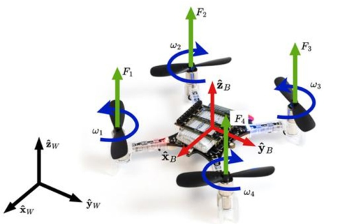 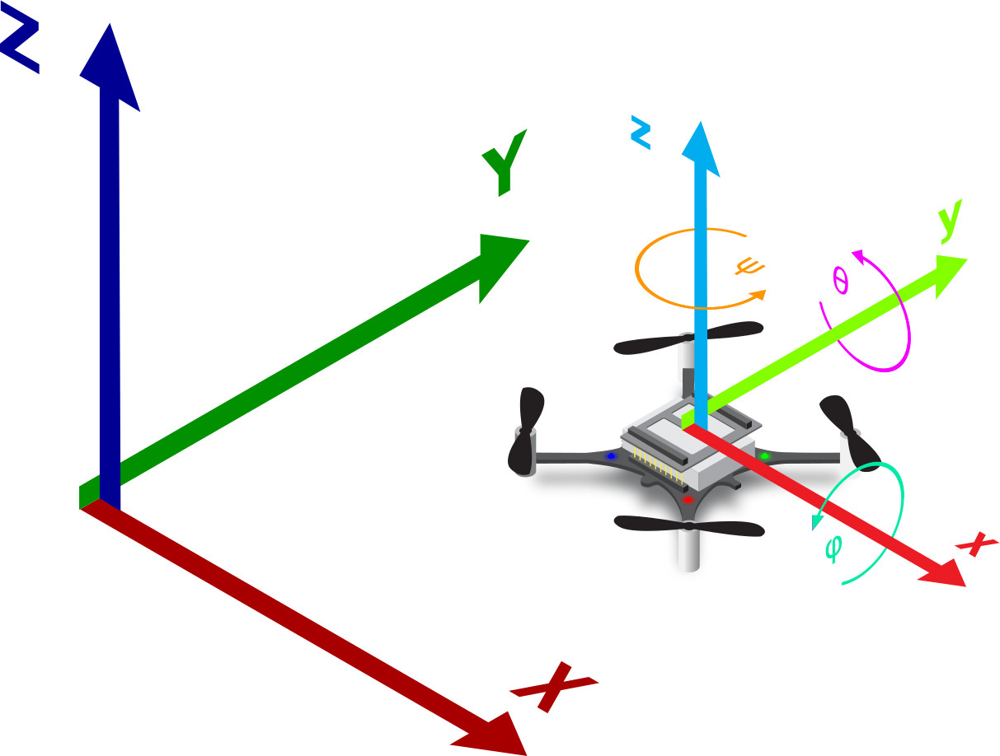

*Hangar mocap frame (+X across the floor, Z up; origin cross close-up on the right):*

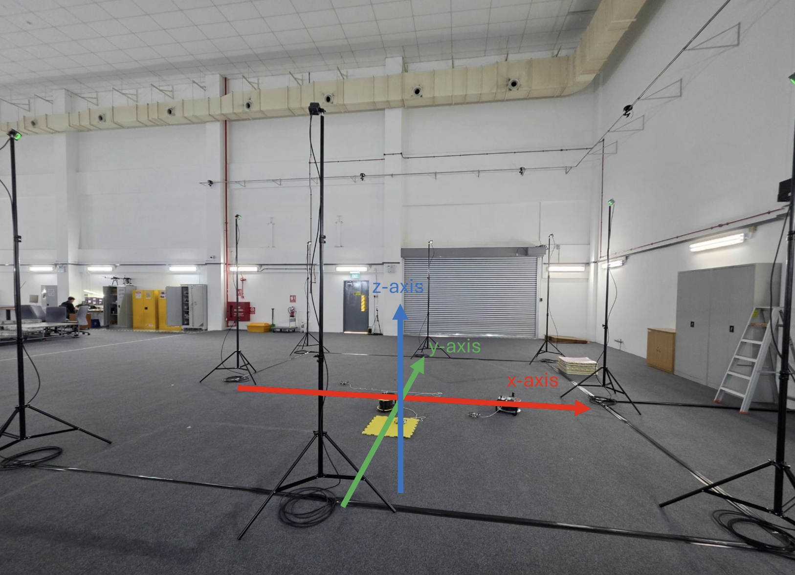 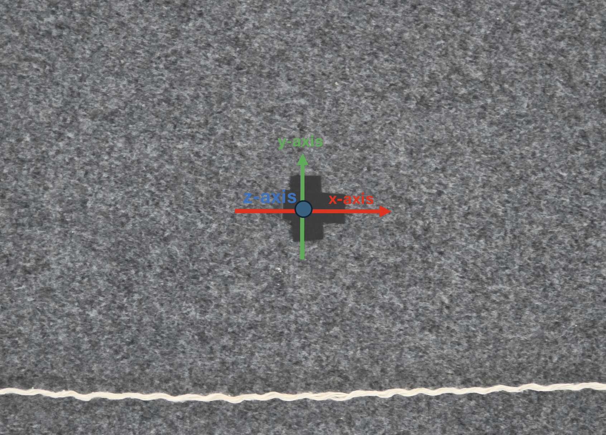

## Emergency stop (E-STOP) demo

Every drone has an **E-STOP** button in the preflight GUI (and the `e` key) that
cuts motors instantly; **E-STOP (all)** kills the whole swarm at once. Know where
it is before you arm anything. Short demo:

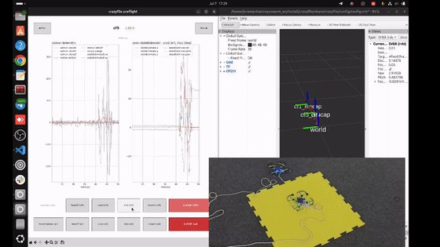

## Config files at a glance

The three config screenshots the checklist links to — what "correct" looks like
before you launch.

*`crazyflies.yaml` — the `robots:` section. Each drone has its own block with a
per-drone `enabled: true/false` flag; only enabled drones are picked up by the
server and the preflight GUI:*

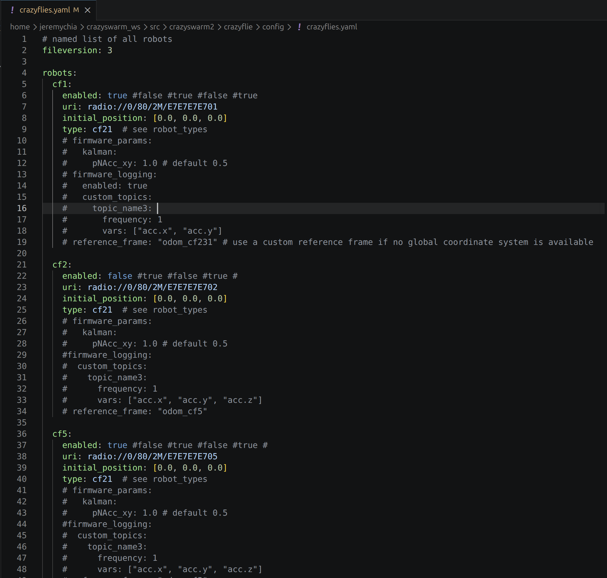

*`crazyflies.yaml` — the `all: firmware_logging:` block. `kalman_preflight` is the
active custom topic; the other `custom_topics` sit commented out, ready to enable
(each log block is capped at 26 bytes of variables):*

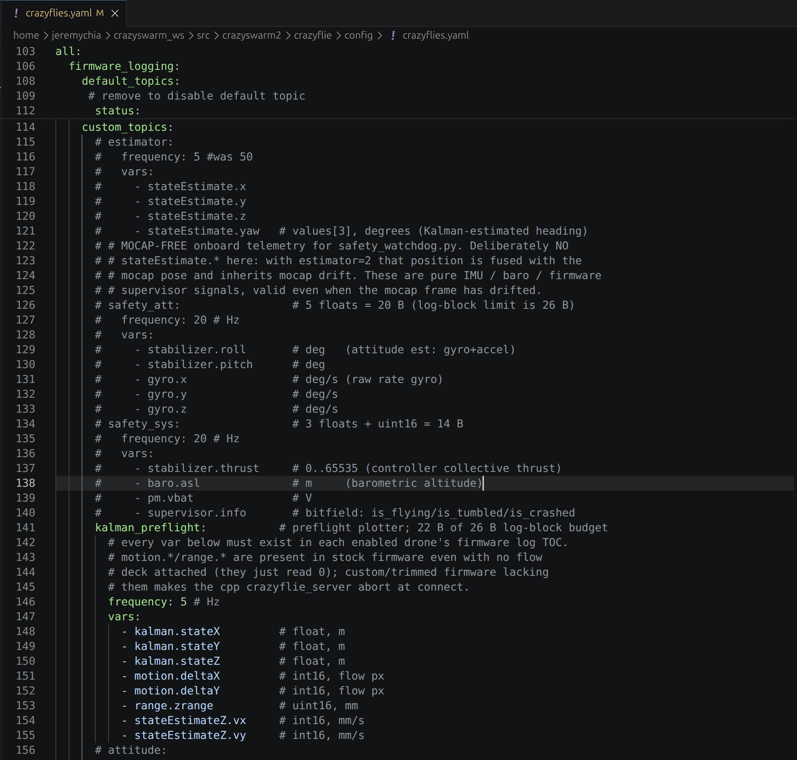

*`motion_capture.yaml` — `hostname` (Motive PC IP), `topics.frame_id` (`world`),
`topics.tf.child_frame_id` (`{}_mocap`) and the poses QoS `deadline` Hz, which
must match the camera frame rate set in Motive. The `hostname` and `type` values
in the screenshot are illustrative — use your rig's current values per
[mocap.md section 5](mocap.md#5-networking-mocap-over-a-router-lab-setup):*

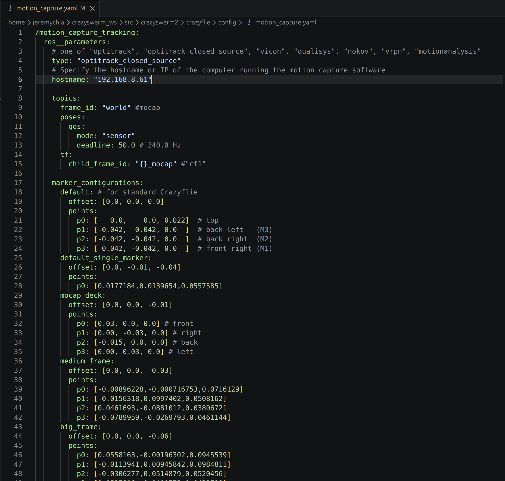

## Reading the GUI

Clear the drone against these before arming:

| Check | Where | Healthy | Go / no-go |
|-------|-------|---------|-----------|
| **Battery** | header voltage | **green > 3.8 V** | **orange 3.7–3.8 V** = fly but land soon; **red < 3.7 V** = **NO-FLY** (charge/swap). `(charging)` = NO-FLY until unplugged. |
| **Mocap rate** | connectivity → `mocap [Hz]` | flat **~50 Hz** | sagging or decaying toward 0 = mocap dying → **NO-FLY** |
| **Radio** | connectivity → `rssi` / `latency` | rssi steady, latency low & flat | erratic / climbing latency = saturated radio (lower logging/mocap rate) |
| **Orientation** | error panel → dashed `err.yaw` + red banner | **\|err.yaw\| ≤ 5°** | 5–15° **fix first**; **> 20° NO-FLY**; the red *"MOCAP ORIENTATION MISALIGNED"* banner fires above 10° |
| **Estimator fusion** | error panel → `err.x/y/z/norm` | small & steady (~mm) | diverging = Kalman not fusing mocap → **NO-FLY** |

> **Don't be reassured by tiny position error.** `locSrv.extPosStdDev` force-fuses
> mocap position, so `err.x/y/z` stays ~1 mm *even when the rigid body is defined
> rotated* — that offset is invisible at rest but becomes a **fly-away** in the
> air. The orientation error (`err.yaw`) and the banner are what catch it. Press
> **`r`** to reset the Kalman filter (all drones); **`e`** is E-STOP.

**Healthy preflight (Flow deck fitted).** All four panels steady, `mocap ~50 Hz`,
`err.yaw` ≈ a couple of degrees. Battery here is 3.71 V (orange) — flyable, but
plan to land and swap soon.

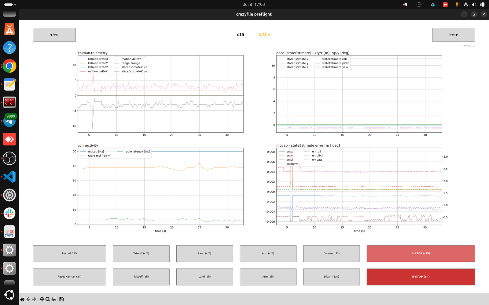

**Healthy preflight (no Flow deck).** With no Flow deck the flow/range channels
(`motion.deltaX/Y`, `range.zrange`, `stateEstimateZ.vx/vy`) sit flat or noisy —
**this is expected, not a fault.** Judge such a drone on mocap, battery and yaw.

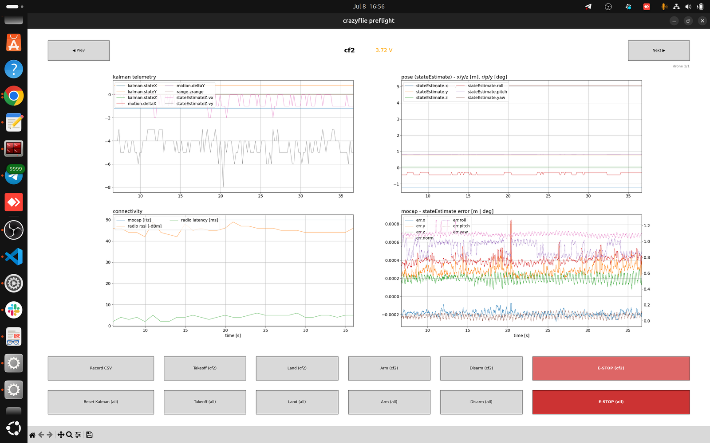

**Warning-band battery.** 3.72 V shows orange: still flyable, but you're near the
warning threshold — do a short flight and recharge.

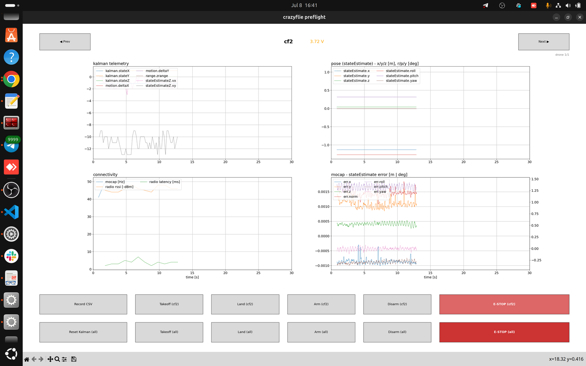

**NO-FLY — orientation misaligned + low battery.** The red banner reads
*"MOCAP ORIENTATION MISALIGNED: cf2 (yaw 18°)"*, `err.yaw` (dashed) climbs toward
15°, and RViz (right) shows the `cf2_mocap` axes visibly rotated. Battery is
3.64 V (red). Do **not** fly: recreate the Motive rigid body with the drone's
forward axis on global **+X** ([mocap.md](mocap.md#2-defining-rigid-bodies))
and charge the pack.

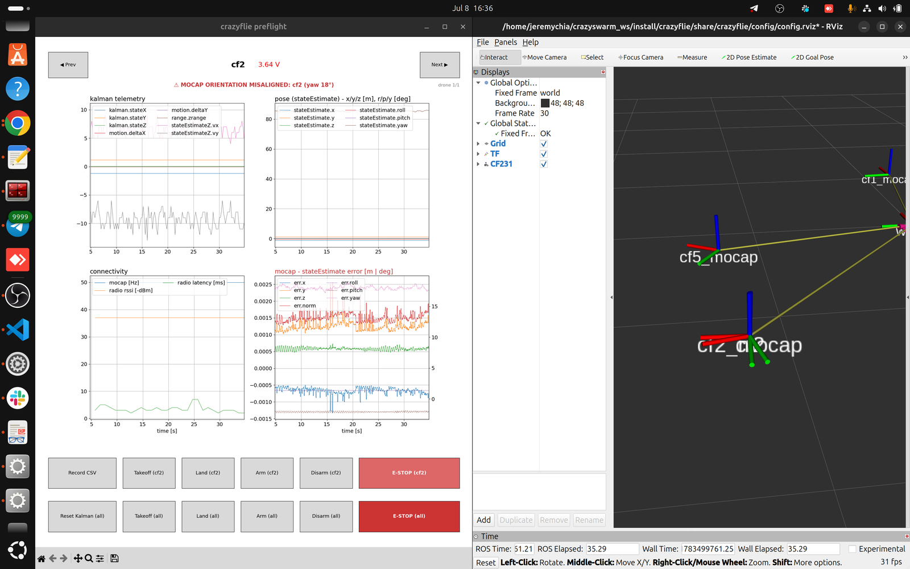

## What a flight looks like

During takeoff/hover/land the kalman, pose and error panels show real motion —
transient swings and error spikes while the drone moves — then settle back when
it lands. **`mocap [Hz]` should stay pinned at ~50 Hz the whole time**; a drop
mid-flight is the mocap failure that triggers an emergency land. Note the battery
sags under load (3.68 V, red, after the flight below):

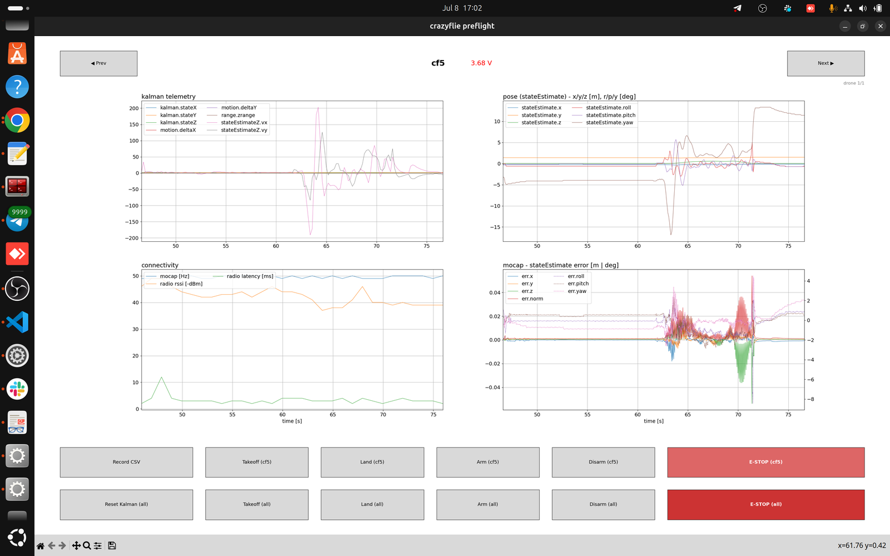

## What you see

- **Header** — big drone name + battery voltage, color-coded to the
  `crazyflies.yaml` thresholds (green > 3.8 V, orange 3.7–3.8 V, red < 3.7 V),
  plus `(charging)` / `ARMED` flags. Cycle drones with the ◀ Prev / Next ▶
  buttons or the left/right arrow keys (wrap-around; a `drone 2/3` indicator
  shows where you are). Only drones with `enabled: true` in `crazyflies.yaml`
  appear (`--config <path>` points the script at a different yaml; if the yaml
  can't be read it accepts everything and prints a warning).
- **2×2 plots**:
  1. **kalman telemetry** — 8 firmware vars from the `kalman_preflight` custom
     log topic (`kalman.stateX/Y/Z`, `motion.deltaX/Y`, `range.zrange`,
     `stateEstimateZ.vx/vy`), in raw firmware units.
  2. **pose** — stateEstimate x/y/z [m] and roll/pitch/yaw [deg] from
     `/<cf>/pose`.
  3. **connectivity** — mocap arrival rate [Hz] of this drone's entry in
     `/poses` (decays to 0 within ~1 s when mocap dies — that is the "mocap
     died" tell), plus radio RSSI and latency from `/<cf>/status`.
  4. **mocap − stateEstimate error** — position err.x/y/z/norm [m] as solid
     lines (left axis), orientation err.roll/pitch/yaw [deg] as dashed lines
     (right axis, wrapped to ±180°).

## The orientation warning (read this)

A red banner like `⚠ MOCAP ORIENTATION MISALIGNED: cf2 (yaw 150°)` appears when
**any** enabled drone — not just the one displayed — has a fresh orientation
error over 10° (`ORIENT_WARN_DEG` in the script; samples older than
`ERR_STALE_S` = 3 s are ignored). The error-panel title also turns red when the
displayed drone is the offender.

Why this matters: `locSrv.extPosStdDev = 1e-3` force-fuses the mocap
**position** into the onboard Kalman, so position error is always ~1 mm even
when the Motive rigid body was defined rotated. A yaw offset is invisible in
position at rest — and causes a fly-away in flight. `err.yaw ≈ 0` means the
rigid body is aligned with the drone's forward axis (see
[mocap.md section 2](mocap.md#2-defining-rigid-bodies) for the rule when creating it).

Go/no-go: within **±5°** fly; **5–15°** fix the rigid body first; **> 20°** do
not fly.

## Buttons and keys

Two rows of buttons. The **upper row** acts on the selected drone only, via its
per-drone services:

> Record CSV | Takeoff (cfX) | Land (cfX) | Arm (cfX) | Disarm (cfX) | E-STOP (cfX)

The **lower row** broadcasts to all drones:

> Reset Kalman (all) — sets `all.params.kalman.resetEstimation` 1→0 |
> Takeoff (all) | Land (all) | Arm (all) | Disarm (all) | E-STOP (all)

Keys: `r` = reset kalman, `e` = **broadcast** e-stop (deliberately broadcast —
the panic key stops everything). Takeoff/land have **no** key bindings on
purpose. The takeoff/land setpoints are constants at the top of the script
(0.5 m over 3 s up, 0.03 m over 3 s down).

## Record CSV

**Record CSV** snapshots **every** enabled drone at 10 Hz to
`~/crazyswarm_ws/preflight_logs/preflight_<YYYYmmdd-HHMMSS>.csv` — 33 columns:
t, drone, mocap x/y/z, estimate x/y/z/rpy, err x/y/z/norm/roll/pitch/yaw, the 8
`kal_*` vars, rssi, latency_ms, mocap_hz, battery_v, pm_state,
supervisor_info. Missing values stay blank. The button shows a live row count
while recording, and the file is flushed every tick.
