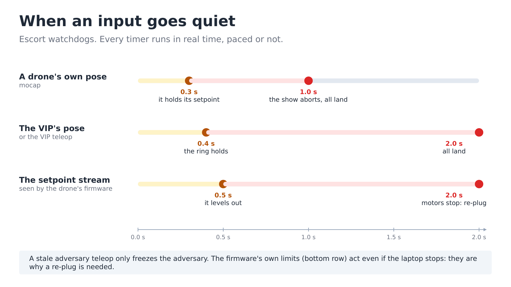

# Escort: operator reference

Every command, setting and number on one page, for an operator who has done
[run.md](../run.md) once. Why it is this way: [theory.md](theory.md); when and how it got
here: [design-notes.md](design-notes.md).

---

## 0. Ground checks: no radio, no mocap, no drones

```bash
ros2 run crazyflie_shows plan_escort              # must not end "REFUSED"
ros2 run crazyflie_shows plan_escort --marks      # must end "MARKS OK"
ros2 run crazyflie_shows plan_escort --sweep      # fastest VIP walk that still clears
ros2 run crazyflie_shows plan_escort --scripted   # the same check against the fixed script
ros2 run crazyflie_shows plan_escort --plot /tmp/escort.png
```

`plan_escort` verifies the *same* objects the flight commands, so a pass means something.
With the shipped numbers it ends "OK - static and walking cases both clear" against the
reactive attacker, and "static case OK; the walking case is NOT cleared" with
`--scripted`. `--sweep` clears 0.20 m/s with either attacker. Both are expected: brief the
pilot to **hold the DJI still while the attacker is pressing**
([design-notes.md, item 1](design-notes.md#decisions-still-open)).

## 1. Place the drones and sync

Mocap and the GUIs, **no server**: nothing owns the radio, nothing can arm.

```bash
ros2 launch crazyflie launch.py server:=False
python3 scripts/place_drones.py          # marks in RViz on /escort/marks
python3 scripts/sync_initial_positions.py
ros2 run crazyflie_shows plan_escort --marks     # re-check: "MARKS OK"
```

`place_drones.py` re-reads the config while running, so edits move the marks without a
restart. Stand each drone on its mark (green at 10 cm), then sync: the yaml must record
where the drones **are**, not where they were meant to go.

What `--marks` lays out, and why:

- **The VIP mark is fixed, not inferred from the fleet**: room centre plus `vip_offset`
  from `EscortConfig`. Syncing moves the drones in the plan, never the mark, so place
  the drones around the mark.
- **Defenders stand on the ring they will hold** (`ring_radius` from the mark, 120 degrees
  apart). The gather is then a lift, and the slot assignment by bearing is unambiguous;
  drones bunched in a corner share a bearing.
- **The attacker starts beyond `ring_radius + min_adv_sep`** (1.80 m; the mark is 0.3 m
  further out still), on its entry bearing. Closer, it starts inside the ring and its
  first leg crosses the defenders.
- **Everything stays inside the arena and at least 1 m apart**: the sync tool refuses
  closer marks, and `--marks` picks the ring phase that keeps the ring furthest from the
  walls (it prints how far the ring reaches).

Marks move whenever `ring_radius` or `vip_offset` changes, or Motive is recalibrated:
**print them, never copy them from prose.**

## 2. Scan, then launch

```bash
./scripts/scan_fleet.sh          # every enabled drone must say GO
ros2 launch crazyflie launch.py
```

Then the preflight GUI ([flight day 4](../../02-flight-day.md#4-preflight-go--no-go)).

## 3. Fly

```bash
# rehearsal: prints the plan, arms nothing
ros2 run crazyflie_shows escort_show --ros-args -p dry_run:=true

# the show, operator-paced (recommended)
ros2 run crazyflie_shows escort_show --ros-args \
    -p vip_mode:=point -p adversary:=reactive -p paced:=true
```

In **sim**, add `-p use_sim_time:=true` to this *and* to any teleop. On hardware, never.

**Paced** (`paced:=true`): arming and every attacker leg wait for Enter, and `q` lands.
Each press announces what the attacker does next (`leg 2/3 STARTED: ATTACK - it finds
its own way in`), and the show says when a phase is COMPLETE (for the reactive attack:
when it stands down). Input is read as a line, so it works from a plain terminal and from
the console's stdin box. Pacing holds only the attacker: show time, the ring, every
clamp and every watchdog keep running. **Unpaced**, `duration` bounds the run and the
reactive attacker advances a phase every 40/3 s.

**From the console:** Dashboard → Missions → **Escort demo** opens the escort's own
window ([console.md](../../rig/console.md)). Its defaults ARE the paced command above;
every gate is a button (Continue = Enter, Land now = `q`), the VIP / adversary keyboard
starts with it and stays locked until `ESCORT LIVE`, the simulation clock follows the
running stack, and **Abort & land** is one Ctrl-C.

**A DJI as the VIP** needs no config: `/poses` carries every rigid body Motive reports (the
driver publishes `mocap->rigidBodies()`, not only the drones in `crazyflies.yaml`). Build
the body in Motive with asymmetric markers and pass `-p vip_mode:=mocap -p
vip_name:=<name>`. The ring then rides `vip_height_offset` above the DJI; if the pilot
leaves the altitude band, the defenders stay inside it and the gap is reported, not
chased.

**In the simulator:**

- **Restart `ros2 launch` between runs.** `crazyflie_sim` does not implement
  `notifySetpointsStop`, so a drone that was streamed stays in low-level mode, and the next
  run's gather `goTo` kills the sim server (`ValueError: goTo from low-level modes not yet
  supported`, only in the launch log). It looks like the escort hanging at "gathering onto
  the ring". Hardware does not have this problem.
- **The pose path is not exercised.** The sim publishes no `/poses` and
  `cf.get_position()` returns `[0, 0, 0]`, so both trust checks fire on every run and say
  so (`live pose [0.0, 0.0, 0.0] is not near its slot ... seeding from the slot instead`,
  `ignoring the live pose of cf1, cf3 -- too far from what was commanded to be
  believable`). Sim verifies geometry, sequencing and clamps; reading real poses is first
  exercised on hardware.

## Arguments: all of them, with defaults

```
dry_run           false      verify and report, then exit
paced             false      Enter gates arming AND every leg; 'q' lands
check_placement   true       compare live pose to initial_position
placement_tol     0.25   m   how far off that may be
lights            true*      LED cues (*forced off under use_sim_time)
duration          <script>   s, unpaced only; the script's own length for
                             adversary:=scripted, else 120
use_sim_time      false      REQUIRED in sim, NEVER on hardware

vip_mode          point      point | mocap | manual
vip_point         <mark>     m, static VIP; default room centre + vip_offset
vip_name          operator   rigid body to escort      (vip_mode:=mocap)
vip_airborne      <auto>     default true only when vip_mode:=mocap
adversary         reactive   reactive | scripted | external | manual | none
adversary_name    adv        its rigid body            (adversary:=external)
defenders         ''         e.g. cf1,cf2,cf3 -- comma-separated STRING (an empty
                             list default would be typed BYTE_ARRAY and reject
                             names); default = the 3 enabled drones nearest the VIP mark
adversary_drone   ''         which drone attacks; default = the enabled drone
                             farthest from the VIP mark

# EscortConfig overrides -- each re-verified before takeoff, refused if it
# does not check out
ring_radius       1.0    m   also sets the chord the closing wall uses
height            1.2    m
v_max             0.6    m/s
phase_rate        0.3    rad/s
alert_radius      2.10   m   adversary-to-VIP distance that ENGAGES blocking
release_radius    2.22   m   the larger one that disengages
min_vip_dist      1.0    m   hard floor, defender to VIP (= ring_radius)
rate_hz           20.0       setpoint stream rate per drone
vip_height_offset 0.3    m   ring altitude relative to an airborne VIP
```

`probe < alert < release < retreat` must hold; `plan_escort` refuses if it does not, so
run it after changing either radius. Overriding `defenders` or `adversary_drone`: dry-run
first, because an override is how an attacker ends up parked inside the ring.

## Teleop (no DJI, nobody in the room)

Separate terminal, **needs a real TTY**, or the mission window, where choosing VIP
`manual` / adversary `manual` starts the teleop for you with a key pad. It publishes a
virtual target and commands no drone.

```bash
# you drive the attacker, VIP is a fixed point
ros2 run crazyflie_shows escort_show   --ros-args -p vip_mode:=point -p adversary:=manual
ros2 run crazyflie_shows escort_teleop --ros-args -p target:=adversary

# you drive the VIP (DJI stand-in), attacker runs its proven script
ros2 run crazyflie_shows escort_show   --ros-args -p vip_mode:=manual -p adversary:=scripted
ros2 run crazyflie_shows escort_teleop --ros-args -p target:=vip
```

`wasd`/arrows in plan view (as `plan_escort --plot` draws it: x right, y up), `q`/`e`
altitude (adversary only), space stop, `c` re-centre, `x` quit. Hold the key: the terminal
has no key-release event, so velocity decays `key_timeout` (0.35 s) after the last
keystroke.

**Start the teleop, then touch nothing until `ESCORT LIVE` appears.** The show reads the
target before takeoff and checks the gather against it; a target already moving makes the
gather refuse (`gather legs close to 0.00 m`) and land.

- **A VIP target moves at `escort.max_vip_speed`** (0.30 m/s), the budget the ring has
  after turning. Faster is a fine test **on purpose** (`-p speed:=...`), and misleading by
  accident.
- **The show refuses to arm until the teleop is publishing.**
- **A stale target counts as a lost body** (below), so closing the teleop is a legitimate
  way to end a test.
- **The teleop clamps to the arena itself**, so what you steer is what the show will try
  to fly.

## Lights

Colours are the `LED_*` constants in `escort_show.py`; the legend is in
[how-it-works.md](../how-it-works.md#what-the-lights-mean). Cyan is reserved for the
geofence hold. Cues are sent after motion commands, can never stop the show, and are off
under `use_sim_time`.

## Numbers

```
ring            3 defenders, 1.00 m radius, 120 deg apart (1.73 m gaps), 1.20 m up
                (+0.30 m above the DJI when it is airborne)
wall            wings close to 58 deg either side of the blocker (0.97 m apart)
slot order      by bearing, fixed at the gather; the nearest slot blocks
ring turn       0.30 rad/s at rest, 0.55 rad/s while blocking
speeds          defenders capped at 0.60 m/s and 1.0 m/s^2; the attacker plans at
                0.80 m/s but its setpoint goes through the same guard, so it FLIES at
                0.60 m/s at most
engagement      starts at 2.10 m (attacker to VIP), releases at 2.22 m
separations     0.80 m defender-defender, 1.00 m defender-to-VIP; the attacker keeps
                0.80 m off every defender; a defender yields only inside 0.70 m
break-even      ~0.99 m/s attacker speed (0.55 rad/s x ~1.8 m)
VIP speed       budget 0.30 m/s at rest, 0.05 m/s while blocking; --sweep clears
                0.20 m/s with both attackers -- still hover during the attack
geofence        the VIP must stay at least ring_radius (1.00 m) inside the room's
                NEAREST edge (the arena.yaml polygon less its tracking margin), or the
                ring HOLDS and all three defenders go CYAN. It resumes once the VIP is
                0.25 m further in AND inside the parked ring: fly it to the MIDDLE,
                not just back in.
room            arena.yaml polygon less its tracking margin; ceiling 1.85 m
rates           /poses 50 Hz in, setpoints 20 Hz per drone, one radio

MARKS AND THE ARENA CENTRE ARE NOT WRITTEN HERE ON PURPOSE. Print them:
    ros2 run crazyflie_shows plan_escort --marks
Copies in prose went wrong when the frame rotated on 2026-10-08 and still LOOKED
plausible, which is how a drone gets stood on the wrong mark.
```

Anything not here: `plan_escort`, or the banner `escort_show` prints before it arms. Both
read the live config.

## When an input goes quiet



Parameters: `self_stale_s` 0.3 s, `self_stale_land_s` 1.0 s, `vip_stale_hold_s` 0.4 s, `vip_stale_land_s` 2.0 s (the VIP teleop uses the same two).

Containment also aborts the show when a drone's measured pose passes the room edge by
`contain_margin` (0.25 m), or stays `track_error_m` (0.60 m) off its command for
`track_error_s` (0.8 s).

## Reviewing a run against the video

Every line the show prints carries show time **and** wall clock, and the `ESCORT LIVE`
banner prints `t0`, so `t+` converts to a timecode. On exit, aborts included, the show
prints the table to lay against the recording:

```
  GEOFENCE EPISODES (2)
    #   show time   wall clock   held
    1   t+  12.3s   14:32:07       6.4 s
    2   t+  48.9s   14:32:44      10.2 s
    the defenders were CYAN for exactly these windows
```

For an independent check, run the monitor in a second terminal. It subscribes only and
commands nothing, and recomputes the fence from `/poses` alone, so its timeline can be
diffed against the show's:

```bash
python3 scripts/watch_escort.py --log ~/escort-$(date +%F-%H%M).jsonl
```

It reports mocap gaps per body (the DJI included), distance to the clamp, containment and
lost-tracking limits, commanded versus actual position, the minimum pair separation and any
defender at or below the DJI's altitude. It prints its own hold table at exit, and the
JSONL carries `wall` and `clock` on every entry. Flight logs in general:
[flight-logs.md](../../rig/flight-logs.md).

## Abort

| Situation | Do |
|---|---|
| paced, between legs | `q` + Enter: lands normally |
| running, any time | **Ctrl-C lands** (it takes SIGINT back from rclpy) |
| drone misbehaving | E-STOP (`e` in the preflight GUI, or `ros2 service call /all/emergency std_srvs/srv/Empty '{}'`). Costs a battery re-plug on every drone. |
