# Escort: theory and design

The idea behind each algorithm, and why each design decision was taken. The plain version
is [escort/how-it-works.md](../how-it-works.md); this page adds the maths. For live
numbers, run `ros2 run crazyflie_shows plan_escort`; the dated history is in
[design-notes.md](design-notes.md).

The plots are computed by calling the real escort code
([`escort_figures.py`](escort_figures.py)), so they show what flies. The block diagrams are
in [`strike-and-guard-diagrams.pptx`](../../diagrams/strike-and-guard-diagrams.pptx).

---

## Notation

Values are the shipped `EscortConfig` defaults.

| Symbol | Meaning | Value |
|---|---|---|
| $p_{\text{VIP}}$ | position of the VIP (the DJI), from mocap | measured |
| $p_k^{\ast}$ | target position of slot $k$ on the ring (horizontal) | computed |
| $k$ | slot index | $0, 1, 2$ |
| $R$ | ring radius: horizontal distance from the VIP to each slot | 1.0 m |
| $\psi$ | ring phase: the one angle that rotates the whole ring | chosen by the controller |
| $\psi^{\ast}$ | phase target: puts the blocker's slot on the threat bearing (or the current phase, when clear) | computed |
| $\theta_k$ | angular offset of slot $k$ from $\psi$ | 0°, 120°, 240° at rest |
| $\beta_k$ | measured bearing of drone $k$ around the VIP | measured |
| $\alpha$ | wall half-angle: angle between the blocker and each wing when closed | 58° |
| $\omega$ | ring turn rate (rate limit on $\psi$) | 0.30 rad/s at rest, 0.55 rad/s blocking |
| $\Delta t$ | control period | 0.05 s (20 Hz) |
| $v_k$ | velocity of slot $k$ | computed |
| $v_{\text{VIP}}$ | velocity of the VIP | estimated (low-pass filtered) |
| $\hat t_k$ | unit tangent to the ring at slot $k$ | geometric |
| $v_{\max}$ | speed cap on every defender setpoint (and the flown attacker) | 0.60 m/s |
| $p,\ c,\ d$ | a setpoint, the centre of a keep-out disc, and that disc's radius | see §5.2 |
| $\sigma$ | fraction of the way along a gather leg, 0 (start) to 1 (end) | $0 \ldots 1$ |
| $d_0,\ \Delta$ | relative position of two drones at the start of a leg, and its change over the leg ($d_1 - d_0$) | computed |
| $k_a,\ k_r$ | attacker's attraction and repulsion gains | 1.0, 3.5 |
| $b$ | approach band: distance over which the attraction fades out | 0.60 m |
| $\rho$ | repulsion range around each defender | 1.70 m |
| $v^{\text{att}}_{\max}$ | attacker *planner* speed cap (the flown drone is capped at $v_{\max}$) | 0.80 m/s |
| $r_{\text{att}}$ | attacker's distance from the VIP while held outside the ring | about 1.8 m |
| $\omega_{\text{att}},\ \omega_{\text{ring}}$ | angular rate of the attacker, and of the ring, about the VIP | computed |
| $\mathrm{clamp}(x, lo, hi)$ | limit $x$ to $[lo, hi]$ | |
| $\mathrm{wrap}(\cdot)$ | wrap an angle into $(-\pi, \pi]$: the short way round | |
| $(x)_{+}$ | $\max(x, 0)$ | |
| $\lVert\cdot\rVert$ | length of a vector (horizontal plane) | |

---

## 1. The problem, in one picture

Three small drones keep a moving, hand-flown VIP protected from a fourth drone. Two facts
constrain everything:

* **Nothing can sense anything.** Positions come only from motion capture, so the system
  is **centralised**: one laptop knows every position and decides for every drone.
* **Nothing can avoid anything.** Crazyflies have no onboard collision avoidance, so
  **every safety property is enforced in the commands** before they leave the laptop.

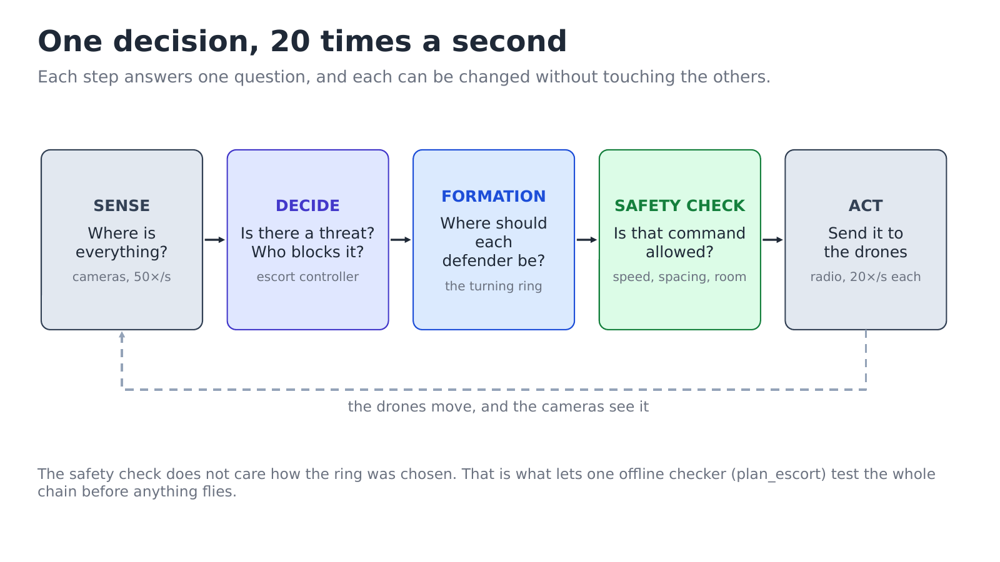

This separation into layers is the main architectural decision.

---

## 2. System architecture

### 2.1 Who computes what

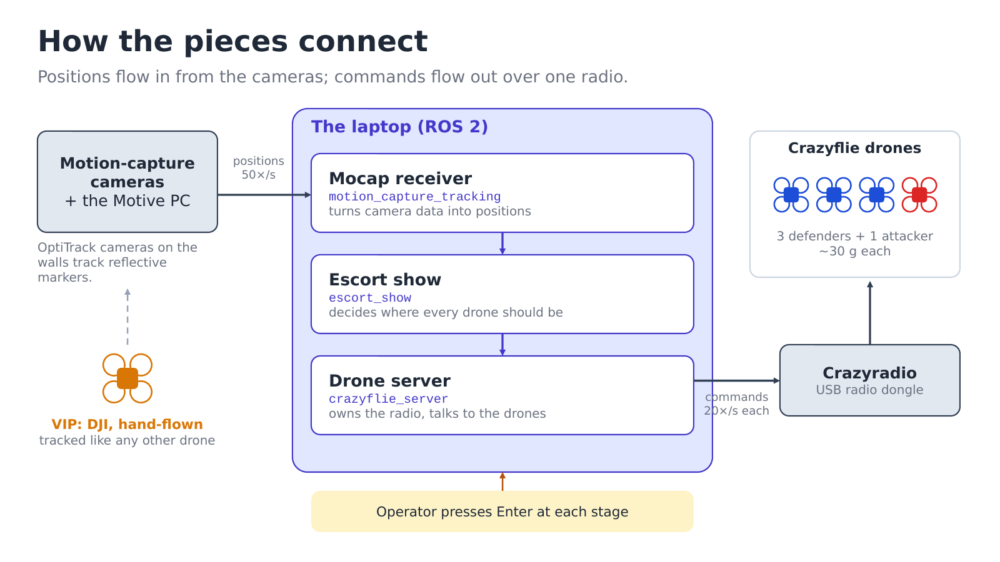

### 2.2 A cascade of control loops on separate time scales

Classic **cascaded control with time-scale separation**: each outer loop is slow enough to
treat the loop inside it as "a drone that goes where it is told, with some lag".

| Loop | Runs on | Rate | Decides |
|---|---|---|---|
| Escort controller | laptop | 20 Hz | WHERE each drone should be |
| Position controller | drone | ~500 Hz | thrust and attitude |
| Attitude controller | drone | ~500 Hz | motor speeds |

Mocap positions (50 Hz) are fused into each drone's onboard estimator. The escort never
commands attitude, only a **position target** plus a velocity feedforward, which is why
the offline verifier can model each drone as a first-order lag.

### 2.3 Two command modes, and the switch between them

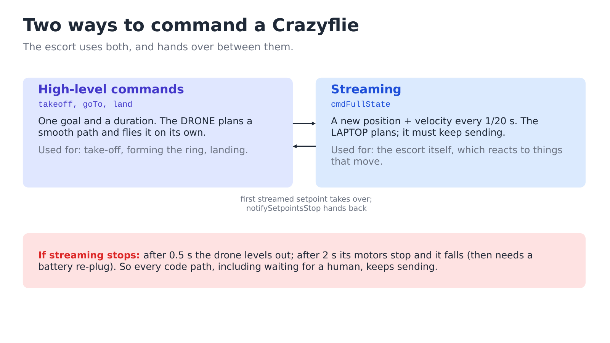

High-level legs are smooth 7th-order polynomials planned on the drone. The firmware
arbitrates by **priority**: a streamed setpoint outranks the onboard planner.
`notifySetpointsStop` hands control back and also tells the planner where the drone
*really* is, so the landing starts from the right place. Once a drone streams, every code
path must keep feeding it, including while the show waits on a human (§7).

### 2.4 One control tick, end to end

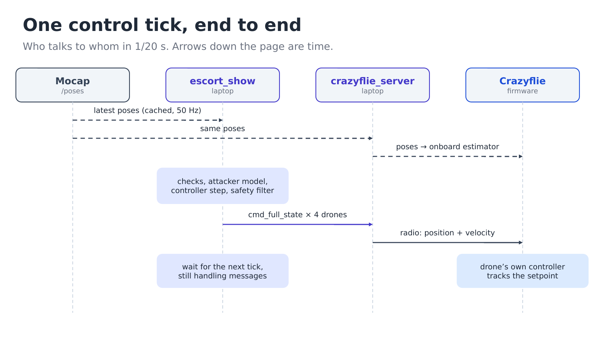

---

## 3. The formation: a ring that turns, not drones that swap

### 3.1 The formation as a virtual rigid body

The ring is a **virtual structure** (Lewis & Tan, 1997): one rigid body with a few
parameters, each drone tracking its own point on it:

$$
p_k^{\ast} = p_{\text{VIP}} + R\begin{bmatrix}\cos(\psi + \theta_k)\\ \sin(\psi + \theta_k)\end{bmatrix},
\qquad \theta_k = \tfrac{2\pi k}{3}\ \text{(at rest)}
$$

Altitude is set separately; $\theta_k$ is pulled toward the blocker when the wall closes
(§3.4). The formation has **three degrees of freedom**: the centre (the VIP's position,
*given*) and one angle $\psi$ (*chosen*). Controlling one angle instead of three drones
keeps the decision logic small enough to reason about.

The ring follows circular-formation-around-a-leader work
([sources](design-notes.md#what-the-sources-support-and-what-is-ours)) minus its potential
fields: with mocap every position is known exactly, so a direct slot target plus a
saturated tracking law does the same job with nothing to tune.

### 3.2 Why rotate instead of reassigning

The textbook way to put a defender in front of the threat is **reassignment** (e.g. the
Hungarian algorithm). Here it would make drones cross paths next to the VIP:

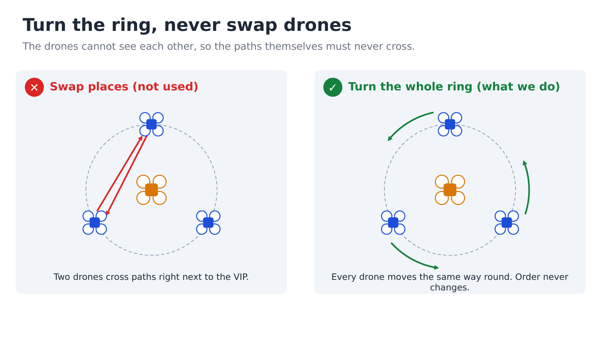

**The invariant:** slot order is fixed once, at the gather, from the drones' bearings
around the VIP (counter-clockwise). Rotation preserves cyclic order, and two drones' angular
separation is constant, so they can never pass each other. Only their *distance* needs
watching (§5).

The initial phase is the **circular mean** of each drone's bearing minus its slot angle:
the $\psi$ that maximises $\sum_k \cos(\beta_k - \theta_k - \psi)$, i.e. the least total
turning to reach the slots.

### 3.3 Which defender blocks: nearest slot, with hysteresis

The blocker is **whichever slot is already nearest the threat bearing**. Three slots 120°
apart put every bearing within 60° of some slot, so:

> **The ring never has to turn more than 180°/n = 60°** to put a defender on the threat.

Always using "slot 0" would sometimes need a 180° turn, which no drone flies in time. The
choice is re-evaluated every tick, but another slot takes over only when it is better **by a
margin** (hysteresis); otherwise a threat midway between two slots would flip the blocker
every tick. The blocker stays on the ring: it does not pursue.

### 3.4 The wall: blending, never switching

Once engaged, the wings leave their 120° posts and close up beside the blocker (right panel
above).

* The transition is a **homotopy**: a scalar `close ∈ [0,1]` ramps over a few seconds and
  each wing's angle blends from rest to its wall post. An instant switch would make the
  targets jump, and a target jump is a drone commanded at maximum speed.
* The blend goes along the **shortest arc**. Interpolating the raw angle values once sent a
  wing the long way round, straight through the blocker's post.
* **The separation floor limits the wall.** The blocker–wing distance is the chord
  $2R\sin(\alpha/2)$, so shrinking the ring *forces* the wall to open: two parameters that
  look independent are coupled. Change one, re-run `plan_escort`.

---

## 4. Deciding: when to block, and how fast to turn

### 4.1 The engagement latch is a Schmitt trigger

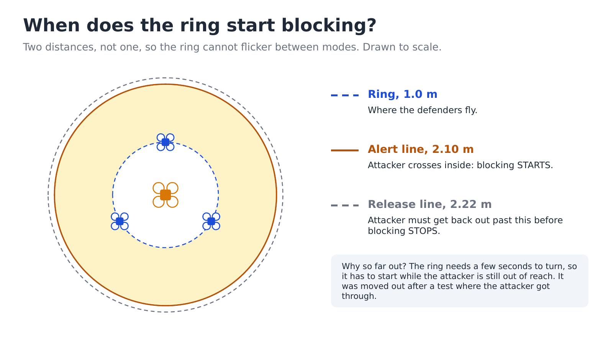

Engaging inside an alert radius and releasing only beyond a larger one is a Schmitt
trigger: the gap absorbs noise, so the mode cannot chatter. **The threshold is a timing
problem, not a geometry problem**: the ring needs seconds to turn, so it must start while
the attacker is out of reach.

On release the ring **holds its current angle**. Winding back to a "home" angle produced a
limit cycle: the attacker retreats, the ring spins home, the attacker returns, the ring
spins out again.

### 4.2 The ring turns at a bounded rate

The phase follows its target through a **slew-rate limiter**, the remaining turn taken the
short way round and cut to $\pm\,\omega\,\Delta t$ per step:

$$
\psi_{t+1} = \psi_t + \mathrm{clamp}\!\big(\mathrm{wrap}(\psi^{\ast} - \psi_t),\ -\omega\,\Delta t,\ +\omega\,\Delta t\big)
$$

This bounds a slot's speed round the ring to $R\omega$, makes the motion readable for an
audience, and makes the ring immune to a target that jumps (a mocap glitch, or the attacker
crossing behind the VIP). The ring turns gently at rest and faster while blocking, because
during an encounter the VIP is meant to hold still and the speed budget (§4.3) is better
spent on turning.

**Prediction was tried and rejected.** Aiming ahead of the attacker by its bearing rate
measured worse: once the blocker is re-selected every tick the ring is already on the
threat, and leading only walks it off. *Re-selecting who blocks beat predicting where the
threat will be.*

### 4.3 The speed budget: the central trade-off

A defender's velocity is following the VIP plus travelling round the ring; by the triangle
inequality the two can at worst add up:

$$
v_k = v_{\text{VIP}} + \omega R\,\hat t_k
\quad\Rightarrow\quad
\lVert v_k\rVert \le \lVert v_{\text{VIP}}\rVert + \omega R \le v_{\max}
\quad\Rightarrow\quad
\lVert v_{\text{VIP}}\rVert \le v_{\max} - \omega R
$$

With the shipped numbers that is $0.60 - 0.30 \times 1.0 = 0.30$ m/s at rest and
$0.60 - 0.55 \times 1.0 = 0.05$ m/s while blocking (ignoring the wings' extra motion while
the wall closes, which only tightens it). Turning and following share one cap: while
blocking almost nothing is left, **which is why the pilot holds the DJI still during an
attack.** The levers are all in the formula: a slower turn (a lazier block), a smaller
ring (less clearance from the VIP), or a higher cap (a safety decision about flying faster
near people):

| Case | $R$ | $\omega$ (rad/s) | $v_{\max}$ (m/s) | VIP budget (m/s) |
|---|---|---|---|---|
| shipped, at rest | 1.0 m | 0.30 | 0.6 | 0.30 |
| slower turn | 1.0 m | 0.15 | 0.6 | 0.45 |
| slower turn, faster drones | 1.0 m | 0.15 | 1.0 | 0.85 |
| ring for a person as the VIP | 1.5 m | 0.30 | 0.6 | 0.15 |

The end-to-end check (every separation held for a whole run) is stricter than this bound;
its current result is in [design-notes.md](design-notes.md#decisions-still-open), item 1.

### 4.4 The controller step, as a flowchart

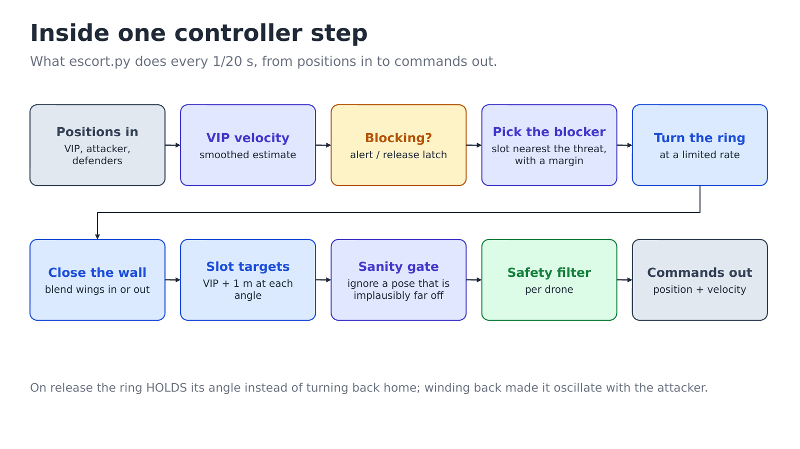

The sanity gate is gating as in target tracking: a measurement wildly inconsistent with
what you expect is more likely bad (a stale pose, a flipped rigid body) than a real event.
A defender pose more than $R$ from its own setpoint is ignored, and the setpoint used.

---

## 5. The safety filter: every setpoint is checked

### 5.1 What it does

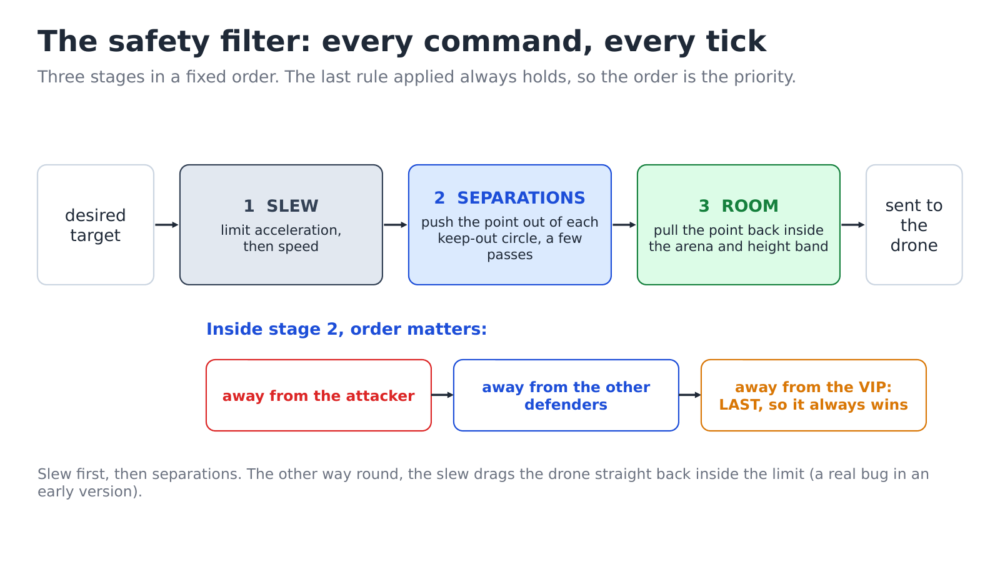

### 5.2 The theory behind it

* **Slewing is a reference governor.** Saturating the change in velocity, then the
  velocity, turns any target sequence into one a double-integrator-like vehicle can follow.
* **Each separation is a projection.** "Stay at least $d$ from $c$" is the outside of a
  disc, and its nearest-point projection is a radial push:
  $p \leftarrow c + d\,\frac{p - c}{\lVert p - c\rVert}$ when $\lVert p - c\rVert < d$.
  The setpoint $p$ moves straight out from the disc centre $c$ (the VIP, the attacker or
  another defender) until it sits exactly $d$ away.
* **Several constraints mean cyclic projection** (alternating projections, POCS). That
  converges for *convex* sets; outside-of-a-disc sets are **not convex**, so there is no
  guarantee. The design uses a **fixed number of passes in a fixed order**, and **the last
  projection always holds**: ending on the VIP makes its separation the one never traded
  away. A *priority ordering*, made explicit.
* **Feasibility is kept by the layer above.** The room clamp runs after the VIP clamp and
  could push a defender back toward the VIP. The **geofence** (§6) prevents that: the ring
  follows the VIP only while the whole ring fits in the arena. Two constraints are
  compatible only if something upstream keeps them so.

### 5.3 Who gives way

Reciprocal methods (e.g. ORCA, van den Berg et al. 2011) split avoidance evenly. Here it
is deliberately **asymmetric**:

| Who | Rule |
|---|---|
| Attacker | owns the separation: projects itself away from every defender |
| Defender | yields only as a last resort, at a tighter floor |

If defenders yield first, the ring can never be an obstacle: an attacker driving straight
in pushed the blocker aside and ended beside the VIP, every separation honoured.

### 5.4 What it is not: a control barrier function

A **CBF** safety filter (Ames et al.) solves a small optimisation each tick for the
minimally changed command that satisfies *all* constraints jointly, with a proof that the
safe set stays invariant. This filter is simpler and cheaper, but a heuristic: the
setpoint-level VIP separation holds by construction, everything else is verified by
simulation (§10), not proven.

---

## 6. Defence in depth: the safety layers in time

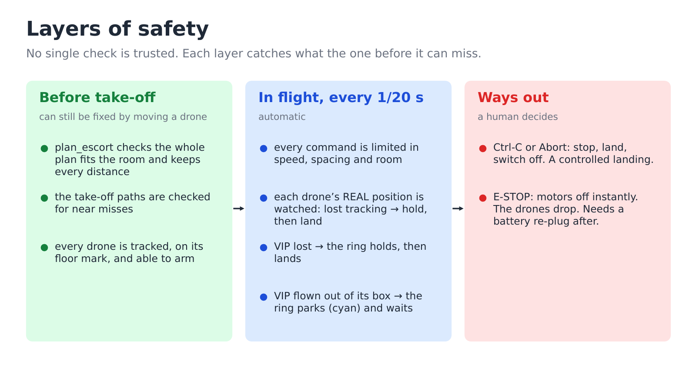

* **Check the plant, not the command.** Clamping a setpoint proves nothing about the
  aircraft: on 2026-10-07 the attacker flew away while its *commanded* point stayed in the
  arena. Containment watches each drone's measured position and its **tracking error**; a
  drone that stops following is the earliest warning, and it shows before the drone leaves
  the room.
* **An exact gather check, because of how goTo works.**
  All drones start the gather together with the same duration, and the onboard planner uses
  the same normalised timing curve for each, so every drone is at the same fraction
  $\sigma(t)$ of its straight leg at every instant. Each pair's relative position is then
  $d_0 + \sigma\Delta$, linear in $\sigma$, and the minimum distance is the closed-form
  **closest point of approach**,
  $\sigma^\ast = \mathrm{clamp}\!\big(-\tfrac{d_0\cdot\Delta}{\lVert\Delta\rVert^2},0,1\big)$,
  giving $\lVert d_0 + \sigma^\ast\Delta\rVert$: *exact*, not sampled.
* **Graceful, ordered responses.**
  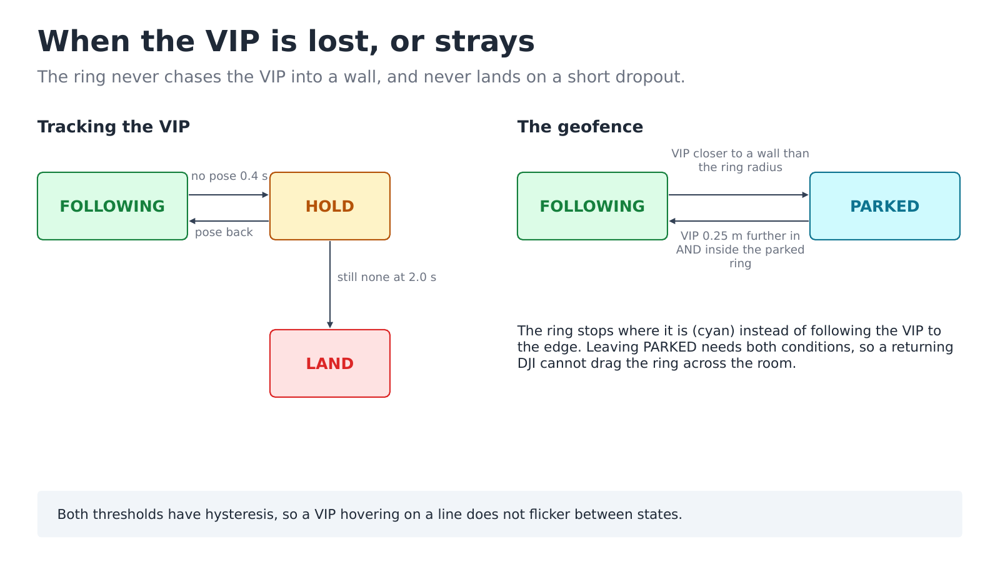

---

## 7. The human in the loop

A run involves an operator, a pilot and autonomous drones; a wall clock would force
everyone to be ready at a moment nobody chose. The show is **operator-paced**: the
attacker waits for the operator, **the defence never waits for anybody**.

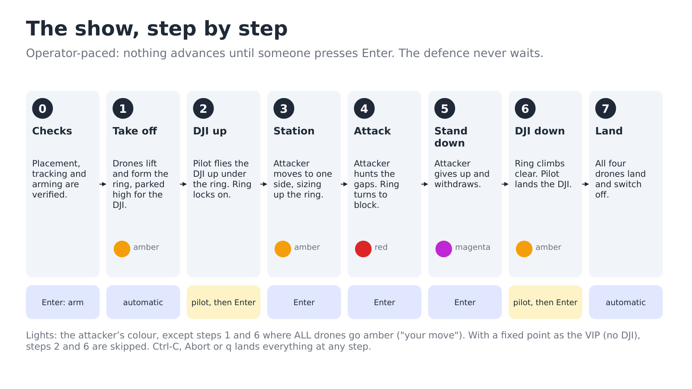

* **First in, last out.** The small drones are up before the DJI and down after it, so the
  large aircraft never manoeuvres past three hovering ones.
* **Above, never below.** While the DJI climbs or descends, the ring is parked high; during
  the escort it rides *above* the DJI, because downwash from a larger aircraft overhead is
  the one geometry a 30 g drone does not survive. Level was tried first and rejected: in
  the same plane, any sideways slip by the pilot becomes a collision.
* **Waiting is not sleeping.** While a gate waits, the full loop keeps running (guards,
  watchdogs, the setpoint stream). A gate that blocked froze the pose timestamps, and the
  operator's reaction time was read as a mocap dropout.
* **Lights carry state:** role and stage, one colour per meaning. When two meanings shared
  a colour, the operator could not tell them apart in flight.

---

## 8. The adversary: a deliberately beatable opponent

The **scripted** attacker flies fixed legs, each proven before takeoff: the verifiable
baseline. The **reactive** one (the default, flown for guests on 2026-10-08) improvises. It
must look aggressive, never be the same twice, and **lose in a way we can reason about**.

### 8.1 An artificial potential field

The reactive attacker is a classic **artificial potential field** (Khatib, 1986): pulled
toward a goal, pushed by obstacles, speed capped:

$$
v = k_a\,\min\!\Big(1, \tfrac{d_{\text{goal}}}{b}\Big)\hat u_{\text{goal}}
\;+\; \sum_{\text{defenders}} k_r\Big(1 - \tfrac{d_j}{\rho}\Big)_{\!+}\hat u_{\text{away},j}
\;+\; \text{wall term},
\qquad \lVert v\rVert \le v^{\text{att}}_{\max}
$$

The goal is the point on the keep-out shell around the VIP, on the bearing of the gap it
chose, at distance $d_{\text{goal}}$ along $\hat u_{\text{goal}}$; inside $b$ the pull fades
so it settles instead of overshooting. $d_j$ is the distance to defender $j$ and
$\hat u_{\text{away},j}$ points from it to the attacker: full push on contact, none beyond
$\rho$. The wall term is the same push away from the arena edge, within 0.40 m of it. The
result then passes the defenders' safety filter, so the drone flies at $v_{\max}$ at most.

Potential fields have known failure modes: local minima and oscillation (Koren &
Borenstein, 1991). This one had a specific one, visible in the figure: **inside the ring,
the three repulsions add up to a push toward the centre, onto the VIP.** No gain fixes
geometry. The fix: after each step the attacker's point is **projected** out of a keep-out
shell around the VIP and out of each defender's disc (§5). **Forces make it look like it is
avoiding; projections make it actually avoid.**

### 8.2 Behaviour on top of the field

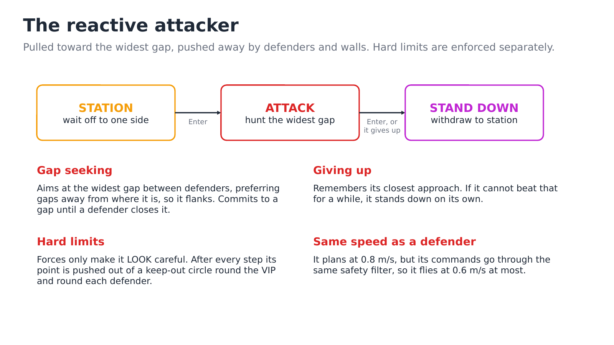

What the diagram does not say is why:

* **Gap seeking.** Driving straight at the VIP only bounced it in and out on one line and
  never made the ring move. Without **commitment** to a gap, it re-chose every tick and
  dithered between two gaps.
* **Giving up.** Its best distance slowly *relaxes* outward, so repeated pressing counts as
  trying. Without that, one good approach became a record it could never beat, and it quit
  mid-attack.

### 8.3 Why the defence can win: the race is angular

The defenders need to **turn** faster, not fly faster. Both sides contest a *bearing*
around the VIP, and the defenders hold the inside track:

$$
\omega_{\text{att}} = \frac{v_{\text{att}}}{r_{\text{att}}}
\qquad\text{vs}\qquad
\omega_{\text{ring}} \le \frac{v_{\max}}{R}, \quad R < r_{\text{att}}
$$

with $r_{\text{att}} \approx R + 0.8$ m $= 1.8$ m and $\omega_{\text{ring}}$ the blocking
rate limit (0.55 rad/s). Break-even is
$v_{\text{att}} = \omega_{\text{ring}}\,r_{\text{att}} \approx 0.55 \times 1.8 \approx 0.99$ m/s.
As flown, the attacker turns at $0.60 / 1.8 \approx 0.33$ rad/s against the ring's 0.55.

The caveat: this assumes the defenders *keep* the attacker out at the larger radius. Closer
in, the same arithmetic favours the attacker. This is the classic **target-guarding**
setting of differential games (Isaacs), solved here by a heuristic, not an optimal
strategy. The offline verifier skips the attacker's safety filter, so it tests a harder
(0.80 m/s) attacker than the one that flies.

---

## 9. One encounter, end to end

* **Left:** the defenders' paths are arcs: they travel *round* the ring, never across it
  (§3.2). The attacker's path is its own (§8).
* **Top right:** the Schmitt latch (§4.1): blocking starts inside the engage line and holds
  until the attacker retreats past the *higher* release line.
* **Bottom right:** the phase turns as a ramp, not a step (§4.2); the wall closure ramps up
  and back down (§3.4).

---

## 10. How it is verified

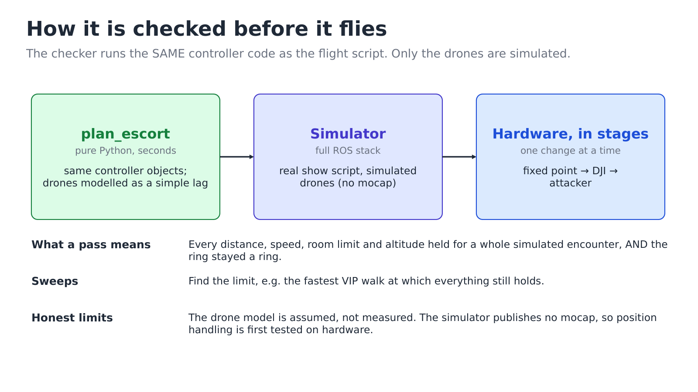

This is software-in-the-loop: `escort.py` is pure Python (no ROS, no radio), so the
verifier and the flight script import the *same* objects. Verdicts are properties of a
whole encounter, formation error included: a run where the guard rescued every separation
but the ring stopped being a ring is a *failed* escort.

---

## 11. Lessons that generalise

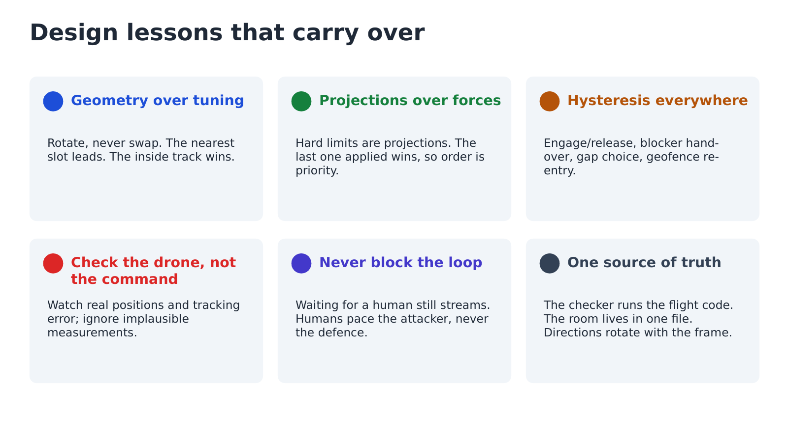

The last item came from a real failure. On 2026-10-08 Motive was recalibrated and the world
frame rotated by about 92°. **A point transforms with rotation and translation; a direction
with rotation only.** The arena centre (a point) was carried across, but three *directions*
(where the VIP stands relative to the centre, and the attacker's two entry bearings) were
not, which put the attacker's waiting station outside the arena. The verifier caught it
before anything flew.

---

## 12. Open questions

They live in one place: [design-notes.md, "Decisions still open"](design-notes.md#decisions-still-open).

**References named in this document:** Lewis & Tan 1997 (virtual structures); arXiv
2212.12554 (circular formation around a leader); Olfati-Saber 2006 (flocking); Khatib 1986
(artificial potential fields); Koren & Borenstein 1991 (their limitations); van den Berg et
al. 2011 (ORCA, reciprocal avoidance); Ames et al. 2019 (control barrier functions); Isaacs
1965 (differential games, target guarding); Preiss et al. 2017 (Crazyswarm, onboard
planning).
