# Escort: how it works

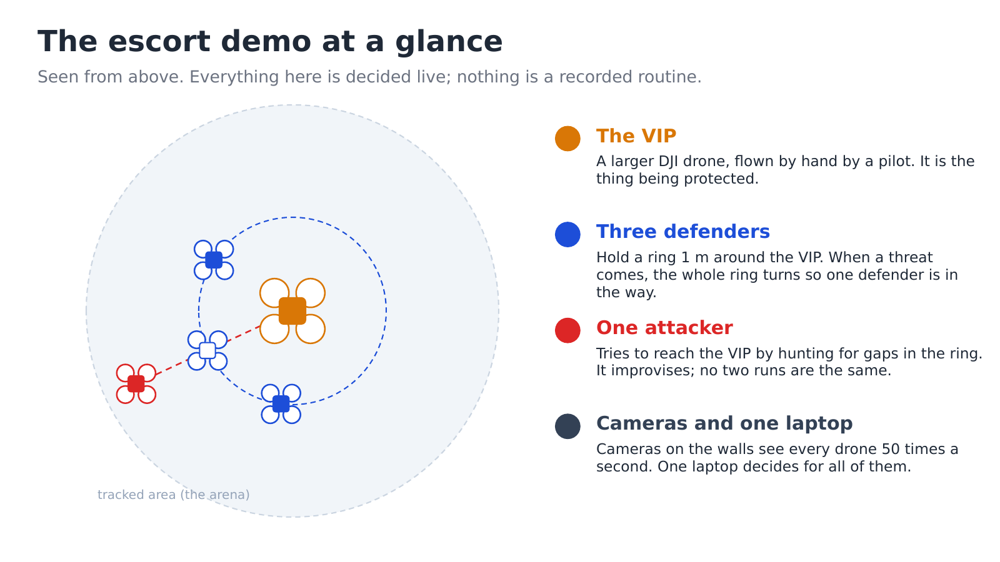

This page uses no maths. The maths, and the reason behind every design choice, are in
[details/theory.md](details/theory.md).

## The pieces

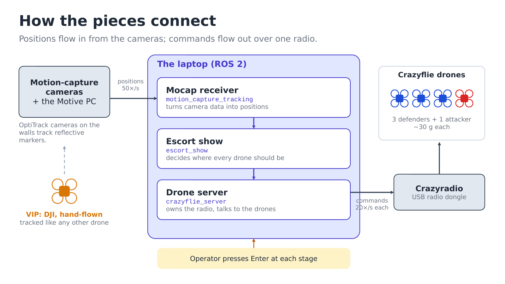

The drones have no sensors to see each other: each one only flies to the point it is
told, using the camera positions to know where it is. So **every safety rule is enforced
on the laptop, before a command is sent.**

## One decision, 20 times a second

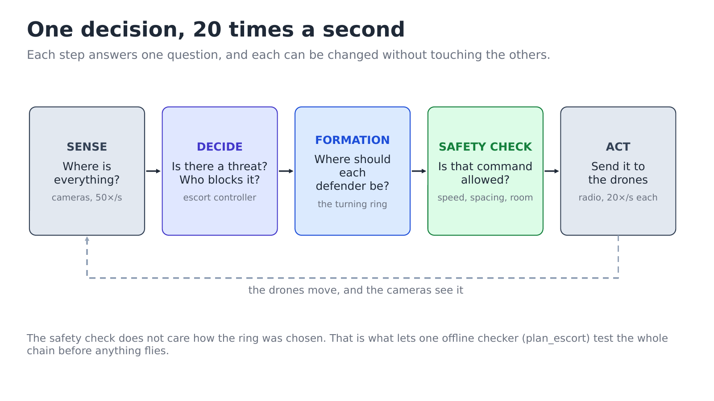

## The ring turns; the drones never swap

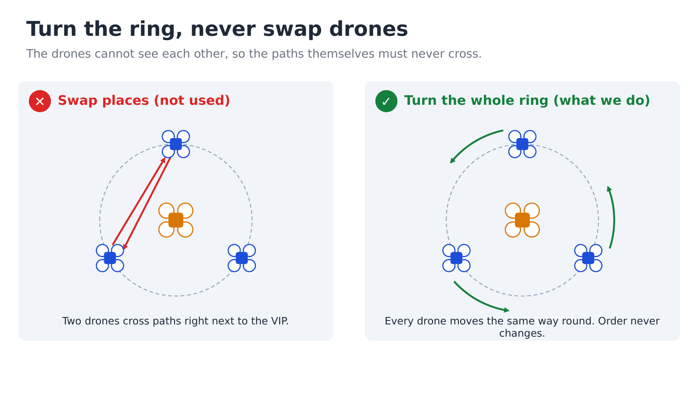

Whichever defender is already nearest the attacker becomes the blocker, so the ring never
has to turn more than 60°.

## Blocking

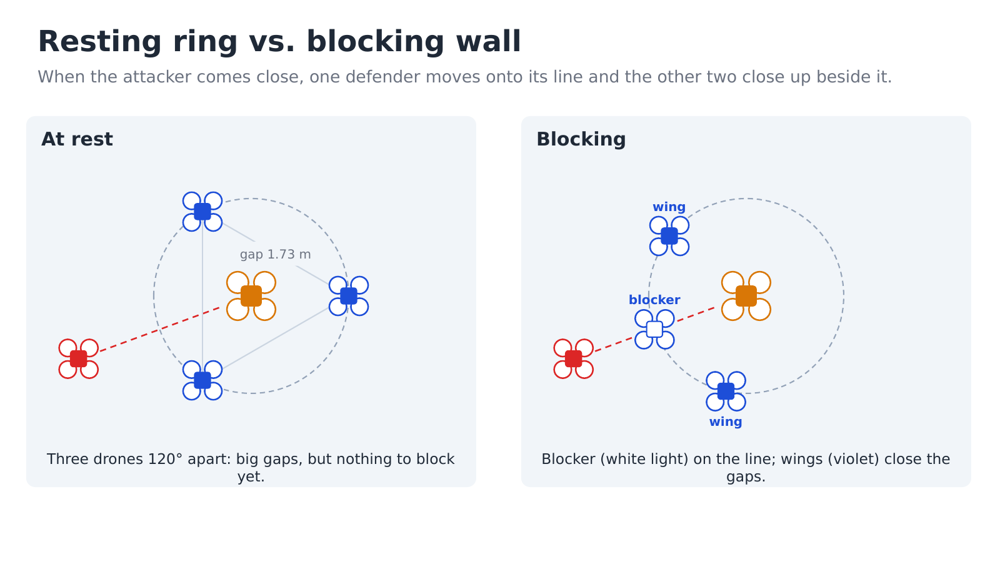

The change from ring to wall is blended over a few seconds, never switched at once, so no
drone is ever asked to jump.

## When blocking starts and stops

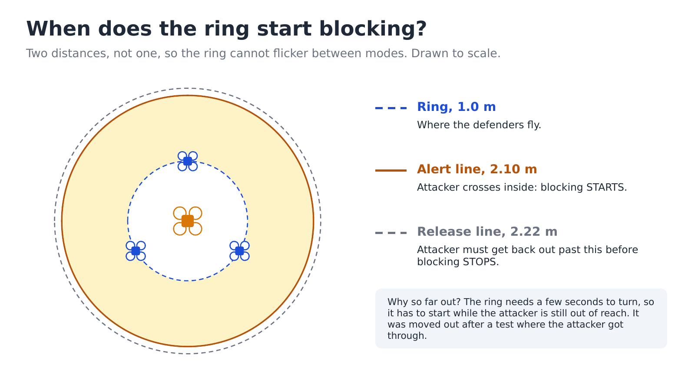

When blocking stops, the ring stays where it is. Turning back to a "home" position made it
swing back and forth with the attacker.

## The speed budget

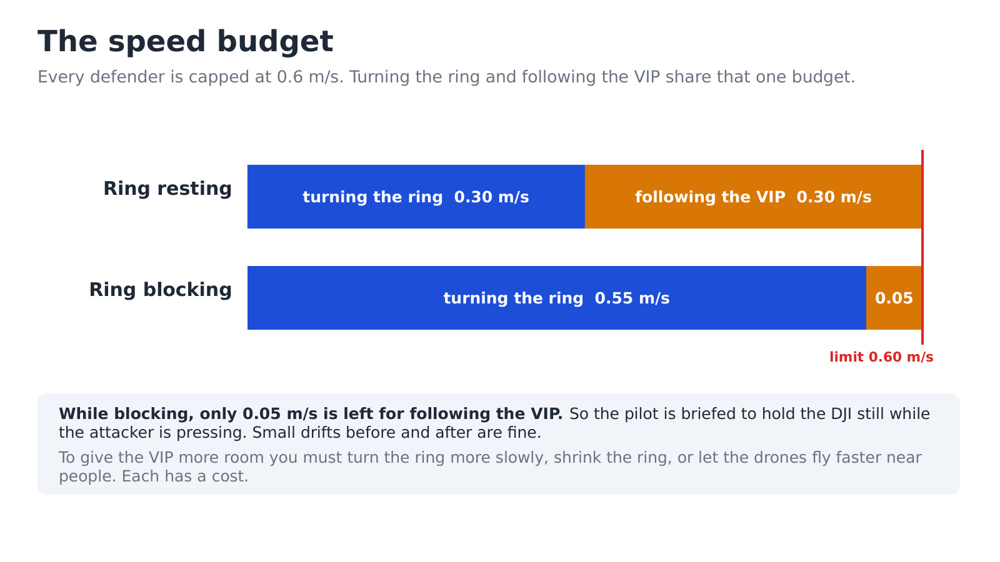

## Why the defenders can win

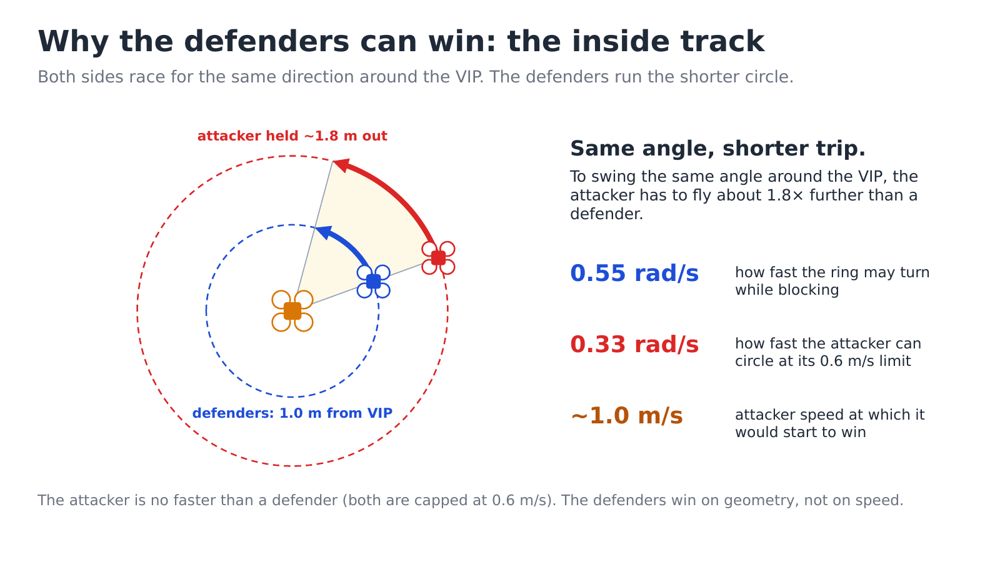

## The attacker

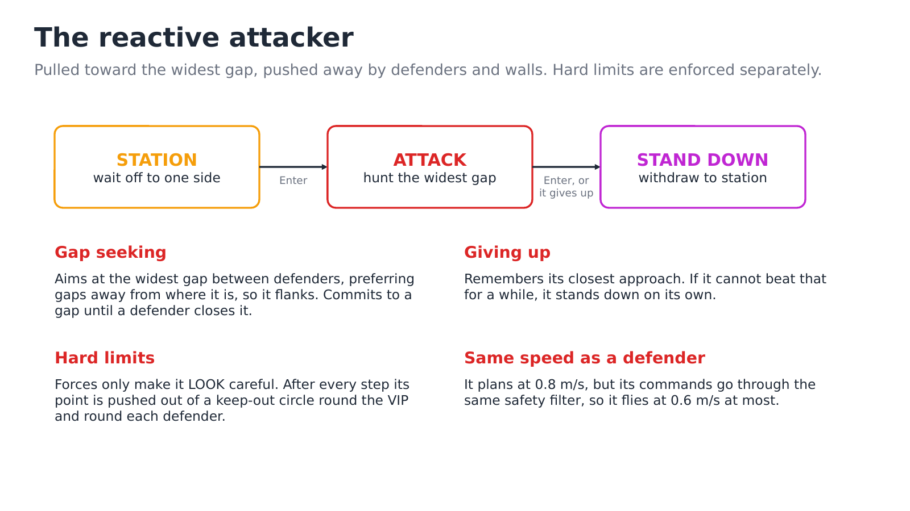

The attacker is not scripted: run the demo ten times and you get ten different attacks. It
obeys the same safety rules as the defenders, so the defenders hold their line and the
attacker is the one that gives way. Details:
[details/theory.md, part 8](details/theory.md#8-the-adversary-a-deliberately-beatable-opponent).

## Layers of safety

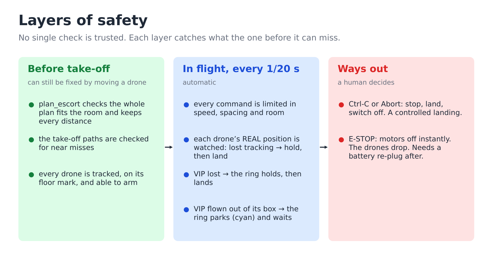

A drone that stops following its command is the earliest warning sign there is. If the
cameras lose the VIP, the ring holds still; after 2 seconds, everything lands.

## What the lights mean

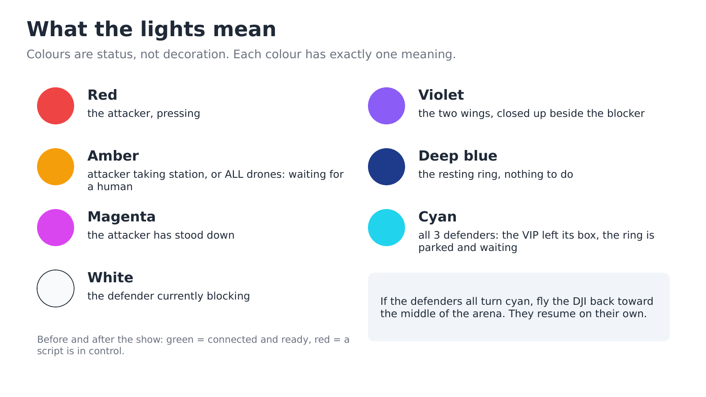

The lights tell the operator, from across the room, that the drones and the script agree
on what is happening.

## Where to go next

| You want | Read |
|---|---|
| The maths and the design reasons | [details/theory.md](details/theory.md) |
| What was tried, what broke, what is still open | [details/design-notes.md](details/design-notes.md) |
| Every setting and number | [details/reference.md](details/reference.md) |
| Answers to visitors' questions | [details/qna.md](details/qna.md) |
