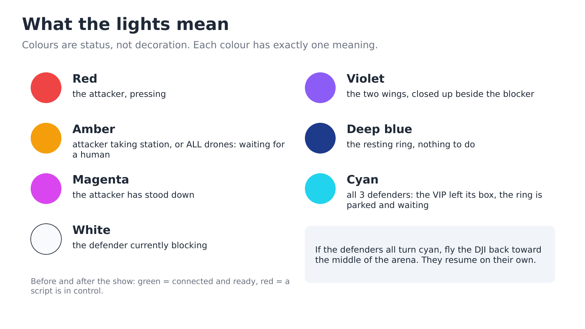

# Escort: presenting to guests

The show is operator-paced: nothing moves on until Enter is pressed, so you can talk as
long as you need at each stage. A full run takes about 4 to 6 minutes.

**Two people:** the *operator* at the laptop presses Enter (and can narrate), and the
*pilot* flies the DJI. Agree beforehand who says "bring it up" and "bring it down": those
are the only two moments when the show waits for the pilot instead of the operator.

## The script

| Stage | Operator | Say |
|---|---|---|
| **Before** | | "This DJI stands in for something we want to protect. These three small drones are its escort, and this fourth one will try to reach it. None of them can see each other: cameras around the room tell one computer where everything is, 50 times a second. And the DJI is flown by hand, so nothing here is rehearsed." |
| **1. Take off** | Enter | "The escort goes up first and waits *above* where the DJI will be, out of its way." |
| **2. DJI up** | pilot flies up, then Enter | "Now they drop down and lock on. Wherever the pilot flies it, the ring follows." *A good moment to let the pilot drift around.* |
| **3. Station** | Enter | "The fourth drone is the threat. It is amber: sizing up the formation, not committed yet." |
| **4. Attack** | Enter | "Now it is red and going for the DJI. It is not following a script: it looks for the widest gap and goes for it. The defenders react: the nearest one turns white and gets in the way, and the other two close up beside it." |
| **5. Stand down** | Enter | "It has run out of options and is backing off. That is the magenta. Nobody told it to give up." |
| **6. DJI down** | Enter, pilot lands, Enter | "The escort climbs out of the way while the DJI lands. They come down last, so the thing being protected is never left alone in the air." |

The key line, if you only get one: **the attacker is as fast as the defenders, but they
fly a tighter circle, so they cover the same angle in less distance. They win on
geometry, not speed.**

## Questions you will get

The answers, shortest first, are in [details/qna.md](details/qna.md) (start with Tier 1),
with the claims to keep honest at the end.

## When something goes wrong, live

Have these ready. Narrating a failure calmly is worth more than a clean run.

| What happened | Say |
|---|---|
| The attacker reaches the DJI | "That one got through, and that is the honest state of it. Three defenders cannot seal a circle; they can only turn to meet the threat, and if the DJI moves at the same time they run out of time." |
| The ring goes cyan and stops | "The geofence tripped: the DJI left the box the ring can hold, so the ring parked instead of following it out." The pilot flies back toward the middle and they resume. |
| A drone lands by itself | "It lost tracking, so it landed. That is the rule: no position, no flight." |
| A drone never arms | "A firmware safety latch. It needs a battery re-plug, which is deliberate." |
| E-STOP fired | "That was me, or the software. Everything on the floor is the correct result of an abort: it is one click and it always works." |
| Nothing happens at all | "Give me a moment, this is a research rig." Then stop talking and fix it. Do not debug out loud. |
