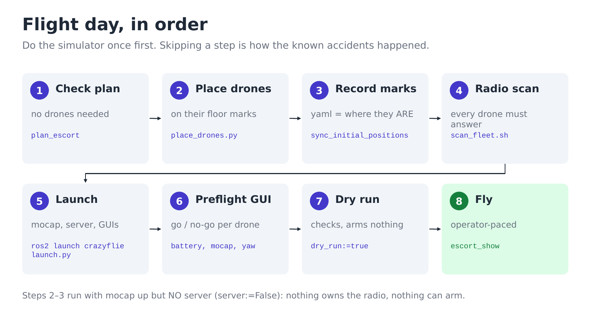
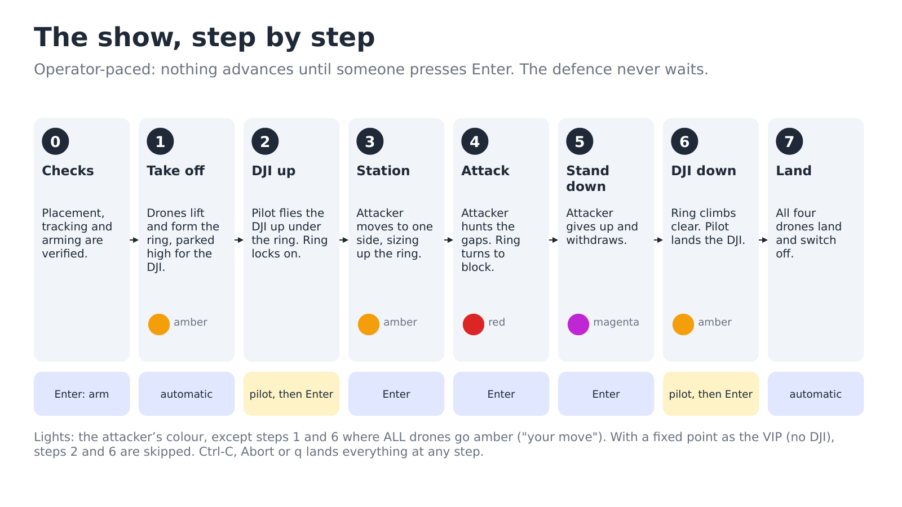

# Escort: run it

Three defenders ring a VIP and turn to block one attacker. What it is and why:
[how-it-works.md](how-it-works.md). The steps every demo shares (simulator rules, radio
scan, launch, preflight, stopping) are in [flight day](../02-flight-day.md); this page adds
the escort's own.

## In the simulator

```bash
ros2 launch crazyflie launch.py backend:=sim                     # terminal 1
ros2 run crazyflie_shows plan_escort                             # terminal 2: must end "static case OK"
ros2 run crazyflie_shows escort_show --ros-args \
    -p use_sim_time:=true -p vip_mode:=point -p paced:=true
```

The show prints a prompt starting `>>>` at every stage and waits. Press **Enter** to go
on, or type **q** then Enter to land. In RViz you will see the ring form, the attacker
move in, and the ring turn to block it. Restart terminal 1 before the next run: a second
run on the same simulated drones hangs at "gathering onto the ring".

## On real drones



**The fleet:** four drones enabled in `crazyflies.yaml`, all on the first Crazyradio. The
show picks the roles itself: the three drones nearest the VIP defend, and the farthest
one attacks. **For a DJI VIP**, create a Motive rigid body for it too (asymmetric
markers) and note its name.

1. **Check the plan**, no drones needed:
   ```bash
   ros2 run crazyflie_shows plan_escort           # must end "static case OK"
   ros2 run crazyflie_shows plan_escort --marks   # where each drone must stand
   ```
2. **Place the drones.** With the cameras up and no server
   (`ros2 launch crazyflie launch.py server:=False`), run `python3 scripts/place_drones.py`:
   it draws each drone's floor mark in RViz (add a MarkerArray display on
   `/escort/marks`). Slide each drone onto its mark, nose along +X.
3. **Record the marks** ([flight day 1](../02-flight-day.md#1-place-the-drones-and-record-where-they-are)),
   then `plan_escort --marks` must end "MARKS OK".
4. **Scan, launch, preflight**: [flight day 2-4](../02-flight-day.md#2-radio-scan).
5. **Dry run:** `ros2 run crazyflie_shows escort_show --ros-args -p dry_run:=true`
6. **Fly.** First flights, with a fixed point as the VIP and nobody in the room:
   ```bash
   ros2 run crazyflie_shows escort_show --ros-args -p vip_mode:=point -p paced:=true
   ```
   With the DJI as the VIP (replace `dji` with its rigid-body name):
   ```bash
   ros2 run crazyflie_shows escort_show --ros-args \
       -p vip_mode:=mocap -p vip_name:=dji -p paced:=true
   ```

The show waits for **Enter** at every stage:



**Brief the pilot:** take off only when asked, fly under the ring, keep inside the
middle of the arena (about 0.9 m from the centre), and **hold still while the attacker
is pressing**. [Why](how-it-works.md#the-speed-budget).

## In the web console

**Missions → Escort demo**: every prompt becomes a button, and a 3D view shows the ring.


## Testing without a DJI

You can steer a pretend VIP, or the attacker, with the keyboard instead. See
[details/escort-reference.md](../details/escort-reference.md#teleop-no-dji-nobody-in-the-room).
All show settings are listed in the same file.
