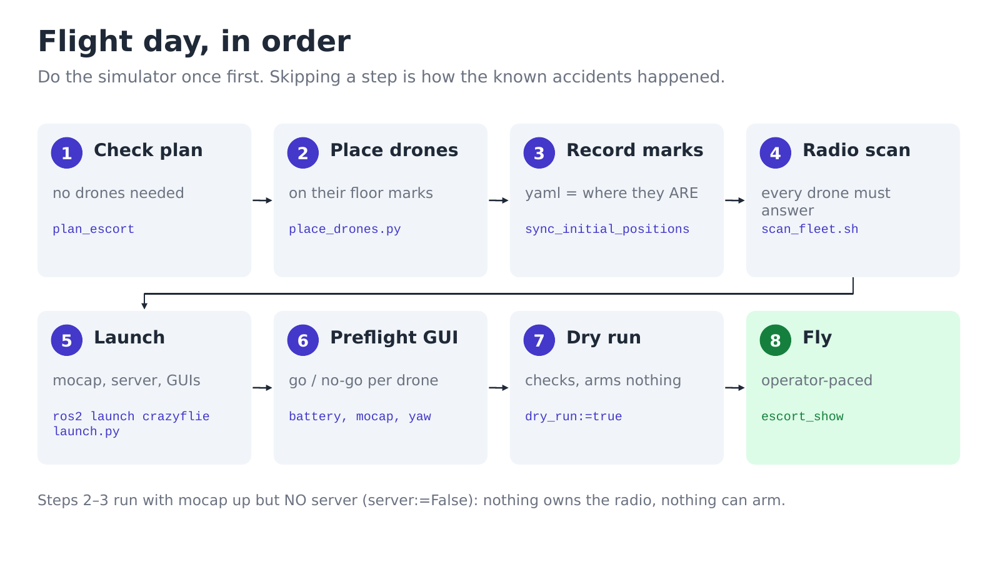
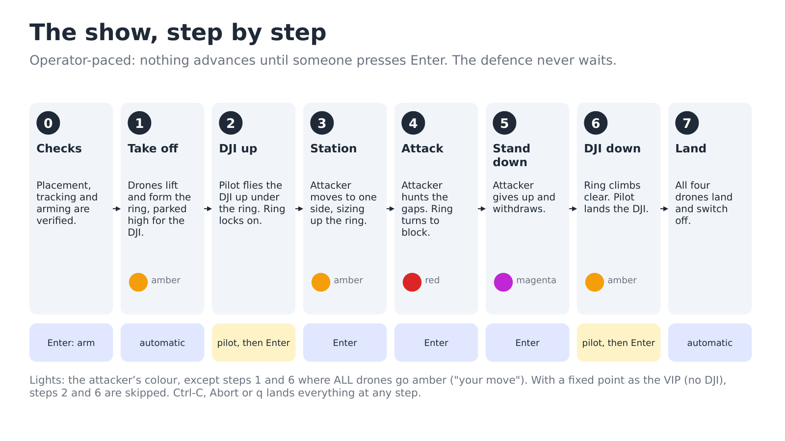

# Escort: run it

Three defenders ring a VIP and turn to block one attacker
([how-it-works.md](how-it-works.md)). The steps every demo shares are in
[flight day](../02-flight-day.md); this page adds the escort's own.

## In the simulator

```bash
ros2 launch crazyflie launch.py backend:=sim                     # terminal 1
ros2 run crazyflie_shows plan_escort                             # terminal 2: must not end "REFUSED"
ros2 run crazyflie_shows escort_show --ros-args \
    -p use_sim_time:=true -p vip_mode:=point -p paced:=true
```

The show prints a prompt starting `>>>` at every stage and waits: **Enter** goes on,
**q** then Enter lands. In RViz the ring forms, the attacker moves in, and the ring turns
to block it. Restart terminal 1 before the next run, or the show hangs at "gathering onto
the ring".

## On real drones



The fleet is in [flight day](../02-flight-day.md#choose-the-fleet). The show picks the
roles itself: the three drones nearest the VIP defend, the farthest attacks. **For a DJI
VIP**, also create a Motive rigid body for it (asymmetric markers) and note its name.

1. **Check the plan**, no drones needed:
   ```bash
   ros2 run crazyflie_shows plan_escort           # must not end "REFUSED"
   ros2 run crazyflie_shows plan_escort --marks   # where each drone must stand
   ```
2. **Place the drones.** With the cameras up and no server
   (`ros2 launch crazyflie launch.py server:=False`), run `python3 scripts/place_drones.py`
   and add a MarkerArray display on `/escort/marks` in RViz. Slide each drone onto its
   mark, nose along +X.
3. **Record the marks** ([flight day 1](../02-flight-day.md#1-place-the-drones-and-record-where-they-are)),
   then `plan_escort --marks` must end "MARKS OK".
4. **Scan, launch, preflight**: [flight day 2-4](../02-flight-day.md#2-radio-scan).
5. **Dry run:** `ros2 run crazyflie_shows escort_show --ros-args -p dry_run:=true`
6. **Fly.** First flights, with a fixed point as the VIP and nobody in the room:
   ```bash
   ros2 run crazyflie_shows escort_show --ros-args -p vip_mode:=point -p paced:=true
   ```
   With the DJI as the VIP (replace `dji` with its rigid-body name):
   ```bash
   ros2 run crazyflie_shows escort_show --ros-args \
       -p vip_mode:=mocap -p vip_name:=dji -p paced:=true
   ```



**Brief the pilot:** take off only when asked, fly under the ring, keep the DJI well inside
the flying area (the ring needs about a metre of room on every side), and **hold still
while the attacker is pressing**. [Why](how-it-works.md#the-speed-budget).

## In the web console

**Missions → Escort demo**: every prompt becomes a button, and a 3D view shows the ring.


## Testing without a DJI

Steer a pretend VIP, or the attacker, with the keyboard:
[details/reference.md](details/reference.md#teleop-no-dji-nobody-in-the-room). Every show
setting is in the same file.
