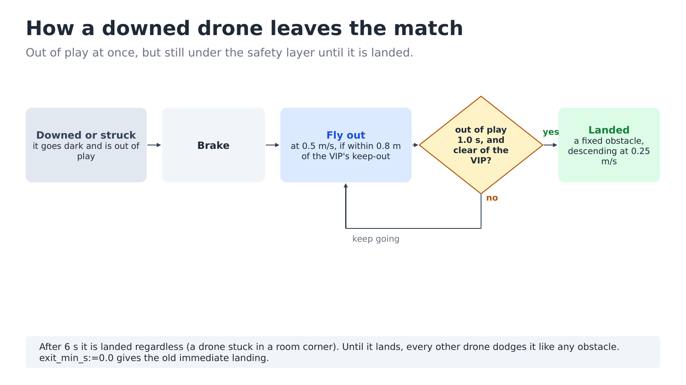

# Guard: design notes

The dated log, oldest first: what was decided, measured and learned. The current design is
[theory.md](theory.md) (why) and [modules.md](modules.md) (the code). Numbers are as
measured on the day; run `plan_guard` for current ones, and do not copy them from here.

Built 2026-11-03 for the big arena as the escort's successor experiment; flown on hardware
since early November 2026.

## First decisions (2026-11-03 to 11-17)

- **Rules became meters (11-03)** without changing play: `tag` and `timer` gave the same
  winner, match time, strikes, downs and closest pair on all 48 recorded matches.
- **The team boundary is enforced (11-03).** An opponent's velocity had been its command,
  and both teams shared one random stream. The spy, vandal and dice tests pin the fix.
- **A held drone still dodges.** The first gate only re-sent the last setpoint, so a
  climbing DJI would have had nothing getting out of its way
  (`test_a_held_drone_still_dodges_the_dji`).
- **Building `coordinated`:** gating the attempt on a provably open lane meant it never
  went ([theory §6.3](theory.md#63-robustness-chooses-the-line-it-does-not-gate-the-attempt));
  fleeing on a defender's first approach made striking impossible.
- **"Not following" is judged against the last 1.0 s of setpoints (11-19, after the 11-17
  flights).** Against the current setpoint, the ~0.6 s lag read as 0.6 m off at 1 m/s and
  aborted the 11-17 matches 1.5-5 s after START: 11 false aborts in 7 of the 14 hardware
  traces. None with the window; worst windowed error
  0.59 m for one tick.

### The first rules matrix (2026-11-03)

`plan_guard --matrix --rules all`, 4 v 3, 12 seeds, relaxed 0.45 m keep-out. Defence wins
of 12 (defenders downed across all 12 in brackets):

| Rule set | `shell` v `coordinated` | `shell` v `direct` | `ring` v `coordinated` | `ring` v `direct` |
|---|---|---|---|---|
| `tag` | 12 | 0 | 4 | 5 |
| `zone` | 11 | 0 | 6 | 5 |
| `pressure` | 8 (13 down) | 3 (10 down) | 0 (23 down) | 0 (12 down) |
| `zone_pressure` | 1 | 3 | 0 | 0 |
| `timer` | 0 | 0 | 0 | 0 |

- Every cell safe; closest pair 0.40 m against the 0.35 m floor.
- **`pressure` is the most two-sided:** defenders are downed too, and `ring`, which never
  gangs up, loses every match. Its strike radius is 1.6 m: at 2.0 m `shell` won 4 and 0
  of 8.
- **`timer` cannot be held** at any strike radius from 1.6 to 2.4 m: with the 0.45 m
  keep-out one defender's wall is too thin. Pure denial needs a wider keep-out
  (`-p d_cc:=0.9`).
- **`zone_pressure` favours the attack:** neither strategy has home-ground tactics yet
  (open; strategy work, not a rule fix).
- **No strategy dominates:** `shell` beats the planner under `tag` and `zone` but loses to
  the rush; `ring` the reverse.

Earlier, with a 0.90 m keep-out: a defender on the VIP–attacker line was a wall, and strike
radii of 1.6–2.2 m never scored against `shell`. At 2.4 m, shell v coordinated went from
11 to 0 of 12 between a 1.10 s and a 1.15 s tag time: one simultaneous exchange tends to
settle a match.

## Making the match readable (2026-11-05)

Hardware flights (4 v 3) had three problems: intent only partly visible, most matches
ending on a near-miss landing, and the winner only shown in the console.

- **Intent, not clutter.** Strategies publish `Intent` and `plan`; the viz draws them as an
  operations map, never handed to the opponent. Same results, match times and closest
  pairs as before (12 seeds of the defaults, 8 of `pressure` with a drifting VIP). Removed:
  the body sphere, the always-on keep-outs (now only while the CBF acts), the VIP's
  translucent spheres (now two circles).
- **Near misses: graded, glitch-filtered, explained.** The old watch landed everything on a
  single frame inside 0.7 of the floor. But one frame is enough for a mocap glitch, and
  landing does not separate a close pair, holding does. So: a glitch filter, a pause on two
  ticks in a row, landing only inside 0.55 or after a 3 s pause (`guard/watch.py`;
  `near_miss_pause:=false` restores the old rule). Every near miss prints its setpoint gap
  and tracking errors, and each run writes `guard_trace.csv`. The cause was unknown (no
  output kept, and the 0.25 s stand-in never came inside the floor); 11-06 pointed at the
  tracking lag.
- **The finale** (`guard/finale.py`), through `Match.steer`, checked on every seed: all
  reached the end on 8 seeds each of 4 v 3 `tag`/`timer`/`pressure`, 2 v 1, 5 v 5
  `zone_pressure`, tau 0.4. Landing losers at their marks wherever the VIP was came to 0.50
  of the VIP keep-out at 0.5 m/s of drift, so they land only `land_clear` (0.8 m) beyond it.
- **A moving DJI** (`plan_guard --vip-move`, 8 seeds, a 0.6 m circle; worst approach as a
  fraction of the VIP keep-out): `tag` SAFE from 0.1 to 0.5 m/s (0.98 to 0.94); `timer`
  with the finale SAFE at 0.3 m/s, FAILED one seed at 0.5 (0.88); `pressure` SAFE at 0.1,
  FAILED from 0.2 to 0.5 (0.85 to 0.66), from downed defenders landed straight down while
  the VIP drifted onto them. Widening `d_vip` to 1.35 did not help. Fixed 2026-11-19 by
  exiting first.
- **LEDs:** dark out of play (amber read as red across the room), white scoring, magenta
  decoy, green winners; sent on change, at most every 0.25 s. Not yet seen on hardware
  then; magenta against red was the one most likely to be hard to tell apart.

## The first hardware matches (2026-11-06)

Seven Crazyflies (cf1-cf4 defend, cf10-cf12 attack), the DJI as the VIP, `pressure`,
paced from the console. Numbers from each run's flight folder
([flight-logs.md](../../rig/flight-logs.md)).

| Run | Ended | Why |
|---|---|---|
| 14:53 | abort at the START gate | `CONTAINMENT cf1: no mocap for 1.1 s`; the console never showed the START card |
| 15:09 | abort in the match | `cf10: 0.64 m from where it was commanded for 0.9 s` |
| 15:13 | **attack won** | cf10 downed cf4 and cf3, then struck; capture finale |
| 15:19 | operator landed | batteries 3.72-3.87 V at the start |
| 15:27 | **defence won** | three downs in 12.4 s; honour-guard finale |

1. **Every drone trailed its setpoint by 0.54-0.60 s** while following its path to within
   3-5 cm: 0.5-0.7 m behind at 1 m/s. The firmware's PID position controller
   (`stabilizer.controller` 1) overwrites the setpoint velocity in `modeAbs`
   (`position_controller_pid.c`, the `runPid` branch), discarding `cmd_full_state`'s
   feed-forward. It caused the 15:09 abort, and both completed runs had their closest pair
   at the 0.35 m floor with the setpoints further apart. The simulator never showed it: it
   runs Mellinger (`server.yaml`). Advice became 0.6 m/s (sweep below); fixed 11-23 by
   Mellinger.
2. **`/poses` went stale inside the show (fixed).** ~127 messages/s of `/cfN/pose` and
   `/cfN/status` on the show's node, one `spin_once` per tick: `/poses` averaged 0.3-0.4 s
   old, up to 0.9 s, and a real 0.34 s stall on top crossed the 1.0 s watchdog (14:53).
   `drain()` now runs up to `drain_count()` callbacks per tick (14 with 7 drones): 0-5 ms
   old. The escort uses the same helper.
3. **The console lost a gate (fixed).** Answering cleared "whatever gate is open", which was
   already the next one when the show printed PILOT -> START in the same millisecond. It now
   clears only the gate it answered.
4. **The console's 3D view lagged (fixed).** Drawing every 20 Hz marker message it fell
   0.7 s/s behind (3.3 s by the end of 15:27), then replayed 4 s in 2, the "accelerated"
   rush on the screen recording. Now 10 Hz, newest snapshot per frame.

**Open:** the whole `/poses` stream froze for 0.2-0.55 s every 10-40 s, seen by the server
too. Under the 1.0 s watchdog; cause unknown (network, or laptop load).

## More strategies (2026-11-06)

`zone`, `hunter`, `flood` and `wolfpack` ([modules.md](modules.md#2-guardpolicies-the-strategies)):
different ideas, not parameter variants, checked offline on every pairing.

**Safety** (12 seeds per cell; `tag` and `pressure`; 4 v 3, 2 v 1, 5 v 5 and the real
roster: 128 cells):

| Stand-in lag | Speed | Safe cells | Failures |
|---|---|---|---|
| 0.25 s | 1.0 m/s | 127/128 | shell v coordinated, `pressure`, roster: 2 seeds of solver emergency |
| 0.6 s | 1.0 m/s | 89/128 | every strategy (hunter and flood 14 cells each, shell and coordinated 10) |
| 0.6 s | 0.6 m/s | 113/128 | hunter 8 (all `pressure`, 0.85-1.00 of the floor), flood 3, shell/ring 6 |

Widening `d_cc` to 0.60 m instead moved the failures into solver emergencies (111 of 128).
The 0.6 s failures are the lag, not the strategies; `hunter` is the most sensitive (its pair
closes on one attacker from both sides).

**Balance** (defence wins of 12, 4 v 3, lag 0.25 s; † = mostly ran the clock out):

| Rules | Defence | v coordinated | v direct | v flood | v wolfpack |
|---|---|---|---|---|---|
| `tag` | shell | 12 | 0 | 12 | 0 |
| `tag` | ring | 4 | 5 | 0 | 0 |
| `tag` | zone | **6** | 0 | 12 | 0 |
| `tag` | hunter | 12 | 12 | 12 | 12 |
| `pressure` | shell | **8** | 3 | 2 | **6** |
| `pressure` | ring | 0 | 0 | 0 | 0 |
| `pressure` | zone | 0 | 0 | 2 | 0 |
| `pressure` | hunter | 0 | 12† | 1 | 2 |

- **Even:** zone v coordinated, `tag` (6/12; 9/12 from the real roster); shell v wolfpack,
  `pressure` (6/12; 8/12); shell v coordinated, `pressure` (8/12, but 0/12 from the roster).
- **Lopsided:** `hunter` wins every `tag` match; `zone` loses to overloads under
  `pressure`; `hunter` v `direct` under `pressure` is a clock-out standoff.
- **Simulator** (SIL, 4 v 3, real roster, fresh launch each; no CBF emergency, backstop or
  near miss): zone v coordinated (`tag`, attack won), shell v wolfpack (`pressure`, defence,
  3 downs), hunter v flood (`pressure`, defence), hunter v wolfpack (`pressure`, attack
  struck at 6.9 s), zone v flood (`tag`, defence).

## The simulator is fast enough to use now (2026-11-06)

The SIL simulator ran at 0.06x real time with 7 drones (about 5 minutes per match), all
per-call overhead in one Python thread. Plain-float rigid-body steps, closed-form angles,
lazy State conversion, `/clock` at 500 Hz and TF at 100 Hz, ten physics steps per callback
(each checked against the original to 1e-13) gave 0.76x under load; it is now paced to
1.00x (`sim.realtime`; `false` runs flat out, about 18 s per match with finale).

Proven in the simulator (no mocap: poses come from setpoints): the full flight, a paced run
answered through stdin, one SIGINT landing all seven (exit 130), downs landing drones one
at a time. Left for hardware: every check that reads real `/poses`, close flying (the STL
game is designed to 0.20 m but has no hardware flight recorded here), seven drones
streaming `cmd_full_state` at 20 Hz on two Crazyradios, the DJI gates, the LED cues.

**A ladder for the first session** (`plan_guard` with the same choices before each step,
a dry run before the first):

| Step | Teams | Settings |
|---|---|---|
| 1 | 1 v 1 | point VIP, `rules:=tag`, `v_max_defense`/`v_max_attack` 0.5, `min_separation` 0.6, `d_cc` 0.7, paced |
| 2 | 2 v 1 | the same; then `rules:=pressure`, so a defender can be downed |
| 3 | 4 v 3 | 0.8 m/s; then narrow the separation in steps, watching the closest pair |
| 4 | with the DJI | `vip_mode:=mocap`, paced, all gates |

Before going faster than 1 m/s, build the acceleration-level CBF (HOCBF).

## Landing out of the way, and what the planner flies (2026-11-19)

**The planner's aircraft** is now a 0.4 s delay then a 0.2 s lag, the best fit to the 11-06
and 11-17 traces (~0.6 s in total), replacing the 0.25 s lag alone (why the split matters:
[theory §8](theory.md#8-the-tracking-lag-and-why-the-speed-caps-follow)). On it the old
landing failed far more than the old stand-in said (shell v coordinated, `pressure`, 1 m/s,
finale: 10 of 12 seeds).

**Landing out of the way.** A downed or struck drone used to stop dead and land at once,
while its neighbours' lagging aircraft carried on into it and a drifting DJI could come
over it. Now it EXITS: out of play at once, but still commanded through the safety layer.

Parameters: it brakes at `a_max`; `exit_land_clear` 0.8 m, `exit_speed` 0.5 m/s, `exit_min_s` 1.0 s, `exit_max_s` 6 s.

Matrix, 1 m/s, 17-11 marks, form-up, 12 seeds, 80 cells per row, the new plant:

| VIP | exit off: unsafe, closest pair | exit on: unsafe, closest pair |
|---|---|---|
| default mark | 14/80, 0.08 m | 1/80, 0.34 m |
| the DJI's 17-11 hover (-0.20, -2.07, 1.10) | 10/80, 0.09 m | 1/80, 0.37 m |
| default, drifting 0.2 m/s | 23/80, 0.20 m | 5/80, 0.25 m |

Defence wins unchanged (214 v 215, 231 v 224, 213 v 212 of 960). Simulator: one paced
7-drone match at 1 m/s, downed drones landed 1.0-1.3 s after their downs, 0 emergencies,
0 near misses.

**Tried and dropped:** commanding ahead along the velocity (right only when the lead
matches tau exactly, which the traces cannot pin down; worse than none at 0.1 or 0.3 s);
padding the keep-out by relative speed (a suddenly growing keep-out swallows drones: up to
194 solver emergencies); a 1.5 s brake-and-hold before the finale (no measurable effect).

**Open:** with a drifting DJI, 5/80 cells still fail, mostly an active drone running into
one being landed, or the DJI within ~1 m of a landing drone. The cure for both is less lag:
Mellinger, or an acceleration-level CBF.

## The form-up (2026-11-17 to 11-23)

Until 11-17 a match started over the floor marks, so where the pilot parked the DJI decided
the geometry, and often the game. The form-up moves the start into the air round the live
VIP, in three versions, each driven by a flight:

- **11-17: built once, at the gate.** The pilot then moved the DJI 1.4 m; the ring stayed,
  cf4's slot ended 1.2 m from the DJI, inside its keep-out, and the show logged "not all in
  position after 25 s".
- **11-19: `Follow`.** Slots became offsets from the live VIP, rebuilt only when the room no
  longer fits them; the form-up waits for the DJI to be airborne and follows it through
  START.
- **11-23: attackers hold.** The pilot moves the DJI *away* from the attackers before START,
  and with the arc they came along (over 12 rebuilds cf10 swung 5.7 m round to the far
  side). Now they hold where they hover and only the defenders follow, so the gap opens; the
  start-reach rule says whether the start is *fair*. Every hold match on 11-23 printed
  `NOT A FAIR START yet`, then `fair start`, before START.

In `plan_guard`, hold looked unsafe on the PID plant (delay 0.4 + tau 0.6); on the Mellinger
plant (0.1 + 0.1) every case was 0/12 unsafe, closest pair 0.42 m or more.

## Mellinger, attackers that hold, contested strikes (2026-11-23)

Four defenders (cf1-cf4) against three attackers (cf10-cf12), the DJI as the VIP,
`pressure`, 1 m/s, paced from the console. Numbers from each run's report.

| Run | Controller | Set-up | Ended |
|---|---|---|---|
| 13:38 | PID | | refused: `no /poses entry for 'operator'` (VIP name left at the console default) |
| 13:39 | PID | shell v coordinated, form-up `follow` | **attack won** at 8.5 s: two defenders downed, then cf12 struck |
| 13:57 | Mellinger | shell v coordinated, `hold` | **attack won** at 14.5 s: two attackers downed, then cf10 struck |
| 14:08 | Mellinger | hunter v coordinated | operator stopped it at the DJI gate |
| 14:13 | Mellinger | shell v wolfpack, `hold` | **attack won** at 8.8 s: one attacker downed, then cf10 struck |
| 14:41 | Mellinger | | refused: the drones were too close to the VIP |
| 14:41 | Mellinger | shell v coordinated, `hold` | **defence won** at 17.0 s: three downs |
| 15:22 | Mellinger | `strike_block` 0.8 | stopped while `Crazyswarm()` waited for the server |
| 16:38 | Mellinger | `strike_block` 0.8 | abort: `VIP pose lost for 2.0 s` |
| 16:42, 16:45 | Mellinger | `strike_block` 0.8 | operator stopped both at the DJI gate |
| 16:49 | Mellinger | shell v coordinated, `hold`, `strike_block` 0.8 | **defence won** at 15.3 s: three downs |

1. **Mellinger removes most of the lag.** PID at 13:39: 0.54-0.58 s, as on 11-06. Mellinger,
   every completed match: 0.08-0.14 s, tracking error p95 0.13-0.21 m at 1 m/s, closest pair
   0.36-0.40 m, no near miss; one unconverged solve (14:41), backstop never fired. Since
   2026-11-24 `controller` defaults to `mellinger` on hardware. `plan_guard`'s default
   plant stays the PID fit, the more cautious verdict (`--delay 0.1 --tau 0.1` for
   Mellinger).
2. **The strike that prompted contested strikes.** At 13:57 cf10 struck 1.40 m from the DJI
   with cf4 shadowing it about 0.45 m away for the whole second, which counted for nothing.
   `strike_block` makes that a contest. `plan_guard` (Mellinger plant, hold layout, DJI moved
   1 m, finale, 12 seeds × 64 cells): 0 unsafe, closest pair 0.42 m. Under `pressure` with
   0.8 m, defence wins of 12: shell v flood 3 → 11, shell v wolfpack 5 → 8, hunter v flood
   and v wolfpack to 12, but shell v coordinated only 1 → 2, because coordinated wins by
   downing every defender (open: a teammate-support radius, not built). `tag` with 0.8 m is
   one-sided for the defence (shell 11-12 of 12 against most attacks). On hardware the
   match was more even (two attackers downed before the 13:57 strike); the one completed
   `strike_block` match (16:49) went to the defence.
3. **Two report quirks, not faults.** cf10's supervisor flagged `crashed, tumbled` at an
   ordinary 13:57 touchdown (as cf4 and cf2 on 11-17), and its `land()` line was missing
   from rosout, so SERVER COMMANDS can be incomplete. The 16:38 abort was the DJI's rigid
   body dropping out of `/poses` for 2 s: the watchdog doing its job.

Full earlier text: `git show 678bac1:docs/guard/details/design-notes.md`.
