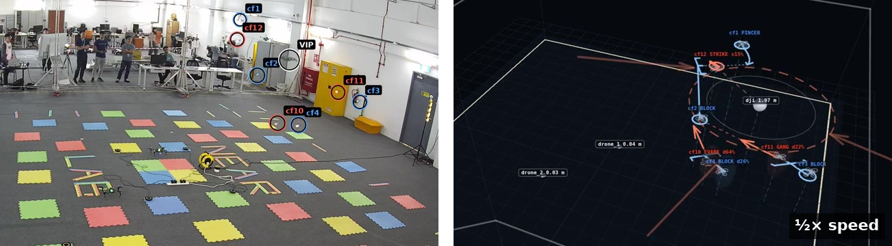

# Watching a hardware flight again

Two tools in `scripts/footage/` turn a guard_show flight log
([flight-logs.md](../../rig/flight-logs.md)) back into pictures:

- `replay_flight.py` rebuilds the console's 3D view of the match;
- `camera_overlay.py` circles every drone, in its team colour, on the hall camera's
  footage, from the mocap positions.



*24 Nov 2026, shell v coordinated under pressure: the moment before cf4 takes down cf10.*

Both read the bag with rclpy, so source the workspace (`source install/setup.bash`).
Neither touches a running stack.

## The console view: `replay_flight.py`

```bash
scripts/footage/replay_flight.py ~/.ros/flight_logs/<stamp>_guard_show /tmp/replay_bag
```

The flight bag has `/poses` but not `/guard/markers` (left out on purpose, see
flight-logs.md). So the script re-runs the same `Match` with the seed, rules and
strategies from `meta.json`, fed the measured positions from `guard_trace.csv` and the
VIP's logged `/poses`, with each tick's setpoints locked to the logged ones so the picture
cannot drift. Out comes a bag with `/poses` and `/guard/markers`, drawn by `guard/viz.py`
exactly as guard_show draws them.

**Checks it prints** (24 Nov in brackets): the trace clock fitted to `/poses` (a fraction
of a centimetre off); how many logged intents the re-run agrees with (2790 of 2821); the
re-run's events, to compare with `output.log` (all three downs matched, at the same
times).

**Limits:** it needs `vip_mode:=mocap` (the VIP must be on `/poses`); before START there is
no plan to show, so the gates and form-up draw only the drones, under the HOLDING and
FORM-UP titles.

**Filming it** with the [footage.md](footage.md) rig: `rig.sh up`, then
`ros2 bag play <bag> --rate 0.5` while ffmpeg grabs the 3D scene, and speed it back up 2x
(as `film.sh` does). Two differences from the simulator clips:
- `camera.sh` places the camera for the simulator's marks; for a hardware flight set the
  view with `cdp_drag.py` (orbit, wheel zoom, `BTN=right` pan) before playing.
- On a Wayland desktop Chrome opens on the real screen, not Xvfb (its log says
  `--ozone-platform=wayland`). Start it with
  `env -u WAYLAND_DISPLAY XDG_SESSION_TYPE=x11 scripts/footage/rig.sh chrome`.

## The hall camera: `camera_overlay.py`

```bash
F=~/.ros/flight_logs/<stamp>_guard_show
V=D04_<YYYYmmddHHMMSS>.mp4                     # the Camera 01 export
scripts/footage/camera_overlay.py sync   $F $V        # writes D04_<...>.sync.json (about 2 min)
scripts/footage/camera_overlay.py render $F $V match.mp4            # 16:9, 6 s before START .. 30 s after
scripts/footage/camera_overlay.py render $F $V wide.mp4 --pip       # 2.59:1, left side clear for an inset
```

### The camera model: `scripts/footage/camera01.json`

A 3×4 projection plus two radial distortion terms, from a mocap position (m) to a pixel of
the 3840×2160 picture. Fitted on 25 Nov from 16 hand-picked points (the seven Crazyflies on
their charging pads, the same seven hovering at 1 m, the two parked Starlings), then
refined from about 350 LED detections over the 24 Nov flight. Median error 2.6 px, 90th
percentile 7.7 px in 4K: about 1 px at slide size.

It holds only while Camera 01 is not moved or re-zoomed. If the circles drift, run
`calibrate $F $V --out cam.json` (refits from that flight's LEDs, starting from the current
model), then `sync` again with `--camera cam.json`. It is fitted where the drones flew,
about x −3…3.4 m and y −4.8…2.1 m; further out it extrapolates (floor strips near the far
wall came out crossing each other, which no real lens does).

### The clock: `sync`

An export starts at the time in its name, to the second, and the camera's clock differs
from the laptop's (0.48 s ahead on 24 Nov: video t=0 was 14:47:38.68 on the log clock).
Every 0.5 s of the flight, `sync` finds the bright, saturated blobs (the LEDs; the white
ceiling lights fail the saturation test), and for each offset on a grid scores the median
distance from each airborne drone's predicted pixel to its nearest blob. On 24 Nov it found
the offset to within 0.01 s of the hand fit.

### The picture: `render`

One fixed crop round everything in play for the whole clip, never into the camera's clock
in the top rows. (A panning crop changes every pixel of every frame: GIFs ballooned past
40 MB, and it was harder to watch.) Circles are sized to the drone's distance: blue for
Guard, red for Strike, white for the VIP; grey with "out" from the moment `output.log` says
DOWNED; dropped once landed. The export is HEVC with an open GOP, and a plain input seek
decodes broken grey frames until the next keyframe, so `render` seeks 3 s early.

## Putting both side by side

One video, so the halves cannot drift apart. `dash.mp4` is the filmed console view for the
same window; the takedowns play at half speed:

```bash
ffmpeg -i match.mp4 -i dash.mp4 -filter_complex "[0]scale=640:360[f];[1]scale=640:360[d];\
[f]pad=663:360:0:0:white[fp];[fp][d]hstack,split=3[s1][s2][s3];\
[s1]trim=0:17,setpts=PTS-STARTPTS[a];[s2]trim=17:23.5,setpts=2*(PTS-STARTPTS)[b];\
[s3]trim=23.5:36,setpts=PTS-STARTPTS[c];[a][b][c]concat=n=3:v=1:a=0" side_by_side.mp4
```

**For slides, embed the MP4, not a GIF.** DeckCraft keeps only 64 MB of decoded frames per
GIF (`GIF_BUDGET`) and silently drops the rest, so a long GIF loops after about 5 s. An MP4
with PowerPoint's "start automatically" timing plays in Slide Show in both PowerPoint and
DeckCraft; DeckCraft ignores the loop flag on import, so turn on Loop in its Playback tab.
