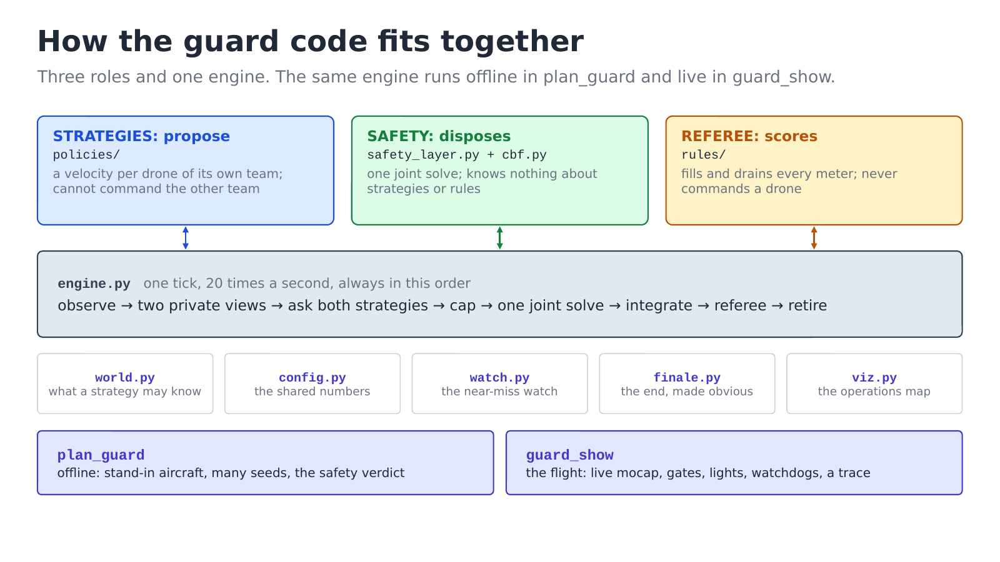

# Guard: the modules

What each module does, what it may and may not do, and how one tick flows through them.
Why: [theory.md](theory.md). What was measured: [design-notes.md](design-notes.md).
All the code is under `src/crazyswarm2/crazyflie_shows/crazyflie_shows/`.

## One tick

`guard/engine.py` runs these every 50 ms, always in this order, identically offline and on
drones (pure Python):

1. **Observe:** every drone's position from mocap (from its setpoint in the simulator),
   and a velocity estimated from those positions.
2. **Two private views:** your own drones carry what you commanded; the other team's only
   what a camera could see.
3. **Ask both strategies:** a velocity per active drone of their own team; neither sees
   the other's requests.
4. **Cap** at the team's speed and the acceleration limit.
5. **One joint safety solve** over *all* requests (§3).
6. **Integrate into setpoints**, sent over the radio, or to `plan_guard`'s stand-in drones.
7. **Referee:** fill and drain every meter from the *aircraft* positions; declare downs,
   strikes and the result.
8. **Retire:** a downed or striking drone first *exits* (brakes, clears the VIP if near it,
   still through the safety layer), then goes to the landing commander as a descending
   obstacle.

The engine counts corrections, emergencies, unconverged solves and backstop firings.

## 1. `guard/world.py`: what a strategy may know

- **`Agent`:** name, team, observed position, velocity, status (active or retiring) and
  outcome (downed or struck). Velocity is what you commanded for your own team, and
  estimated from observed positions for an opponent. A retiring drone exits under the
  engine (`Match.exiting`) and is handed to the caller to land by `Match.pop_landing()`.
- **`View`:** the time, the VIP's position and velocity, every agent, the arena, the
  config, the rule set, everybody's meters and the public events so far. Every View is a
  copy made for one team for one tick.
- **`Arena`:** clearance to the edge, which way is inward, room above and below.

## 2. `guard/policies/`: the strategies

- **Contract:**
  - `act(view)` returns a velocity per active drone of your own team.
  - `reset(view, rng)` is called once, with your team's own random stream.
  - `DEFAULTS` lists your tunables; a misspelled one is an error, not a silent default.
  - `labels`: a word per drone, for logs and RViz.
  - `intents` (optional): an `Intent(kind, goal, target)` per drone. `plan` (optional): the
    team's play (`phase`, `lanes`, `decoy`). Both go to the viz and LEDs in the `Tick`,
    never to the other strategy. `DEFENSE_KINDS` / `ATTACK_KINDS` in `policies/__init__.py`
    list the kinds the viz has symbols for.
- **Plugging in:** decorate the class with `@register` and choose it by name
  (`-p defense:=...`, `-p attack:=...`). From outside the package: any importable module,
  with `-p policy_module:=...` (show) or `--policy-module` (planner). The template is in
  `policies/__init__.py`.
- **A strategy cannot** command the other team, exceed its limits or get past the safety
  layer.
- **`common.py`:** a braking-law `seek`, the smooth minimum, assignment, room and band
  projections.

| Name | Team | What it does |
|---|---|---|
| `shell` | defence (default) | Urgency-weighted 3D intercepts; every spare defender a pincer. Posts round the VIP, alternating above and below, only while no attacker is in play |
| `zone` | defence | Each defender owns a sector of the VIP's sky that turns toward the attack (idle posts alternate above and below); engages only inside it, at the attacker's height, and helps a neighbour only where the rules say a 2 v 1 downs the attacker |
| `hunter` | defence | A pair flanks one attacker out at range (only a target the rules say two hunters down, from spots where neither is outnumbered); the rest guard close. Everyone guards under `timer` |
| `ring` | defence (baseline) | The escort's idea: a flat ring that turns to face the nearest threat |
| `coordinated` | attack (default) | A team play (stage, commit together or behind a decoy, regroup), each attacker planning 3D options scored by STL-style robustness, plus feints and evasion |
| `flood` | attack | Spread to evenly spaced bearings, then all charge at once with a sideways weave; regroup from the gaps when all stall |
| `wolfpack` | attack | The pack closes on the loneliest defender (never where a wolf is outnumbered); strikes from spread lanes once the defence is halved, after `hunt_timeout_s` (12 s), or when nobody is worth hunting; straight to the strike where defenders cannot be downed |
| `direct` | attack (baseline) | Straight at the VIP, all at once |

Every built-in sets `labels`, `intents` and (where it has a team phase) `plan`. Tests:
`test/test_guard_strategies.py` (registration, an intent per active drone, only its own
team commanded, deterministic per seed, a short safe match each).

## 3. `guard/safety_layer.py` + `cbf.py`: what the drones are allowed to do

- **`cbf.py`:** AirStack's CBF solver, byte for byte; a test checks its hash. Never edit it
  here: change it in AirStack and re-copy.
- **`safety_layer.py`** builds the constraints ([theory §4](theory.md#4-the-constraint-builder-the-integration-this-project-adds)):
  an ellipsoidal keep-out for every pair; the VIP and drones being landed as fixed rows; one
  row per nearby wall edge, plus floor and ceiling.
- **The backstop:** a clamp after integration for a failed solve, counted when it fires. It
  has never fired, in simulation or in any hardware match through 2026-11-23.

It knows nothing about strategies or rules, and nothing above it can turn it off.

## 4. `guard/rules/`: the rules and the referee

Rule sets plug in by name (`-p rules:=...`, `--rules`; `plan_guard --list` names them).
The model is [theory §7](theory.md#7-rules-as-rates). A rule set is a `Rules` subclass
with:
- `down_rates`, `strike_rates`: fill rates per second, vectorised for whole rollouts;
- `drain`: per second when nothing fills (`inf` = reset);
- `result`: the attack wins on `strikes_to_win` strikes or with no defender left; the
  defence with no attacker left or when `duration` runs out;
- `problems()`: refuses numbers only contact could meet;
- `DOWNABLE` (which teams can be downed) and `DEFAULTS` (its tunables).

To write one: subclass `Rules`, set `name`, `DEFAULTS` and `DOWNABLE`, implement
`down_rates` (and `drain` if it is not a plain reset), and decorate it with `@register`.
The built-in sets are in `rules/standard.py`.

**Contested strikes** (`strike_block`, every rule set, 0 = off; the maths is
[theory §7.3](theory.md#73-the-built-in-sets)). `strike_rates(att_p, vip_p, def_p)` takes
the active defenders as (M, 3), or (K, M, 3) per case for a planner's predictions; without
`def_p` the rate is uncontested. The referee passes the active defenders. Set it with
`guard_show -p strike_block:=0.8`, `plan_guard --rparam strike_block=0.8`, or the
console's field.

## 5. `guard/config.py`: the shared contract

Everything both strategies are held to under every rule set: the room and height band,
speed and acceleration limits, the separation floor and keep-outs, the watchdogs. Rule
numbers live with each rule set. `problems()` refuses an inconsistent set (a keep-out under
the hard floor, a floor under 0.20 m, near-miss ratios out of order, and so on). Field
names match the escort's config, so the containment check and room helpers are shared.

## 6. `guard/viz.py`: the picture, as an operations map

The same markers go to RViz and the console's 3D view; the module docstring has the full
symbol table, and [../run.md](../run.md#what-you-will-see) the operator's legend.
- **Who is who:** a team-coloured halo and a label per drone. The drone is the real one
  (TF / `/poses`); only `plan_guard --rviz` adds a body sphere (`GuardViz(bodies=True)`).
- **What each drone means to do:** its `Intent` as a symbol, with a dotted line to the
  opponent it is about.
- **The attack's plan:** lanes as axes of advance, the phase on the scoreboard
  (`attack COMMITTED behind decoy cf11`).
- **The safety layer at work:** a keep-out shows only on ticks the CBF changed that drone's
  command (`Match.corrected`).
- **Events and result:** a ring bursts at a down, and at the VIP on a strike; the VIP turns
  green or red under a banner.

Markers not drawn this tick are deleted at once. `guard_show` publishes at about 10 Hz
(events in between carried to the next), and the console draws only the newest snapshot
per frame (`latestOnly`). Publishing is best effort: a failed marker costs a picture,
never a flight.

## 6a. `guard/finale.py`: the end, made obvious

After the result, for every strategy and rule set:
1. **Rally.** Winners take a formation round the VIP. Losers sink to `floor + loser_dz`,
   fly home to their marks and are landed there (`Match.retire`).
2. **Emote.** Defence win: an honour guard turning with a Mexican wave. Attack win: a
   capture ring squeezing in and out; the attacker whose strike won is reinstated
   (`Match.reinstate`).
3. **Home.** Winners fly to their marks at start height and hold; a mark with a downed
   drone on it is moved aside.

Every move is `Match.steer`: requests to goals through the same safety layer, with no
strategy, referee or clock. The formation is VIP-relative, so a moving DJI drags it along.
Lights per drone: `win` (green), `team`, `off`. `check()` refuses a ring inside the VIP
keep-out + 0.2 m or a non-positive speed; the speed is capped at the slower team's.
`plan_guard` flies and checks the finale (`--no-finale` skips it; `--matrix` never flies
it).

## 6b. `guard/formation.py`: the form-up before START

After the DJI gate, once the DJI is above `vip_airborne_z` (0.3 m), every drone flies
through `Match.steer` to a formation round the VIP's *live* position; the match starts
from where they are at START.

- **`formation(cfg, rules, vip, pos, D, A, check, params)`** returns `(goals, turn_deg,
  why)`: defenders to a ring at `r_def` (1.8 m), one facing the attack side (the bearing
  from the VIP to the attackers' centroid), slots by least travel, the layout turned up
  to ±90° if it does not fit the room. `check` is `plan_guard.mark_problems`, the same
  rules as a start from the floor marks.
- **`attackers`:** `hold` (default since 2026-11-23): each attacker's slot is where it
  hovered when the form-up began, fixed through every rebuild. `follow`: an arc at up to
  `r_att` (4.4 m) on their side, `spacing` apart, moving with the VIP. `params_of()`
  refuses anything else.
- **`Follow`** keeps the formation as offsets from the VIP and translates it every tick
  (with `hold`, only the defenders' slots). It rebuilds round the live VIP only when the
  translated slots fail the checks, and holds the last good goals if nothing fits
  (`rebuilds` counts them).
- **A fair start.** Under rules that can down someone, no attacker may start within
  `reach` + 0.5 m of a defender. With `follow` the arc is laid out to pass that; with
  `hold` the rule decides whether the start is *fair*: `Follow.unfair(vip)` lists those
  problems, `guard_show` prints `NOT A FAIR START yet: ...` / `fair start`, and
  `plan_guard` prints them as `!!!` warnings (move the VIP with `--vip`).
- **Parameters:** `r_def`, `r_att`, `spacing`, `room_margin`, `speed` (0.4 m/s, slow
  because the drones lag), `reached` (0.15 m), `timeout_s` (25 s, then hold where they
  are). Set with `guard_show -p form_up_params:=key=value,...` or `plan_guard --uparam
  key=value`; the attackers' mode with `-p form_up_attackers:=hold|follow` or `--uparam
  attackers=follow`; off with `form_up:=false` or `--no-form-up`.

Tests: `test/test_guard_formup.py`.

## 6c. `guard/watch.py`: the near-miss watch

Runs on the *measured* aircraft every tick in `guard_show`, gates included. Thresholds and
why: [theory §5.2](theory.md#52-defence-in-depth-on-the-aircraft-themselves).
- `mocap_jump_m`: a glitch, not a near miss; the drone flies on its setpoint for two ticks;
- `near_miss_ratio` for `near_miss_ticks` ticks pauses; `near_miss_clear_ratio` resumes;
- `near_miss_land_ratio`, or a pause longer than `near_miss_pause_s`, lands everything;
- `near_miss_pause:=false`: the old rule, a soft near miss lands everything.

Each near miss prints the measured gap, the setpoint gap at that tick and each drone's
tracking error: "the plan put them there" versus "the aircraft lagged the plan".

## 7. The programs

- **`plan_guard`** (offline, no drones): whole matches over many seeds and a **safety
  verdict**, the gate before flying.
  - `--matrix` (every defence v every attack; `--rules all`: under every rule set);
    `--rviz` (live replay, rotating through the matrix, with `d40%` / `s40%` meters);
    `--marks`; `--list`.
  - The form-up before every match, as in the show (`--no-form-up`, `--uparam`).
  - Stand-in aircraft: a pure delay (`--delay`, 0.4 s) then a first-order lag (`--tau`,
    0.2 s), fitted to the PID traces; `--delay 0.1 --tau 0.1` for Mellinger.
- **`guard_show`** (the flight): preflight, arming, takeoff, the lift to start height, the
  form-up, then the engine on live mocap at 20 Hz. It lands drones as they are downed or
  strike; an abort lands everything. Watchdogs: VIP pose lost (hold, then land); each drone
  stale, outside the room or not following (the escort's check); near miss (6c).
  - **Rules options:** `strike_block` and `rules_params`; a `rules_params` entry for
    `strike_block` wins over the separate parameter.
  - **LEDs:** white while scoring, magenta for the decoy, dark out of play
    (`role_lights:=false` turns these off), and the finale's. Each change is sent once, at
    most every 0.25 s per drone.
  - **`controller`** = `mellinger` (default since 2026-11-24) sets `stabilizer.controller`
    2 on the flying drones before arming and back to 1 (PID) after landing or abort
    (`set_controller`, in a `finally`). With `use_sim_time` nothing is switched: the
    simulator runs Mellinger from `server.yaml`, and restoring PID would leave it on PID.
    `controller:=pid` leaves the server's setting alone.
  - **Gates** (`paced:=true`, order in [../run.md](../run.md#3-simulator-then-a-dry-run-then-fly)):
    Enter or the console's Continue. While a gate waits or the match pauses (VIP pose lost,
    a drone on hold), `Match.hold()` keeps every drone in place *through the safety layer*,
    every watchdog running, the clock stopped. The console's window is
    `missions/guard.yaml`.
  - Every tick drains the node's ready callbacks (`drain`, shared with `escort_show.py`), so
    `/poses` never queues behind the drones' pose and status topics.
  - `trace:=true` (default) writes every tick's measured and commanded position, phase and
    intent per drone to `guard_trace.csv` in the flight's folder
    ([flight-logs.md](../../rig/flight-logs.md)).
