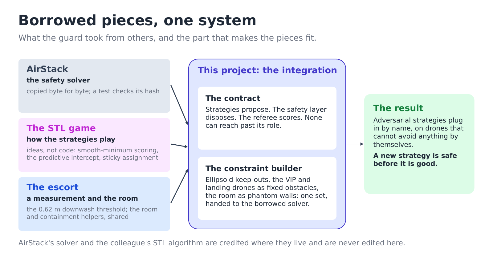
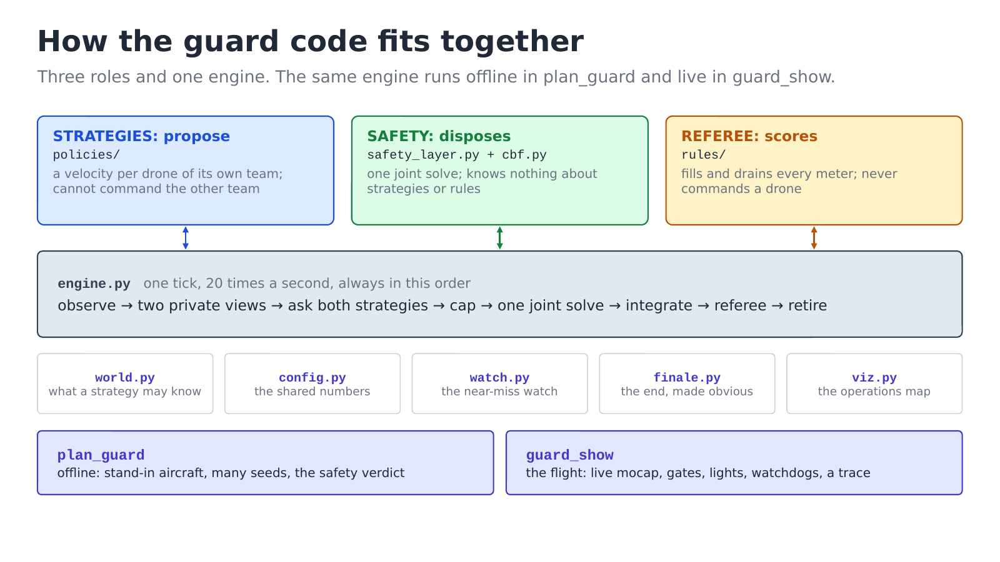
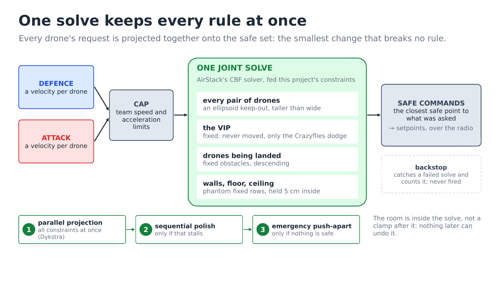
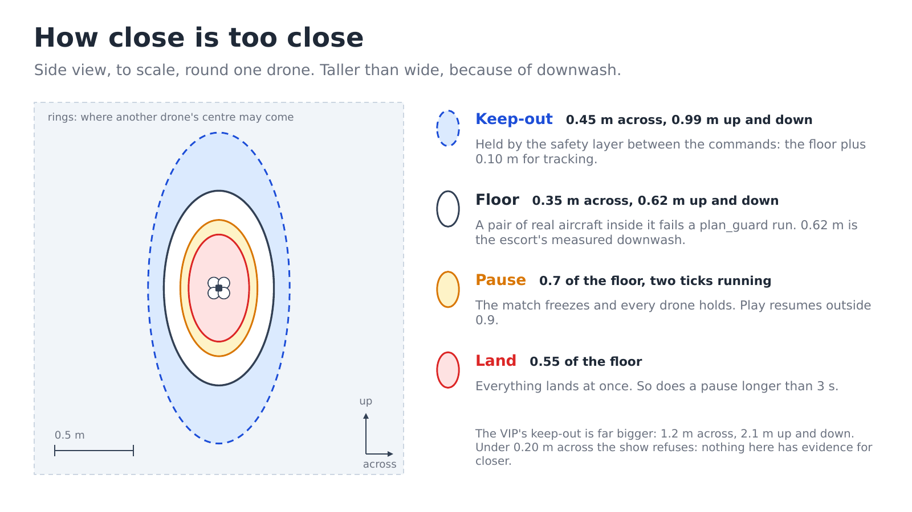
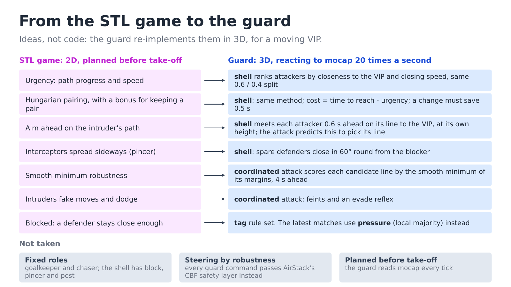
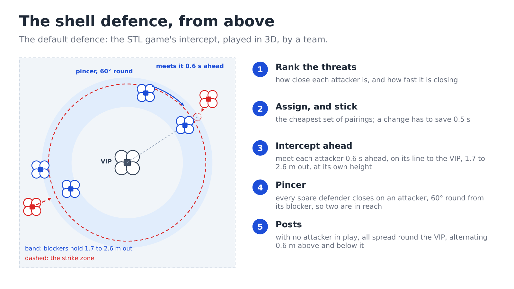
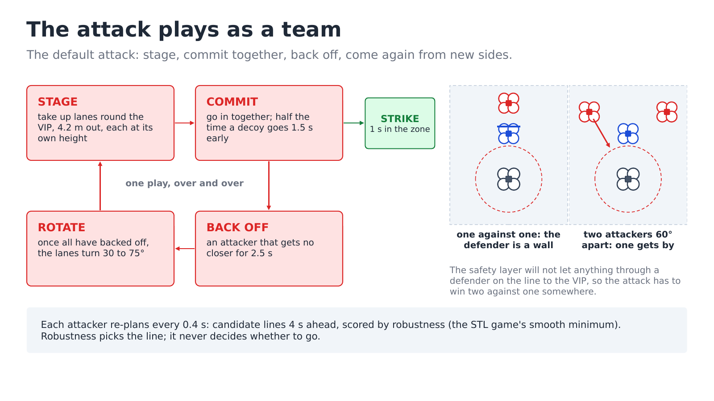
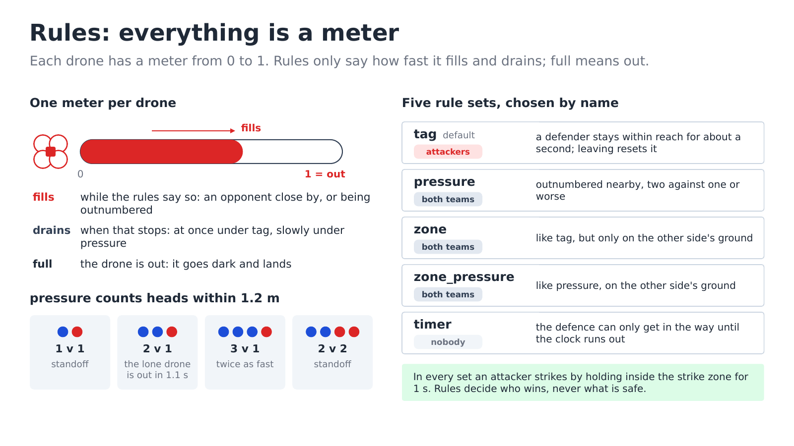
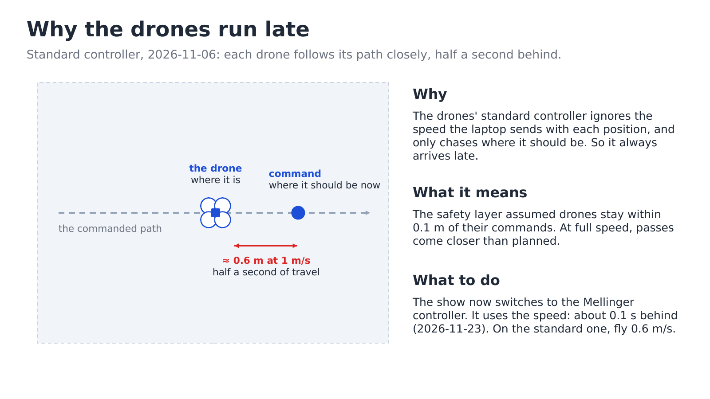
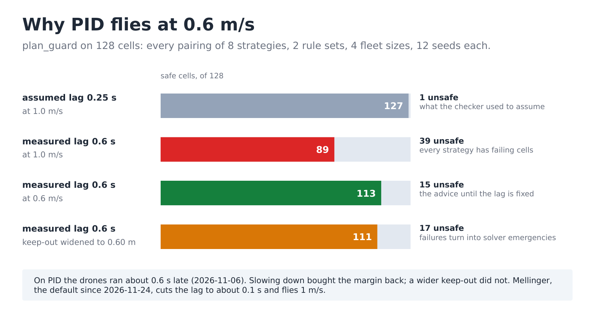

# Guard: theory and design

Why each algorithm is built the way it is, with the maths. The plain version is
[../how-it-works.md](../how-it-works.md); the code is [modules.md](modules.md); what was
measured, and when, is [design-notes.md](design-notes.md).

The guard borrows its machinery on purpose: AirStack's safety solver (§3), the STL game's
way of playing (§6) and the escort's measured downwash threshold (§5.1). What is this
project's own is the integration: the contract (§2) and the constraint set built for the
borrowed solver (§4), which together make it safe to plug in adversarial strategies by
name on drones where a wrong command is a collision.

---

## Notation

Values are the shipped `GuardConfig` defaults (`guard/config.py`) and rule sets
(`guard/rules/standard.py`) unless stated. The central equations also have a "where"
legend under them.

| Symbol | Meaning | Value in the demo |
|---|---|---|
| $p_i,\ v_i$ | position and commanded velocity of drone $i$ | measured; computed |
| $v^{\text{nom}}_i$ | the velocity drone $i$'s strategy asked for | computed |
| $\Delta t$ | control period | 0.05 s (20 Hz) |
| $v_{\max}$ | per-team speed cap, applied to each request before the safety layer | 1.0 m/s both teams |
| $v^{\text{saf}}_{\max}$ | hard cap the safety layer may use while dodging | 1.2 m/s |
| $a_{\max}$ | acceleration limit on each strategy's request | 2.0 m/s² |
| $h_{ij}$ | pairwise barrier between drones $i$ and $j$ (safe when $\ge 0$) | computed |
| $r$ | per-drone safety radius in AirStack's spherical form | solver input |
| $\alpha$ | CBF class-K gain: how fast a gap may close, per metre of gap | 2.5 /s |
| $\alpha_{\text{wall}}$ | gain for the walls, floor and ceiling | 2.0 /s |
| $a,\ c$ | half-axes of a keep-out ellipsoid: across, and up/down | see §4.1 |
| $W^2$ | $\mathrm{diag}(1/a^2,\,1/a^2,\,1/c^2)$, the ellipsoid's shape matrix | computed |
| $d_{\text{cc}}$ | Crazyflie–Crazyflie keep-out across | 0.45 m |
| $z_{\text{cc}}$ | vertical ratio of the Crazyflie keep-out ($d_{\text{cc}} \cdot z_{\text{cc}}$ tall) | 2.2 |
| $d_{\text{vip}},\ z_{\text{vip}}$ | Crazyflie–VIP keep-out across, and its vertical ratio | 1.2 m, 1.75 |
| $\eta$ | hard separation floor across (`min_separation`) | 0.35 m |
| $\eta_z$ | hard separation floor vertically (`min_separation_z`) | 0.62 m |
| $\mathrm{TM}$ | tracking margin: how far an aircraft may trail its setpoint | 0.10 m |
| $t_d,\ \tau$ | pure delay, then first-order lag, of `plan_guard`'s stand-in aircraft (`--delay`, `--tau`) | 0.4 s, 0.2 s (PID fit); 0.1 s, 0.1 s for Mellinger. Measured lags: §8 |
| $n$ | inward unit normal of a wall | geometric |
| $T$ | down time: seconds of filling that downs a drone | 1.1 s |
| $\rho$ | reach: distance within which an opponent counts against a drone | 1.15 m `tag`, 1.2 m `pressure` |
| $\delta$ | drain rate of a meter nothing is filling | ∞ (`tag`), 0.5 /s (`pressure`) |
| $r_s,\ T_s$ | strike radius round the VIP, and the time inside it that strikes | 2.4 m `tag`/`zone`, 1.6 m `timer`/`pressure`/`zone_pressure`; 1.0 s |
| $b$ | contested-strike distance (`strike_block`): a defender this close stops a strike | 0 (off) |
| $k$ | sharpness of the smooth minimum | 8.0 |
| $\mathrm{clip}(x, lo, hi)$ | limit $x$ to the range $[lo, hi]$ | |
| $\lVert\cdot\rVert$ | length of a vector | |

---

## 1. The game as a control problem

N defenders protect a VIP against M attackers: pursuit and evasion under hard safety
constraints, a target-guarding game (Isaacs) replanned 20 times a second. Three facts
constrain everything:

* **Nothing can sense anything.** Positions come only from motion capture, so the system is
  **centralised**: one program knows every position and decides for every drone.
* **Nothing can avoid anything.** The Crazyflies have no onboard collision avoidance, so
  **every safety property has to be enforced in the commands** before they leave the ground.
* **Nothing above the safety layer can be trusted.** This is the one the escort did not
  have. The strategies are *adversarial by design*, and new ones plug in by name from
  outside the package (`-p policy_module:=...`). A safety argument that assumed correct
  strategies would not survive the first plugged-in experiment.

The speeds are a step up from the escort's 0.6 m/s (notation table). The answer to the
third fact is not a better strategy: it is a contract that makes the strategies
irrelevant to safety (§2), and a filter strong enough to absorb whatever they ask for
(§3–§5).

---

## 2. The stack and the contract

The engine runs the three parties in one fixed order each tick
([modules.md](modules.md#one-tick)). Two points of that order matter here: **every request
is projected at once onto the safe set**, after the caps and before integration; and the
referee judges the *aircraft* positions, not the setpoints.

### 2.1 The five clauses of the contract

1. **Strategies propose; they never dispose.** A strategy returns a velocity request, capped
   by the engine before the layer sees it
   (`test_a_strategy_cannot_steer_the_other_team`).
2. **The safety layer has the last word, by construction.** Nothing after the projection may
   undo it, except one backstop clamp for a solver that failed. It has never fired, it is
   counted if it does (`safety_layer.backstop`), and `plan_guard` treats a firing as a
   safety failure.
3. **Opponents are observed, never asked.** Each team gets a private copy of the world, built
   fresh every tick. An opponent's velocity is *estimated* from its observed positions; its
   commands and its strategy's decisions never appear. Each team has its own random stream.
   `test_guard.py` checks this with a spy (an opponent's command never appears in a view), a
   vandal (mutating a view changes nothing outside it) and a dice test.
4. **Rules never touch safety.** The referee scores; it never commands. Each rule set's
   `problems()` refuses numbers only contact could meet: a reach inside the 0.45 m
   keep-out, or a strike radius inside the VIP's 1.2 m. Rules change who *wins*, never what
   is *safe*.
5. **The numbers are one shared file.** `GuardConfig` holds everything every strategy is
   held to under every rule set. Its field names match the escort's `EscortConfig`, so the
   two shows share one definition of "inside the room" and one containment rule.

**Why this makes pluggable strategies safe.** Safety is a property of the layer under the
strategies, which none of them can switch off, with numbers none of them can weaken. A
buggy strategy costs matches, not drones: a new strategy is safe *before it is good*, and
the offline verifier only has to test one layer, because every strategy goes through the
same projection.

---

## 3. The safety filter: AirStack's solver, verbatim

`crazyflie_shows/cbf.py` is AirStack's `svg_ground_control/cbf_filter.py`, copied **byte
for byte** between BEGIN/END markers (snapshot 91376aa, castacks yikuan/SVG_ground_control
@ cf719f0, 2026-10-07, sha256
`7f5d8c5a58398a9702e79ab905e8ef371304277136700658b5234fb5a9078db9`). `test/test_cbf.py`
runs AirStack's own tests plus one that re-hashes the block; the file is never edited here
(change it upstream and re-copy). Two reasons: the same solver runs AirStack's swarm
commander, so it is the bridge to flying Crazyflies under AirStack later; and AirStack
validated it in MuJoCo against the Starling 2 Max airframe.

It is a **control barrier function** (CBF) safety filter (Ames et al. 2019). Escort-theory
§5.4 named one as future work; the escort's own filter is a heuristic projection.

### 3.1 The barrier and the constraint

For drones $i$, $j$ with a shared safety radius $r$:

$$
h_{ij} = \lVert p_i - p_j\rVert^2 - (2r)^2
\qquad (\ge 0 \text{ means safe})
$$

Requiring the class-K condition $\dot h + \alpha h \ge 0$ gives a constraint **linear in
the velocities**:

$$
2\,(p_i - p_j)\cdot(v_i - v_j) + \alpha\, h_{ij} \;\ge\; 0
$$

| Where | |
|---|---|
| $(p_i - p_j)\cdot(v_i - v_j)$ | how fast the gap is closing, along the line between them |
| $\alpha h_{ij}$ | the slack: the gap may close at rate $\alpha$ per metre of gap that remains |

With the per-drone cap $\lVert v_i \rVert \le v_{\max}$, the safe set is an intersection of
convex sets, and the solver returns its closest point to the requests:

$$
\min_{v}\ \sum_k \lVert v_k - v^{\text{nom}}_k\rVert^2
\quad\text{subject to every pair half-space and every cap}
$$

### 3.2 Solving it: Dykstra, two phases, and a fallback

Dykstra's alternating projection in **parallel product-space form**: every constraint is
projected at once in vectorised numpy, and each drone's results are averaged per sweep,
weighted by how many constraint sets it is in (its pair count, plus one for the speed cap).
From the docstring:

* **Active-pair pruning.** A pair with $\alpha h \ge \lVert\text{grad}\rVert \cdot 2 v_{\max}$
  cannot activate this step and is dropped, so cost scales with *active* conflicts, not all
  $N^2$ pairs.
* **A Gauss-Seidel polish**, warm-started from the parallel phase, runs only if it stalls
  (consensus averaging stalls when many constraints share drones).
* **An emergency push-apart** when the problem is infeasible (drones already inside each
  other's spheres, or a negative barrier with no gradient): violated pairs get an
  away-from-each-other velocity capped at $v_{\max}$. Best effort, not optimal.

The solver takes a generic `PairwiseConstraints` bundle (rows
$\text{gradient}\cdot(x_i - x_j) + \text{bias} \ge 0$, plus a per-drone norm cap), which
its docstring names as the extension point: a different constraint builder plugs into the
same solver. This project builds on exactly that seam.

### 3.3 Fixed rows

A **fixed** row's command is ground truth: never projected, capped or averaged, and every
pair constraint with it puts its **full** correction on the movable drone. AirStack added
this for an RC-flown intruder; the guard uses it for the VIP and every retiring drone
(§4.2).

---

## 4. The constraint builder: the integration this project adds

`guard/safety_layer.py` builds the constraint set in the solver's own `PairwiseConstraints`
shape. Not a new algorithm: the fitting of a borrowed solver to this show's bodies, room
and referee.

### 4.1 Aircraft pairs: an ellipsoidal barrier

A drone under another's rotors loses thrust, so the hazard is taller than it is wide. The
keep-out is an ellipsoid:

$$
h_{ij} = \frac{d_x^2 + d_y^2}{a^2} + \frac{d_z^2}{c^2} - 1
\qquad (d = p_i - p_j,\ \ge 0 \text{ means safe})
$$

normalised so the surface is $h = 0$, unlike AirStack's $-(2r)^2$. $W^2$ is constant, so
$\dot h$ picks up exactly the relative velocity, and $\dot h + \alpha h \ge 0$ gives

$$
2\,W^2 (p_i - p_j)\cdot(v_i - v_j) + \alpha\, h_{ij} \;\ge\; 0,
\qquad W^2 = \mathrm{diag}\!\big(1/a^2,\ 1/a^2,\ 1/c^2\big)
$$

which is AirStack's sphere with $W = I/r$ when $a = c$ (the extra $1/r^2$ is absorbed by
the gain). The ellipsoid is a different builder, not a different solver.

A Crazyflie–Crazyflie pair uses $(d_{\text{cc}},\, d_{\text{cc}} z_{\text{cc}})$ =
(0.45 m, 0.99 m); any pair with the VIP uses the larger
$(d_{\text{vip}},\, d_{\text{vip}} z_{\text{vip}})$ = (1.2 m, 2.1 m). The evidence for
the numbers is §5.

### 4.2 Fixed rows: the VIP and the retiring drones

The VIP (a hand-flown DJI, or a person) cannot be commanded, so it is a fixed row at its
measured velocity, and the Crazyflies absorb the whole evasion. A retiring drone (downed or
struck) first exits as an ordinary commanded row: it brakes and clears the VIP, so it still
dodges. Once handed to the landing commander it becomes a fixed row descending at
`land_speed` (0.25 m/s), as the commander flies it.

### 4.3 Phantom walls: the room inside the same projection

The solver only knows pairs, so walls, floor and ceiling are pairs with **phantom fixed
rows** at zero velocity, one per nearby constraint, which is a single-drone half-space:

$$
n \cdot v_i + \alpha_{\text{wall}}\cdot\text{clearance} \;\ge\; 0
$$

**Why not clamp afterwards.** A clamp after the CBF could push a setpoint back into a
pair's forbidden half-space, the ordering failure the escort hit when it clamped
separation before slewing (escort-theory §5.2). With the room inside the solve, one solve
keeps every property at once, or reports that it could not.

Three details the corners forced:

* **One row per polygon edge within reach**, by distance to the edge *segment*. With only
  the nearest edge, a drone sliding along one wall passed straight through the next at a
  convex corner (`test_walls_hold_a_drone_inside_the_room`). Segments also keep the step's
  reflex corner from trimming the room.
* **The rows hold `wall_margin` (5 cm) inside**, because at 20 Hz the inward normal turns
  between ticks at a corner and a setpoint can creep a couple of centimetres past $h = 0$.
* **Rows exist only within reach** of the boundary,
  $v^{\text{saf}}_{\max}/\alpha_{\text{wall}} + 0.5 \approx 1.1$ m; farther out a boundary
  cannot bind yet.

---

## 5. What the filter guarantees, and what it does not

### 5.1 It holds setpoints apart, not aircraft

The CBF runs on the commanded reference, identical in the simulator and on hardware. The
aircraft trail their setpoints, so the keep-out is the hard floor **plus** the tracking
margin (`TRACKING_MARGIN`, arena.yaml):

$$
d_{\text{cc}} = \eta + \mathrm{TM} = 0.35 + 0.10 = 0.45\ \text{m},
\qquad d_{\text{cc}} \cdot z_{\text{cc}} \approx 0.99\ \text{m}
$$

The floor is this project's own, relaxed from the arena's 0.80 m on 2026-11-03: side by side
at one height is the regime the STL game showed to be fine (closest approach 0.18–0.20 m).
One drone over another is downwash, so the vertical floor stays at
$\eta_z$ = `escort.DOWNWASH_DZ`, the escort's *measured* threshold. `config.problems()`
refuses anything under 0.20 m across: nothing here has evidence for closer.

The margin in $d_{\text{cc}}$ covers the *assumed* lag; the watchdogs below cover the
*measured* one (§8).

### 5.2 Defence in depth on the aircraft themselves

The near-miss watch (`guard/watch.py`) measures the real aircraft in fractions of the
hard-floor ellipsoid,
$\mathrm{floor\_ratio} = \sqrt{(d_x^2+d_y^2)/\eta^2 + d_z^2/\eta_z^2}$ (1 = on it), with the
pause and land lines in the diagram. Two things the diagram does not say:

* **Mocap glitches are not near misses.** A jump over 0.30 m in one tick (6 m/s, faster than
  any Crazyflie) is a swapped or ghost rigid body: the drone flies on its setpoint for that
  tick and the next, and the glitch is counted.
* **A pause holds every drone *through the safety layer***, so the aircraft settle back onto
  setpoints the CBF already keeps $d_{\text{cc}}$ apart. Landing would not separate them.

The per-drone watchdog is the escort's `contain_check`, shared: stale mocap (0.3 s hold,
1.0 s land), outside the room (0.25 m margin), or not following (0.60 m from every
setpoint of the last 1.0 s, for 0.80 s) lands the show. The 1.0 s window (`track_lag_s`) is
the ~0.6 s PID lag plus margin: a drone that follows late is still near where the command
just was; one that stops, or leaves the path, is not. **Check the plant, not the command**.

### 5.3 What is proved, measured, assumed

* **Proved, at the solver's level:** the commands are the projection onto the safe set, with
  a residual per tick and convergence checked before sending.
* **Assumed:** the first-order CBF is exact in continuous time only; at 20 Hz under a lagging
  aircraft it is not a proof. Hence the margins (§5.1, §4.3) and the watchdogs (§5.2).
  AirStack's docstring names the acceleration-level upgrade (an HOCBF) as a builder swap on
  the same solver; it would remove the dependence on lag.
* **Measured:** the vertical floor (the escort's downwash), and the watchdog lines (from the
  2026-11-05 flights). The horizontal floor is swept, not measured (§8).

---

## 6. Playing well: the STL game's theory, turned round

The default strategies re-use the STL game's ideas, not its code (`stl_game.py` is a port
and never edited; how it decides is in
[../../stl/details/design-notes.md](../../stl/details/design-notes.md#the-algorithm)).
Nothing here affects safety: these are requests, and §2 holds however good or bad they are.

### 6.1 Robustness: a smooth minimum over a rollout

The STL game scores a candidate by **robustness**: how far every margin stays on the safe
side along the path, taken as a smooth minimum (`policies/common.py`):

$$
\mathrm{soft\_min}(x, k) \;=\; m - \frac{1}{k}\log \sum_i e^{-k\,(x_i - m)},
\qquad m = \min_i\, x_i
$$

| Where | |
|---|---|
| $x_i$ | the margins at sample $i$ along the rollout |
| $k$ | sharpness: as $k$ grows the value tends to $\min_i x_i$ |

The attack replans every 0.4 s: candidate goals round its lane (bearings ±25°, ±50°, ±80°,
three heights, at staging or striking range) are rolled out 4.0 s ahead in 8 samples, each
scored by the smooth minimum of the room margin and the altitude-band margin.

### 6.2 The margin that includes time

The rules are *temporal*: a meter has to fill. An instantaneous distance margin forbade the
fast pass through tag range that the rules allow, and the attack never struck. So the
margin has a temporal part, in metres-equivalent: the rule set's own `down_rates` fill the
attacker's meter along the predicted path, from its current value, and the margin is the
meter left unspent at its worst, times $v\,T$. The two combine by a plain minimum:
**space** margins hold at every instant, **time** margins over the plan.

### 6.3 Robustness chooses the line; it does not gate the attempt

A line's score is robustness plus progress toward the VIP (weight 1.0), the pull of the
attacker's own lane (0.5), the safe-robustness term (2.5) and the bearing gap to the
nearest defender (1.5: strike where they are not). Gating the attempt on positive
robustness meant never going at all, while a simultaneous rush wins. So robustness picks
the least-exposed line, spread and height, and the attack goes anyway. A `commit_margin` of
0.3 keeps the plan unless a new one wins by that much.

### 6.4 The defence the attacker plans against

Each candidate is rolled out against a **prediction**: every defender marked against this
attacker runs for the meeting point between the VIP and the attacker at full speed (the
STL game's predictive intercept, turned round). Only *markers* move; a defender can only be
in one place, which is what attacking together exploits. Predicting every defender onto
every attacker made no lane ever look open.

### 6.5 The shell

`policies/defense_shell.py`. What the diagram does not give:

* **Urgency** $= 0.6\,(1 - \mathrm{clip}(r/4.0, 0, 1)) + 0.4\,\mathrm{clip}(\text{closing}, 0, 1)$:
  distance $r$ against 4.0 m, closing speed against 1.0 m/s.
* **Assignment** is min-cost over all defenders and threats at once
  (`linear_sum_assignment`): travel time minus 1.5 × urgency, plus a penalty for pincer
  slots; repeating last tick's pairing costs 0.5 s less.
* **3D.** Meeting on the line from the VIP lets it meet an over-the-top or floor-level
  attack at its own height: the guard's addition to the borrowed intercept.
* **Pincers** exist because under a majority rule one defender alone downs nobody (§7).
* **Rules-aware spots.** A spot the rules would punish (off home ground under `zone`, next
  to two attackers under `pressure`) is pulled in toward the VIP. A defender whose own down
  meter passes `bail` (0.35) falls back to the shell.

### 6.6 The team play

`policies/attack_coordinated.py`. The lanes exist because **a defender on the line between
the VIP and an attacker is a wall**: §3.1's constraint is exactly "the gap may not close",
so the attack must win two-on-one somewhere, and the rules (§7) say what that is worth.
Beyond the diagram:

* The decoy goes with probability 0.5.
* Under the plan sit the STL intruder's other two layers: a feint (show the other side
  first, with a cooldown), and an evade reflex judged by the rules. Staging, it leaves when
  the rule set would start filling its down meter there, or one step nearer the closest
  defender. Striking, it breaks off only once its down meter passes `evade_share` and it is
  outside the strike radius.
* Where defenders can be downed, the attack **hunts**: when the rule set's own rates say the
  pack could down a defender, evaluated at the spots the pack would take without filling
  any attacker's own meter, the attackers converge on it.

---

## 7. Rules as rates

### 7.1 Meters

Each drone has a **down** meter and each attacker a **strike** meter, from 0 to 1; full is
an event (downed and lands, or strikes, scores and lands). A rule set says only:

* how fast each meter fills (`down_rates`, `strike_rates`, per second, so $1/\text{rate}$
  is the time to fill from empty);
* how fast it drains when nothing fills it (`drain`; **inf resets it the moment the
  condition stops**);
* who has won (`result`).

That covers a clock ("within range for 1.1 s": rate $1/1.1$, reset on leaving), a graded
counter, zones, and anything else that is a rate. A meter is a sum of 20 Hz ticks and
$22 \times 0.05/1.1$ lands a hair under 1.0, so "full" is $\ge 1 - 10^{-9}$ (a test pins
it); otherwise a down lands one tick late.

### 7.2 One definition, two uses

The **referee** integrates the meters from the aircraft positions. Strategies get the
**same rule object**, plus everybody's meters (public, like a scoreboard), and call the
same rate functions on *predicted* positions (`down_rates` is vectorised over whole
rollouts for this). So one strategy plays under any rule set: it never asks "is this
tag?", it asks "what would the rules do here?".

### 7.3 The built-in sets

All share the strike rule: hold within $r_s$ of the VIP for $T_s$.

| Name | Who can be downed | The down meter fills... |
|---|---|---|
| `tag` | attackers | at $1/T$ while any defender is within $\rho$; resets on leaving: **the STL game's block** |
| `timer` | nobody | never: the defence can only deny |
| `pressure` | both teams | at $(\text{opponents in reach} - \text{teammates in reach} - 1)/T$, never below 0; drains at $\delta$ |
| `zone` | both teams | like `tag`, only on the other team's ground: attackers within `home` (3.0 m) of the VIP, defenders outside it |
| `zone_pressure` | both teams | like `pressure`, on the other team's ground |

`pressure` is a **graded local majority** from the victim's point of view (the diagram has
1 v 1 to 2 v 2; 3 v 2 gives $1/T$ to each of the pair). There is a reason to gang up and a
reason not to be caught alone, for both teams, and the meter drains rather than resets, so
a drone that escapes stays weakened for up to 2 s. Its strike radius (1.6 m, chosen in
simulation) is smaller than `tag`'s: a lone defender cannot down a lone attacker here, so
the strike zone has to be smaller.

**Contested strikes** ($b$ = `strike_block`, any rule set) gate the strike rate on the
nearest active defender:

$$\dot s_a = \frac{1}{T_s}\,\mathbf 1\!\left[\lVert p_a - p_{\text{VIP}}\rVert \le r_s\right]\,
\mathbf 1\!\left[\min_d \lVert p_a - p_d\rVert > b\right].$$

The second factor makes shadowing count as a block. `coordinated` adds the robustness term
$\min_t(\min_d\lVert \hat p_a(t) - \hat p_d(t)\rVert - b)$ over the dwell, so a spot a
predicted defender will shadow scores as unsafe. $b \le d_{\text{cc}}$ is refused: the
safety layer never lets a defender that close.

---

## 8. The tracking lag, and why the speed caps follow

Offline, `plan_guard` models each aircraft as a **pure delay** $t_d$ then a **first-order
lag** $\tau$, so at speed $v$ it sits about $(t_d + \tau)\, v$ behind its setpoint. The split
matters: a delay every commanded drone shares replays a safe pattern late, but the lag
rounds corners, and a body that does not share the delay (the DJI, a landing drone) can be
run into. Until 2026-11-19 it was a 0.25 s lag alone, a stand-in.

Hardware measured it on 2026-11-06: every drone followed its path to within 3–5 cm, but
0.54–0.60 s late, because the firmware's PID position controller overwrites the setpoint
velocity and throws the feed-forward away. $\mathrm{TM}$ and the stand-in were both
optimistic. The sweep that followed (below) is why the caps follow the lag: slowing down
buys the margin back, a wider keep-out does not, because the constraints start to
conflict.

That advice held until Mellinger (full-state tracking) was flown on 2026-11-23: 0.08–0.14 s
of lag at 1 m/s, closest pair 0.36–0.40 m, no near miss. The lag term is about a fifth of
PID's, and 1 m/s is the advice on Mellinger. The match records are in
[design-notes.md](design-notes.md).

---

## 9. How it is verified

* **The solver travels with its tests**, plus the hash check (§3).
* **The contract has its own tests** (§2.1, clause 3).
* **`plan_guard`'s safety verdict covers every seed.** It fails if two airborne aircraft get
  inside the hard floor, or one inside the VIP's keep-out; if a drone leaves the room or the
  band; on a solver emergency; or if the backstop fires. `--matrix --rules all` is
  4 × 4 strategies × 5 rule sets = 80 cells per fleet size.
* **Measured offline** (2026-11-19, PID plant, 1 m/s, 12 seeds): 1 of 80 cells unsafe,
  closest pair 0.34 m; with a DJI drifting at 0.2 m/s, 5 of 80 (§10). Re-run for today's.
* **Fast enough:** a tick takes 3 ms mean, 17 ms worst for 4 v 3, 27 ms worst for 6 v 6,
  against 50 ms at 20 Hz. The spikes are the attackers' replans.
* **Honest limits.** The stand-in aircraft is a fit, not a model of the airframe. The
  simulator publishes no mocap, so every check that reads real poses (containment,
  near-miss, placement) is first exercised on hardware. Upstream's MuJoCo validation covers
  the solver, not these constraints: §4's builders are checked by this repo's tests, sweeps
  and flights.

---

## 10. Open questions

The evidence for each is in [design-notes.md](design-notes.md).

| Question | Where it points |
|---|---|
| Were the early near misses the PID lag (§8)? Likely (closest pairs at the floor with the setpoints further apart on 2026-11-06, none on Mellinger), not proved for the flights before 11-06, which kept no output | each new near miss prints its setpoint gap and tracking errors; `guard_trace.csv` |
| Does Mellinger stay this good with more drones, a faster DJI, low batteries? | `lag s` in each flight report |
| Can the dependence on lag be designed out (§5.3)? | an HOCBF builder on the same solver, before flying faster |
| `pressure` with a drifting DJI: 5 of 80 cells still fail on the PID plant | re-run on the Mellinger plant (`--delay 0.1 --tau 0.1 --vip-move 0.2`) |
| The defence loses under `pressure` to `coordinated`, which wins by downing every defender | a teammate-support radius, or a defence that keeps its pairs together |
| `zone_pressure` favours the attack | home-ground tactics: strategy work, not a rule fix |
| `/poses` freezes 0.2–0.55 s every 10–40 s, cause unknown | the flight traces |
