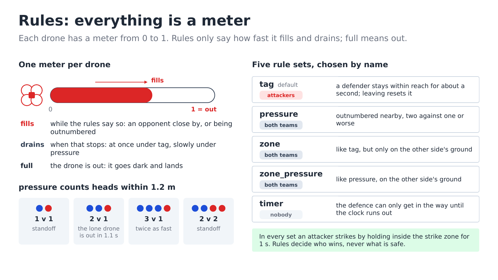
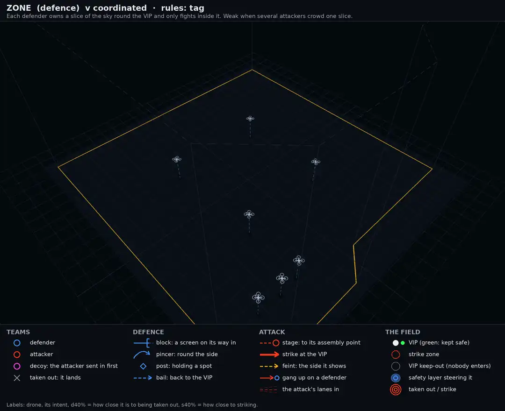
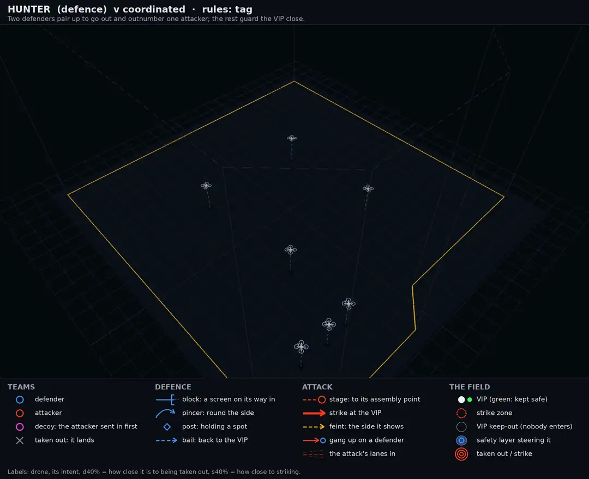
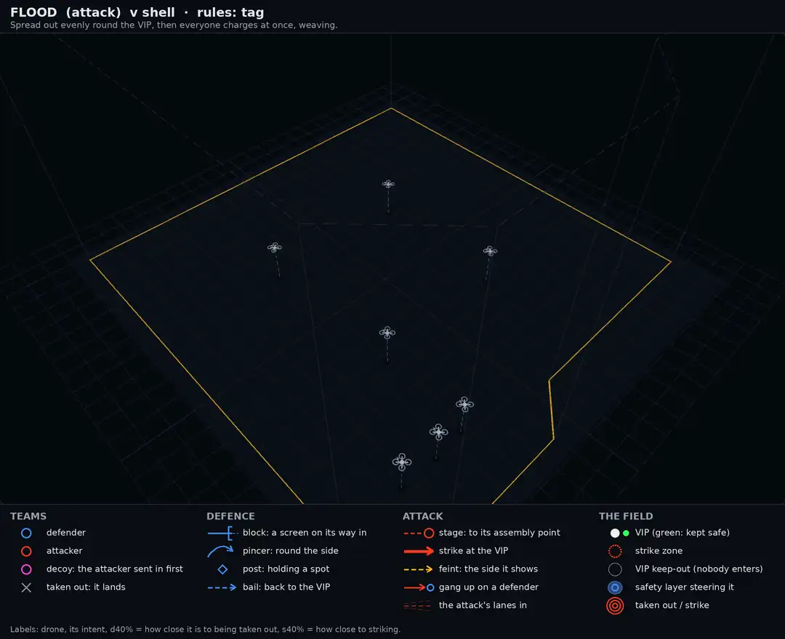
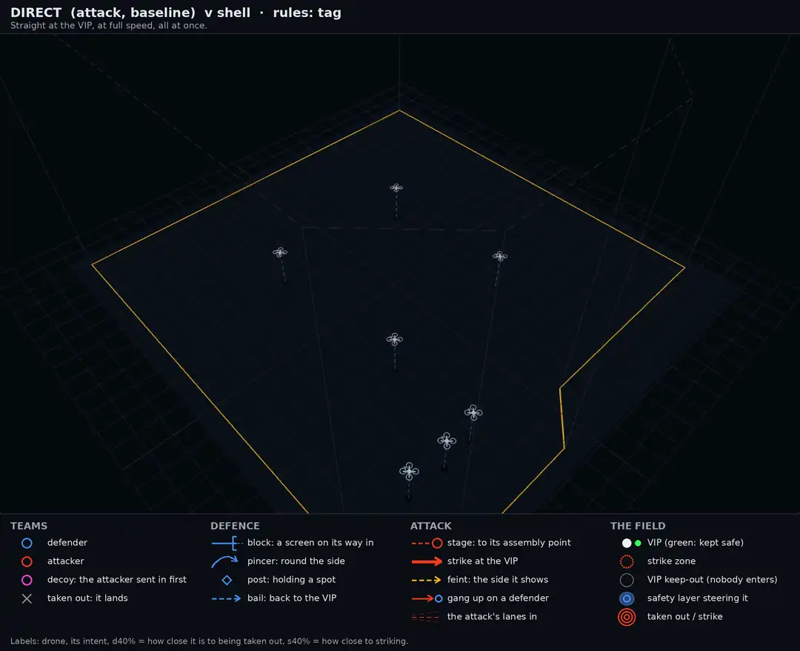
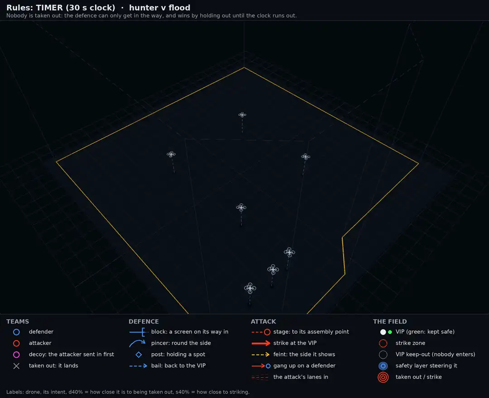
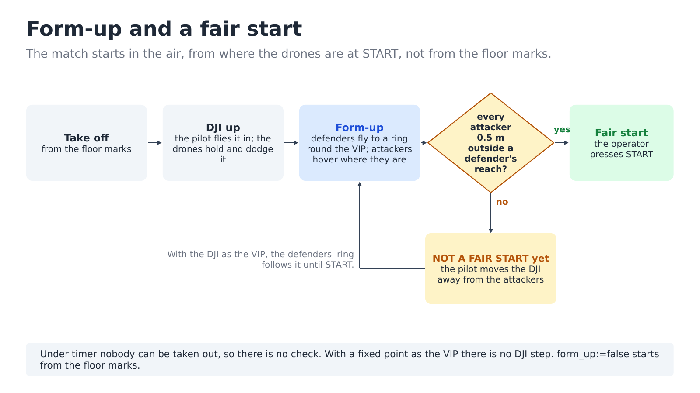
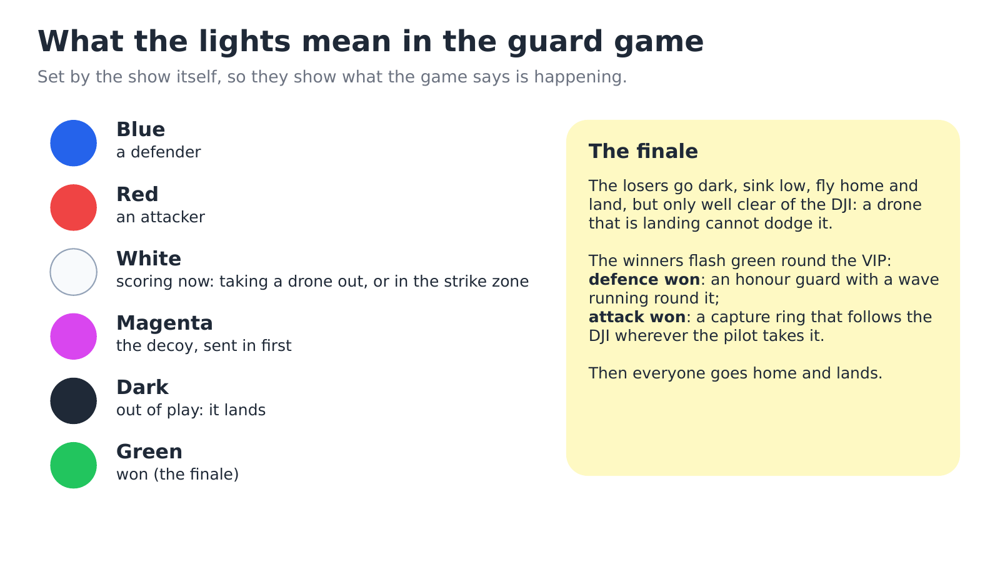
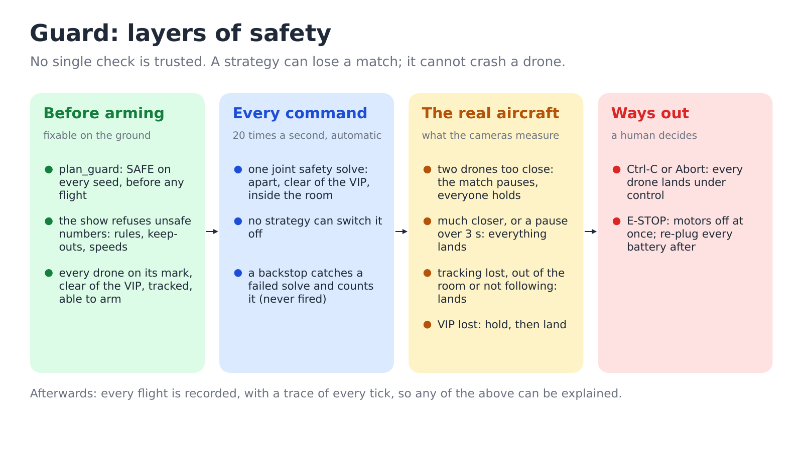
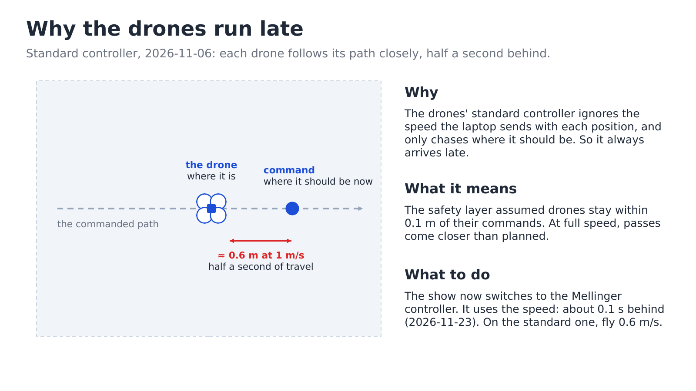

# Guard: how it works

No maths on this page; the deep dives are listed at the end.

## The game

You choose how many drones are on each side, which strategy each team plays, and which
rules decide who is out.

- An attacker **strikes** by staying in the strike zone for about a second. One strike
  wins the match for the attack.
- A drone is **taken out** when the other team keeps it under pressure for about a
  second. It goes dark, moves clear of the VIP if it is close, and lands. Depending on
  the rules, that can happen to either side.
- The defence wins when no attacker is left, or when it holds out until the clock runs
  out.

Nothing is scripted, so no two matches are the same, even from the same marks.

## The pieces

The equipment is the escort's ([escort/how-it-works.md](../escort/how-it-works.md#the-pieces)):
cameras see every drone and the DJI, one laptop decides everything, and the drones only
fly to the point they are told. Every safety rule is enforced on the laptop, before a
command leaves it.

## One decision, 20 times a second

A strategy sees its own team as it commanded it, and the other team only as the cameras
see it: where each drone is and how it is moving, never what it was told. The safety
layer changes the requests as little as possible, and no strategy can switch it off: a
bad strategy loses matches, it does not crash drones.

## The rules

Choose the rules before the match. **pressure** gives the most two-sided matches:
defenders that leave the VIP to chase can be ganged up on.

**Contested strikes** can be added to any rule set. Then a defender close enough to an
attacker stops its strike, so shadowing an attacker counts as a block.

## The strategies

Some pairings are one-sided (hunter beats every attack under tag); the even ones are
under the diagram, and the numbers are in [details/design-notes.md](details/design-notes.md#more-strategies-2026-11-06).

The clips are simulator matches in the console's 3D view, seen from behind the attackers; the legend under each explains the symbols. The pairing flown on hardware, the defaults under **pressure**:

*coordinated, under pressure.* Two of the positions are close together on one side, and
when blocked the attack backs off and comes again from new sides. Here it goes in behind
a decoy (magenta) and strikes after 12 s.

<b>Watch every strategy and rule set</b> (nine more clips)

Each defence against the default attack, under tag:

*shell.* Blocks meet each attacker on its way in, at its own height, and spare
defenders pincer from the side. All three attackers are taken out after 13 s.

*zone.* Each defender only goes out inside its own slice (the diamonds are its post).
Strong against a spread attack, weak when attackers crowd one slice: here the attack
commits behind a decoy and strikes after 13 s.

*hunter.* Pairs go out to outnumber an attacker while the rest stay close. All three
attackers are taken out after 14 s.

*ring.* The ring turns towards the threat, but cannot face every side at once: the
attack comes from several sides and strikes after 13 s.

Each other attack against the default defence (shell), except wolfpack:

*flood, under tag.* The shell takes all three out after 10 s.

*wolfpack, against zone under pressure.* It needs rules where defenders can be taken
out, and goes for the VIP once the defence is thin or the hunt has taken too long. Here
it takes out the defender that went out alone and strikes through the gap after 6 s.
(Against the shell, in the simulator, it rarely gets that far.)

*direct, under tag.* The shell meets all three on the way in and takes them out in
under 4 s.

The rule sets not shown above:

*zone_pressure.* Either side can be taken out, but only on the other side's ground.
Here the attack comes in together and strikes after 13 s.

*timer, with a 30 s clock.* Nobody can be taken out. The defence blocks wave after wave
and wins by holding out.

## What you see on the map

RViz and the console's 3D view draw what each drone *means* to do: a block, a pincer, a
strike, a feint, a decoy. The legend is in [run.md](run.md#what-you-will-see).

## The start of a match

## What the lights mean

The right-hand box is the finale, which makes the result obvious from across the room.

## Layers of safety

Where the recordings are: [../rig/flight-logs.md](../rig/flight-logs.md).

## Why the drones run late (and what to do about it)

With the drones' standard controller, passes at full speed get closer than the safety
layer planned for. Since 2026-11-24 the show switches the drones to **Mellinger** for
each match and back afterwards. On 2026-11-23 four matches flew it at full speed with no
near miss.

## Where to go next

| You want | Read |
|---|---|
| To run it | [run.md](run.md) |
| To present it to guests | [presenting.md](presenting.md) |
| How the code is put together | [details/modules.md](details/modules.md) |
| Why it is built this way, with the maths | [details/theory.md](details/theory.md) |
| What was measured, match by match | [details/design-notes.md](details/design-notes.md) |
