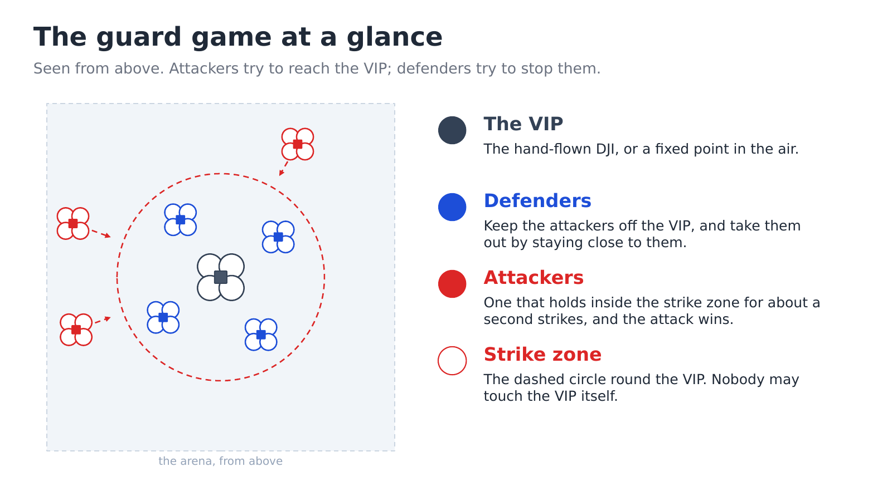
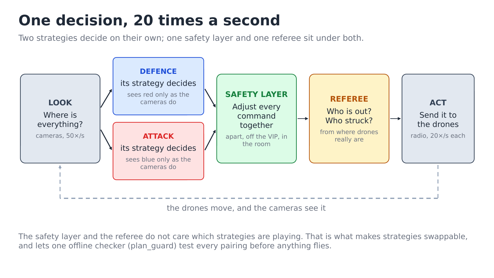
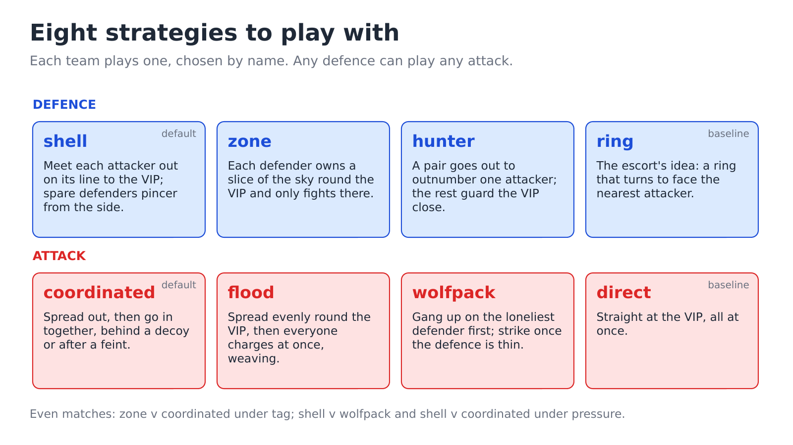
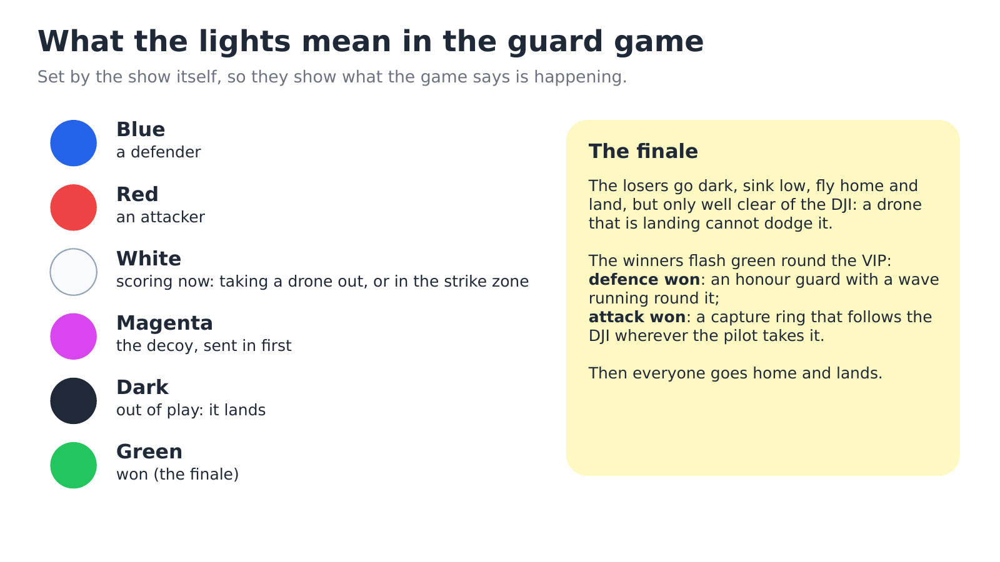
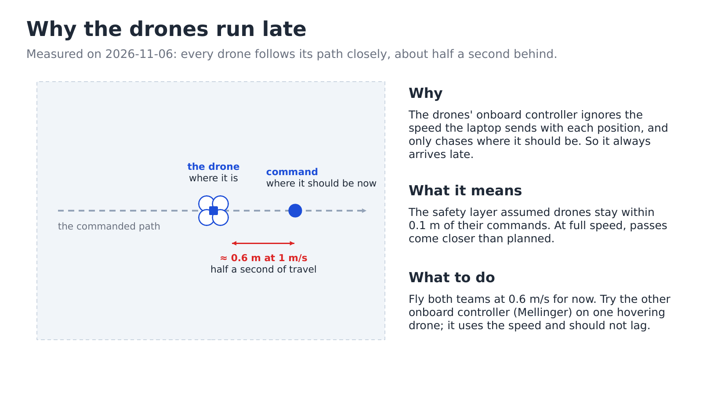

# Guard: how it works

This page uses no maths. How the code is put together is in
[details/guard-modules.md](../details/guard-modules.md); why it is that way, and what was
measured, is in [details/guard-design-notes.md](../details/guard-design-notes.md).

## The game

A team of **defenders** (blue) protects a **VIP**: a hand-flown DJI, or a fixed point
in the air. A team of **attackers** (red) tries to reach it. You choose how many drones
are on each side, which strategy each team plays, and which rules decide who is out.

- An attacker **strikes** by staying close to the VIP for about a second. One strike
  wins the match for the attack.
- A drone is **taken out** when the other team keeps it under pressure for about a
  second. It goes dark and lands. Depending on the rules, that can happen to either side.
- The defence wins when no attacker is left, or when it holds out until the clock runs
  out.

Nothing is scripted. Each team's strategy decides 20 times a second from what it can
see, so no two matches are the same, even with the same drones on the same marks.

## The pieces

The equipment is the same as for the escort ([escort/how-it-works.md](../escort/how-it-works.md#the-pieces)):
- cameras around the room see every drone and the DJI;
- one laptop decides everything;
- the drones only fly to the point they are told.

Every safety rule is enforced on the laptop, before a command leaves it.

## One decision, 20 times a second

1. **Look.** The cameras say where every drone and the DJI are.
2. **Each team decides, on its own.** A strategy sees its own team as it commanded it,
   and the other team only as the cameras see it: where each drone is and how it is
   moving, never what it has been told to do. The two strategies cannot read each
   other's minds.
3. **The safety layer adjusts everything together.** It changes every team's requests
   as little as possible so that no two drones get too close, nobody flies into the
   DJI, and everyone stays inside the room and between the floor and the ceiling.
   A strategy cannot switch it off. A bad strategy loses matches; it does not crash
   drones.
4. **The referee scores.** It checks who is close to whom, using where the drones
   really are, and decides who is taken out, who struck and who has won.

Because the strategies sit on top of the same safety layer and the same referee, you
can swap them freely, and compare them fairly.

## The rules

Choose the rules before the match. Each one only changes who can be taken out, and how.

| Rules | Who can be taken out | How |
|---|---|---|
| **tag** | attackers | a defender stays close to an attacker for about a second |
| **pressure** | both teams | a drone is outnumbered nearby, two against one or worse. One against one is a standoff. |
| **zone** | both teams | like tag, but each side only on the other side's ground (near the VIP is the defence's ground) |
| **zone_pressure** | both teams | like pressure, on the other side's ground |
| **timer** | nobody | the defence can only get in the way and hold out until the clock runs out |

**pressure** gives the most two-sided matches: defenders that leave the VIP to chase can
be ganged up on.

## The strategies

Each team plays one strategy, chosen by name. Four per side are built in.

**Defence**

| Strategy | The idea |
|---|---|
| **shell** (default) | Meet each attacker out on its line to the VIP, at its own height. With spare defenders, send a second one round the side (a pincer). |
| **zone** | Each defender owns a slice of the sky round the VIP and only fights inside it. Strong against a spread attack, weak against several attackers crowding one slice. |
| **hunter** | Two defenders pair up to go out and outnumber one attacker; the rest guard the VIP close. |
| **ring** | The escort's idea: a ring that turns to face the nearest attacker. A baseline to compare against. |

**Attack**

| Strategy | The idea |
|---|---|
| **coordinated** (default) | Take up positions all round, then go in together, sometimes behind a decoy sent in first, sometimes after a feint to the other side. Back off and come again from new sides when blocked. |
| **flood** | Spread out evenly round the VIP, then everyone charges at once, weaving. |
| **wolfpack** | Gang up on the loneliest defender first, and only go for the VIP once the defence is thinned out. It needs rules where defenders can be taken out. |
| **direct** | Straight at the VIP, all at once. A baseline. |

**Which matches are worth showing.** Some pairings are one-sided: hunter beats every
attack under tag, for example. The most even ones, measured over many simulated matches,
are:
- zone against coordinated under **tag**: the attack overloads one slice.
- shell against wolfpack under **pressure**: defenders really do get taken out.
- shell against coordinated under **pressure**.

The full table is in [details/guard-design-notes.md](../details/guard-design-notes.md).

## What you see on the map

RViz and the console's 3D view draw what each drone *means* to do: a defender's block
or pincer, an attacker's staging point, strike, feint or decoy, and the attack's lanes.
The legend is in [run.md](run.md#what-you-will-see).

## The end of a match

The finale makes the result obvious from across the room.

- **The losers** go dark, sink low, fly home and land. They only land well clear of the
  DJI, because a drone that is landing cannot dodge it.
- **The winners** flash green and gather round the VIP:
  - after a defence win, an honour guard with a wave running round it;
  - after an attack win, a tight ring that squeezes in and out. If the DJI moves, the
    ring follows it: the VIP is captured.

Then everyone goes home and lands.

## What the lights mean

| Light | Meaning |
|---|---|
| blue | a defender |
| red | an attacker |
| white | scoring right now: a defender taking an attacker out, or an attacker inside the strike zone |
| magenta | the attacker sent in first as a decoy |
| dark | out of play |
| flashing green, then green | won (the finale) |

## Layers of safety

No single check is trusted.

- **Before arming,** the show refuses to fly if the plan does not fit the measured room,
  if drones stand too close to the VIP or each other, or if a drone is not on its mark.
- **Every command** passes the safety layer: drones apart, out of the DJI's way, inside
  the room.
- **In flight,** the show watches where each drone *really* is.
  - If two drones come too close, the match **pauses** and everyone holds still until
    they are apart again.
  - If they come much closer, everything lands.
  - A drone that stops following its command, or that the cameras lose, lands the show.
- **Every flight is recorded**, so any of the above can be explained afterwards
  ([details/flight-logs.md](../details/flight-logs.md)).

## Why the drones run late (and what to do about it)

Measured on 2026-11-06, every drone flies its commanded path faithfully, but about half
a second behind it. At full speed that is half a metre or more. The cause is the drones'
own controller: it ignores the speed the laptop sends with each position.

Two consequences:
- The safety layer was designed assuming drones stay much closer to their commands than
  that. So at full speed, passes get closer than planned.
- The cure is a different onboard controller, which the show can switch to for one match
  (`controller`). It has to be tried on a hovering drone first.

Until then, a slower match (`0.6 m/s` for both teams) keeps a comfortable margin.

## Where to go next

| You want | Read |
|---|---|
| To run it | [run.md](run.md) |
| To present it to guests | [presenting.md](presenting.md) |
| How the code is put together | [details/guard-modules.md](../details/guard-modules.md) |
| What was measured, and why things are the way they are | [details/guard-design-notes.md](../details/guard-design-notes.md) |
