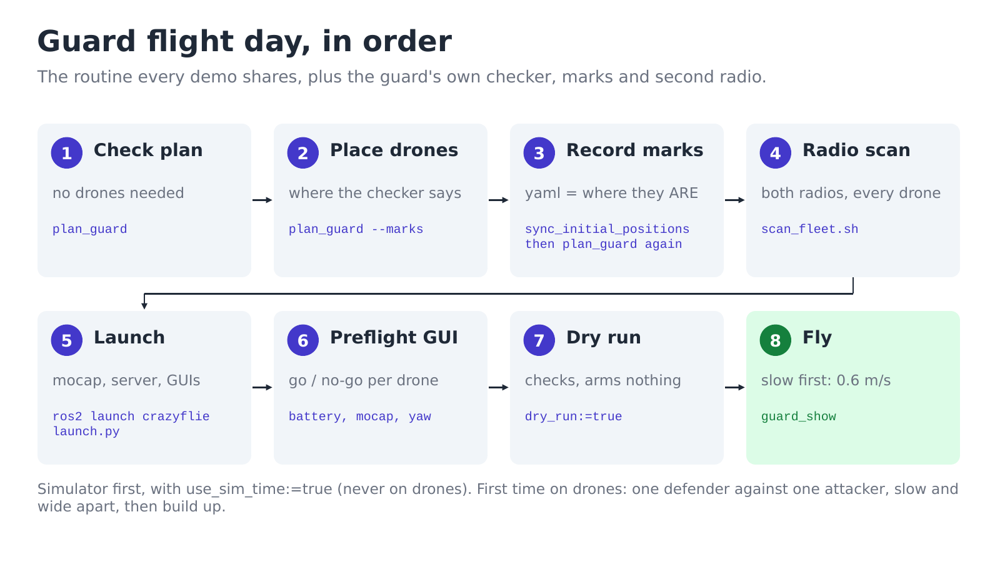
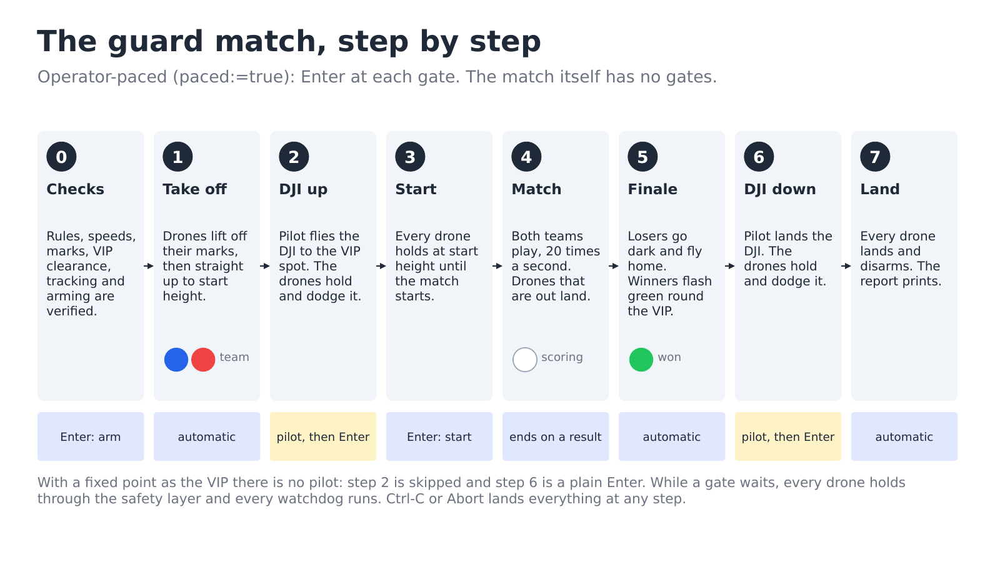

# Running the guard show

Defenders protect a VIP (a fixed point, or a hand-flown DJI) from attackers. You
choose how many of each, and which strategy each team uses. A safety layer sits
under both strategies and keeps every drone apart, out of the DJI's way and
inside the room, whatever the strategies ask for.

The shared steps (power, mocap, scanning, syncing) are in
[../02-flight-day.md](../02-flight-day.md). This page is only what is different. How the
game works: [how-it-works.md](how-it-works.md). Showing it to guests:
[presenting.md](presenting.md).



## 1. Check it with no drones

```bash
ros2 run crazyflie_shows plan_guard --defenders 4 --attackers 3
```

It plays a dozen matches against simulated drones and ends in **SAFE on every
seed** or **SAFETY FAILED**. Do not fly a configuration that fails.

To see the matches, open RViz and add `--rviz`:

```bash
rviz2 -d install/crazyflie_shows/share/crazyflie_shows/data/guard.rviz &
ros2 run crazyflie_shows plan_guard --rviz --matrix
```

`--matrix` plays every defence strategy against every attack strategy in turn, and
`--matrix --rules all` does that under every rule set.
`ros2 run crazyflie_shows plan_guard --list` names them all.

## 2. Stand the drones on their marks

```bash
ros2 run crazyflie_shows plan_guard --marks --defenders 4 --attackers 3
```

Defenders go round the VIP, attackers on the far side from the operator. Sync the
positions and run `plan_guard` again.

## 3. Simulator, then a dry run, then fly

```bash
ros2 launch crazyflie launch.py backend:=sim
ros2 run crazyflie_shows guard_show --ros-args -p use_sim_time:=true \
    -p defenders:=cf1,cf2,cf3,cf4 -p attackers:=cf5,cf6,cf7
```

On the drones, run the same command without `use_sim_time`, first with
`-p dry_run:=true` (every check, nothing armed), then for real. Add
`-p vip_mode:=mocap` to protect the DJI. With `-p paced:=true` the show waits for
Enter before arming, before the match starts and before landing. With the DJI, it
also waits while the pilot takes it off and lands it; the drones hold and keep
out of its way during every wait.



Or use the web console (`./console/run.sh`), **Missions → Guard (N v M)**: every
choice is a field, the waits are buttons, and the 3D view shows the match.

For the first sessions on real drones, follow the ladder in
[../details/guard-design-notes.md](../details/guard-design-notes.md) ("Before the
first hardware flight"): start 1 v 1, slow and wide apart.

**Speed.** On real drones, every drone runs about half a second behind its commands
(measured 2026-11-06), so at the default 1 m/s two drones can pass right at the
minimum distance. For a comfortable margin, set both teams to 0.6 m/s
(`-p v_max_defense:=0.6 -p v_max_attack:=0.6`, or the two speed fields in the console).
`-p controller:=mellinger` switches the drones to a controller that should not lag. Try
it on a single hovering drone before using it in a match.

## Choosing the strategies

Add `-p defense:=<name> -p attack:=<name>` (`--defense`, `--attack` for the planner):

| Defence | Attack |
|---|---|
| `shell` (default), `zone`, `hunter`, `ring` | `coordinated` (default), `flood`, `wolfpack`, `direct` |

What each one does, and which pairings make even matches:
[how-it-works.md](how-it-works.md#the-strategies). Check a new pairing with
`plan_guard --defense <name> --attack <name>` first.

## Choosing the rules

Add `-p rules:=<name>` (`--rules <name>` for the planner):

| Rules | In one line |
|---|---|
| `tag` (default) | a defender that stays close to an attacker long enough takes it out |
| `pressure` | either side takes a drone out by outnumbering it nearby; one against one is a standoff |
| `zone` | like `tag`, but each side can only be taken out on the other side's ground |
| `zone_pressure` | like `pressure`, on the other side's ground |
| `timer` | nobody is taken out; the defence must hold until the clock runs out |

Check a rule set with `plan_guard --rules <name>` before flying it.

## What you will see

**On the drones.** Defenders are blue and attackers red.
- A drone turns **white** while it is scoring. For a defender, that means taking an
  attacker out; for an attacker, it means sitting inside the strike zone.
- An attacker sent in first as a **decoy** turns magenta.
- A drone that is **taken out** goes dark and lands; depending on the rules, that
  can happen to either side.

The attack wins on a strike. The defence wins by taking out every attacker, or by
holding until the clock runs out.

**At the end (the finale).** Every move in the finale still goes through the safety
layer.
- **The losers** go dark, sink low, fly home to their marks and land.
- **The winners** flash green and gather round the VIP:
  - *Defence wins*: a slow honour guard with a wave running round it.
  - *Attack wins*: a tight ring that squeezes in and out round the VIP. The attacker
    that struck stays up for this. If the DJI moves, the ring follows it: the VIP is
    captured.
- Then the winners fly home, hold over their marks, and land as usual.

Turn the finale off with `-p finale:=false`.

**In RViz or the console's 3D view**, the map shows what each drone means to do:

| You see | It means |
|---|---|
| blue line ending in a bar across | a defender **blocking** an attacker's way in |
| blue curved arrow | a defender coming round the side (**pincer**) |
| blue diamond | a defender's **post** while nothing is coming |
| red dashed line to a small circle | an attacker going to its **staging** point |
| thick red arrow | an attacker **striking**; magenta is the **decoy** |
| dashed amber arrow | an attacker **feinting** (showing one side, going for another) |
| faint red lines out from the VIP | the attack's **lanes**: dashed while staging, arrows once it commits |
| a faint bubble round a drone | the safety layer is changing that drone's path right now |

Each label shows how close the drone is to being taken out (`d40%`), and an
attacker's how close it is to striking (`s40%`). The VIP turns green (secure) or
red (compromised) at the end.

**Near misses.** If two drones come too close, the match **pauses**. Every drone
holds until they are apart again, then play resumes. If they come much closer, or
the pause does not clear in a few seconds, everything lands. After each flight the
show prints any near misses and the closest pair, and says where the run's trace
was saved.

Ctrl-C (or the console's Abort) lands everything where it is.

How it is put together: [../details/guard-modules.md](../details/guard-modules.md).
Why, what was measured, and how to write your own strategy or rule set:
[../details/guard-design-notes.md](../details/guard-design-notes.md).
