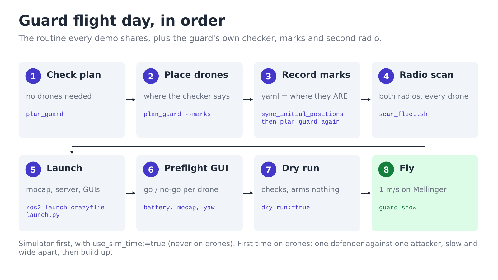
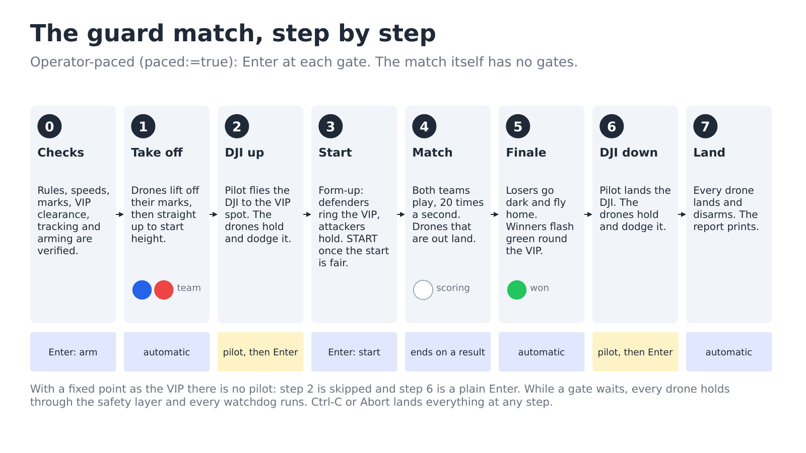

# Running the guard show

Defenders protect a VIP (a fixed point, or a hand-flown DJI) from attackers. You
choose how many of each, and which strategy each team uses. A safety layer sits
under both strategies and keeps every drone apart, out of the DJI's way and
inside the room, whatever the strategies ask for.

The shared steps (power, mocap, scanning, syncing) are in
[../02-flight-day.md](../02-flight-day.md). This page is only what is different. How the
game works: [how-it-works.md](how-it-works.md). Showing it to guests:
[presenting.md](presenting.md).



## 1. Check it with no drones

```bash
ros2 run crazyflie_shows plan_guard --defenders 4 --attackers 3
```

It plays a dozen matches against simulated drones and ends in **SAFE on every
seed** or **SAFETY FAILED**. Do not fly a configuration that fails.

To see the matches, open RViz and add `--rviz`:

```bash
rviz2 -d install/crazyflie_shows/share/crazyflie_shows/data/guard.rviz &
ros2 run crazyflie_shows plan_guard --rviz --matrix
```

`--matrix` plays every defence strategy against every attack strategy in turn, and
`--matrix --rules all` does that under every rule set.
`ros2 run crazyflie_shows plan_guard --list` names them all.

## 2. Stand the drones on their marks

```bash
ros2 run crazyflie_shows plan_guard --marks --defenders 4 --attackers 3
```

Defenders go round the VIP, attackers on the far side from the operator. Sync the
positions and run `plan_guard` again.

## 3. Simulator, then a dry run, then fly

```bash
ros2 launch crazyflie launch.py backend:=sim
ros2 run crazyflie_shows guard_show --ros-args -p use_sim_time:=true \
    -p defenders:=cf1,cf2,cf3,cf4 -p attackers:=cf5,cf6,cf7
```

On the drones, run the same command without `use_sim_time`, first with
`-p dry_run:=true` (every check, nothing armed), then for real. Add
`-p vip_mode:=mocap` to protect the DJI. With `-p paced:=true` the show waits for
Enter before arming, before the match starts and before landing. With the DJI, it
also waits while the pilot takes it off and lands it; the drones hold and keep
out of its way during every wait.



Or use the web console (`./console/run.sh`), **Missions → Guard (N v M)**: every
choice is a field, the waits are buttons, and the 3D view shows the match.

For a new set-up on real drones, start small: 1 v 1, slow and wide apart, then add
drones and speed one step at a time.

**Speed and the onboard controller.** Both teams fly at 1 m/s by default, and the
show switches the drones to the **Mellinger** controller for the match (and back
afterwards). With Mellinger a drone runs about a tenth of a second behind its
commands; four matches flew it at 1 m/s on 2026-11-23, with no near miss. The
drones' standard controller (`-p controller:=pid`, or **pid** in the console's
controller field) runs about half a second behind, so at 1 m/s two drones can pass
closer than the minimum distance. If you fly it, set both teams to 0.6 m/s
(`-p v_max_defense:=0.6 -p v_max_attack:=0.6`, or the two speed fields in the console)
and check it with `plan_guard` first.

## Choosing the strategies

Add `-p defense:=<name> -p attack:=<name>` (`--defense`, `--attack` for the planner):

| Defence | Attack |
|---|---|
| `shell` (default), `zone`, `hunter`, `ring` | `coordinated` (default), `flood`, `wolfpack`, `direct` |

What each one does, and which pairings make even matches:
[how-it-works.md](how-it-works.md#the-strategies). Check a new pairing with
`plan_guard --defense <name> --attack <name>` first.

## Choosing the rules

Add `-p rules:=<name>` (`--rules <name>` for the planner):

| Rules | In one line |
|---|---|
| `tag` (default) | a defender that stays close to an attacker long enough takes it out |
| `pressure` | either side takes a drone out by outnumbering it nearby; one against one is a standoff |
| `zone` | like `tag`, but each side can only be taken out on the other side's ground |
| `zone_pressure` | like `pressure`, on the other side's ground |
| `timer` | nobody is taken out; the defence must hold until the clock runs out |

Check a rule set with `plan_guard --rules <name>` before flying it.

**Contested strikes.** Normally an attacker strikes by staying near the VIP, even with
a defender right beside it. Add `-p strike_block:=0.8` (the console's **Contested
strikes** field) to change that: a defender within 0.8 m of an attacker stops its
strike. It works with every rule set, and it is off (`0`) unless you set it. For the
planner, add `--rparam strike_block=0.8`.

## What you will see

**Form-up.** Just before START (after the DJI gate when there is one), the
defenders fly slowly to a ring round the VIP. The attackers **stay where they are
hovering**. With the DJI as the VIP, the form-up waits until the DJI is in the air,
and then the defenders' ring **follows the DJI** wherever the pilot takes it, until
START. The match starts from where they are at START, not from the floor marks.

While an attacker is within half a metre of a defender's reach, the show prints
`NOT A FAIR START yet`, because the match would open with a take-out. The pilot flies
the DJI further from the attackers until the show prints `fair start`, and then the
operator presses START. (Under `timer` nobody can be taken out, so there is no check.)

To make the attackers follow the VIP as well, onto an arc on their own side, add
`-p form_up_attackers:=follow` (the console's **Attackers during the form-up**
field). Turn the whole form-up off with `-p form_up:=false` (and `--no-form-up` for
the planner).

**The match, the lights and the finale** are explained in
[how-it-works.md](how-it-works.md#what-the-lights-mean). Every move in the finale still
goes through the safety layer; turn it off with `-p finale:=false`.

**In RViz or the console's 3D view**, the map shows what each drone means to do:

| You see | It means |
|---|---|
| blue line ending in a bar across | a defender **blocking** an attacker's way in |
| blue curved arrow | a defender coming round the side (**pincer**) |
| blue diamond | a defender's **post** while nothing is coming |
| red dashed line to a small circle | an attacker going to its **staging** point |
| thick red arrow | an attacker **striking**; magenta is the **decoy** |
| dashed amber arrow | an attacker **feinting** (showing one side, going for another) |
| faint red lines out from the VIP | the attack's **lanes**: dashed while staging, arrows once it commits |
| a faint bubble round a drone | the safety layer is changing that drone's path right now |

Each label shows how close the drone is to being taken out (`d40%`), and an
attacker's how close it is to striking (`s40%`). The VIP turns green (secure) or
red (compromised) at the end.

**Near misses** pause the match, or land everything
([how-it-works.md](how-it-works.md#layers-of-safety)). After each flight the show
prints any near misses and the closest pair, and says where the run's trace was saved.

Ctrl-C (or the console's Abort) lands everything where it is.

How it is put together, and how to write your own strategy or rule set:
[../details/guard-modules.md](../details/guard-modules.md). Why it is built this way:
[../details/guard-theory.md](../details/guard-theory.md). What was measured:
[../details/guard-design-notes.md](../details/guard-design-notes.md).
