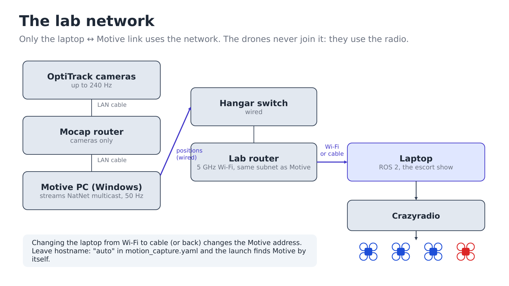
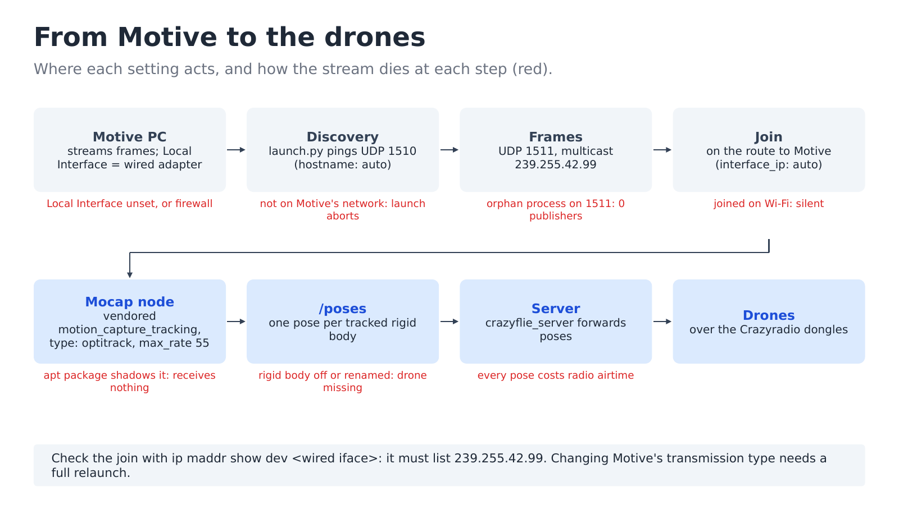

# MOCAP: OptiTrack setup, rigid bodies, and frequency tuning

OptiTrack's **Motive** (on the Windows PC) streams every rigid body's pose over NatNet to
`motion_capture_tracking`, which `launch.py` starts and which publishes `/poses` for the
server. The `natnet_ros2` + `pose_bridge.py` path is an alternative, not the default
([running.md B](running.md#b-hardware-flight-with-optitrack)).

Before flight: a good calibration, one clean rigid body per drone with its nose on +X
(section 2), and a streaming rate the radio can carry (section 3). `config/<name>.yaml`
below means `src/crazyswarm2/crazyflie/config/<name>.yaml`.

## 1. Camera calibration (brief)

Full procedure: <https://docs.optitrack.com/motive/calibration>.

1. **Mask reflections.** With no markers in the volume, *Calibration* pane →
   **Mask Visible**, so the cameras ignore the shiny floor, window frames, lights.
2. **Wand the volume.** **Start Wanding** and cover every height and corner until each
   camera's sample bar fills.
3. **Calculate** and apply; aim for an "Exceptional" / "Excellent" mean error.
4. **Set the ground plane** with the calibration square, **Z-up**.

A camera flashing white sees marker-like blobs. With the volume empty the cameras should
be quiet; one that keeps flashing sees stray reflections: re-mask (step 1) or remove the
reflector. In flight, flashing just means it sees the drones.

## 2. Defining rigid bodies

Full procedure: <https://docs.optitrack.com/motive/rigid-body-tracking>.

1. Place the drone so its markers show as a small cluster in the *Perspective* view,
   **nose along global +X**. The body's zero orientation is captured now; a rotated body
   is a fly-away ([why](known-issues.md#rigid-body-orientation)). The preflight GUI's red
   banner / `err.yaw` catches it ([preflight-gui.md](preflight-gui.md#the-orientation-warning-read-this));
   RViz shows it as rotated axes between `<cf>` and `<cf>_mocap`. If in doubt, delete the
   body, re-orient the drone and recreate it.
2. Select the markers, right-click → **Rigid Body → Create From Selected Markers**
   (**Ctrl+T**).
3. **Name it exactly like the robot key in `config/crazyflies.yaml`** (e.g. `cf1`). The
   natnet path publishes `/<name>/pose`, and `pose_bridge.py` takes its roster from the
   same yaml.
4. Enable streaming of IDs / names; the body's axes must not jitter or flip. Keep marker
   patterns **asymmetric and different between drones** so Motive does not swap them.

`marker_configurations` in `config/motion_capture.yaml` must match the physical marker
layout (`default_single_marker`, `mocap_deck`, ...).

## 2b. Setting `initial_position` from `/poses`

Whenever the drones' floor placement changes, update `initial_position` in
`config/crazyflies.yaml` from mocap, never from `/cfX/pose`
([why](known-issues.md#initial_position-comes-from-poses-never-cfxpose)). Use the script;
it carries refusals a hand edit lacks:

1. **Place** the drones where they will take off (a planner's `--marks` output, or
   `scripts/place_drones.py`).
2. **Start mocap without the server**, so nothing owns the radio:
   ```bash
   ros2 launch crazyflie launch.py server:=False
   ```
3. **Preview, then apply:**
   ```bash
   python3 scripts/sync_initial_positions.py --dry-run     # shows the diff, writes nothing
   python3 scripts/sync_initial_positions.py               # prompts; --yes skips the prompt
   ```
   It matches each drone to the rigid body of the same name and rewrites only the
   `initial_position` triples (comments kept), for **every drone mocap streams, enabled or
   not**, so switching fleets never leaves a stale mark (`--enabled-only`: the old
   scope). It **refuses** when an enabled drone is not streamed, is moving (> 10 mm spread
   over the window), sits above 0.5 m, or when two drones are under 0.30 m apart (their
   marker sets can merge). Under 1 m apart it only warns. `--force` overrides; `--with-z`
   writes the measured z instead of keeping the yaml's.
4. **Restart the server**: it reads the yaml only at launch.
5. **Re-run the planner** (e.g. `plan_escort --marks`).

By hand, if you must: read x/y from `ros2 topic echo /poses | grep -A5 -- '- name: cf1$'`.

Each drone must sit at **its own** yaml position: the flight scripts compute absolute
`goTo` targets from it (return home = `initial_position` + height), so swapped drones fly
crossing paths, the mid-air collision of 2026-08-04. For the trajectory shows, keep every
pair of enabled drones **≥ 1 m apart**: they fly the same relative trajectory, so the
spacing on the floor is the spacing in the air. Each planner checks its own spacing.

## 2c. The world frame, the measured arena, and what a recalibration breaks

Everything the shows and planners know about the room is in `config/arena.yaml`, read by
`crazyflie_shows/safety.py` at import. Print it, do not copy it:
`python3 -c "from crazyflie_shows import safety as s; print(s.ARENA_CENTRE, s.ARENA_RADIUS_TESTED, s.ARENA_RADIUS_PLAN, s.ARENA_RADIUS_LOST)"`.

- **The frame is whatever Motive's ground plane defines.** Look at the axis triad in
  Motive, not at your memory of it. `scripts/check_mocap_yaw.py` prints each body's X
  axis live (mocap up, server stopped) while you square the drones.
- **The radii** (surveyed 2026-10-01 by carrying a tracked body and by flying,
  `scripts/measure_arena.py` and `scripts/arena_flight_sweep.py`, data in `data/arena/`):
  `ARENA_RADIUS_TESTED` is where flight was clean, `ARENA_RADIUS_LOST` where a flying
  drone lost tracking, `ARENA_RADIUS_PLAN` tested minus the tracking margin, the limit a
  plan must stay inside.
- **2026-10-08 recalibration (old room):** the frame moved while the room did not. The
  fit on three undisturbed drones: rotate +91.59°, translate [+0.043, -0.098] m, max
  residual 0.0159 m (their pairwise distances still matched the yaml within 21 mm).
  `ARENA_CENTRE` was carried across; the radii are invariant. A transformed survey is not a survey: re-fly the sweep before
  trusting the edges.
- **2026-11-02: the rig moved to the big arena.** New cameras, calibration and frame;
  nothing carries over. Git tags: `pre-big-arena`, `post-big-arena`.
  - *Ground plane:* the square sat on a raised stand, so it was set with Motive's
    *Custom* ground plane (the square's three markers) and a *Vertical Offset* equal to
    the floor-to-marker-centre height in mm. *Auto* assumes the square is on the floor;
    with the offset at 0 it put z = 0 about 1.4 m above the floor. The plane is
    gravity-level and the floor slopes about 1°, so grounded drones read slightly
    different z. Takeoff and land heights are absolute: check that drones on the floor
    read near 0 every flight day.
  - *Streaming:* Motive's *Local Interface* was unset after the move, so nothing answered
    discovery. It must name the wired adapter.
  - *arena.yaml* was re-surveyed the same day (carried walk, flown climb and edge loops;
    details in the file's header). The radius is limited by furniture, not cameras, so
    the arena is a `polygon:` (a rectangle less the chamfer and the step, traced by a
    carried lap and flown round). Containment uses it; the circle is kept inside it for
    geometry built around a centre (the escort). Delete the key to fall back to the
    circle. The ceiling is the cameras' limit: a flown climb lost tracking (the
    measured heights are in the file's header).
- **After any recalibration or rigid-body rename:** do not fly. Re-sync the marks (2b);
  transform every world-frame number in the escort config by its kind (a point: rotate
  and translate; an offset: rotate; an absolute bearing: add the angle; the escort got
  this wrong three ways on 2026-10-08,
  [escort design notes](../escort/details/design-notes.md#what-flew-and-what-broke-as-of-2026-10-08));
  re-run the planner.

## 3. Frequency / bandwidth tuning (240 → 50 Hz)

Every `/poses` message is forwarded to the drones over the radio, so the mocap rate
competes with telemetry and setpoints for the same 2 Mbit/s. 50 Hz is plenty for position
hold.

### 3a. The rate Motive streams

In Motive, **View → Settings → Streaming** (or the *Data Streaming* pane):

1. Enable **Broadcast Frame Data** and the NatNet engine (VRPN / Trackd off if unused).
2. Transmission type **Multicast**, not Unicast (section 4). It is read once at connect:
   after changing it, restart the whole launch, checking first for leftover mocap
   processes ([troubleshooting](troubleshooting.md#mocap-pipeline)).
3. Camera / system rate **50 Hz** (*Settings → Cameras → Rate*). The stream follows it.

**When Motive must stay at 240 Hz** (the Starlings share the volume, since 2026-11-17),
the node limits itself: `max_rate: 55.0` in `config/motion_capture.yaml` (patch 0006,
`src/motion_capture_tracking/VENDORED.md`). It still reads every frame, so each published
one is the newest, but publishes `/poses`, `/tf` and `pointCloud` at most 55 times a
second. It only steps down: at Motive's 50 Hz every frame passes (measured 50.2 in, 50.2
out; a 50.0 ceiling would drop one in ~250), and it never repeats a frame, which would
hide a dropout. Without it, on 2026-11-17 the server got ~117 `/poses` a second, each
forwarded over both Crazyradios, and every drone warned of a low receive rate.
`max_rate: 0` gives one message per Motive frame.

### 3b. The ROS side

Already set; keep them consistent with Motive's rate:

- `config/motion_capture.yaml`: `max_rate: 55.0`, and `topics.poses.qos.deadline: 50.0`
  (the Motive rate).
- `scripts/pose_bridge.py` (natnet path only): `PUBLISH_HZ = 50.0`. Publishing faster than
  Motive streams only resends stale poses.

### 3c. Trim drone log topics to protect radio bandwidth

`all.firmware_logging` in `config/crazyflies.yaml` sets what each drone sends back:
`pose` at 10 Hz, `status` at 1 Hz, and the `kalman_preflight` custom topic at 5 Hz, which
feeds the preflight GUI (keep it). The comments there record why `pose` stays at 10 Hz.

- Drones on one Crazyradio share its bandwidth. For two dongles, see
  [known-issues.md](known-issues.md#two-dongles-channels-at-least-2-apart-at-2m)
  (channels) and [the connect hang](known-issues.md#the-server-hangs-forever-on-the-first-unreachable-drone)
  (datarate).
- Turn on the commented-out blocks (attitude, kalman, downwash) only while debugging,
  then off again.
- **A saturated radio shows** as latency / receive-rate warnings from the server
  (`min_unicast_receive_rate` in `config/server.yaml`), choppy hold, dropped log packets,
  or a supervisor emergency landing.

After editing a config: `./scripts/build.sh crazyflie`.

## 4. Multicast vs unicast (primer)

- **Multicast:** Motive sends one stream to a group address and every client that joins
  receives it. Needs IGMP working on the LAN; a process squatting on UDP 1511 starves the
  real client ([troubleshooting](troubleshooting.md#mocap-pipeline)).
- **Unicast:** one copy per client. No IGMP, more load on the Motive PC.
- Neither limits the number of drones: every rigid body rides in every frame, and the
  drones get their poses over the Crazyradio, not the network.
- The vendored node (open `optitrack` parser, socket on `0.0.0.0:1511`) hears Multicast
  and Motive's **Broadcast Frame Data**. This rig sends broadcast, to
  `255.255.255.255:1511`, although Motive's GUI says Multicast (the profile flag
  `BroadcastInsteadOfMulticast` is set). Unicast is not supported. The closed-source
  NatNet SDK client (`natnet_ros2`) binds the group address and is deaf to broadcast,
  which is why it sees nothing here.

## 5. Networking: mocap over a router (lab setup)



Reserve fixed addresses for the Motive PC and laptops in the router's DHCP, use gigabit
ports for the wired Motive PC, and **restart Motive after switching it (or your laptop)
between wired and Wi-Fi**: its streaming address follows the active interface, but not at
once. In `config/motion_capture.yaml`:



- **`hostname: "auto"`**: `launch.py` sends a NatNet discovery ping (UDP 1510 broadcast)
  and uses whichever Motive answers, logging `mocap: Motive at <ip> (from NatNet
  discovery)`; if none answers, the launch aborts with a message. Discovery needs you on
  Motive's LAN segment (`ip route get <ip>` must not say `via`). To pin an address:
  `mocap_hostname:=<ip>` or `CRAZYSWARM_MOCAP_HOST=<ip>` (an IPv4 literal).
- **`interface_ip: "auto"`**: the multicast join uses the source address of the route to
  Motive (`ip route get <motive>`), not the default route, which is Wi-Fi when Wi-Fi and
  the wire are both up ([why](known-issues.md#poses-silent-with-wi-fi-and-the-wire-both-up-fixed-2026-11-23)).
  The launch logs `mocap: NatNet multicast joined on <ip> (from <source>)` and warns if
  the route goes through a gateway. Override: `mocap_interface_ip:=<ip>` or
  `CRAZYSWARM_MOCAP_IFACE=<ip>`. Needs vendored patch 0007. Check:
  `ip maddr show dev <wired iface>` lists `239.255.42.99`.
- **`type: "optitrack"`** (the open parser) is required on Wi-Fi: the closed-source
  parser wedges for good on a Wi-Fi multicast stall.

Then restart Motive and relaunch. Getting this wrong leaves `/poses` silent with no
error. Lab addresses and router details are kept privately; ask the lab admin.

---

Full earlier text: `git show 678bac1:docs/rig/mocap.md`
