# The preflight GUI

The preflight window opens with `ros2 launch crazyflie launch.py`. It is the go / no-go
check for every drone before every flight. It shows one drone at a time; ← / → (or
◀ Prev / Next ▶) switches drone.

## Checklist

Before every flight:

- [ ] **1. `crazyflies.yaml`** (`crazyflie/config/`): the drones you will fly have
  `enabled: true`, shelf drones `enabled: false`; only enabled drones connect and appear
  here ([example](#img-drone-yaml)). Under `all: firmware_logging:` only the
  `kalman_preflight` custom topic is on, plus the default `pose` / `status`; more can be
  enabled, each log block within 26 bytes ([example](#img-logging-yaml),
  [how](running.md#g-enabling-extra-telemetry-logging-custom-topics)).
- [ ] **2. Each drone on its own `initial_position`**, every pair ≥ 1 m apart. The scripts
  compute absolute `goTo` targets from these marks, so a drone standing on another's mark
  crosses paths (a real mid-air collision, 2026-08-04). Take marks from `/poses`, never
  from `/cfX/pose`, whose estimate is seeded by the yaml
  ([flight day step 1](../02-flight-day.md#1-place-the-drones-and-record-where-they-are)).
- [ ] **3. `motion_capture.yaml`**: `hostname` and `interface_ip` are `"auto"`. The launch
  finds Motive and joins its multicast on the interface that reaches it, and logs both
  (`mocap: Motive at <ip>`, `mocap: NatNet multicast joined on <ip>`); pin either only to
  override ([mocap.md section 5](mocap.md#5-networking-mocap-over-a-router-lab-setup)).
  `topics.frame_id` is `world`, `topics.tf.child_frame_id` is `{}_mocap`, and the poses
  QoS `deadline` equals Motive's streaming rate, or the stream is flagged unhealthy
  ([example](#img-mocap-yaml)).
- [ ] **4. Battery, mocap rate, radio and orientation pass** the
  [go / no-go table](#reading-the-gui).
- [ ] **5. Kalman estimate settles near 0 at rest.** If not, re-plug the battery (or
  **Reset Kalman (all)** / `r`) and check again ([healthy example](#img-preflight-healthy)).

> **Good practice:** each time someone enters the mocap zone, reset the rigid body in
> Motive. Bumped markers or a blocked view can silently shift its orientation.

**Axis alignment, drone to mocap.** `err.yaw` reads ~0° only when the rigid body was
created with the drone's body frame on the mocap frame:

1. **The drone's front** is the notch between motors **M1** and **M4** (the arm pair with
   the red/green LEDs; the PCB says `UP → FRONT`). Body frame: **X forward, Y left,
   Z up** ([Bitcraze reference](https://www.bitcraze.io/documentation/system/platform/cf2-coordinate-system/)).
2. **The hall's +X** runs across the floor as marked below; Z is up, the origin is the
   cross on the carpet.
3. **Align, then create**: drone flat, front along **+X**, then create (or reset) the
   rigid body in Motive. Then `err.yaw` sits at ~0° and the RViz axes overlap.

*Crazyflie body frame on the real airframe (body axes, motor thrusts F₁–F₄, spin
directions) and as a diagram with roll / pitch / yaw:*

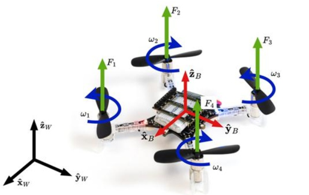 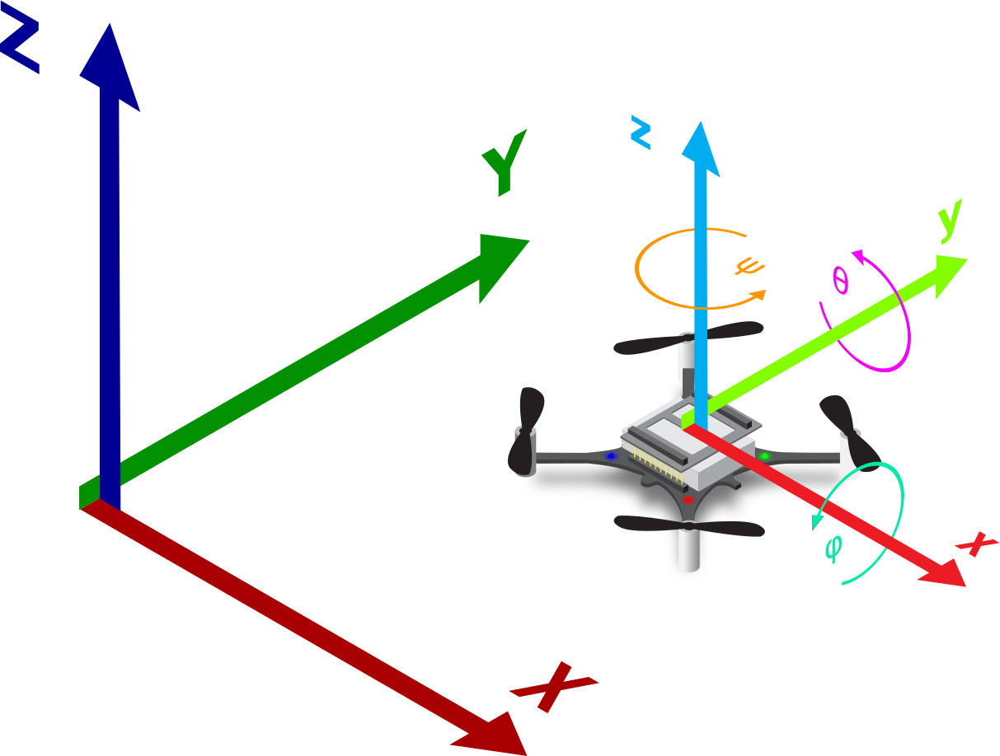

*Hall mocap frame (+X across the floor, Z up), and the origin cross:*

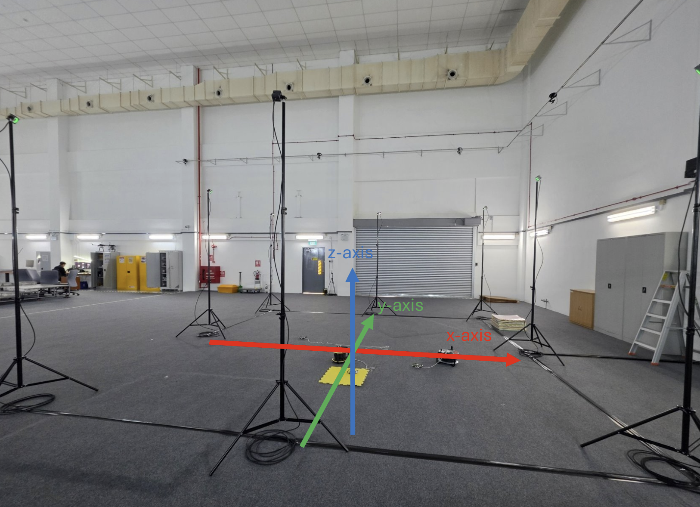 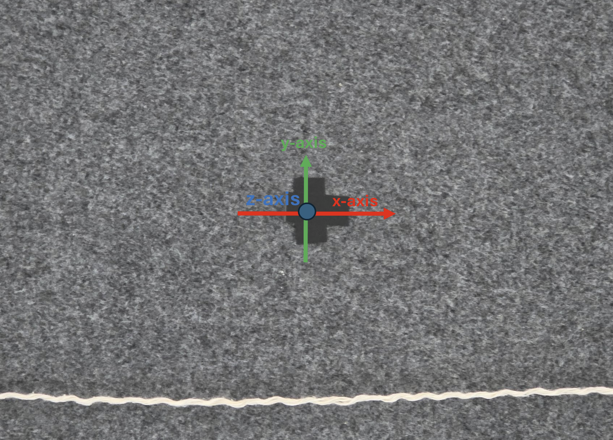

## Emergency stop (E-STOP) demo

Each drone's **E-STOP** button cuts its motors at once; **E-STOP (all)** and the `e` key
cut the whole swarm. Know where they are before you arm anything:

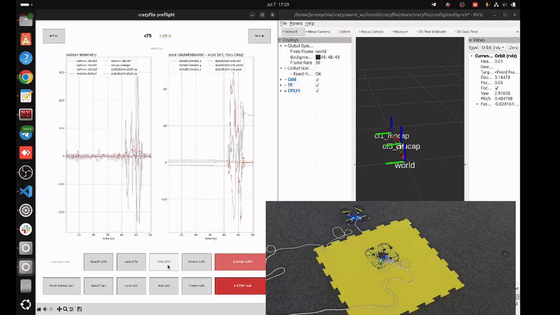

## Config files at a glance

*`crazyflies.yaml`, the `robots:` section: one block per drone with its own
`enabled: true/false`:*

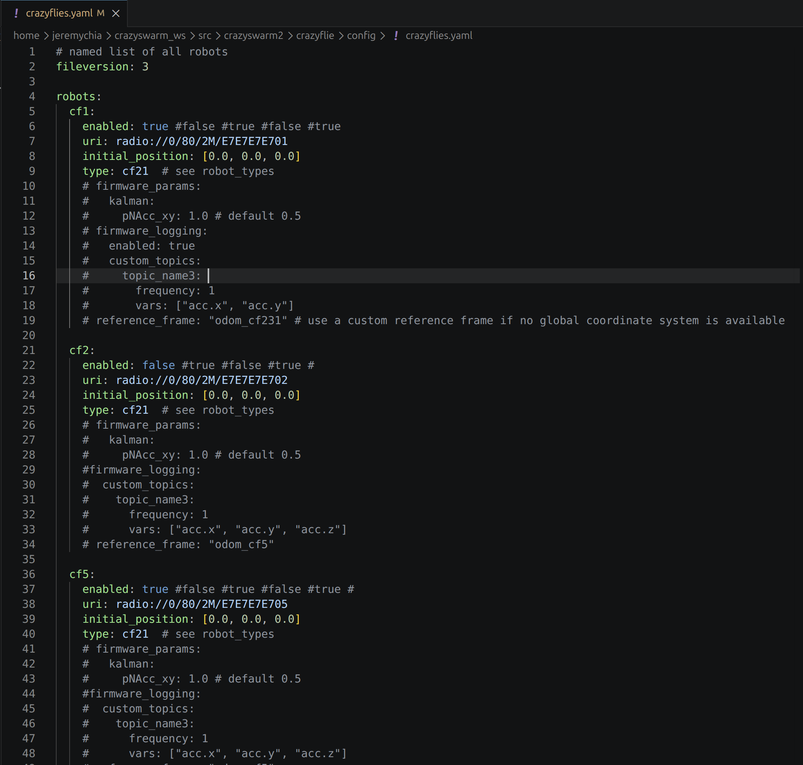

*`crazyflies.yaml`, the `all: firmware_logging:` block: `kalman_preflight` on, the other
custom topics commented out:*

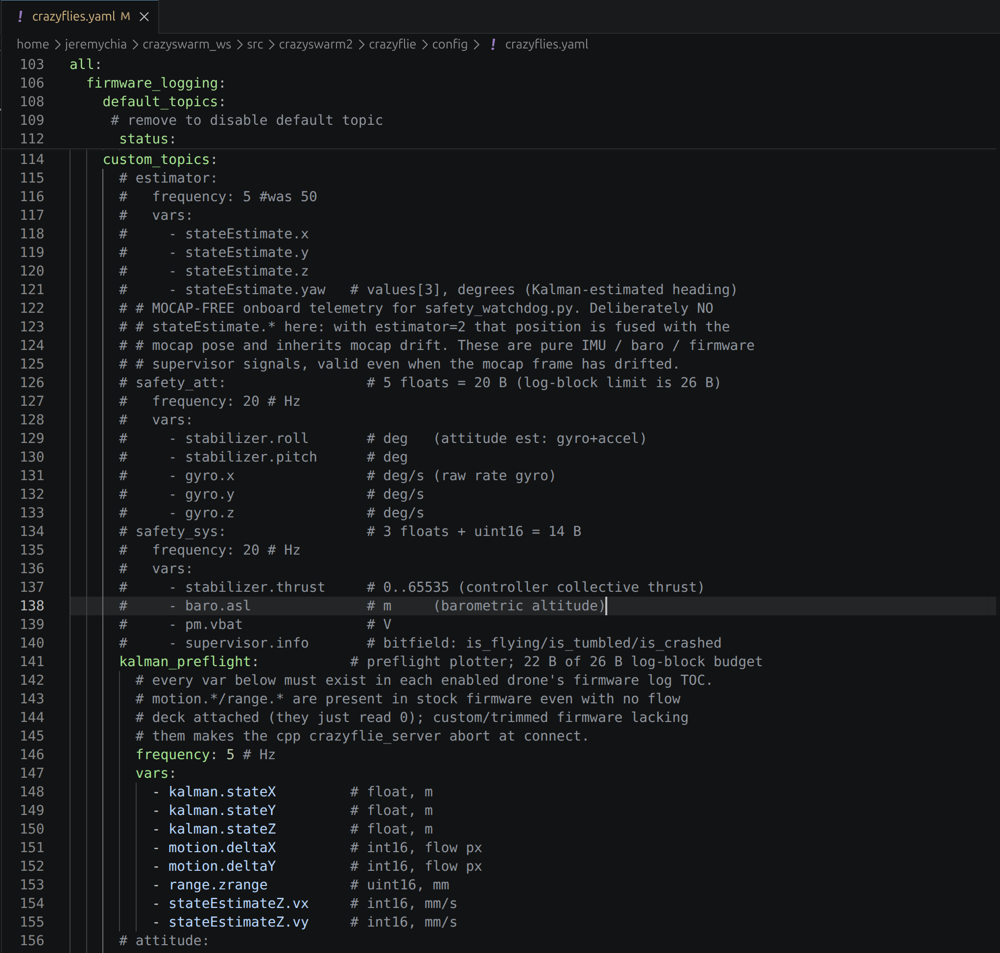

*`motion_capture.yaml`: `hostname`, `topics.frame_id`, `topics.tf.child_frame_id` and the
poses QoS `deadline`. The `hostname` and `type` shown are illustrative; use the values in
checklist item 3:*

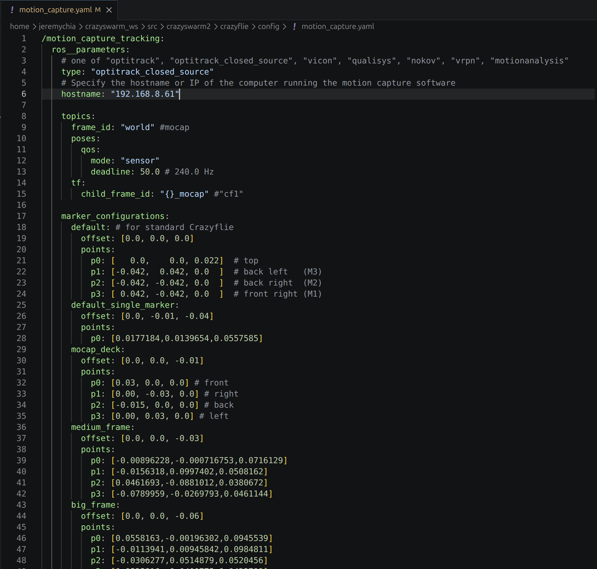

## Reading the GUI

| Check | Where | Fly | Do not fly |
|-------|-------|---------|-----------|
| **Battery** | header voltage | **green, > 3.8 V**; orange 3.7–3.8 V = fly, land soon | **red, < 3.7 V**, or `(charging)` |
| **Mocap rate** | connectivity → `mocap [Hz]` | flat at **~50 Hz** | sagging, or decaying toward 0 |
| **Radio** | connectivity → `rssi` / `latency` | steady, latency low and flat | erratic or climbing latency = saturated radio (lower the logging or mocap rate) |
| **Orientation** | error panel → dashed `err.yaw`, red banner | **\|err.yaw\| ≤ 5°** | 5–15°: fix first; **> 20°: no-fly** ([why](#the-orientation-warning-read-this)) |
| **Estimator** | error panel → `err.x/y/z/norm` | small and steady (~mm) | diverging: the Kalman filter is not fusing mocap |

**Healthy, Flow deck fitted.** All panels steady, mocap ~50 Hz, `err.yaw` a couple of
degrees. The battery is 3.71 V (orange): flyable, land and swap soon.

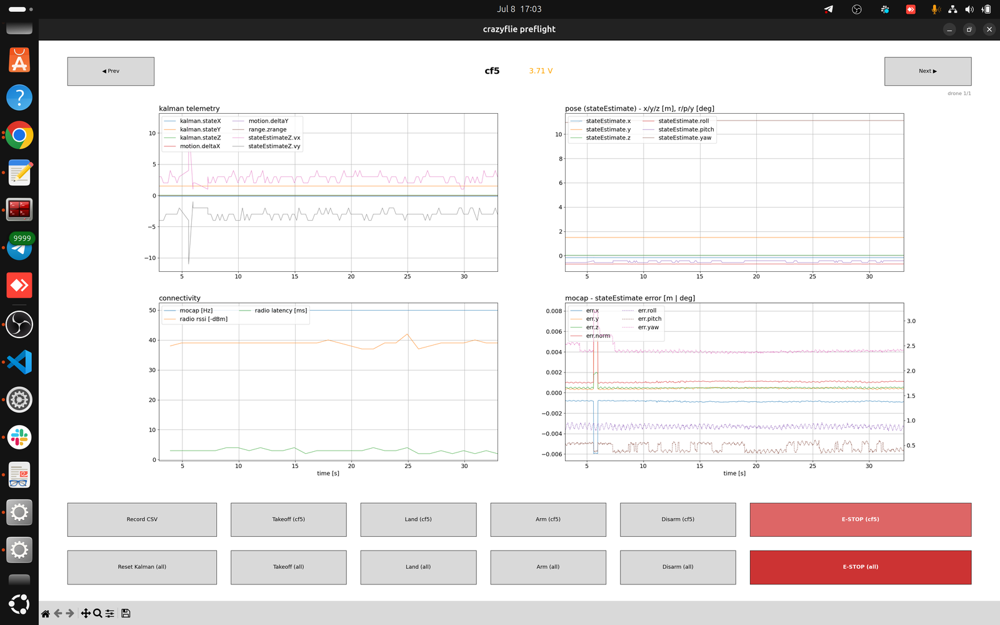

**Healthy, no Flow deck.** The flow and range channels (`motion.deltaX/Y`, `range.zrange`,
`stateEstimateZ.vx/vy`) sit flat or noisy. **That is normal**: judge such a drone on mocap,
battery and yaw.

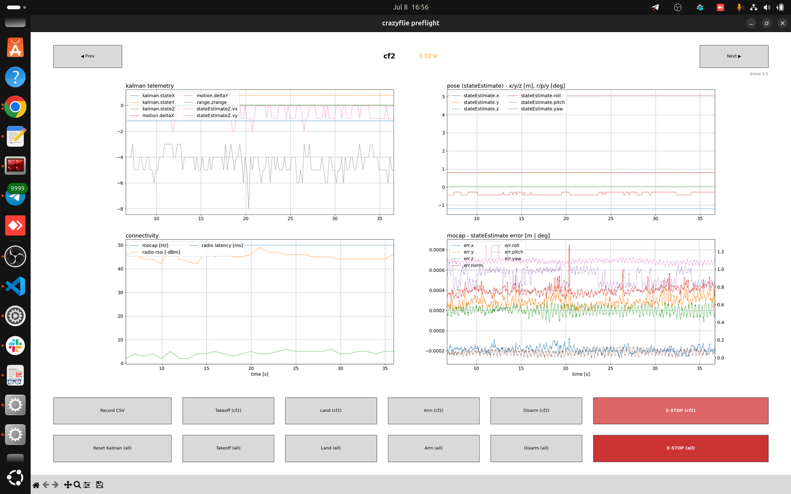

**Warning-band battery**, 3.72 V, orange: a short flight, then recharge.

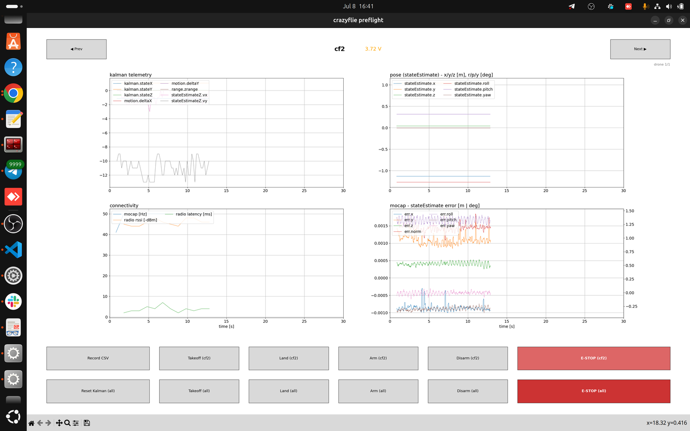

**No-fly: misaligned and low battery.** The banner reads *"MOCAP ORIENTATION MISALIGNED:
cf2 (yaw 18°)"*, dashed `err.yaw` climbs toward 15°, RViz (right) shows `cf2_mocap`
rotated, and the battery is 3.64 V (red). Recreate the rigid body with the drone's front
on **+X** ([mocap.md](mocap.md#2-defining-rigid-bodies)) and charge the pack.

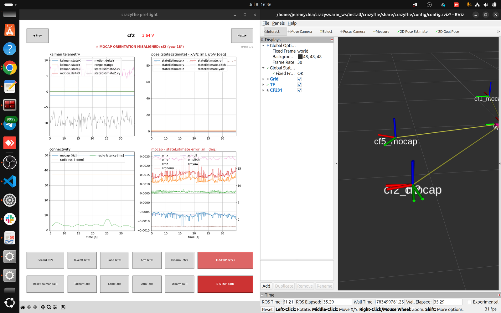

## What a flight looks like

During take-off, hover and landing the panels swing, then settle when the drone lands.
**`mocap [Hz]` must stay at ~50 Hz throughout**: a drop mid-flight is the mocap failure
that triggers an emergency landing. The battery sags under load (3.68 V, red, after this
flight):

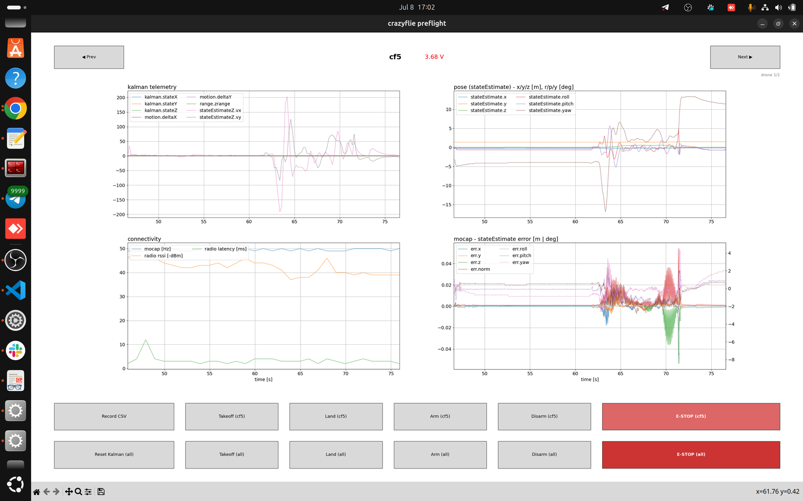

## What you see

- **Header**: the drone's name and battery voltage, coloured green / orange / red at the
  `crazyflies.yaml` thresholds above, plus `(charging)` and `ARMED`, and a `drone 2/3`
  indicator (the selector wraps round). Only `enabled: true` drones appear; `--config
  <path>` reads another yaml, and an unreadable yaml shows every drone, with a warning.
- **Four plots**:
  1. **kalman telemetry**: the 8 `kalman_preflight` vars, in raw firmware units.
  2. **pose**: the onboard estimate, x/y/z [m] and roll/pitch/yaw [deg], from
     `/<cf>/pose`.
  3. **connectivity**: this drone's arrival rate in `/poses` [Hz] (falls to 0 within ~1 s
     when mocap dies), radio RSSI and latency from `/<cf>/status`.
  4. **mocap − estimate error**: position err.x/y/z/norm [m] solid (left axis),
     orientation err.roll/pitch/yaw [deg] dashed (right axis, wrapped to ±180°).

## The orientation warning (read this)

A red banner such as `⚠ MOCAP ORIENTATION MISALIGNED: cf2 (yaw 150°)` appears when
**any** enabled drone, not only the one shown, has a fresh roll, pitch or yaw error over
10° (`ORIENT_WARN_DEG`; samples more than `ERR_STALE_S` = 3 s older than the newest are
ignored). The error panel's title turns red when the drone shown is the offender.

**Do not trust a tiny position error.** `locSrv.extPosStdDev = 1e-3` forces the mocap
**position** into the onboard Kalman filter, so `err.x/y/z` stays ~1 mm even when the
rigid body was created rotated. A yaw offset is invisible at rest and becomes a fly-away
in the air; only `err.yaw` and the banner catch it. The rule for creating the rigid body:
[mocap.md section 2](mocap.md#2-defining-rigid-bodies).

## Buttons and keys

Upper row, the selected drone only (its own services):

> Record CSV | Takeoff (cfX) | Land (cfX) | Arm (cfX) | Disarm (cfX) | E-STOP (cfX)

Lower row, every drone:

> Reset Kalman (all), which sets `all.params.kalman.resetEstimation` 1 then 0 |
> Takeoff (all) | Land (all) | Arm (all) | Disarm (all) | E-STOP (all)

Keys: `r` resets the Kalman filter, `e` is the **broadcast** e-stop (the panic key stops
everything). Take-off and landing have no keys, on purpose. Their setpoints are constants
at the top of `preflight_kalman_plotter.py`: up to 0.5 m in 3 s, down to 0.03 m in 3 s.

## Record CSV

**Record CSV** logs **every** enabled drone at 10 Hz to
`~/crazyswarm_ws/preflight_logs/preflight_<YYYYmmdd-HHMMSS>.csv`: 32 columns (t, drone,
mocap x/y/z, estimate x/y/z/rpy, err x/y/z/norm/roll/pitch/yaw, the 8 `kal_*` vars, rssi,
latency_ms, mocap_hz, battery_v, pm_state, supervisor_info). Missing values stay blank.
The button shows a live row count, and the file is flushed every tick.

---

Full earlier text: `git show 678bac1:docs/rig/preflight-gui.md`
