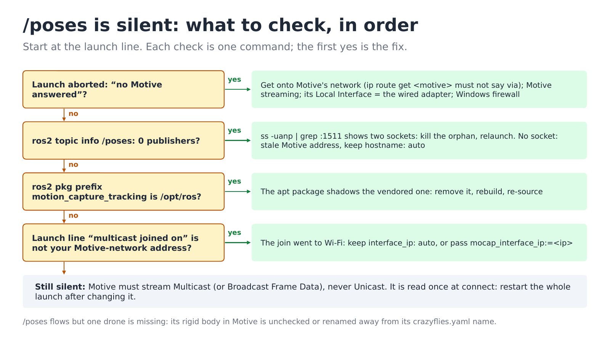

# Troubleshooting: the full list

Symptom, cause and fix for everything this rig is known to do. The short version is
[troubleshooting.md](../troubleshooting.md); the evidence behind an entry ("why") is in
[known-issues.md](known-issues.md).

## Setup / build

| Symptom | Cause / fix |
|---------|-------------|
| `Unsupported Ubuntu <ver>` from a script | Only 22.04 (Humble) and 24.04 (Jazzy) are supported; or `source /opt/ros/<distro>/setup.bash` first so `$ROS_DISTRO` is set. |
| Mocap node dies with exit **-6** (`set_option: No such device`), or `/poses` has a publisher and never any data, and `ros2 pkg prefix motion_capture_tracking` prints `/opt/ros/...` | The broken apt driver shadows the vendored one ([why](known-issues.md#never-install-the-apt-motion-capture-tracking)). `sudo apt remove ros-$ROS_DISTRO-motion-capture-tracking ros-$ROS_DISTRO-motion-capture-tracking-interfaces`, `./scripts/build.sh`, re-source; the prefix must now be `.../install/motion_capture_tracking`. |
| `vcs: command not found` | `sudo apt install python3-vcstool` (`install_deps.sh` does). |
| `colcon build` fails on `crazyflie_interfaces` | Source ROS 2 first; `ros-dev-tools` / `rosidl` must be installed (`scripts/install_deps.sh`). |
| Missing submodule headers (`crazyflie_tools`, link-cpp) | `cd src/crazyswarm2 && git submodule update --init --recursive`, rebuild. |
| `natnet_ros2`: "NatNet SDK not found" / `install_sdk.sh` fails | The SDK is downloaded with `wget` on the first build: needs internet. Offline, download `NatNet_SDK_4.4_ubuntu*.tar` and extract it into `src/natnet_ros2/deps/NatNetSDK/`. |
| Out of memory during the build (SBC) | `LOW_MEM=1 ./scripts/build.sh`. |
| Package not found after a build | `source install/setup.bash`. After editing `.msg`/`.srv`, rebuild `crazyflie_interfaces` and its dependents. |
| `install/` missing although `setup.sh` "built" | The build aborted before `colcon` ([`set -u`](known-issues.md#environment-traps-closed)); current scripts are fixed. `git pull`, or run `./scripts/build.sh`. |
| Typesupport / ABI errors at runtime | Built under one ROS distro, sourced another. Keep `$ROS_DISTRO` the same for `build.sh` and every shell. |
| `invalid message type`, `No module named '_cffirmware'`, odd rclpy errors | conda is active ([why](known-issues.md#environment-traps-closed)). `conda deactivate`, new terminal. |
| `No module named 'cffirmware'` (`backend:=sim`) | Run `./scripts/setup_sim_firmware.sh` once ([setup step 4](../01-setup.md#step-4-build-the-simulator-simulator-only)). Hardware does not need it. |
| `make bindings_python`: `git-lfs: not found` / `arm_add_f32.c: No such file or directory` | `sudo apt install -y git-lfs && git lfs install`; in `~/crazyflie-firmware`, `git submodule update --init --recursive --force`; re-run. (`setup_sim_firmware.sh` now installs git-lfs.) |
| `No module named '_cffirmware'` in sim, though `import cffirmware` works inside `build/` | The egg lacks the compiled `.so`. `echo 'export PYTHONPATH=$HOME/crazyflie-firmware/build:$PYTHONPATH' >> ~/.bashrc && source ~/.bashrc`; test from your home directory. |

## Simulation

| Symptom | Cause / fix |
|---------|-------------|
| Sim server dies with `TypeError: takes 5 positional arguments but 7 were given` at the first `start_trajectory` | An older `crazyflie_sil.py` that hard-codes the arity ([why](known-issues.md#environment-traps-closed)). The vendored one probes it; re-vendoring an older crazyswarm2 brings the crash back. Sim only. |
| A script finishes in seconds, or commands fire before the last move ends | It slept on the wall clock. Add `--ros-args -p use_sim_time:=true` ([running.md A](running.md#a-simulation-no-hardware-no-mocap); [why](known-issues.md#use_sim_timetrue-in-the-simulator-never-on-hardware)). Never on hardware. |
| The second sim run hangs | Restart the `ros2 launch` between sim runs. |

## Crazyradio / drones

| Symptom | Cause / fix |
|---------|-------------|
| A drone never connects | Check its `uri` in `crazyflie/config/crazyflies.yaml` (each drone needs its own address) and USB permissions ([setup step 3](../01-setup.md#step-3-let-your-user-talk-to-the-radio-real-drones-only)). |
| Server hangs at startup; the `/all/*` services never appear | An enabled drone does not answer: dead, wrong address, or a URI datarate that differs from the drone's ([why](known-issues.md#the-server-hangs-forever-on-the-first-unreachable-drone)). `./scripts/scan_fleet.sh`; fix the URI or set the drone `enabled: false`. Kill the hung server with `pkill -9 -f crazyflie_server`. |
| `Channels 80 and 81 are already served by Crazyradio 0` | Two dongles on adjacent channels. Keep them at least 2 apart at 2M ([why](known-issues.md#two-dongles-channels-at-least-2-apart-at-2m)). |
| Won't arm, nothing flies, no error | Supervisor LOCKED after an E-STOP: `ros2 topic echo /cfX/status --once` shows `supervisor_info` bit `0x40` set and `0x01` clear. Battery out and in, every drone ([why](known-issues.md#supervisor-locked-after-an-e-stop)). Otherwise tumbled / can't-fly bits: place level, retry. End-to-end arming test (ground only, props spin 10 s): `ros2 run crazyflie_examples arming` ([running.md](running.md#prop-spin-ground-test-arming-example)). |
| Unsure what state the rig is in (Color LED deck) | Green: connected and ready. Red: a script controls the drones. Dark: clean server shutdown ([LED convention](known-issues.md#led-convention)). |
| **One drone silent**: its `/cfX/pose`, `/cfX/status` and `/cfX/kalman_preflight` all at 0.00 Hz, while it still answers `ros2 param set` | The drone dropped its own log blocks after a ≥ 1 s receive gap ([why](known-issues.md#link-alive-log-data-dead)). The server's telemetry watchdog recovers it about 1 s after declaring the stall, but only while mocap shows the drone on the floor. Otherwise restart the server; do not power-cycle. Diagnose with `scripts/link_stall_recorder.py` and `launch.py trace_cf:=all`. |
| **All drones stop publishing during a trajectory upload**; `takeoff (cfX): timed out waiting for response`; log ends at `[cfX] upload_trajectory(...)` | The server wedged on a reply the drone flushed ([why](known-issues.md#an-upload-can-wedge-the-server-fixed-2026-10-05); bounded since 2026-10-05). `/all/emergency`, `/all/land`, `/all/takeoff` still work. The server ignores SIGINT: `pkill -9 -f crazyflie_server`, check `pgrep -f crazyflie_server` and UDP 1511, relaunch. Never upload to armed drones. |
| Ctrl-C on a show left the drones flying; `failed to initialize wait set: the given context is not valid` | The script did not take the signals back from rclpy ([why](known-issues.md#ctrl-c-kills-the-ros-context-before-your-handler-runs)). Now: E-STOP (a battery cycle per drone) or `/all/land`. Fix the script: `take_signals()` from `crazyflie_shows/abort.py`. |
| Commands or nodes you did not start | ROS domain 0 is shared with the lab ([why](known-issues.md#set-ros_domain_id-domain-0-is-shared-with-the-lab)). Set your own `ROS_DOMAIN_ID` in every terminal and the console. |
| Drifts, then emergency-lands | Estimator diverging, usually no `/poses` reaching the server: see [Mocap pipeline](#mocap-pipeline). |
| Latency / receive-rate warnings, choppy hold | Radio saturated. Lower the `firmware_logging` rates and the mocap rate ([mocap.md 3](mocap.md#3-frequency--bandwidth-tuning-240--50-hz)), or spread the drones over more dongles. |
| Slow connects, low acknowledged share, hundreds of `Unexpected number of unicast packets` a minute | Replies lost one way. On 2026-11-17 this was Crazyradio firmware 5.1 ([why](known-issues.md#crazyradio-firmware-51-fixed-2026-11-17)). Measure, then try the steps below one at a time. |

`Motion capture rate off (#: N, Avg/Min/Max)` counts N one-second intervals outside the
40-60 Hz band (rates in Hz); it is not the number of poses received. A Min under 10 Hz
means a pose gap of over 100 ms.

**Measure the link** from the newest server log (healthy, as on 2026-11-06: all drones
connected within ~30 s, 40 % or more acknowledged, under 20 "received more than sent" a
minute, a few seconds a minute of pose gaps at most):

```bash
f=$(ls -t ~/.ros/log/crazyflie_server_*.log | head -1)
grep -E "\] Memories:" $f | awk -F'[][]' 'NR==1{s=$4} {printf "%.0fs ", $4-s} END{print "(connects)"}'
awk -F'[][]' 'NR==1{t0=$4} {t=$4}
/Low unicast receive rate/ { match($0,/Sent: [0-9]+\. Received: [0-9]+/); x=substr($0,RSTART,RLENGTH); split(x,a,/[^0-9]+/); su+=a[2]; re+=a[3] }
/Unexpected number of unicast packets/ {u++}
/Motion capture rate off/ { match($0,/Min: [0-9.]+/); if (substr($0,RSTART+5,RLENGTH-5)+0 < 10) g++ }
END { m=(t-t0)/60; printf "%.1f min: ack %.2f, received-more-than-sent %.0f/min, seconds with a pose gap >100 ms %.1f/min\n", m, (su?re/su:0), u/m, g/m }' $f
```

**If the link is bad**, in this order, measuring after each:

1. **Both Crazyradios on the same firmware release, 5.5** (5.1 is retired; Bitcraze
   asks for 5.2 or newer). Stop the stack (the server holds
   the radios). Releases: github.com/bitcraze/crazyradio2-firmware, one
   `crazyradio2-<version>.uf2` each. Hold the button while plugging the radio in (LED
   pulses red) and a drive appears; copy `CURRENT.UF2` off as a backup, then copy the new
   file on. Roll back the same way. Files and backups on the rig laptop:
   `~/crazyradio_firmware/`. The drones are not touched.
2. **Reboot the laptop**, or stop the stack and console, `fastdds shm clean`,
   `ros2 daemon stop`, restart ([why](known-issues.md#open-poses-arrives-late-between-processes-on-the-laptop-2026-11-17)).
3. **Radios away from the laptop:** a USB extension, 1-2 m from the laptop and its
   charger, raised. Plugged in directly, replies fell from 8-30 % to 2 %.
4. **Less telemetry while flying:** turn `kalman_preflight` (5 Hz) down or off (edit with
   the `config-editor` agent; it knows the log-block limits).
5. **Only if still bad, 1M instead of 2M.** In cfclient connect at the current URI,
   **Connect → Configure 2.x**, set 1M, keep channel and address, Write, power-cycle the
   drone. Then change `/2M/` to `/1M/` in its URI in `crazyflies.yaml`, or the server
   hangs at launch. Change every drone on one radio together; `./scripts/scan_fleet.sh`
   before the stack.
6. **Then channels**, same dialog and URI edit, once a measurement shows a quieter one.

Do not raise Motive's rate for the Crazyflies: every pose forwarded is another radio
broadcast. cfclient's own settings do not affect the stack (the server has its own link
library).

## ROS 2 / DDS / parameters

| Symptom | Cause / fix |
|---------|-------------|
| `ros2 param set /crazyflie_server <cf>.params.<group>.<name> <value>` succeeds but the drone never changes | A re-vendored upstream server: this rig never delivers a node's own `/parameter_events` ([why](known-issues.md#a-node-never-hears-its-own-parameter_events)). The vendored server applies them in `add_on_set_parameters_callback` ([running.md F](running.md#runtime-firmware-parameters)). |
| Fresh `rclpy` processes stall: parameter calls time out, `Crazyswarm()` waits forever on `all/emergency` | DDS discovery in a new process sometimes never completes here. Use the `ros2` CLI (its daemon keeps the graph warm), as `scripts/led.sh` does. |
| `/cf231/robot_description` in `ros2 topic list`, though no cf231 exists | Harmless: a stale RViz RobotModel display in `config/config.rviz`. Ignore it or delete that display. |
| Console says "crazyflie_server not running" while RViz and the preflight GUI work | The network changed after the console started ([why](known-issues.md#console-blind-after-a-wi-fi-switch)). Stop the console, `ros2 daemon stop`, start it again. Switch networks before starting it. |

## Mocap pipeline



| Symptom | Cause / fix |
|---------|-------------|
| `/poses` silent, `ros2 topic info /poses` shows **0 publishers**, mocap node missing from `ros2 node list` | A leftover process on UDP 1511 starves the node ([why](known-issues.md#mocap-died-an-orphan-on-udp-1511)). `ss -uanp \| grep :1511`: two sockets is the bug. Kill the orphan, relaunch. Ping proves nothing. |
| `/poses` silent, no errors, node alive but 0 publishers, and no 1510/1511 socket for it in `ss -ulpn` | It waits in `connect()` for a stale Motive address ([why](known-issues.md#motives-address-and-local-interface)). Keep `hostname: "auto"` in `motion_capture.yaml` (the launch logs `mocap: Motive at <ip>`) or pass `mocap_hostname:=<ip>`. |
| Launch aborts: `no Motive answered a NatNet discovery ping` | Not on Motive's LAN segment (`ip route get <motive-ip>` says `via`), Motive not running or not streaming, Motive's Data Streaming **Local Interface** unset or loopback, or the Windows firewall. Fix that, or pin `mocap_hostname:=<ip>` (the same causes then hang the node silently). |
| `/poses` silent, no errors, Motive answers discovery and ping, Wi-Fi and the wire both up | The multicast join is on Wi-Fi ([why](known-issues.md#poses-silent-with-wi-fi-and-the-wire-both-up-fixed-2026-11-23)): `ip maddr show dev <wifi>` lists `239.255.42.99`. Keep `interface_ip: "auto"`; the launch line `mocap: NatNet multicast joined on <ip>` must show this laptop's Motive-network address. Override: `mocap_interface_ip:=<ip>` or `CRAZYSWARM_MOCAP_IFACE`. |
| Changed Motive's transmission type, still nothing | It is read once at connect: restart the whole launch. Multicast (or Broadcast Frame Data) only; Unicast is not supported ([mocap.md 4](mocap.md#4-multicast-vs-unicast-primer)). |
| Killed `ros2 run motion_capture_tracking ...` but `ss -ulpn` still shows 1511 | Killing the wrapper leaves the node. `pkill -f motion_capture_tracking_node`; `ss -ulpn \| grep 1511` must be empty before relaunching. |
| Mocap node ignores Ctrl-C; the next connect aborts with SIGABRT | A frozen node ignores SIGINT; the launch escalates to SIGKILL. Check `pgrep -f motion_capture_tracking` for leftovers before relaunching. |
| `/poses` flows but one drone is missing | Its rigid body in Motive is unchecked, deleted or renamed away from the `crazyflies.yaml` key. Fix in Motive before flight. Check: `ros2 topic echo /poses \| grep -A5 -- '- name: cf1$'`. |
| Yaw offset or fly-away with perfect position; red misalignment banner, large `err.yaw` | The rigid body was created rotated ([why](known-issues.md#rigid-body-orientation)). Recreate it with the nose on global +X ([mocap.md 2](mocap.md#2-defining-rigid-bodies)). ±5° fly; 5-15° fix first; over 20° do not fly. |
| `/poses` flows, drone still drifts | Rate or QoS mismatch, or `marker_configurations` in `motion_capture.yaml` does not match the markers; orientation flips: make the marker pattern asymmetric. |
| Cameras flash white with an empty volume | Stray reflections: re-mask or remove the reflector ([mocap.md 1](mocap.md#1-camera-calibration-brief)). |
| Wrong orientation or axes | Motive's ground plane is not Z-up: recalibrate it. |

The alternative `natnet_ros2` path ([running.md B](running.md#b-hardware-flight-with-optitrack)):

| Symptom | Cause / fix |
|---------|-------------|
| `/<body>/pose` silent | `serverIP` / `clientIP` in the natnet launch must match Motive's Local Interface; firewall off; multicast address and ports match; Broadcast Frame enabled. On this rig its NatNet SDK client is deaf to the broadcast frames Motive sends ([mocap.md 4](mocap.md#4-multicast-vs-unicast-primer)). |
| natnet node up, no topics | It is a LifecycleNode: launch with `activate:=true` or transition it to ACTIVE. |
| `/<body>/pose` flows, `/poses` silent | `pose_bridge.py` ignores bodies whose name is not a `crazyflies.yaml` key and drops poses older than 0.25 s. Do not leave `namespace:=` empty, or natnet and the server both publish `/<name>/pose`. |

## Preflight GUI

| Symptom | Cause / fix |
|---------|-------------|
| **The window never appears** (server and RViz fine) | Usually matplotlib. Run `/usr/bin/python3 -c "import matplotlib.pyplot as p; print(p.get_backend())"`. **NumPy 1.x-vs-2.x traceback**: the apt matplotlib (NumPy 1 ABI) under the pip NumPy 2; re-run `./scripts/install_deps.sh`, which installs pip `matplotlib>=3.9`. **`ModuleNotFoundError`**: `sudo apt install python3-matplotlib python3-tk`. **Prints `Agg`**: no GUI toolkit, `sudo apt install python3-tk` (with Agg the node exits at once and the launch logs "finished cleanly"). **`Could not load the Qt platform plugin xcb`**: `sudo apt install libxcb-cursor0`. **Prints `TkAgg`/`QtAgg`**: run `python3 src/crazyswarm2/crazyflie/scripts/preflight_kalman_plotter.py` to see the real error. Full deps block: [setup step 2](../01-setup.md#step-2-get-the-code-and-build-it). |
| Nothing opens, not even RViz; `package 'X' not found` | A default-on node's package is missing, which aborts the whole launch. RViz, the preflight GUI and Foxglove are on by default. `sudo apt install ros-$ROS_DISTRO-<pkg>` (`joy`, `rviz2`, `foxglove-bridge`; `motion_capture_tracking` is vendored: rebuild and re-source instead), or disable the node: `teleop:=False`, `rviz:=false`, `foxglove:=False`, `mocap:=False`. Foxglove is viewed in the Foxglove Studio app, not a window. |
| A drone is missing from the GUI | It is `enabled: false`, or the GUI was given another yaml with `--config`. |
| Every drone shown, disabled ones too, plus a yaml warning | The GUI could not read `crazyflies.yaml` and accepts everything. Fix the path or pass `--config <path>`. |
| Mocap Hz trace decays to 0 | Mocap died: see [Mocap pipeline](#mocap-pipeline). |
| kalman panel empty | The `kalman_preflight` custom topic was removed or renamed in `crazyflies.yaml`: restore it ([running.md G](running.md#g-enabling-extra-telemetry-logging-custom-topics)). |

## Color LED

| Symptom | Cause / fix |
|---------|-------------|
| The deck never lights green | Server log `No Color LED deck detected … skipping LED set`: deck missing or loose, or the firmware lacks the `colorLedBot` params. |
| Which drones carry a Color LED deck? | `python3 scripts/deck_check.py` with the server stopped (it opens the radio): detected decks and LED state for every enabled drone. |
| `led.sh` / `color_led`: no `…colorLedBot.wrgb8888` params | `firmware_params: query_all_values_on_connect` must stay `true` in `config/server.yaml`; and the drone must be connected and carry the deck. |
| `color_led`: `/crazyflie_server/set_parameters not available after 10s` | The server is not running, or your shell is on another `ROS_DOMAIN_ID`. |
| A colour "succeeds" but nothing changes under `backend:=sim` | Expected: LED control is hardware only. |
| `color_led_cflib.py` cannot open the radio | The server owns the dongle: stop the launch. Check the in-file `URI` (`# EDIT ME`). |

## Quick diagnostics

```bash
ros2 topic hz /cf1/pose       # onboard pose (firmware logging)
ros2 topic hz /poses          # mocap output (~50 Hz expected)
ros2 topic info /poses        # publisher count: 0 = mocap node dead or starved
ss -uanp | grep :1511         # two sockets on 1511 = an orphan starving the mocap node
pgrep -f motion_capture_tracking   # leftover frozen mocap process?
ros2 topic echo /cf1/status --once          # battery / supervisor / link
ros2 run tf2_tools view_frames               # TF tree
ros2 node list ; ros2 topic list
./scripts/which_server.sh                # hardware server, sim server, both, or none?
./scripts/which_server.sh --require sim  # non-zero unless ONLY the sim is up (2 = both: never fly)
python3 scripts/check_mocap_yaw.py       # live yaw of every rigid body, to square them in Motive
```

---

Full earlier text: `git show 678bac1:docs/rig/troubleshooting.md`
