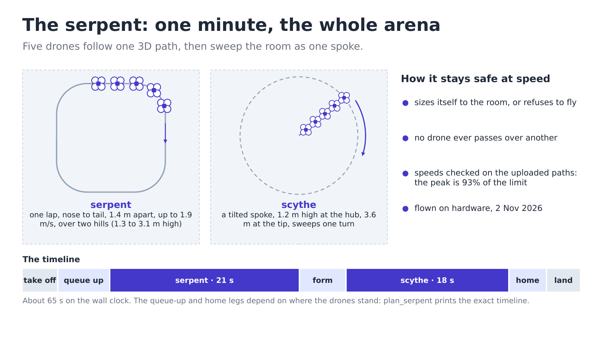

# The serpent show: run it

A fast, three-dimensional, one-minute show for five drones in the big arena: one lap of
the room nose to tail, then a tilted spoke that sweeps one full turn.



Between the figures, the line takes off to 1 m over the marks, queues up along the loop,
pivots into the spoke ("form"), and flies home to land on the marks. About 65 s on the
wall clock. `ros2 run crazyflie_shows plan_serpent` prints the exact timeline and every
budget (add `--plot out.png` for a top view).

## How it stays safe at speed

- **It sizes itself to the room.** The centre is the point of the arena polygon furthest
  from its edge; the loop and the spoke are the largest that keep `SerpentConfig.margin`
  (0.6 m) plus the tracking margin from every edge. A smaller room gets a smaller show, or
  a refusal.
- **Plan-view separation is enforced**, so no drone passes over another and downwash never
  stacks: an arc gap along the loop, a radial gap along the spoke.
- **Speeds and accelerations are checked on the uploaded trajectories**, not the ideal
  paths, against `safety.MAX_SPEED` / `MAX_ACCEL`. The 21 s lap peaks near 1.86 m/s, 93 %
  of the limit; shorten it and the planner says when you cross the limit.
- The morph into the spoke (its heading, and who goes where) is chosen so that the flight
  home is clear too.

It flies through the constellation show's loop (`constellation_show.run`: the same
checks, upload, light cues and abort). Code: `crazyflie_shows/serpent.py` (the plan,
pure) and `serpent_show.py`.

## Run it

The shared steps are in [flight day](../02-flight-day.md). For the serpent:

1. **Enable exactly five drones** in `crazyflies.yaml`: the show is choreographed for five
   and refuses any other number.
2. **Simulator first:**
   `ros2 run crazyflie_shows serpent_show --ros-args -p use_sim_time:=true`
3. **Place the five** anywhere inside the arena polygon, record their marks
   ([flight day 1](../02-flight-day.md#1-place-the-drones-and-record-where-they-are)), then
   run `plan_serpent`; it must pass. The marks set the queue-up and home legs, and the
   flight home is usually the tightest moment.
4. **Scan, launch, preflight** ([flight day 2-4](../02-flight-day.md#2-radio-scan)).
5. **Dry run**, then fly:
   ```bash
   ros2 run crazyflie_shows serpent_show --ros-args -p dry_run:=true   # every check, nothing armed
   ros2 run crazyflie_shows serpent_show
   ```

**Ctrl-C** lands every drone at any time.

## Record

- 2026-11-02, simulator, three full runs on a private ROS domain: on time; tracked the
  plan within 21 cm (serpent) and 19 cm (spoke); closest pair 1.06 m (3D) and 0.92 m (plan
  view), as planned; every drone landed within 2 mm of its mark.
- 2026-11-02, hardware: first run, operator-run, a success. Rehearse with `dry_run:=true`
  after moving the marks.

