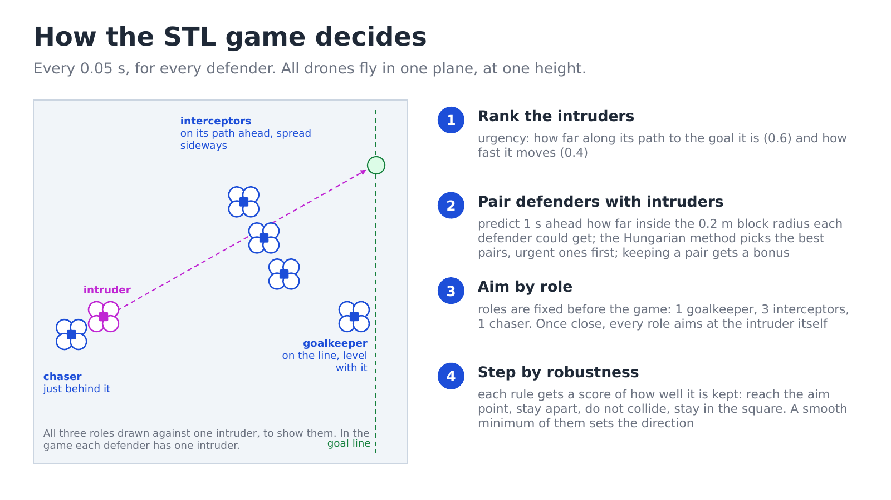

# STL game: design notes

5 defenders vs 5 intruders: a colleague's Signal-Temporal-Logic game, flown on ten
Crazyflies. Added 2026-10-13. Plain-language version: [how-it-works.md](../how-it-works.md);
how to fly it: [run.md](../run.md). Code is under `src/crazyswarm2/crazyflie_shows/` and
`src/crazyswarm2/crazyflie_examples/`.

| File | What it is |
|---|---|
| `crazyflie_examples/.../stl_pursuit_evasion_game_v3.py` | **The original.** The colleague's work, kept unchanged and still runnable (`ros2 run crazyflie_examples stl_pursuit_evasion_game_v3`). Arrives over Slack, not git. |
| `crazyflie_shows/stl_game.py` | The algorithm, copied: constants and helpers line for line, `main()` split into `play()` (no ROS) and `fly()` (the command sequence). Plus `verify()`, which is ours. |
| `crazyflie_shows/stl_show.py` | Flies it with the checks every show here makes before arming (abort, preflight, placement). |
| `crazyflie_shows/plan_stl.py` | Offline check of any seed, and the drift check against the original. |
| `missions/stl.yaml` | The console's mission window. |

Nothing in `crazyflie_shows` imports `crazyflie_examples`. The original is
only ever read as a file, by `plan_stl --against`.

## The algorithm

Each step of the diagram, in `stl_game.py` (all in one plane, at `CRUISE_ALTITUDE`):

| Step | What the code does |
|---|---|
| 1. Rank | `URGENCY_GOAL_W` 0.6 × the fraction of its path covered + `URGENCY_SPEED_W` 0.4 × its speed over the sprint speed. |
| 2. Pair | For every defender and active intruder, both are predicted `STL_HORIZON` (20) ticks ahead; the score is `soft_max` (`SOFT_K` 125) of `BLOCK_RADIUS` minus the gap. Cost = -score × (1 + `URGENCY_GAIN` 1.6 × urgency), less `SWITCH_THRESH` for last tick's pair; `hungarian_assign` solves it. |
| 3. Aim | Roles are fixed once, by rank in `DETECTION_ACCURACY` (`assign_defender_roles`). The aim point is the intruder's position `min(time to reach it, LOOKAHEAD)` ahead, put on its path, moved 45 % toward its goal (`INTERCEPT_BIAS`) and smoothed (`INTERCEPT_SMOOTH` 0.65). Goalkeeper: `GOALKEEPER_WALL_MARGIN` from the goal wall, level with the intruder. Interceptors: ±`PINCER_SPREAD` (0.12 m) sideways. Chaser: `CHASER_BEHIND_OFFSET` (0.08 m) behind. Inside `ARRIVAL_RADIUS`, or 1.1 × `BLOCK_RADIUS` of the intruder, the aim is the intruder itself. |
| 4. Step | `_defender_stl_gradient`: the gradient of `soft_min` over reach, teammate separation, collision, arena and keep-off-finished-intruders, weighted by `ROLE_WEIGHTS`. Within 1.5 × `BLOCK_RADIUS` of the aim it slows, to no less than half speed; each step is blended with the last (`MOMENTUM_ALPHA` 0.1). |

Intruders follow re-planned waypoints, crawl when a defender is near and sprint when
the way is clear, and fake a move now and then (`DECEPTION_*`). A defender within
`BLOCK_RADIUS` freezes an intruder; from tick 50, a frozen intruder is BLOCKED.

The guard re-uses several of these ideas, not the code:
[../../guard/details/theory.md §6](../../guard/details/theory.md#6-playing-well-the-stl-games-theory-turned-round).

## Why the flight can be checked before takeoff

The game never reads mocap, and its only randomness is one generator, so a seed fixes the
flight ([diagram](../how-it-works.md#the-big-difference-from-the-escort-it-is-planned-before-take-off)).
In code: `stl_game.play(seed)` computes every `goTo`, `land` and LED cue up front (~1 s),
`verify()` checks that table, and `fly()` sends that same table. A seed that `plan_stl`
passes is the flight `stl_show` flies.

If a later version closes the loop on mocap, this property is gone, and with
it the pre-flight proof. The port would then need the escort's approach
(clamp at flight time, [../../escort/details/design-notes.md](../../escort/details/design-notes.md)).

## What the show adds, and what it deliberately does not

Added, all outside the algorithm:
- `verify()` before arming: the takeoff columns plus the 3 s start move from
  each drone's `initial_position` to its start slot (closed form, exact), and
  every tick of the game and the return leg, against `min_sep` (default
  0.15 m). A BLOCKED intruder stays in the check for its whole 5 s descent.
- `wait_for_mocap` and `check_placement` (each drone on its own mark),
  `report_supervisor`, and `dry_run`.
- `take_signals` / `abort_land`, so Ctrl-C or the console's Stop lands all
  ten. The E-STOP is still the answer to a drone out of control.
- Ticks paced to `t0 + k*DT` instead of `DT` after the last sleep. That
  changes nothing in a stub and stops latency accumulating on hardware.

Not changed:
- The game's 4 m x 4 m square centred on the origin. It does not use
  `safety.ARENA_*`.
- The colours, including green for REACHED, which is also the rig's "ready"
  colour.
- `goTo` streaming at 20 Hz, rather than `cmdFullState`. It is what flew on
  hardware.

## Measured 2026-10-13 (v3, current yaml)

`plan_stl` on seeds 0-19:
- **The port is identical to the original**: every command, value and time
  on all 20 seeds (`--against`).
- **Every seed: 5 BLOCKED, 0 REACHED**, game 9.0-10.5 s, return ~4.3 s.
- **Closest approach among drones at cruise height: 0.18-0.20 m.** That is
  the design (BLOCK_RADIUS = COLLISION_RADIUS = 0.20 m).
- **0.108 m on every seed, cf5 to cf13, about 3.5 s in, so the default
  refuses.** cf13 is BLOCKED at tick 64 and told to land. Its descent is a
  7th-order polynomial, so 0.35 s later it is still at 0.999 m, and cf5 passes
  it at 10.8 cm. The cause is in the algorithm: once an intruder is out of
  the game, defenders keep only `INTR_KEEP_OUT = 0.04 m` from it. That is a
  question for the colleague, not something to patch here. To fly v3 anyway,
  pass `min_sep:=0.10` knowingly.
- **The start move depends on the marks.** On the yaml marks as committed,
  cf10 and cf11 pass 0.043 m apart, and cf10's 3.14 m leg peaks at
  2.29 m/s. If the drones really sit elsewhere, sync the marks
  (`server:=False`, then `scripts/sync_initial_positions.py`) and re-run
  `plan_stl`. `check_placement` refuses a flight whose marks are wrong.
- **Simulator** (`backend:=sim`, seed 0, `min_sep:=0.04`): flew takeoff to
  disarm. `kill -INT` mid-game landed all ten and disarmed (exit 130).
  Hardware has not been flown with `stl_show` yet.

## Measured 2026-10-20 (this repo, v3)

- **The game square against the room (closed).** In the old room, measured from
  `arena.yaml`'s centre, four of the five intruder goals (2.29-2.71 m) lay beyond the
  2.24 m where tracking was lost. The big arena (2026-11) contains the whole square.
  Neither `verify()` nor `plan_stl` checks the room, by design ("Not changed" above).
- **Simulator, ten drones, seed 0, `min_sep:=0.04`, drones on their start slots:**
  takeoff to disarm, 5 BLOCKED, exit 0. On the committed marks instead, the show
  correctly refused (cf10-cf11 start move 0.010 m).

## Settings

All ten of the game's drones (`DEFENDER_CF_NAMES`, `INTRUDER_CF_NAMES`) must be
`enabled: true`; `defenders:=` / `intruders:=` (comma lists, in slot order; `plan_stl
--defenders` / `--intruders` likewise) fly others. Any other enabled drone stays on the
ground but is still landed by an abort. Other parameters: `seed` (-1 draws one),
`min_sep` (0.15 m), `dry_run`, `check_placement`, `placement_tol`.

## When v4 arrives

1. Save it beside v3 in `crazyflie_examples/crazyflie_examples/`, keeping v3,
   and commit it as received. Add its `setup.cfg` entry if you want to run it
   raw.
2. `diff v3.py v4.py`. The constant block in `stl_game.py` is v3's
   verbatim, so a constant change ports as the same edit. Loop changes go
   into `play()` in the same order of arithmetic.
3. Point `SOURCE_SHA256` / `SOURCE_NAME` in `stl_game.py` at v4
   (`sha256sum v4.py`).
4. `plan_stl --against .../stl_pursuit_evasion_game_v4.py` must print
   *identical*. It diffs every call the two make, on every seed. Until it
   does, the port is not v4. If v4 starts reading mocap or changes how it
   talks to the drones, the stubs in `plan_stl` and `fly()` change too.
5. Re-run `plan_stl` without `--against` for the new separation numbers, then
   `dry_run`, then sim, then hardware, and update the numbers above with a
   date.

---

Full earlier text: `git show 678bac1:docs/stl/details/design-notes.md`
