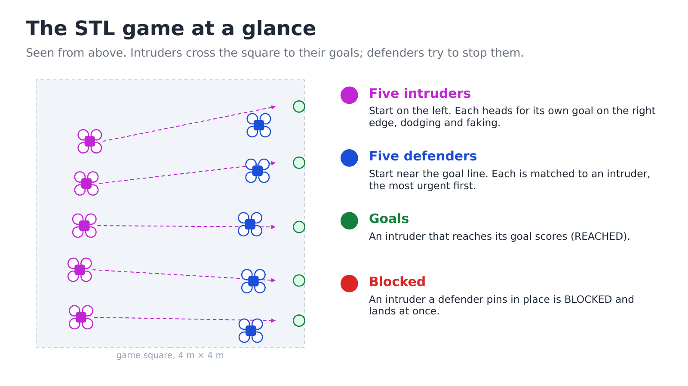
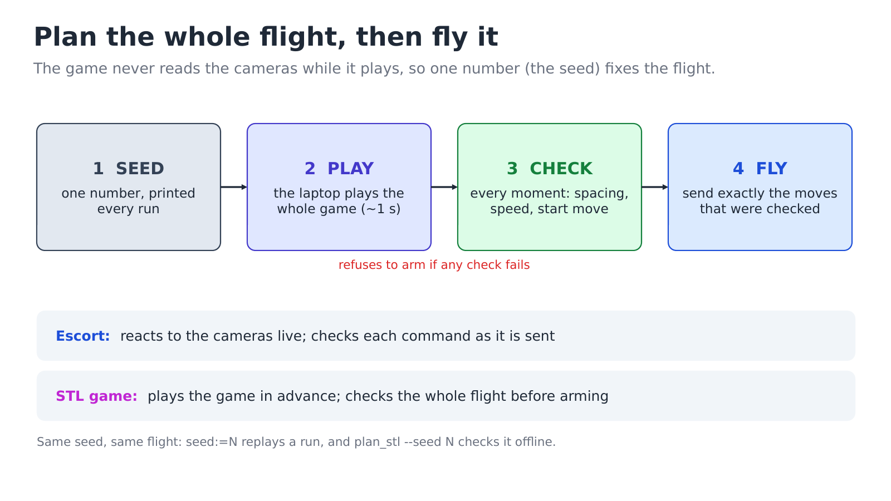
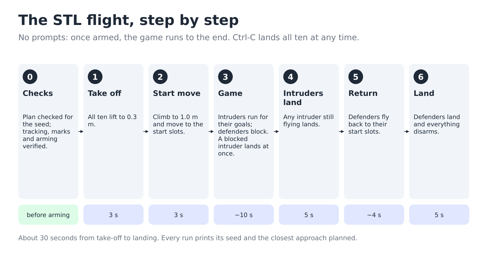
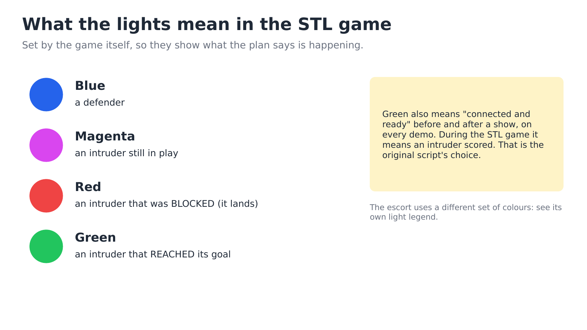

# STL: how it works

Five intruders try to cross the room to a goal line. Five defenders try to stop them.
It is the escort's problem turned around: instead of guarding one moving VIP, the team
guards a line. The algorithm is a colleague's; this repo flies it and checks it. The
maths and the history are in [details/stl-design-notes.md](../details/stl-design-notes.md).

## The game

- **Intruders** start on one side of a 4 m × 4 m square. Each has its own goal on the far
  edge. They plan a path around the defenders, fake a move now and then, slow down when
  a defender is close and sprint when the way is clear.
- **Defenders** start near the goal line. Each one is matched to an intruder, favouring
  the intruder closest to scoring. They play different roles: a goalkeeper holds near the
  line, an interceptor cuts the path, a chaser follows behind.
- An intruder that reaches its goal is **REACHED** (green light). An intruder a defender
  pins in place is **BLOCKED** (red light) and lands straight away.
- Everyone flies at 1.0 m height and 0.4 m/s. A game lasts about 10 seconds.

"STL" is *signal temporal logic*: a precise way to write a goal such as "stay within
20 cm of that intruder at some point in the next second". The defenders steer by
whichever move improves that score fastest.

## The big difference from the escort: it is planned before take-off

The escort reacts to camera positions 20 times a second. The STL game never reads the
cameras while it plays: every drone's position comes from the game's own simulation, and
its only chance element is a random number generator. So **one number, the seed, fixes
the whole flight.**

That allows a check the escort cannot do. Before anything arms, the show plays the full
game for that seed on the laptop (about 1 second), checks every moment of it for drones
too close together, and then flies exactly the moves it checked. Every run prints its
seed; `seed:=N` replays the same flight.

The cost is that a drone that drifts off its planned path is not corrected by the game.
The drones still use the cameras to fly, so each one does go where it is told; but if
one is bumped, the others do not react to it.

## The flight, step by step

## What the lights mean

## Honest limits

- **As shipped, the check refuses to fly it.** On every seed tried, defender cf5 passes
  10.8 cm from intruder cf13 just after cf13 was blocked and started landing. The safety
  floor is 15 cm. Flying it anyway means choosing a lower floor (`min_sep:=0.10`) on
  purpose. Why it happens: [details/stl-design-notes.md](../details/stl-design-notes.md#measured-2026-10-13-v3-current-yaml).
- **Drones pass close by design.** Defenders get within about 20 cm of intruders, which
  is how blocking works. The escort keeps 80 cm.
- **Part of the game square is outside the measured tracking area.** The square is
  centred on the room's origin, not on the centre of the area the cameras were measured
  to track. Four of the five goals are 2.3-2.7 m from that centre, past the 2.24 m where
  tracking was lost during the survey. `plan_stl` does not check this. Test the edges
  before trusting them.
- **It has not been flown with this repo's show yet.** The colleague's original script
  has flown; `stl_show` has run in the simulator only.
