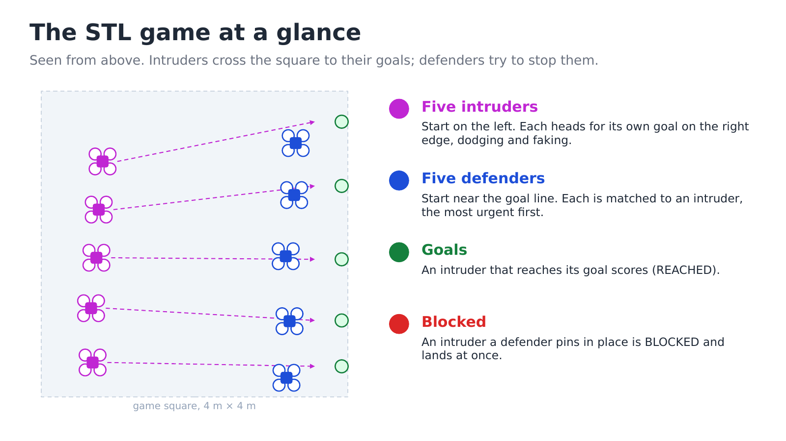
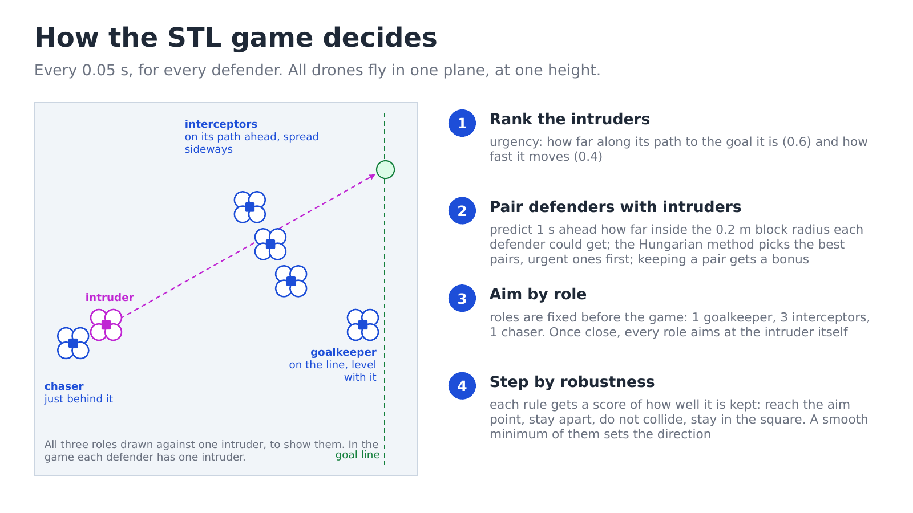
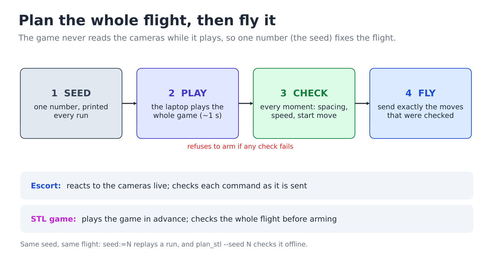
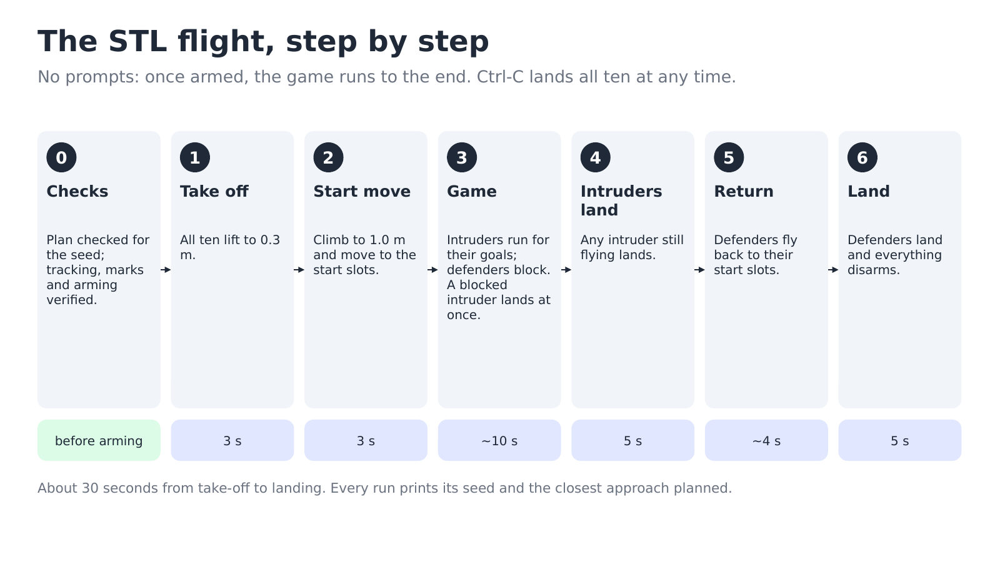
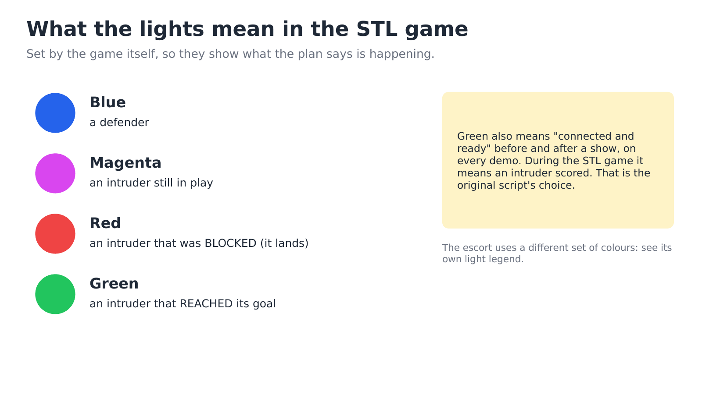

# STL: how it works

Five intruders try to cross the room to a goal line; five defenders try to stop them. It
is the escort's problem turned round: the team guards a line instead of one moving VIP.
The algorithm is a colleague's; this repo flies it and checks it. The maths and the
history: [details/design-notes.md](details/design-notes.md).

## The game

Intruders plan a path round the defenders, fake a move now and then, crawl when a
defender is close and sprint when the way is clear. Each defender plays a fixed role.
Everyone flies at 1.0 m and 0.4 m/s, and a game lasts about 10 seconds.

"STL" is *signal temporal logic*: a precise way to write rules such as "get within 20 cm
of that intruder in the next second". Each rule gets a score for how well it is kept, and
each defender steps the way that most improves the worst-kept one.

## The big difference from the escort: it is planned before take-off

Its only chance element is a random number generator, so the seed fixes the whole flight.
The cost: a drone that drifts off its planned path is not corrected by the game. Each
drone still uses the cameras to go where it is told, but if one is bumped, the others do
not react.

## The flight, step by step

## What the lights mean

## Honest limits

- **As shipped, the check refuses to fly it.** On every seed tried, one defender passes
  10.8 cm from an intruder just after that intruder was blocked and started landing; the
  safety floor is 15 cm. Flying it anyway means choosing a lower floor (`min_sep:=0.10`)
  on purpose. Why: [details/design-notes.md](details/design-notes.md#measured-2026-10-13-v3-current-yaml).
- **Drones pass close by design.** Defenders get within about 20 cm of intruders; that is
  how blocking works. The escort keeps 80 cm.
- **The game square is the game's, not the room's.** It is a fixed 4 m × 4 m square
  centred on the room's origin, and `plan_stl` does not check it against the measured
  arena. In the old room four of the five goals lay beyond where tracking was lost; the
  big arena's measured circle contains the whole square.
- **It has not been flown with this repo's show yet.** The colleague's original script
  has flown; `stl_show` has run in the simulator only.

